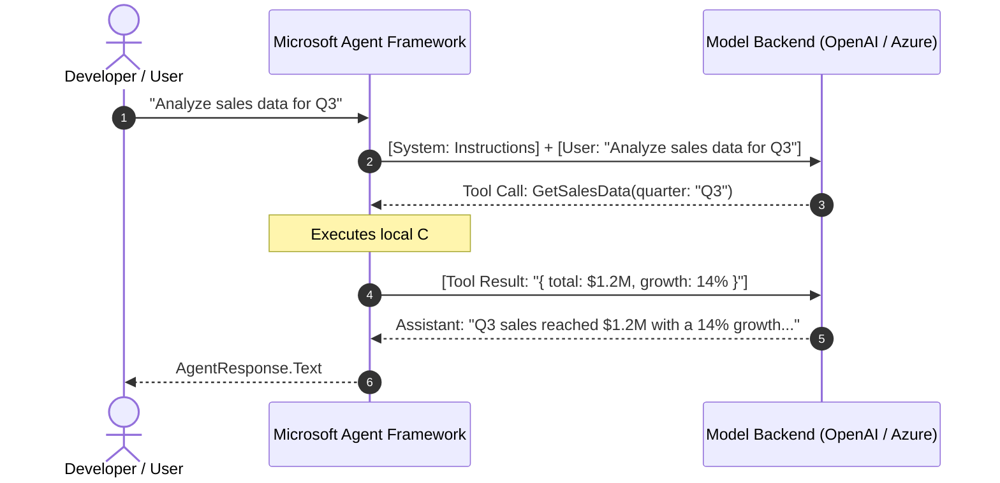
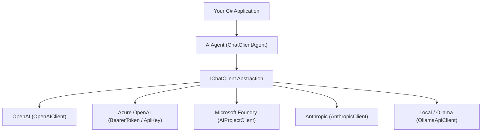

# Module 00 — Prerequisites and Environment Setup

> **Time:** ~25 min · **Level:** Beginner · **Prerequisites:** Basic knowledge of .NET and C#
> **Packages:** `Microsoft.Agents.AI` 1.28.0 (GA), `Microsoft.Agents.AI.OpenAI` 1.28.0 (GA), `Azure.Identity` 1.21.0 (GA), `Microsoft.Agents.AI.Anthropic` 1.28.0 (GA), `Microsoft.Agents.AI.Foundry` 1.28.0-preview.261106.1 *(preview)*

---

## Learning objectives

- Explain fundamental LLM concepts essential for agent development: prompts, tokens, context windows, temperature, tool calling, and structured outputs.
- Configure a development environment targeting **.NET 10** (`net10.0`) with required project settings.
- Navigate the Microsoft Agent Framework (MAF) NuGet package ecosystem, distinguishing between GA, Preview, and Alpha packages.
- Initialize and configure agents across diverse model providers: OpenAI, Azure OpenAI, Microsoft Foundry, Anthropic, and local models (Ollama).
- Implement secure credential management comparing API keys and Microsoft Entra ID authentication, avoiding common `DefaultAzureCredential` pitfalls.
- Handle framework-level experimental warnings (`MAAI001`, `MEAI001`, `OPENAI001`) adhering to course standards.

---

## Concepts

### 1. LLM fundamentals for C# developers

Before writing agentic code, you must understand the underlying primitives that drive Large Language Models.

#### Prompts and message roles
In modern chat-based AI models, every interaction consists of structured messages tagged with specific roles:
- **System / Developer (`ChatRole.System`)**: High-priority instructions defining the persona, behavioral boundaries, response format, and guidelines. In MAF, these are commonly specified as agent `Instructions`.
- **User (`ChatRole.User`)**: The input supplied by the end-user or upstream caller.
- **Assistant (`ChatRole.Assistant`)**: The text or tool invocation requests emitted by the model.
- **Tool (`ChatRole.Tool`)**: The outputs returned back to the model after executing a local C# function or remote API.



#### Tokens and the context window
LLMs do not process characters or words directly; they process **tokens** (subword segments). In English text:
- 1 token ≈ 4 characters or ~0.75 words.
- 1,000 tokens ≈ 750 words.

Every model has a finite **context window** (e.g., 128,000 tokens for GPT-4o / GPT-5.4-mini). The context window accommodates:
1. System instructions.
2. Conversation history (all previous turns).
3. Tool declarations and schema definitions.
4. Intermediate tool call inputs and results.
5. The generated output completion.

When context limits are exceeded, the API returns an error or trims messages, causing catastrophic memory loss. Efficient agent design requires managing conversation history and token budgets carefully.

#### Temperature and Top-P
These parameters control sampling randomness:
- **Temperature ($0.0$ to $2.0$)**: Controls randomness. Use low temperatures ($0.0$ to $0.2$) for deterministic tasks like code evaluation, data extraction, and tool invocation. Use moderate temperatures ($0.7$) for open-ended conversational assistants.
- **Top-P (Nucleus Sampling)**: An alternative to temperature that restricts candidate tokens to the cumulative probability $P$. Recommended practice is to adjust *either* temperature *or* top-p, leaving the other at default.

#### Tool calling (function calling)
A critical insight for C# engineers: **LLMs never execute code directly.**
When an agent has access to tools (such as database queries or weather APIs), MAF provides JSON schemas describing the C# methods to the model. If the model decides a tool is needed, it pauses generation and responds with a structured JSON request containing the function name and argument values. MAF's execution pipeline intercepts this request, invokes your C# method, appends the output to the message history with `ChatRole.Tool`, and invokes the model again to synthesize the final answer.

#### Structured output
While standard LLM generation produces freeform text, **Structured Output** forces the model's token decoding engine to adhere strictly to a JSON Schema derived from a C# class. This guarantees that deserialization into strongly-typed C# models will never fail due to missing fields, hallucinations of unexpected keys, or invalid JSON syntax.

---

### 2. .NET 10 environment setup

Microsoft Agent Framework 1.28.0 targets modern .NET runtimes. This course standardizes on **.NET 10** (current LTS).

Verify your installed SDK by opening PowerShell and running:

```powershell
dotnet --version
```

Ensure the output begins with `10.`. If not, download and install the latest [.NET 10 SDK](https://dotnet.microsoft.com/download/dotnet/10.0).

All course projects use standard modern C# configurations:
- `<TargetFramework>net10.0</TargetFramework>`
- `<Nullable>enable</Nullable>`
- `<ImplicitUsings>enable</ImplicitUsings>`

---

### 3. NuGet packages reference map

MAF separates core abstractions, provider implementations, workflow engines, and hosting layers into distinct NuGet packages. Be attentive to package stability:

| Package ID | Released Version | Status | Purpose |
|---|---|---|---|
| `Microsoft.Agents.AI` | 1.28.0 | **GA** | Core agent abstractions, `ChatClientAgent`, context providers, sessions |
| `Microsoft.Agents.AI.Abstractions` | 1.28.0 | **GA** | Contracts: `AIAgent`, `AgentSession`, `AgentResponse`, `AIContextProvider` |
| `Microsoft.Agents.AI.OpenAI` | 1.28.0 | **GA** | OpenAI Chat Completions & Responses integration; Azure OpenAI client adapters |
| `Microsoft.Agents.AI.Anthropic` | 1.28.0 | **GA** | Anthropic Claude client integration |
| `Microsoft.Agents.AI.Workflows` | 1.28.0 | **GA** | Graph workflows, executors, edges, in-process streaming execution |
| `Microsoft.Agents.AI.Workflows.Declarative` | 1.28.0 | **GA** | JSON/YAML declarative workflow schema execution |
| `Microsoft.Agents.AI.Harness` | 1.28.0 | **GA** *(pkg)* | Batteries-included agent harness (contains `[Experimental]` APIs) |
| `Microsoft.Agents.AI.GitHub.Copilot` | 1.28.0 | **GA** | GitHub Copilot agent integration |
| `Microsoft.Agents.AI.Foundry` | 1.28.0-preview.261106.1 | **Preview** | Microsoft Foundry Project agent integration (`AIProjectClient.AsAIAgent`) |
| `Microsoft.Agents.AI.Hosting` | 1.28.0-preview.261106.1 | **Preview** | Hosting infrastructure, background lifecycle |
| `Microsoft.Agents.AI.Hosting.AspNetCore` | 1.28.0-preview.261106.1 | **Preview** | ASP.NET Core endpoint mapping (`MapAIAgent`) |
| `Microsoft.Agents.AI.A2A` | 1.28.0-preview.261106.1 | **Preview** | Agent-to-Agent protocol client and server |
| `Microsoft.Agents.AI.Mcp` | 1.28.0-alpha.261106.1 | **Alpha** | Model Context Protocol integration |
| `Microsoft.Extensions.AI` | 10.11.0 | **GA** | Foundation layer: `IChatClient`, `ChatMessage`, `AIFunction` |
| `Azure.Identity` | 1.21.0 | **GA** | Microsoft Entra ID authentication credentials |

> [!WARNING]
> **Preview Packages:** Packages containing `-preview` or `-alpha` (such as `Microsoft.Agents.AI.Foundry` or `Microsoft.Agents.AI.Hosting`) require installing with the `--prerelease` flag or specifying the exact version string in your `.csproj`.

---

### 4. Model provider ecosystem

MAF sits on top of `Microsoft.Extensions.AI` (`IChatClient`), allowing you to switch between model providers seamlessly.



#### Provider 1: OpenAI (Course default)
Direct OpenAI connection using an API key and model name (e.g. `gpt-5.4-mini` or `gpt-4o`):
```csharp
using Microsoft.Agents.AI;
using OpenAI;
using OpenAI.Chat;

AIAgent agent = new OpenAIClient(apiKey)
    .GetChatClient(model)
    .AsAIAgent(instructions: "You are a concise mentor.", name: "TechMentor");
```

#### Provider 2: Azure OpenAI
Connecting to enterprise Azure OpenAI resources. In enterprise systems, Microsoft Entra ID is the preferred authentication mechanism:
```csharp
#pragma warning disable OPENAI001 // OpenAIClient with AuthenticationPolicy is an experimental OpenAI SDK API
using System.ClientModel.Primitives;
using Azure.Identity;
using Microsoft.Agents.AI;
using OpenAI;
using OpenAI.Chat;

AIAgent agent = new OpenAIClient(
    new BearerTokenPolicy(new DefaultAzureCredential(), "https://ai.azure.com/.default"),
    new OpenAIClientOptions { Endpoint = new Uri(azureEndpoint) })
    .GetChatClient(deploymentName)
    .AsAIAgent(instructions: "You are an Azure assistant.", name: "AzureAgent");
```

#### Provider 3: Microsoft Foundry (Preview)
Microsoft Foundry provides hosted agent versioning, storage, and server-side tools via the Azure AI Projects SDK:
```csharp
using Azure.AI.Projects;
using Azure.Identity;
using Microsoft.Agents.AI;

AIAgent agent = new AIProjectClient(new Uri(foundryEndpoint), new DefaultAzureCredential())
    .AsAIAgent(model: modelName, instructions: "You are a Foundry agent.", name: "FoundryAgent");
```

#### Provider 4: Anthropic Claude
Anthropic models (Claude 3.5 Sonnet, Claude Haiku) can be used either directly via the official Anthropic SDK or through Foundry:
```csharp
using Anthropic;
using Microsoft.Agents.AI;

AIAgent agent = new AnthropicClient { ApiKey = anthropicApiKey }
    .AsAIAgent(model: "claude-haiku-4-5", instructions: "You are Claude.", name: "ClaudeAgent");
```

#### Provider 5: Ollama & Local Models
Any provider that implements `Microsoft.Extensions.AI.IChatClient` connects to MAF via `.AsAIAgent()`:
```csharp
using Microsoft.Agents.AI;
using OllamaSharp;

AIAgent agent = new OllamaApiClient(new Uri("http://localhost:11434"), "llama3.2")
    .AsAIAgent(instructions: "You are running locally.", name: "LocalAgent");
```

---

### 5. Authentication: API keys vs. Entra ID

Secure credential storage is mandatory for production AI agents.

#### Local development secrets
Never hardcode secrets in code or commit them to version control. For local development, use .NET User Secrets:

```powershell
dotnet user-secrets init
dotnet user-secrets set "OPENAI_API_KEY" "sk-proj-..."
```

Or configure local environment variables in your launch profile:
- `OPENAI_API_KEY`
- `AZURE_OPENAI_ENDPOINT`
- `AZURE_OPENAI_DEPLOYMENT_NAME`

#### Entra ID and `DefaultAzureCredential` caveats
`DefaultAzureCredential` simplifies authentication by checking a sequential chain of credential sources:
1. Environment variables (`AZURE_CLIENT_ID`, `AZURE_TENANT_ID`, `AZURE_CLIENT_SECRET`)
2. Workload Identity
3. Managed Identity
4. Visual Studio / Visual Studio Code
5. Azure CLI (`az login`)
6. Azure PowerShell
7. Interactive Browser

> [!CAUTION]
> **DefaultAzureCredential in Production:**
> 1. **Latency spikes:** In development environments without Managed Identity, probing the entire chain before reaching Azure CLI can introduce several seconds of startup latency.
> 2. **Token expiration:** If your Azure CLI session expires, `DefaultAzureCredential` fails during runtime requests rather than startup.
> 3. **Production security risks:** In production, unconstrained fallback behavior can lead to unintentional credential probing. Always pin to `ManagedIdentityCredential` in production containers and App Services.

---

### 6. Experimental diagnostics and warnings

As AI SDKs evolve rapidly, select APIs are marked with compiler diagnostic warnings:
- `MAAI001`: Microsoft Agent Framework experimental API.
- `MEAI001`: `Microsoft.Extensions.AI` experimental API (e.g., background response continuation tokens).
- `OPENAI001`: OpenAI .NET SDK experimental API (e.g., passing custom `AuthenticationPolicy` into `OpenAIClient`).

When using these APIs, suppress them narrowly at the top of the C# file using `#pragma warning disable <ID>` and document the experimental dependency in your comments.

---

## Hands-on

### Example 1 — Multi-provider switchboard

In this hands-on project, you will create a unified console application that switches dynamically between OpenAI and Azure OpenAI based on environment configuration.

#### Setup commands

```powershell
dotnet new console -n ProviderSwitchboard --framework net10.0
cd ProviderSwitchboard
dotnet add package Microsoft.Agents.AI.OpenAI --version 1.28.0
dotnet add package Azure.Identity --version 1.21.0
```

#### Project file (`ProviderSwitchboard.csproj`)

```xml
<Project Sdk="Microsoft.NET.Sdk">

  <PropertyGroup>
    <OutputType>Exe</OutputType>
    <TargetFramework>net10.0</TargetFramework>
    <ImplicitUsings>enable</ImplicitUsings>
    <Nullable>enable</Nullable>
  </PropertyGroup>

  <ItemGroup>
    <PackageReference Include="Azure.Identity" Version="1.21.0" />
    <PackageReference Include="Microsoft.Agents.AI.OpenAI" Version="1.28.0" />
  </ItemGroup>

</Project>
```

#### Program code (`Program.cs`)

```csharp
#pragma warning disable OPENAI001 // OpenAIClient with AuthenticationPolicy is an experimental OpenAI SDK API

using System.ClientModel;
using System.ClientModel.Primitives;
using Azure.Identity;
using Microsoft.Agents.AI;
using Microsoft.Extensions.AI;
using OpenAI;
using OpenAI.Chat;

// --- Provider Selection Switchboard ---
// Demonstrates configuring Microsoft Agent Framework with different backends:
// 1. OpenAI Chat Completions (GA)
// 2. Azure OpenAI with Entra ID (BearerTokenPolicy + DefaultAzureCredential)
// 3. Azure OpenAI with API Key (ApiKeyCredential)
// 4. Any custom/local model provider exposing an IChatClient (e.g. Ollama, test fakes)

string provider = Environment.GetEnvironmentVariable("AI_PROVIDER") ?? "openai";
AIAgent agent;

switch (provider.ToLowerInvariant())
{
    case "azure":
    {
        string endpoint = Environment.GetEnvironmentVariable("AZURE_OPENAI_ENDPOINT")
            ?? "https://example-resource.openai.azure.com/";
        string deployment = Environment.GetEnvironmentVariable("AZURE_OPENAI_DEPLOYMENT_NAME")
            ?? "gpt-5.4-mini";

        // Recommended for Azure production: Entra ID via TokenCredential / BearerTokenPolicy
        agent = new OpenAIClient(
            new BearerTokenPolicy(new DefaultAzureCredential(), "https://ai.azure.com/.default"),
            new OpenAIClientOptions { Endpoint = new Uri(endpoint) })
            .GetChatClient(deployment)
            .AsAIAgent(instructions: "You are an Azure-hosted cloud architect.", name: "AzureArchitect");
        break;
    }

    case "azure-key":
    {
        string endpoint = Environment.GetEnvironmentVariable("AZURE_OPENAI_ENDPOINT")
            ?? "https://example-resource.openai.azure.com/";
        string deployment = Environment.GetEnvironmentVariable("AZURE_OPENAI_DEPLOYMENT_NAME")
            ?? "gpt-5.4-mini";
        string apiKey = Environment.GetEnvironmentVariable("AZURE_OPENAI_API_KEY") ?? "mock-azure-key";

        agent = new OpenAIClient(
            new ApiKeyCredential(apiKey),
            new OpenAIClientOptions { Endpoint = new Uri(endpoint) })
            .GetChatClient(deployment)
            .AsAIAgent(instructions: "You are an Azure-hosted cloud architect.", name: "AzureArchitect");
        break;
    }

    case "openai":
    default:
    {
        string apiKey = Environment.GetEnvironmentVariable("OPENAI_API_KEY") ?? "mock-openai-key";
        string model = Environment.GetEnvironmentVariable("OPENAI_MODEL") ?? "gpt-5.4-mini";

        agent = new OpenAIClient(apiKey)
            .GetChatClient(model)
            .AsAIAgent(instructions: "You are a concise software engineering mentor.", name: "TechMentor");
        break;
    }
}

Console.WriteLine($"Configured Agent Name : {agent.Name}");
Console.WriteLine($"Configured Agent ID   : {agent.Id}");
```

#### What's happening
1. **`AI_PROVIDER` routing**: The program evaluates an environment variable to select between standard public OpenAI, Azure OpenAI with Entra ID tokens, or Azure OpenAI with API keys.
2. **`BearerTokenPolicy`**: Bridges Azure's `TokenCredential` (`DefaultAzureCredential`) into the `System.ClientModel` HTTP pipeline used by the `OpenAIClient`.
3. **`AsAIAgent(...)`**: MAF extension method that wraps the low-level `ChatClient` into a ready-to-use `AIAgent` (`ChatClientAgent`), assigning default instructions and an agent display name.
4. **Agent identity**: An `Id` (GUID) and `Name` are assigned to the agent instance for logging, tracing, and multi-agent coordination.

#### Execution output

```text
Configured Agent Name : TechMentor
Configured Agent ID   : 5abfa09d8fa54bf59acfe8c611ef5972
```

---

## Common pitfalls

- **Symptom:** `InvalidOperationException: OPENAI_API_KEY is not set.`
  - **Cause:** Attempting to run without setting environment variables or User Secrets.
  - **Fix:** Initialize `dotnet user-secrets init` and set `dotnet user-secrets set "OPENAI_API_KEY" "sk-..."`, or define environment variables in your terminal before launching.
- **Symptom:** Application hangs for 15-30 seconds on the first call to Azure OpenAI, then throws `CredentialUnavailableException`.
  - **Cause:** `DefaultAzureCredential` failed to locate credentials in environment variables, Managed Identity, or Visual Studio, and timed out trying to reach the Azure CLI or browser.
  - **Fix:** Run `az login` in PowerShell, or configure an explicit `AzureCliCredential` in development.
- **Symptom:** Compiler error `CS0246: The type or namespace name 'FoundryAgent' could not be found`.
  - **Cause:** `Microsoft.Agents.AI.Foundry` is a preview package and was omitted from the `.csproj` or added without the preview version.
  - **Fix:** Add `dotnet add package Microsoft.Agents.AI.Foundry --version 1.28.0-preview.261106.1`.
- **Symptom:** Compiler warning `OPENAI001: 'OpenAIClient.OpenAIClient(...)' is for evaluation purposes only`.
  - **Cause:** Using `BearerTokenPolicy` with `OpenAIClientOptions` triggers the experimental constructor warning in the OpenAI .NET SDK.
  - **Fix:** Add `#pragma warning disable OPENAI001` at the top of the file and document the diagnostic suppression.

---

## When to use / when not to use

| Provider Option | Recommended When | Avoid When |
|---|---|---|
| **OpenAI Public API** | Quick prototypes, independent SaaS development, consumer applications without Azure enterprise tenant restrictions. | Regulated enterprise workloads requiring strict data sovereignty, private endpoints, or Entra ID tenant isolation. |
| **Azure OpenAI (Entra ID)** | Enterprise production deployments, zero-secret architectures, applications deployed inside Azure Virtual Networks with private endpoints. | Local offline developer machines without Azure credentials or internet connectivity. |
| **Microsoft Foundry (`AIProjectClient`)** | Projects requiring cloud-hosted persistent agents, centralized agent catalogs, server-side evaluations, or Foundry-managed tools. | Lightweight edge microservices needing minimal dependencies and zero cloud control-plane overhead. |
| **Anthropic (`AnthropicClient`)** | Workloads optimized specifically for Claude 3.5 Sonnet / Claude 3.5 Haiku reasoning and extended context. | Solutions mandating Microsoft-managed infrastructure or direct Azure OpenAI token billing. |
| **Ollama (`OllamaApiClient`)** | Local development, offline air-gapped environments, cost-sensitive unit testing of basic flows. | Production agent pipelines requiring advanced tool calling, structured JSON output reliability, and high concurrency. |

---

## Exercises

1. **Resilient Provider Resolution Factory**: Implement a factory method `CreateConfiguredAgent()` that attempts to initialize an Azure OpenAI agent if `AZURE_OPENAI_ENDPOINT` is present, falls back to OpenAI if `OPENAI_API_KEY` is present, and provides a safe mock fallback agent if neither is found, ensuring the application starts cleanly in any environment.
2. **Configuration Validator with Masking**: Write a configuration audit routine that checks whether AI environment variables are defined and prints their status to the console while masking secret tokens (e.g., displaying `sk-pr...1234` or `CONFIGURED [MASKED]`).
3. **Agent Metadata Diagnostic**: Write a utility method that inspects an instantiated `AIAgent`, displaying its `Id`, `Name`, runtime class type, and whether it wraps an underlying `IChatClient`.

---

## Summary

- Large Language Models operate on tokens, discrete message roles (`System`, `User`, `Assistant`, `Tool`), and finite context windows. Tool calling and structured outputs are client-coordinated protocols.
- Microsoft Agent Framework 1.28.0 is built for **.NET 10** (`net10.0`), utilizing nullable reference types and implicit usings.
- The MAF package suite distinguishes between **GA** packages (`Microsoft.Agents.AI`, `Microsoft.Agents.AI.OpenAI`, `Microsoft.Agents.AI.Workflows`) and **Preview** packages (`Microsoft.Agents.AI.Foundry`, `Microsoft.Agents.AI.Hosting`).
- Agents can be created from any model provider via `AsAIAgent()`: OpenAI, Azure OpenAI, Foundry, Anthropic, or Ollama.
- In Azure production environments, prioritize Microsoft Entra ID (`BearerTokenPolicy` + `ManagedIdentityCredential`) over API keys to prevent credential leaks and expiration issues.

---

## Further reading

- [Microsoft Agent Framework Overview](https://learn.microsoft.com/agent-framework/overview/)
- [Agent Providers Overview](https://learn.microsoft.com/agent-framework/integrations/by-component/model-providers/)
- [Official MAF Agent Providers Samples](https://github.com/microsoft/agent-framework/tree/main/dotnet/samples/02-agents/AgentProviders)
- [Microsoft.Extensions.AI Documentation](https://learn.microsoft.com/dotnet/ai/ai-extensions)

---

## Solutions

### Exercise 1 — Resilient Provider Resolution Factory

```csharp
#pragma warning disable OPENAI001

using System.ClientModel.Primitives;
using Azure.Identity;
using Microsoft.Agents.AI;
using OpenAI;
using OpenAI.Chat;

public static class AgentFactory
{
    public static AIAgent CreateConfiguredAgent()
    {
        string? azureEndpoint = Environment.GetEnvironmentVariable("AZURE_OPENAI_ENDPOINT");
        string? azureDeployment = Environment.GetEnvironmentVariable("AZURE_OPENAI_DEPLOYMENT_NAME");
        string? openAiKey = Environment.GetEnvironmentVariable("OPENAI_API_KEY");
        string model = Environment.GetEnvironmentVariable("OPENAI_MODEL") ?? "gpt-5.4-mini";

        // 1. Try Azure OpenAI if endpoint & deployment are configured
        if (!string.IsNullOrWhiteSpace(azureEndpoint) && !string.IsNullOrWhiteSpace(azureDeployment))
        {
            return new OpenAIClient(
                new BearerTokenPolicy(new DefaultAzureCredential(), "https://ai.azure.com/.default"),
                new OpenAIClientOptions { Endpoint = new Uri(azureEndpoint) })
                .GetChatClient(azureDeployment)
                .AsAIAgent(instructions: "You are an Azure cloud assistant.", name: "AzureAgent");
        }

        // 2. Try standard OpenAI if API key is provided
        if (!string.IsNullOrWhiteSpace(openAiKey))
        {
            return new OpenAIClient(openAiKey)
                .GetChatClient(model)
                .AsAIAgent(instructions: "You are a software tutor.", name: "OpenAIAgent");
        }

        // 3. Fallback mock client for offline developer testing without API keys
        return new OpenAIClient("mock-dev-key")
            .GetChatClient("gpt-5.4-mini")
            .AsAIAgent(instructions: "Fallback offline mock agent.", name: "MockFallbackAgent");
    }
}
```

### Exercise 2 — Configuration Validator with Masking

```csharp
public static class EnvironmentAuditor
{
    public static void ValidateAndDisplayStatus()
    {
        string? openAiKey = Environment.GetEnvironmentVariable("OPENAI_API_KEY");
        string? azureEndpoint = Environment.GetEnvironmentVariable("AZURE_OPENAI_ENDPOINT");
        string? azureDeployment = Environment.GetEnvironmentVariable("AZURE_OPENAI_DEPLOYMENT_NAME");

        Console.WriteLine("============================================");
        Console.WriteLine(" AI Provider Environment Diagnostic Audit");
        Console.WriteLine("============================================");
        Console.WriteLine($"OPENAI_API_KEY            : {MaskKey(openAiKey)}");
        Console.WriteLine($"AZURE_OPENAI_ENDPOINT     : {azureEndpoint ?? "(not configured)"}");
        Console.WriteLine($"AZURE_OPENAI_DEPLOYMENT   : {azureDeployment ?? "(not configured)"}");
        Console.WriteLine("============================================");
    }

    private static string MaskKey(string? key)
    {
        if (string.IsNullOrWhiteSpace(key)) return "(not configured)";
        if (key.Length <= 8) return "[CONFIGURED: <hidden>]";
        return $"{key[..4]}...{key[^4]} (length: {key.Length})";
    }
}
```

### Exercise 3 — Agent Metadata Diagnostic

```csharp
using Microsoft.Agents.AI;

public static class AgentDiagnostics
{
    public static void PrintMetadata(AIAgent agent)
    {
        ArgumentNullException.ThrowIfNull(agent);

        Console.WriteLine("--- AIAgent Metadata Inspection ---");
        Console.WriteLine($"Agent ID      : {agent.Id}");
        Console.WriteLine($"Agent Name    : {agent.Name ?? "(unnamed)"}");
        Console.WriteLine($"Runtime Class : {agent.GetType().FullName}");
        
        bool isChatClientAgent = agent is ChatClientAgent;
        Console.WriteLine($"Is ChatClient : {isChatClientAgent}");
        
        if (agent.Description is { Length: > 0 } desc)
        {
            Console.WriteLine($"Description   : {desc}");
        }
    }
}
```
