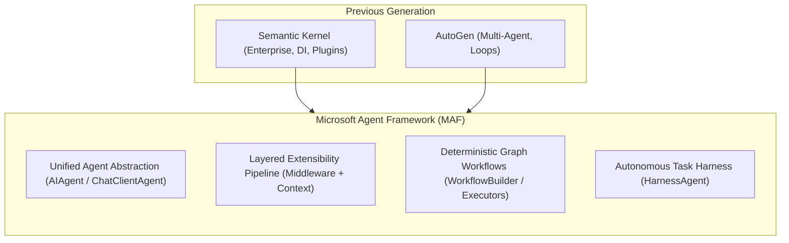
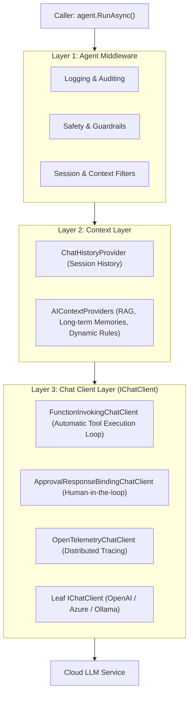
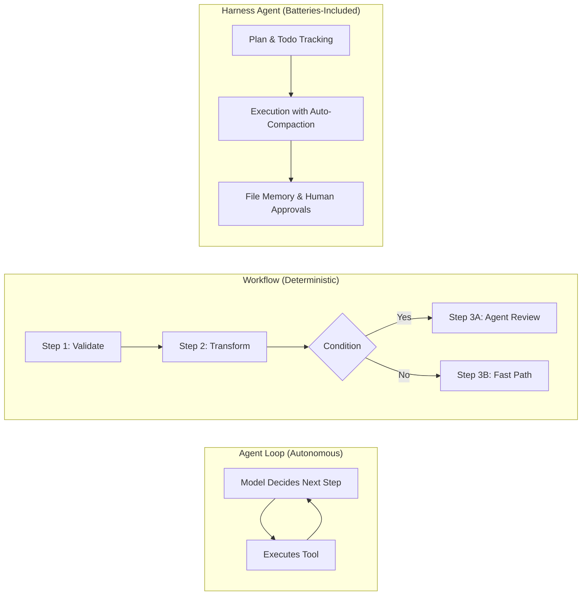

# Module 01 — Introduction to Microsoft Agent Framework

> **Time:** ~30 min · **Level:** Beginner · **Prerequisites:** [Module 00](00-prerequisites.md)
> **Packages:** `Microsoft.Agents.AI` 1.28.0 (GA), `Microsoft.Agents.AI.OpenAI` 1.28.0 (GA), `Microsoft.Agents.AI.Workflows` 1.28.0 (GA)

---

## Learning objectives

- Explain the architecture of Microsoft Agent Framework (MAF) and its position as the successor unifying Semantic Kernel and AutoGen.
- Describe the layered agent pipeline architecture: Agent Middleware, Context Layer, and Chat Client Layer.
- Identify the core abstractions in MAF: `IChatClient`, `AIAgent`, `ChatClientAgent`, `AgentSession`, `AIContextProvider`, and Workflows.
- Distinguish between an **Agent Loop**, an **Explicit Workflow**, and a **Harness Agent**, selecting the right paradigm for business requirements.
- Build and execute a minimal agent anatomy and a deterministic multi-step workflow.

---

## Concepts

### 1. What is Microsoft Agent Framework?

**Microsoft Agent Framework (MAF)** is Microsoft’s unified open-source framework for building, orchestrating, and hosting production-ready AI agents in .NET.

In previous generations of AI development, .NET developers navigated two distinct libraries:
1. **Semantic Kernel (SK)**: Focused on enterprise application integration, plugins, filters, memory connectors, and Dependency Injection.
2. **AutoGen**: Focused on multi-agent collaboration, conversational loops, and autonomous group problem-solving.

MAF brings these worlds together. Developed collaboratively by the Semantic Kernel and AutoGen teams, MAF combines AutoGen's flexible agent abstractions and multi-agent coordination with Semantic Kernel's enterprise-grade state management, type safety, observability, and middleware architecture. Furthermore, MAF introduces a first-class, graph-based **Workflow engine** (`Microsoft.Agents.AI.Workflows`) that gives developers deterministic control over complex multi-step processes.



---

### 2. The layered agent pipeline architecture

At the center of MAF is a pipeline that processes requests through well-defined layers. When you invoke `agent.RunAsync()` on a `ChatClientAgent`, the request and response traverse three primary layers:



#### Layer 1: Agent Middleware
The outermost decorator layer. It intercepts every invocation (`RunAsync` and `RunStreamingAsync`) across **any** `AIAgent` type—including remote agents like `A2AAgent` or `GitHubCopilotAgent`. Use this layer for global logging, execution timeouts, authorization policies, and prompt sanitization.

#### Layer 2: Context Layer
Executes immediately before the model is called. It consists of:
- **`ChatHistoryProvider`**: Retrieves and persists the multi-turn conversation history for the current `AgentSession`.
- **`AIContextProviders`**: A pipeline of providers that dynamically augment the request messages with relevant context, such as vector search results (RAG), user preferences, or dynamic persona instructions.

#### Layer 3: Chat Client Layer (`IChatClient`)
Wraps the low-level model client (`Microsoft.Extensions.AI.IChatClient`). By default, `ChatClientAgent` automatically equips the client with:
- **`FunctionInvokingChatClient`**: Automatically detects tool call requests emitted by the model, executes the matching C# methods, and delivers the results back to the model in an autonomous loop.
- **`ApprovalResponseBindingChatClient`**: Binds human approval decisions to tool calls.
- **Telemetry decorators**: Emits OpenTelemetry spans adhering to GenAI semantic conventions.

---

### 3. Core building blocks

MAF defines clean interfaces and base classes:

| Primitive | Namespace | Description |
|---|---|---|
| **`IChatClient`** | `Microsoft.Extensions.AI` | The fundamental abstraction for sending chat requests to an LLM. Compatible with OpenAI, Azure, Anthropic, Ollama, and test mocks. |
| **`AIAgent`** | `Microsoft.Agents.AI` | The abstract base class representing any agent. Provides `RunAsync`, `RunStreamingAsync`, session management, and service lookup. |
| **`ChatClientAgent`** | `Microsoft.Agents.AI` | The primary `AIAgent` implementation. Combines an `IChatClient`, instructions, tools, context providers, and session storage. |
| **`AgentSession`** | `Microsoft.Agents.AI` | Encapsulates conversation state, message history, and user state bag across turns. Supports JSON serialization and persistence. |
| **`AIContextProvider`** | `Microsoft.Agents.AI` | Pluggable component for injecting memories, RAG documents, or dynamic instructions into an agent run. |
| **`Workflow`** | `Microsoft.Agents.AI.Workflows` | A directed graph connecting discrete `Executor` components with conditional edges, loops, and fan-out transitions. |
| **`HarnessAgent`** | `Microsoft.Agents.AI` | An opinionated, batteries-included agent for multi-step tasks with planning, todo tracking, file memory, and context compaction. |

---

### 4. Agent Loop vs. Workflow vs. Harness

Choosing the correct orchestration pattern is the most critical design decision in AI system architecture:



#### The Agent Loop
- **How it works:** You give the agent a goal, instructions, and a set of tools. The model iteratively decides which tools to call, inspects their return values, and determines when the goal is achieved.
- **Strengths:** Highly flexible, handles ambiguous or conversational requests, autonomous problem-solving.
- **Risks:** Unpredictable token usage, potential infinite loops if tool outputs are ambiguous, higher latency.

#### Workflows (`Microsoft.Agents.AI.Workflows`)
- **How it works:** You write explicit C# code defining a directed graph of `Executor` steps connected by direct or conditional edges. The execution path is deterministic and governed by business logic. Agents can be embedded inside individual workflow steps.
- **Strengths:** 100% deterministic, auditable, predictable token cost, ideal for regulated business workflows.
- **Risks:** Less adaptable to unpredictable user queries.

#### The Harness Agent (`HarnessAgent`)
- **How it works:** An advanced agent configured out-of-the-box for complex, long-running developer and research tasks. It includes built-in planning and todo lists, automated context window compaction, file memory, and standing tool approvals.
- **Strengths:** Out-of-the-box support for multi-step deep work without manual pipeline assembly.
- **Risks:** Heavier runtime overhead; contains experimental features.

---

## Hands-on

In this walkthrough, you will create a single console application demonstrating both paradigms side-by-side:
1. Creating a `ChatClientAgent` from an `IChatClient`.
2. Constructing and running a deterministic two-step `Workflow`.

### Setup commands

```powershell
dotnet new console -n AgentAndWorkflowDemo --framework net10.0
cd AgentAndWorkflowDemo
dotnet add package Microsoft.Agents.AI.OpenAI --version 1.28.0
dotnet add package Microsoft.Agents.AI.Workflows --version 1.28.0
```

### Project file (`AgentAndWorkflowDemo.csproj`)

```xml
<Project Sdk="Microsoft.NET.Sdk">

  <PropertyGroup>
    <OutputType>Exe</OutputType>
    <TargetFramework>net10.0</TargetFramework>
    <ImplicitUsings>enable</ImplicitUsings>
    <Nullable>enable</Nullable>
  </PropertyGroup>

  <ItemGroup>
    <PackageReference Include="Microsoft.Agents.AI.OpenAI" Version="1.28.0" />
    <PackageReference Include="Microsoft.Agents.AI.Workflows" Version="1.28.0" />
  </ItemGroup>

</Project>
```

### Program code (`Program.cs`)

```csharp
using Microsoft.Agents.AI;
using Microsoft.Agents.AI.Workflows;
using Microsoft.Extensions.AI;
using OpenAI;
using OpenAI.Chat;

// ========================================================
// Part 1: Minimal Agent Anatomy (ChatClientAgent)
// ========================================================
string apiKey = Environment.GetEnvironmentVariable("OPENAI_API_KEY") ?? "mock-key";
string model = Environment.GetEnvironmentVariable("OPENAI_MODEL") ?? "gpt-5.4-mini";

// Create an AIAgent from OpenAI's ChatClient
AIAgent agent = new OpenAIClient(apiKey)
    .GetChatClient(model)
    .AsAIAgent(instructions: "You are a concise AI tutor.", name: "TutorAgent");

Console.WriteLine("=== 1. Agent Anatomy ===");
Console.WriteLine($"Agent ID   : {agent.Id}");
Console.WriteLine($"Agent Name : {agent.Name}");
Console.WriteLine($"Agent Type : {agent.GetType().Name}");
Console.WriteLine();

// ========================================================
// Part 2: Minimal Workflow Anatomy (Deterministic Graph)
// ========================================================
Console.WriteLine("=== 2. Workflow Execution ===");

// 1. Instantiate discrete executors
UppercaseExecutor uppercaseStep = new();
ReverseExecutor reverseStep = new();

// 2. Connect executors via WorkflowBuilder
WorkflowBuilder builder = new(uppercaseStep);
builder.AddEdge(uppercaseStep, reverseStep).WithOutputFrom(reverseStep);
var workflow = builder.Build();

// 3. Execute the workflow in streaming mode
await using StreamingRun run = await InProcessExecution.RunStreamingAsync(workflow, input: "agent framework");
await foreach (WorkflowEvent evt in run.WatchStreamAsync())
{
    if (evt is ExecutorCompletedEvent stepCompleted)
    {
        Console.WriteLine($"[Workflow Step] {stepCompleted.ExecutorId} produced: {stepCompleted.Data}");
    }
}

// --------------------------------------------------------
// Workflow Executor Definitions
// --------------------------------------------------------

internal sealed class UppercaseExecutor() : Executor<string, string>("UppercaseExecutor")
{
    public override ValueTask<string> HandleAsync(string message, IWorkflowContext context, CancellationToken cancellationToken = default)
    {
        return ValueTask.FromResult(message.ToUpperInvariant());
    }
}

internal sealed class ReverseExecutor() : Executor<string, string>("ReverseExecutor")
{
    public override ValueTask<string> HandleAsync(string message, IWorkflowContext context, CancellationToken cancellationToken = default)
    {
        char[] chars = message.ToCharArray();
        Array.Reverse(chars);
        return ValueTask.FromResult(new string(chars));
    }
}
```

### What's happening
1. **Agent creation**: `new OpenAIClient(...).GetChatClient(...).AsAIAgent(...)` constructs a `ChatClientAgent`. It wraps the low-level `IChatClient` with default function calling and telemetry decorators.
2. **`Executor<TInput, TOutput>`**: The foundational unit of work in MAF workflows. Each executor defines a typed contract receiving `TInput` and returning `ValueTask<TOutput>`.
3. **`WorkflowBuilder`**: Assembles executors into a directed graph. The initial executor passed to the constructor acts as the workflow entrypoint. `AddEdge(from, to)` defines transitions. `WithOutputFrom(step)` marks the terminal node whose result surfaces to the caller.
4. **`InProcessExecution.RunStreamingAsync`**: Executes the workflow locally, streaming `WorkflowEvent` objects as each step completes.

### Execution output

```text
=== 1. Agent Anatomy ===
Agent ID   : 01af634b35f04f8aafc5d2b4c7b7f845
Agent Name : TutorAgent
Agent Type : ChatClientAgent

=== 2. Workflow Execution ===
[Workflow Step] UppercaseExecutor produced: AGENT FRAMEWORK
[Workflow Step] ReverseExecutor produced: KROWEMARF TNEGA
```

---

## Common pitfalls

- **Symptom:** Unpredictable execution order, runaway token bills, or infinite tool loops.
  - **Cause:** Using an autonomous `AIAgent` loop for a business process that has strict, predetermined sequential steps.
  - **Fix:** Refactor fixed processes into a `Workflow` using `WorkflowBuilder` and `Executor` steps. Use agents *only* within specific workflow steps where generative reasoning is required.
- **Symptom:** Confusing `IChatClient` with `AIAgent`.
  - **Cause:** Calling model-level APIs directly instead of leveraging agent features, or conversely expecting `AIAgent` to expose raw model options.
  - **Fix:** Remember the division of responsibilities: `IChatClient` talks to the LLM (raw completion); `AIAgent` orchestrates tools, conversation history, context providers, and middleware.
- **Symptom:** Compiler error: `'MyExecutor' does not implement inherited abstract member 'Executor<TIn, TOut>.HandleAsync(...)'`.
  - **Cause:** Overriding `HandleMessageAsync` or older preview method names.
  - **Fix:** In MAF 1.28.0, the abstract method on `Executor<TInput, TOutput>` is `ValueTask<TOutput> HandleAsync(TInput message, IWorkflowContext context, CancellationToken cancellationToken)`.

---

## When to use / when not to use

| Requirement | Use a Plain C# Function | Use an Agent (`AIAgent`) | Use a Workflow (`WorkflowBuilder`) | Use a Harness Agent (`HarnessAgent`) |
|---|---|---|---|---|
| Deterministic calculation or DB lookup | **Yes** | No | No | No |
| Conversational customer support chatbot | No | **Yes** | Only for rigid escalations | No |
| Multi-step data extraction pipeline (ETL) | No | Only for extraction steps | **Yes** (orchestrator) | No |
| Order processing with approval gates | No | No | **Yes** (HITL edges) | No |
| Deep research assistant with plan & todos | No | Inefficient | Complex to hand-code | **Yes** |

---

## Exercises

1. **Agent Pipeline Introspection**: Create a console utility that accepts an `AIAgent` and checks whether it is a `ChatClientAgent`. If so, verify whether custom options or default middleware decorators are active.
2. **Architectural Mapping Exercise**: For each of the following scenarios, determine whether to use an **Agent Loop**, a **Workflow**, or a **Plain C# Function**, and write a 2-sentence architectural justification:
   - *Scenario A:* Calculating state sales tax based on ZIP code.
   - *Scenario B:* Resolving ambiguous customer complaints by researching warranty terms and deciding refund eligibility.
   - *Scenario C:* A mortgage application pipeline that verifies documents, runs credit checks, routes to an underwriter if risk is elevated, and issues an approval letter.
3. **Dual-Stage Text Processing Workflow**: Implement a workflow containing two sequential executors:
   - `SanitizeInputExecutor`: Strips extra whitespace and trims the input string.
   - `WordCountExecutor`: Counts the number of words in the sanitized text and outputs an integer.
   Verify the workflow runs using `InProcessExecution.RunStreamingAsync`.

---

## Summary

- Microsoft Agent Framework 1.28.0 unifies the enterprise reliability of Semantic Kernel with the multi-agent flexibility of AutoGen.
- The agent pipeline architecture consists of three layers: **Agent Middleware** (outer), **Context Layer** (`ChatHistoryProvider` + `AIContextProviders`), and **Chat Client Layer** (`IChatClient` with tool invocation).
- `AIAgent` is the universal abstraction; `ChatClientAgent` is its primary implementation backed by `IChatClient`.
- An **Agent Loop** is autonomous and model-driven; a **Workflow** is deterministic and developer-driven; a **Harness Agent** provides an out-of-the-box runtime for multi-step tasks with planning and context compaction.
- If a task can be solved deterministically with a C# function or structured workflow, do not use an autonomous LLM loop.

---

## Further reading

- [Microsoft Agent Framework Architecture Concepts](https://learn.microsoft.com/agent-framework/concepts/agents/agent-pipeline)
- [Workflows Overview in MAF](https://learn.microsoft.com/agent-framework/concepts/workflows/)
- [Harness Agent Overview](https://learn.microsoft.com/agent-framework/concepts/harness)
- [Official MAF Workflows Samples](https://github.com/microsoft/agent-framework/tree/main/dotnet/samples/03-workflows)

---

## Solutions

### Exercise 1 — Agent Pipeline Introspection

```csharp
using Microsoft.Agents.AI;

public static class PipelineInspector
{
    public static void Inspect(AIAgent agent)
    {
        ArgumentNullException.ThrowIfNull(agent);

        Console.WriteLine($"[Agent Inspection]");
        Console.WriteLine($"ID   : {agent.Id}");
        Console.WriteLine($"Name : {agent.Name ?? "(unnamed)"}");

        if (agent is ChatClientAgent chatAgent)
        {
            Console.WriteLine($"Pipeline Type: ChatClientAgent (Layered IChatClient stack)");
            
            // Check for service availability through the agent abstraction
            var historyProvider = chatAgent.GetService<ChatHistoryProvider>();
            Console.WriteLine($"History Provider Registered: {historyProvider?.GetType().Name ?? "Default / None"}");
        }
        else
        {
            Console.WriteLine($"Pipeline Type: Remote / Custom Agent ({agent.GetType().FullName})");
        }
    }
}
```

### Exercise 2 — Architectural Mapping Solution

- **Scenario A (State sales tax calculation):**
  - *Recommendation:* **Plain C# Function**
  - *Justification:* Tax tables are deterministic, mathematical, and legally strict. Using an LLM introduces hallucination risk, unnecessary latency, and token costs for a problem easily solved with a lookup table or database query.
- **Scenario B (Ambiguous customer complaint resolution):**
  - *Recommendation:* **Agent Loop (`AIAgent`)**
  - *Justification:* Natural language complaints are unstructured and ambiguous. The agent requires autonomous tool use to look up customer records, check warranty policies, and synthesize empathetic responses.
- **Scenario C (Mortgage application pipeline):**
  - *Recommendation:* **Workflow (`WorkflowBuilder`)**
  - *Justification:* Loan underwriting requires strict, auditable, deterministic steps (document verification → credit check → rule evaluation). Conditional edges handle branching to manual underwriter review cleanly without relying on model discretion for critical regulatory decisions.

### Exercise 3 — Dual-Stage Text Processing Workflow

```csharp
using Microsoft.Agents.AI.Workflows;

// 1. Instantiate the executors
SanitizeInputExecutor sanitizeStep = new();
WordCountExecutor countStep = new();

// 2. Build the workflow graph
WorkflowBuilder builder = new(sanitizeStep);
builder.AddEdge(sanitizeStep, countStep).WithOutputFrom(countStep);
var workflow = builder.Build();

// 3. Execute in streaming mode
await using StreamingRun run = await InProcessExecution.RunStreamingAsync(
    workflow,
    input: "  Building   production AI agents    with .NET 10 and MAF!  ");

await foreach (WorkflowEvent evt in run.WatchStreamAsync())
{
    if (evt is ExecutorCompletedEvent stepCompleted)
    {
        Console.WriteLine($"Step '{stepCompleted.ExecutorId}' Output: {stepCompleted.Data}");
    }
}

// ----------------------------------------------------
// Executors
// ----------------------------------------------------

internal sealed class SanitizeInputExecutor() : Executor<string, string>("SanitizeInputExecutor")
{
    public override ValueTask<string> HandleAsync(string message, IWorkflowContext context, CancellationToken cancellationToken = default)
    {
        string sanitized = string.Join(' ', message.Split(' ', StringSplitOptions.RemoveEmptyEntries | StringSplitOptions.TrimEntries));
        return ValueTask.FromResult(sanitized);
    }
}

internal sealed class WordCountExecutor() : Executor<string, int>("WordCountExecutor")
{
    public override ValueTask<int> HandleAsync(string message, IWorkflowContext context, CancellationToken cancellationToken = default)
    {
        int count = message.Split(' ', StringSplitOptions.RemoveEmptyEntries).Length;
        return ValueTask.FromResult(count);
    }
}
```
