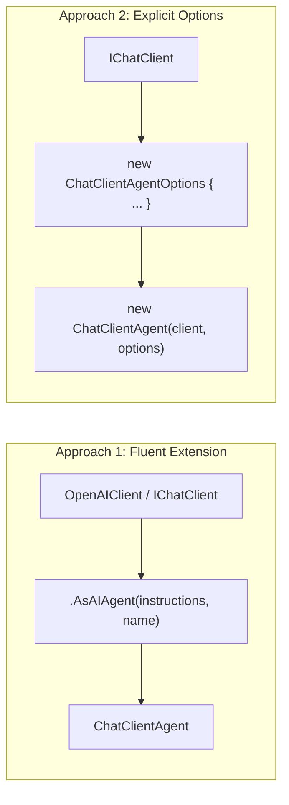
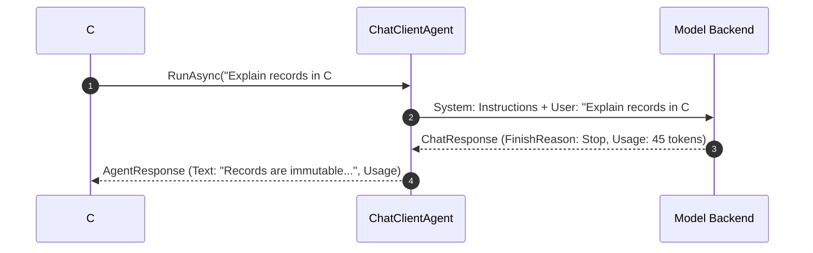

# Module 02 — Building Your First Agent

> **Time:** ~35 min · **Level:** Beginner · **Prerequisites:** [Module 01](01-introduction.md)
> **Packages:** `Microsoft.Agents.AI` 1.28.0 (GA), `Microsoft.Agents.AI.OpenAI` 1.28.0 (GA)

---

## Learning objectives

- Instantiate and configure agents using both `AsAIAgent()` extension methods and the direct `ChatClientAgent` constructor.
- Formulate effective agent instructions and personas using system-level prompts.
- Execute agent runs using `RunAsync` overloads, inspecting `AgentResponse`, message collections, and token usage metrics.
- Stream responses in real time using `RunStreamingAsync` and process `AgentResponseUpdate` chunks.
- Configure invocation-level parameters using `ChatClientAgentRunOptions` (temperature, token limits, stop sequences).
- Produce strongly-typed JSON outputs using the generic `RunAsync<T>` method with JSON Schema validation.
- Construct multimodal inputs combining text and image content.

---

## Concepts

### 1. Anatomy of an agent

In Microsoft Agent Framework, an agent is an instance of `AIAgent`. When backed by a chat completion model, the concrete type is `ChatClientAgent`.

You can create an agent using two distinct approaches:



#### Approach 1: Fluent extension method (`AsAIAgent`)
The quickest, most idiomatic way to wrap an existing `ChatClient` or `IChatClient`:
```csharp
AIAgent agent = new OpenAIClient(apiKey)
    .GetChatClient("gpt-5.4-mini")
    .AsAIAgent(instructions: "You are a concise mentor.", name: "TechMentor");
```

#### Approach 2: Explicit constructor (`ChatClientAgentOptions`)
Provides complete control over pipeline decorators, default chat options, chat history providers, and context providers:
```csharp
IChatClient chatClient = new OpenAIClient(apiKey).GetChatClient("gpt-5.4-mini").AsIChatClient();

AIAgent agent = new ChatClientAgent(chatClient, new ChatClientAgentOptions
{
    Name = "SeniorArchitect",
    Description = "Specializes in distributed systems design.",
    ChatOptions = new ChatOptions
    {
        Instructions = "You are a software architect focusing on distributed systems.",
        Temperature = 0.2f,
        MaxOutputTokens = 1000
    }
});
```

---

### 2. Instructions and persona formulation

Agent `Instructions` represent the system-level prompt delivered to the model before any user turn. The instructions establish:
- **Persona & Tone:** Conciseness, professional demeanor, humor, or pedagogical depth.
- **Scope & Boundaries:** What topics the agent may or may not address.
- **Output formatting rules:** Markdown formatting, code block styles, or language requirements.

```csharp
string instructions = """
    You are an expert .NET 10 performance engineer.
    Analyze user-submitted code snippets for allocation bottlenecks and async anti-patterns.
    Be extremely concise: provide a 1-sentence diagnosis followed by the optimized C# code.
    """;
```

MAF automatically wraps your instructions into a message with `ChatRole.System` and ensures it precedes conversational history in model requests.

---

### 3. Invoking the agent: `RunAsync` and `AgentResponse`

The `RunAsync` method provides multiple overloads for non-streaming execution:

| Overload | Typical Usage |
|---|---|
| `agent.RunAsync(string message, ...)` | Convenience method for simple user text queries. |
| `agent.RunAsync(ChatMessage message, ...)` | Sending structured messages with attachments (e.g. images). |
| `agent.RunAsync(IEnumerable<ChatMessage> messages, ...)` | Multi-message batches or custom pre-formatted histories. |

All overloads return an **`AgentResponse`** instance containing:
- **`response.Text`**: Concatenated text across all assistant text content blocks in the response.
- **`response.Messages`**: The complete list of `ChatMessage` objects generated during the run (including tool call requests and tool responses if functions were invoked).
- **`response.Usage`**: Detailed token telemetry (`InputTokenCount`, `OutputTokenCount`, `TotalTokenCount`).
- **`response.FinishReason`**: The completion reason (`Stop`, `Length`, `ContentFilter`, or `ToolCalls`).



---

### 4. Real-time streaming with `RunStreamingAsync`

For interactive applications (consoles, web UIs), waiting for the complete response introduces perceived latency. `RunStreamingAsync` yields incremental chunks as they are generated by the model:

```csharp
await foreach (AgentResponseUpdate update in agent.RunStreamingAsync("Explain async/await."))
{
    Console.Write(update.Text);
}
```

#### Key properties of `AgentResponseUpdate`
- **`update.Text`**: The textual delta emitted in this chunk.
- **`update.Role`**: The role of the author (`ChatRole.Assistant`).
- **`update.Contents`**: The list of `AIContent` items (e.g. `TextContent`, `UsageContent`).

#### Reassembling a stream into an `AgentResponse`
If you need both real-time streaming to the user and a final `AgentResponse` object for logging or database persistence, use the `ToAgentResponseAsync()` extension method:

```csharp
IAsyncEnumerable<AgentResponseUpdate> updates = agent.RunStreamingAsync("Summarize LINQ.");
AgentResponse fullResponse = await updates.ToAgentResponseAsync();
Console.WriteLine($"\nTotal tokens used: {fullResponse.Usage?.TotalTokenCount}");
```

---

### 5. Invocation-level configuration: `RunOptions`

While default settings are configured when instantiating the agent, you often need to override parameters for specific queries. MAF uses **`ChatClientAgentRunOptions`**:

```csharp
var runOptions = new ChatClientAgentRunOptions(new ChatOptions
{
    Temperature = 0.0f,         // Zero temperature for deterministic output
    MaxOutputTokens = 150,      // Hard limit on response length
    StopSequences = ["###"]     // Custom termination tokens
});

AgentResponse response = await agent.RunAsync("Extract the order ID from: Order #94821", options: runOptions);
```

Settings specified in `ChatClientAgentRunOptions` take precedence over default agent settings for that specific invocation.

---

### 6. Strongly-typed structured outputs (`RunAsync<T>`)

When your application requires data extraction or machine-readable responses, relying on manual string parsing or regular expressions is error-prone. MAF provides native JSON Schema enforcement via **`RunAsync<T>`**:

```csharp
AgentResponse<OrderAnalysis> response = await agent.RunAsync<OrderAnalysis>(
    "Customer purchased 3 laptops at $1,200 each on 2026-11-10 with standard shipping.");

OrderAnalysis result = response.Result; // Strongly typed C# object!
Console.WriteLine($"Total: ${result.TotalAmount}, Risk: {result.RiskScore}");
```

#### How it works under the hood
1. MAF generates a strict JSON Schema from `typeof(T)`.
2. It sets `ChatResponseFormat.ForJsonSchema<T>()` in the underlying request.
3. The LLM backend's token sampling engine constrains generation to valid JSON tokens conforming to that schema.
4. MAF deserializes the verified JSON into `response.Result`.

Decorate your C# classes with `[Description]` and `[JsonPropertyName]` to guide the model's extraction accuracy:

```csharp
[Description("Parsed customer order details")]
public sealed class OrderAnalysis
{
    [JsonPropertyName("total_amount")]
    [Description("Total monetary value calculated from item price and quantities")]
    public decimal TotalAmount { get; set; }

    [JsonPropertyName("risk_score")]
    [Description("Fraud risk assessment from 1 (low) to 10 (high)")]
    public int RiskScore { get; set; }
}
```

---

### 7. Multimodal input

Modern models process vision, audio, and documents alongside text. In MAF, multimodal content is passed via the `ChatMessage` constructor using `AIContent` items:

```csharp
ChatMessage multiModalMessage = new(ChatRole.User, [
    new TextContent("Describe the architecture depicted in this diagram:"),
    new DataContent(imageBytes, "image/png")
]);

AgentResponse response = await agent.RunAsync(multiModalMessage);
```

You can supply images via raw bytes (`DataContent`), a file path (`await DataContent.LoadFromAsync("path.jpg")`), or an absolute URI (`new UriContent("https://...")`).

---

## Hands-on

In this comprehensive hands-on program, you will explore all core agent execution capabilities:
1. Creating agents via fluent extensions and explicit options.
2. Inspecting non-streaming responses and token usage metrics.
3. Consuming real-time streams with `RunStreamingAsync`.
4. Generating strongly-typed structured outputs via `RunAsync<T>`.
5. Executing multimodal requests.

### Setup commands

```powershell
dotnet new console -n AgentFundamentalsDemo --framework net10.0
cd AgentFundamentalsDemo
dotnet add package Microsoft.Agents.AI.OpenAI --version 1.28.0
```

### Project file (`AgentFundamentalsDemo.csproj`)

```xml
<Project Sdk="Microsoft.NET.Sdk">

  <PropertyGroup>
    <OutputType>Exe</OutputType>
    <TargetFramework>net10.0</TargetFramework>
    <ImplicitUsings>enable</ImplicitUsings>
    <Nullable>enable</Nullable>
  </PropertyGroup>

  <ItemGroup>
    <PackageReference Include="Microsoft.Agents.AI.OpenAI" Version="1.28.0" />
  </ItemGroup>

</Project>
```

### Program code (`Program.cs`)

```csharp
using System.ComponentModel;
using System.Text.Json.Serialization;
using Microsoft.Agents.AI;
using Microsoft.Extensions.AI;
using OpenAI;
using OpenAI.Chat;
using ChatMessage = Microsoft.Extensions.AI.ChatMessage;

string apiKey = Environment.GetEnvironmentVariable("OPENAI_API_KEY") ?? "mock-key";
string model = Environment.GetEnvironmentVariable("OPENAI_MODEL") ?? "gpt-5.4-mini";

// -------------------------------------------------------------
// 1. Creating an agent via extension method
// -------------------------------------------------------------
AIAgent agent1 = new OpenAIClient(apiKey)
    .GetChatClient(model)
    .AsAIAgent(instructions: "You are a concise software mentor.", name: "Mentor");

// -------------------------------------------------------------
// 2. Creating an agent via direct constructor and ChatClientAgentOptions
// -------------------------------------------------------------
IChatClient rawChatClient = new OpenAIClient(apiKey).GetChatClient(model).AsIChatClient();
AIAgent agent2 = new ChatClientAgent(rawChatClient, new ChatClientAgentOptions
{
    Name = "SeniorArchitect",
    ChatOptions = new ChatOptions
    {
        Instructions = "You are a software architect focusing on distributed systems.",
        Temperature = 0.2f,
        MaxOutputTokens = 500
    }
});

Console.WriteLine($"Agent 1: {agent1.Name} ({agent1.Id})");
Console.WriteLine($"Agent 2: {agent2.Name} ({agent2.Id})");
Console.WriteLine();

// -------------------------------------------------------------
// 3. Execution with RunOptions (per-invocation settings)
// -------------------------------------------------------------
var runOptions = new ChatClientAgentRunOptions(new ChatOptions
{
    Temperature = 0.1f,
    MaxOutputTokens = 150
});

// RunAsync overload: string prompt
AgentResponse response = await agent1.RunAsync("Explain immutability in one sentence.", options: runOptions);
Console.WriteLine($"Agent Text: {response.Text}");

// Inspecting Usage and Messages
if (response.Usage is { } usage)
{
    Console.WriteLine($"Tokens - Input: {usage.InputTokenCount}, Output: {usage.OutputTokenCount}, Total: {usage.TotalTokenCount}");
}

foreach (ChatMessage msg in response.Messages)
{
    Console.WriteLine($"[{msg.Role}] {msg.Text}");
}
Console.WriteLine();

// -------------------------------------------------------------
// 4. Streaming execution with RunStreamingAsync
// -------------------------------------------------------------
Console.WriteLine("=== Streaming Output ===");
IAsyncEnumerable<AgentResponseUpdate> updates = agent1.RunStreamingAsync("List 3 benefits of records in C#.");
await foreach (AgentResponseUpdate update in updates)
{
    Console.Write(update.Text);
}
Console.WriteLine("\n");

// Or assemble the stream into a full AgentResponse
AgentResponse assembledResponse = await agent1.RunStreamingAsync("Summarize pattern matching.").ToAgentResponseAsync();
Console.WriteLine($"Assembled length: {assembledResponse.Text.Length} chars");
Console.WriteLine();

// -------------------------------------------------------------
// 5. Structured Outputs with RunAsync<T>
// -------------------------------------------------------------
Console.WriteLine("=== Structured Outputs ===");
AgentResponse<CodeAnalysisResult> analysisResponse = await agent1.RunAsync<CodeAnalysisResult>(
    "Analyze this: int x = 42; is it clean?");
CodeAnalysisResult result = analysisResponse.Result;
Console.WriteLine($"Score   : {result.QualityScore}/10");
Console.WriteLine($"Summary : {result.Summary}");
Console.WriteLine($"Advice  : {string.Join(", ", result.Suggestions)}");
Console.WriteLine();

// -------------------------------------------------------------
// 6. Multimodal input
// -------------------------------------------------------------
Console.WriteLine("=== Multimodal Vision Input ===");
ChatMessage multiModalMessage = new(ChatRole.User, [
    new TextContent("Describe this image and its dominant colors."),
    new DataContent(new byte[] { 0xFF, 0xD8, 0xFF, 0xE0 }, "image/jpeg")
]);
AgentResponse visionResponse = await agent1.RunAsync(multiModalMessage);
Console.WriteLine($"Vision response: {visionResponse.Text}");

// -------------------------------------------------------------
// Data model for structured outputs
// -------------------------------------------------------------
[Description("Result of source code quality and complexity analysis")]
public sealed class CodeAnalysisResult
{
    [JsonPropertyName("quality_score")]
    [Description("A score from 1 to 10 indicating code quality")]
    public int QualityScore { get; set; }

    [JsonPropertyName("summary")]
    [Description("A brief 1-sentence summary of the evaluation")]
    public string Summary { get; set; } = string.Empty;

    [JsonPropertyName("suggestions")]
    [Description("Actionable recommendations for improvement")]
    public List<string> Suggestions { get; set; } = [];
}
```

### What's happening
1. **Agent configuration:** `agent1` is created using the concise fluent extension, while `agent2` uses `ChatClientAgentOptions` with strict default limits.
2. **`ChatClientAgentRunOptions`:** Per-call overrides set `Temperature = 0.1f` and `MaxOutputTokens = 150`, keeping output concise without modifying the agent's baseline configuration.
3. **Usage inspection:** `response.Usage` extracts token counts for telemetry and cost tracking.
4. **Streaming:** `RunStreamingAsync` delivers `AgentResponseUpdate` chunks sequentially. `ToAgentResponseAsync()` demonstrates reassembling an asynchronous stream into an immutable `AgentResponse`.
5. **Schema enforcement:** `RunAsync<CodeAnalysisResult>()` forces the model to emit valid JSON adhering to `CodeAnalysisResult`, surfacing strongly-typed properties through `.Result`.
6. **Multimodal payload:** A single `ChatMessage` holds both a `TextContent` prompt and binary image bytes wrapped in `DataContent`.

---

## Common pitfalls

- **Symptom:** `error CS1061: 'AgentResponse' does not contain a definition for 'Result'`
  - **Cause:** Calling non-generic `RunAsync("...")` instead of `RunAsync<T>("...")`.
  - **Fix:** Specify the type argument on the method call: `AgentResponse<MyType> response = await agent.RunAsync<MyType>(prompt);`.
- **Symptom:** UI freezes or updates all arrive simultaneously after 5 seconds instead of streaming word-by-word.
  - **Cause:** Using `await updates.ToListAsync()` or awaiting the entire stream before rendering.
  - **Fix:** Consume updates incrementally using `await foreach (AgentResponseUpdate update in agent.RunStreamingAsync(...))`.
- **Symptom:** `JsonException: The JSON value could not be converted to System.Int32` during `RunAsync<T>`.
  - **Cause:** The class schema is ambiguous, or property descriptions were omitted, leading the model to hallucinate strings where numbers were expected.
  - **Fix:** Add `[Description("...")]` attributes to class properties and use `[JsonPropertyName]` to guarantee strict schema alignment.
- **Symptom:** High latency and high cloud costs across all agent requests.
  - **Cause:** Instantiating new `OpenAIClient` and `AIAgent` instances inside request loops or HTTP controllers instead of reusing long-lived singleton instances.
  - **Fix:** Register `AIAgent` and `IChatClient` as singletons in your Dependency Injection container.

---

## When to use / when not to use

| Method | Recommended When | Avoid When |
|---|---|---|
| **`RunAsync(string)`** | Simple conversational tasks, background batch jobs, backend services where UI streaming is unnecessary. | Interactive chat applications where users expect real-time feedback. |
| **`RunStreamingAsync(string)`** | Interactive consoles, web chat applications, long-form content generation requiring visible progress. | Inter-agent communication inside a pipeline where downstream code requires the complete response object. |
| **`RunAsync<T>(string)`** | Data extraction, form parsing, routing decisions, schema validation, structured inter-agent data passing. | Open-ended conversational chit-chat where flexible freeform text is desired. |
| **`RunAsync(ChatMessage)`** | Multimodal interactions (image analysis, file processing) or multi-part prompts. | Trivial single-sentence text prompts (use string overload for cleaner code). |

---

## Exercises

1. **Interactive Streaming Stopwatch Console**: Build a console method that streams an agent response using `RunStreamingAsync`, wrapping each chunk in brackets (e.g. `[Hello][ world]`) to visualize token boundaries, and displays the total streaming duration in milliseconds upon completion.
2. **Defect Triage Generator (`RunAsync<T>`)**: Create a strongly-typed C# class `BugTriageReport` containing:
   - `Severity` (enum: `Low`, `Medium`, `High`, `Critical`)
   - `RootCause` (string)
   - `RecommendedFix` (string)
   - `EstimatedHours` (int)
   Invoke an agent using `RunAsync<BugTriageReport>` with a raw error trace and print the formatted triage report.
3. **Multimodal Quality Inspection with Strict RunOptions**: Write a method that sends an image message to an agent with `ChatClientAgentRunOptions` configured for strict extraction (`Temperature = 0.0f`, `MaxOutputTokens = 250`) to analyze an image for visual defects.

---

## Summary

- Create agents using either `.AsAIAgent()` on any `ChatClient`/`IChatClient`, or explicitly via `new ChatClientAgent(client, options)`.
- System instructions govern the agent's persona, operational boundaries, and response behavior.
- `RunAsync` delivers a complete `AgentResponse` containing `Text`, message history, and token `Usage` metrics.
- `RunStreamingAsync` yields `AgentResponseUpdate` chunks in real time, which can be reassembled into an `AgentResponse` using `ToAgentResponseAsync()`.
- Use `ChatClientAgentRunOptions` to adjust temperature, token limits, and stop sequences on a per-invocation basis.
- `RunAsync<T>` uses JSON Schema validation to guarantee strongly-typed C# responses via `response.Result`.
- Send images and multi-part content using `ChatMessage` and `DataContent`.

---

## Further reading

- [Microsoft Agent Framework Getting Started Guide](https://learn.microsoft.com/agent-framework/overview/)
- [Structured Outputs in MAF](https://learn.microsoft.com/agent-framework/agents/structured-outputs)
- [Multimodal Vision Support](https://learn.microsoft.com/agent-framework/agents/multimodal)
- [Official MAF Agents Samples](https://github.com/microsoft/agent-framework/tree/main/dotnet/samples/02-agents/Agents)

---

## Solutions

### Exercise 1 — Interactive Streaming Stopwatch Console

```csharp
using System.Diagnostics;
using Microsoft.Agents.AI;

public static class StreamingVisualizer
{
    public static async Task StreamWithDelimitersAsync(AIAgent agent, string prompt)
    {
        ArgumentNullException.ThrowIfNull(agent);
        ArgumentException.ThrowIfNullOrWhiteSpace(prompt);

        Console.WriteLine($"[Prompt]: {prompt}");
        Console.WriteLine("--- Streaming Output ---");

        Stopwatch stopwatch = Stopwatch.StartNew();
        int tokenChunks = 0;
        int totalCharacters = 0;

        await foreach (AgentResponseUpdate update in agent.RunStreamingAsync(prompt))
        {
            if (!string.IsNullOrEmpty(update.Text))
            {
                Console.Write($"[{update.Text}]");
                tokenChunks++;
                totalCharacters += update.Text.Length;
            }
        }

        stopwatch.Stop();
        Console.WriteLine("\n------------------------");
        Console.WriteLine($"Elapsed Time : {stopwatch.ElapsedMilliseconds} ms");
        Console.WriteLine($"Total Chunks : {tokenChunks}");
        Console.WriteLine($"Total Chars  : {totalCharacters}");
    }
}
```

### Exercise 2 — Defect Triage Generator (`RunAsync<T>`)

```csharp
using System.ComponentModel;
using System.Text.Json.Serialization;
using Microsoft.Agents.AI;

public enum BugSeverity
{
    Low,
    Medium,
    High,
    Critical
}

[Description("Triage assessment for an incoming software bug or error trace")]
public sealed class BugTriageReport
{
    [JsonPropertyName("severity")]
    [Description("Assessed severity rating based on business impact")]
    public BugSeverity Severity { get; set; }

    [JsonPropertyName("root_cause")]
    [Description("Suspected technical root cause of the error")]
    public string RootCause { get; set; } = string.Empty;

    [JsonPropertyName("recommended_fix")]
    [Description("Actionable engineering fix to resolve the defect")]
    public string RecommendedFix { get; set; } = string.Empty;

    [JsonPropertyName("estimated_hours")]
    [Description("Estimated effort in engineer-hours to develop and test the fix")]
    public int EstimatedHours { get; set; }
}

public static class BugTriageService
{
    public static async Task<BugTriageReport> TriageBugAsync(AIAgent agent, string errorLog)
    {
        string prompt = $"""
            Triage the following error report:
            {errorLog}
            """;

        AgentResponse<BugTriageReport> response = await agent.RunAsync<BugTriageReport>(prompt);
        return response.Result;
    }
}
```

### Exercise 3 — Multimodal Quality Inspection with Strict RunOptions

```csharp
using Microsoft.Agents.AI;
using Microsoft.Extensions.AI;
using ChatMessage = Microsoft.Extensions.AI.ChatMessage;

public static class VisionQualityInspector
{
    public static async Task<string> InspectImageAsync(AIAgent agent, byte[] imageBytes, string imageMediaType = "image/png")
    {
        ArgumentNullException.ThrowIfNull(agent);
        ArgumentNullException.ThrowIfNull(imageBytes);

        // 1. Construct multimodal message
        ChatMessage message = new(ChatRole.User, [
            new TextContent("Analyze this manufacturing part for visible cracks, misalignments, or surface defects."),
            new DataContent(imageBytes, imageMediaType)
        ]);

        // 2. Configure strict deterministic run options
        ChatClientAgentRunOptions runOptions = new(new ChatOptions
        {
            Temperature = 0.0f,
            MaxOutputTokens = 250
        });

        // 3. Execute inspection
        AgentResponse response = await agent.RunAsync(message, options: runOptions);
        return response.Text;
    }
}
```
