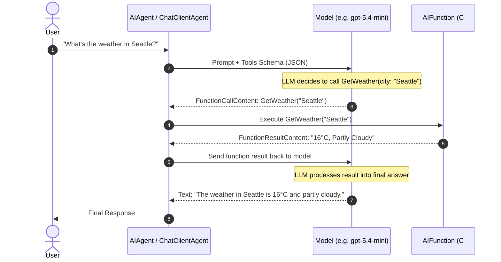
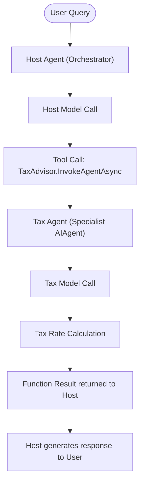

# Module 03 — Tools

> **Time:** ~25 min · **Level:** Intermediate · **Prerequisites:** [Module 02 — Your First Agent](02-first-agent.md)
> **Packages:** `Microsoft.Agents.AI.OpenAI` 1.28.0 (GA)

## Learning objectives
- Transform arbitrary C# static and instance methods into agent function tools using `AIFunctionFactory.Create`.
- Annotate functions, parameters, and return schemas with `[Description]` attributes to steer model tool selection.
- Compose hierarchical and specialist architectures by exposing agents as tools via `AsAIFunction()`.
- Dynamically control tool availability per run and inspect runtime tool expansion using `FunctionInvokingChatClient`.
- Contrast local function tools with provider-hosted tools (Code Interpreter, Web Search, and File Search).
- Recognize tool approval requirements and identify when to introduce human-in-the-loop gates.

---

## Concepts

### What are tools?
Large language models generate text by default, but real-world tasks require querying live databases, making HTTP requests, calculating formulas, or triggering workflows. In Microsoft Agent Framework (MAF), a **tool** is an abstraction that allows an agent to invoke external code or services during its reasoning loop.

MAF tools inherit from `AITool` (from `Microsoft.Extensions.AI`). The most common tool type is `AIFunction`, which wraps a C# delegate or method and exposes its schema to the model using JSON Schema.



### Creating function tools: `AIFunctionFactory.Create`
MAF allows turning delegates, lambdas, static methods, or instance methods into `AIFunction` instances with `AIFunctionFactory.Create`.

```csharp
[Description("Get the current weather for a city.")]
static string GetWeather([Description("The city name, e.g. London, Seattle.")] string city)
    => $"The weather in {city} is 16°C, partly cloudy.";

AIFunction tool = AIFunctionFactory.Create(GetWeather);
```

When registering tools with an agent:
1. **Method name and signature**: The method name becomes the default tool name (unless overridden via `AIFunctionFactory.Create(..., name: "CustomName")`).
2. **Parameters**: Every parameter becomes part of the generated JSON Schema properties. Primitive types (`string`, `int`, `double`, `bool`) and complex classes/records are serialized to JSON Schema automatically.
3. **Descriptions**: The LLM relies solely on natural-language descriptions to decide *when* and *how* to invoke your tool. Decorating the method and every parameter with `[Description("...")]` (from `System.ComponentModel`) is essential.

### Instance methods and Dependency Injection
Tools often need access to databases, HTTP clients, or repository state. You can pass instance methods directly to `AIFunctionFactory.Create`:

```csharp
var inventoryService = serviceProvider.GetRequiredService<InventoryService>();
AIFunction tool = AIFunctionFactory.Create(inventoryService.CheckStock, name: "CheckStock");
```

In addition, `AsAIAgent(...)` accepts an optional `IServiceProvider` parameter:
```csharp
AIAgent agent = chatClient.AsAIAgent(
    instructions: "...",
    tools: [AIFunctionFactory.Create(orderService.CancelOrder)],
    services: serviceProvider);
```
If a parameter in a tool method cannot be supplied by the LLM or is injected via DI, MAF and `Microsoft.Extensions.AI` resolve it against the provided `IServiceProvider`.

### Agents as tools: `AsAIFunction()`
One of MAF's most powerful architectural patterns is **agents-as-tools**. Any `AIAgent` can be converted into an `AIFunction` using the `AsAIFunction()` extension method (found in `Microsoft.Agents.AI`).

When the host agent decides to delegate work:
1. The host model emits a tool call targeting the sub-agent.
2. `AsAIFunction()` invokes the sub-agent via `agent.RunAsync(query, session: session)`.
3. The sub-agent runs its own prompt and tools.
4. The sub-agent's text response is returned as the function result back to the host model.



> [!WARNING]
> **Stateful Sub-Agents and Concurrency:** `agent.AsAIFunction(session: session)` binds the function to an `AgentSession`. Because MAF sessions are not thread-safe for concurrent runs, avoid running parallel tool calls across multiple conversations on the same sub-agent session.

### Adding and controlling tools at runtime
Tools do not need to remain static for the entire lifetime of an agent. You can adjust tool availability dynamically in two primary ways:

1. **Per-run options (`ChatClientAgentRunOptions.ChatOptions.Tools`):**
   You can pass specific tools on an individual `RunAsync` call to override or augment the agent's baseline tools:
   ```csharp
   var options = new ChatClientAgentRunOptions
   {
       ChatOptions = new ChatOptions
       {
           Tools = [AIFunctionFactory.Create(SensitiveAdminTool)]
       }
   };
   await agent.RunAsync("Perform audit", session, options: options);
   ```

2. **In-loop dynamic tool loading (`Agent_Step20_DynamicFunctionTools` pattern):**
   When an agent has dozens of potential tools, sending all schemas in every prompt inflates token costs and confuses the model. Instead, start the agent with a single `RequestTools` meta-tool. When the model invokes `RequestTools(capability)`, the tool retrieves the ambient `FunctionInvocationContext` via `FunctionInvokingChatClient.CurrentContext`, inspects `context.Options?.Tools`, and dynamically appends matching tools to the active call:
   ```csharp
   var context = FunctionInvokingChatClient.CurrentContext
       ?? throw new InvalidOperationException("No ambient context.");
   context.Options?.Tools?.Add(newTool);
   ```
   The model can then call the newly loaded tools in subsequent turns of the same invocation loop!

3. **Tool selection mode (`ChatOptions.ToolMode`):**
   You can guide the model's tool selection strategy via `ChatOptions.ToolMode`:
   - `ChatToolMode.Auto`: The model decides whether to call a tool or reply with text (default).
   - `ChatToolMode.None`: The model is forbidden from calling tools.
   - `ChatToolMode.RequireAny`: The model *must* call at least one tool.
   - `ChatToolMode.RequireSpecific("ToolName")`: The model *must* call the designated tool.

### Hosted tools overview
In addition to local C# function tools, cloud providers offer **hosted tools** that execute in the provider's managed cloud infrastructure:

| Tool | Purpose | Typical Provider Support | Class / Definition |
|---|---|---|---|
| **Code Interpreter** | Executes Python code in a secure cloud sandbox for data analysis, charting, and math | Microsoft Foundry, Azure OpenAI, OpenAI Responses | `CodeInterpreterToolDefinition` |
| **Web Search** | Searches the live internet for up-to-date information | Microsoft Foundry, Azure OpenAI, OpenAI | `HostedWebSearchTool` |
| **File Search** | Searches vector-indexed documents stored in cloud vector stores | Microsoft Foundry, Azure OpenAI, OpenAI | `FileSearchToolDefinition` |

Hosted tools require provider support (such as `Microsoft.Agents.AI.Foundry` or `Microsoft.Agents.AI.OpenAI` Responses client). Local C# function tools created via `AIFunctionFactory.Create` run locally on your host machine or container, giving you complete control over security, databases, and dependencies.

### Tool approvals (Human-in-the-Loop) preview
Certain actions (e.g., executing shell scripts, charging credit cards, deleting records) should not execute autonomously. MAF provides `ApprovalRequiredAIFunction` to intercept tool execution and pause the run until an explicit approval token is granted. We explore human-in-the-loop workflows in depth in [Module 14 — Human in the Loop](14-human-in-the-loop.md).

---

## Hands-on

### Example 1 — Creating local function tools with static and instance methods

This example demonstrates how to create static and stateful instance tools, attach `[Description]` metadata, and register them with a `ChatClientAgent`.

#### Setup
```powershell
dotnet new console -n ToolsBasics -f net10.0
cd ToolsBasics
dotnet add package Microsoft.Agents.AI.OpenAI --version 1.28.0
```

#### Program.cs
```csharp
using System.ComponentModel;
using Microsoft.Agents.AI;
using Microsoft.Extensions.AI;
using OpenAI;
using OpenAI.Chat;

// 1. Static method tool
[Description("Get the current weather for a city.")]
static string GetWeather([Description("The city name, e.g. London, Seattle.")] string city)
{
    return city.ToLowerInvariant() switch
    {
        "london" => "12°C, Rainy",
        "seattle" => "16°C, Partly Cloudy",
        _ => "20°C, Sunny"
    };
}

// 2. Instance service tool with state
var inventory = new InventoryService();

string apiKey = Environment.GetEnvironmentVariable("OPENAI_API_KEY") ?? "mock-key";
string model = Environment.GetEnvironmentVariable("OPENAI_MODEL") ?? "gpt-5.4-mini";

AIAgent agent = new OpenAIClient(apiKey)
    .GetChatClient(model)
    .AsAIAgent(
        instructions: "You are a helpful customer service assistant. Use available tools to answer queries.",
        name: "CustomerAssistant",
        tools: [
            AIFunctionFactory.Create(GetWeather),
            AIFunctionFactory.Create(inventory.CheckStock, name: "CheckInventoryStock")
        ]);

Console.WriteLine($"Agent '{agent.Name}' created with tools successfully.");

// Tool implementation class
public class InventoryService
{
    private readonly Dictionary<string, int> _stock = new(StringComparer.OrdinalIgnoreCase)
    {
        ["laptop"] = 7,
        ["headphones"] = 0,
        ["mouse"] = 15
    };

    [Description("Check current stock level for a product in inventory.")]
    public string CheckStock([Description("The product SKU or name to check.")] string productName)
    {
        if (_stock.TryGetValue(productName, out int count))
        {
            return count > 0 ? $"{count} units available in warehouse" : "Out of stock";
        }
        return "Product not found in catalog";
    }
}
```

#### What's happening
- `GetWeather` is a C# local function decorated with `[Description]`. MAF generates JSON Schema defining a `location` parameter of type `string`.
- `inventory.CheckStock` is an instance method bound to the state of `inventory`. When the LLM calls `CheckInventoryStock`, it accesses the live dictionary.
- Both tools are passed to `tools: [...]` during agent instantiation.

---

### Example 2 — Composing multi-agent workflows with agents-as-tools (`AsAIFunction`)

This example demonstrates delegating specialized tasks to sub-agents wrapped as tools using `AsAIFunction()`.

#### Setup
```powershell
dotnet new console -n AgentsAsTools -f net10.0
cd AgentsAsTools
dotnet add package Microsoft.Agents.AI.OpenAI --version 1.28.0
```

#### Program.cs
```csharp
using System.ComponentModel;
using Microsoft.Agents.AI;
using Microsoft.Extensions.AI;
using OpenAI;
using OpenAI.Chat;

string apiKey = Environment.GetEnvironmentVariable("OPENAI_API_KEY") ?? "mock-key";
string model = Environment.GetEnvironmentVariable("OPENAI_MODEL") ?? "gpt-5.4-mini";

var openAIClient = new OpenAIClient(apiKey);
var chatClient = openAIClient.GetChatClient(model);

// 1. Define a specialized agent that answers tax and financial questions
AIAgent taxAgent = chatClient.AsAIAgent(
    name: "TaxAdvisor",
    description: "Expert tax advisor that calculates VAT and corporate tax rates for different regions.",
    instructions: "You are an expert tax advisor. Provide concise tax rate advice and calculations.");

// 2. Wrap the specialized agent as a function tool using AsAIFunction()
AIFunction taxTool = taxAgent.AsAIFunction();

// 3. Define the primary orchestrating assistant that delegates tax questions to TaxAdvisor
AIAgent orchestratorAgent = chatClient.AsAIAgent(
    name: "BusinessConsultant",
    instructions: "You are an executive business consultant. When clients ask tax questions, consult the TaxAdvisor tool.",
    tools: [taxTool]);

Console.WriteLine($"Orchestrator '{orchestratorAgent.Name}' configured with tool '{taxTool.Name}'.");
```

#### What's happening
- `taxAgent.AsAIFunction()` converts `taxAgent` into an `AIFunction`. The tool's name defaults to `taxAgent.Name` ("TaxAdvisor") and its description defaults to `taxAgent.Description`.
- The orchestrator agent does not know or care that `TaxAdvisor` is backed by another LLM run; to the orchestrator, it is simply a tool that accepts a string query and returns an answer.

---

### Example 3 — Dynamic tool discovery and expansion at runtime

This example demonstrates the dynamic tool catalog pattern (`Agent_Step20_DynamicFunctionTools`). The agent starts with only a `RequestTools` function and expands its tool set on demand.

#### Setup
```powershell
dotnet new console -n DynamicTools -f net10.0
cd DynamicTools
dotnet add package Microsoft.Agents.AI.OpenAI --version 1.28.0
```

#### Program.cs
```csharp
using System.ComponentModel;
using Microsoft.Agents.AI;
using Microsoft.Extensions.AI;
using OpenAI;
using OpenAI.Chat;

string apiKey = Environment.GetEnvironmentVariable("OPENAI_API_KEY") ?? "mock-key";
string model = Environment.GetEnvironmentVariable("OPENAI_MODEL") ?? "gpt-5.4-mini";

// Catalog of tools that can be dynamically loaded
Dictionary<string, List<AITool>> toolCatalog = new(StringComparer.OrdinalIgnoreCase)
{
    ["shipping"] = [
        AIFunctionFactory.Create(
            [Description("Calculate shipping cost.")] (
                [Description("Destination country code (e.g. US, UK, DE)")] string country,
                [Description("Weight in kg")] double weightKg) =>
                $"Standard shipping to {country} for {weightKg}kg is ${(weightKg * 4.5):F2}",
            name: "CalculateShippingCost")
    ],
    ["discount"] = [
        AIFunctionFactory.Create(
            [Description("Verify coupon code.")] (
                [Description("Coupon promo code")] string couponCode) =>
                couponCode.Equals("SAVE10", StringComparison.OrdinalIgnoreCase) ? "10% discount applied" : "Invalid coupon",
            name: "ApplyCoupon")
    ]
};

// Tool that allows the LLM to request additional tools on demand
AIFunction requestToolsFunction = AIFunctionFactory.Create(
    [Description("Request additional specialized tools to be loaded into your current session. Call this when you need capabilities not currently available.")] (
        [Description("Keywords describing the functionality needed (e.g., 'shipping', 'discount').")] string requestedCapability
    ) =>
    {
        var context = FunctionInvokingChatClient.CurrentContext
            ?? throw new InvalidOperationException("No ambient FunctionInvocationContext available.");

        var currentTools = context.Options?.Tools;
        if (currentTools is null)
        {
            return "Unable to register tools: ChatOptions.Tools is null.";
        }

        List<string> addedNames = [];
        foreach (var (key, tools) in toolCatalog)
        {
            if (requestedCapability.Contains(key, StringComparison.OrdinalIgnoreCase))
            {
                foreach (var tool in tools)
                {
                    if (tool is AIFunction fn && !currentTools.Any(t => t is AIFunction existing && existing.Name == fn.Name))
                    {
                        currentTools.Add(tool);
                        addedNames.Add(fn.Name);
                    }
                }
            }
        }

        return addedNames.Count > 0
            ? $"Successfully loaded tools: {string.Join(", ", addedNames)}."
            : $"No tools found for '{requestedCapability}'. Available categories: {string.Join(", ", toolCatalog.Keys)}.";
    },
    name: "RequestTools");

// Create agent initialized ONLY with RequestTools
AIAgent agent = new OpenAIClient(apiKey)
    .GetChatClient(model)
    .AsAIAgent(
        instructions: "You are an order support agent. If you need capabilities like shipping calculation or coupon verification, use the RequestTools function first.",
        tools: [requestToolsFunction]);

Console.WriteLine($"Agent created with initial dynamic tool discovery function: {requestToolsFunction.Name}");
```

#### What's happening
- The agent is initialized with only `RequestTools`. Its prompt context remains lean and token-efficient.
- When an end user asks "What is the shipping cost to UK for 3kg?", the model calls `RequestTools(requestedCapability: "shipping")`.
- Inside `RequestTools`, `FunctionInvokingChatClient.CurrentContext.Options.Tools` is populated with `CalculateShippingCost`.
- In the very next iteration of the function loop, the model invokes `CalculateShippingCost` to complete the request.

---

## Common pitfalls

- **Missing parameter descriptions:**
  - *Symptom:* The model hallucinates invalid parameter values or fails to call the tool when expected.
  - *Cause:* The method has parameter names but lacks `[Description]` attributes explaining parameter formats or acceptable ranges.
  - *Fix:* Decorate every parameter with `[Description("...")]`, especially enums, dates, currency codes, and identifiers.

- **Concurrently calling stateful sub-agents:**
  - *Symptom:* `InvalidOperationException` or scrambled session histories.
  - *Cause:* Passing a shared `AgentSession` to `agent.AsAIFunction(session: session)` and invoking the function concurrently across multiple parallel user requests.
  - *Fix:* Ensure sub-agents used across concurrent conversations either operate statelessly (no session) or receive fresh, request-scoped sessions.

- **Ambiguous ChatMessage references:**
  - *Symptom:* `error CS0104: 'ChatMessage' is an ambiguous reference between 'Microsoft.Extensions.AI.ChatMessage' and 'OpenAI.Chat.ChatMessage'`.
  - *Cause:* Importing both `Microsoft.Extensions.AI` and `OpenAI.Chat` in the same file.
  - *Fix:* Add an explicit alias: `using ChatMessage = Microsoft.Extensions.AI.ChatMessage;`.

- **Throwing unhandled exceptions from tools:**
  - *Symptom:* Entire agent execution crashes with an unhandled exception when a tool encounters an invalid user input.
  - *Cause:* Tools throwing raw exceptions instead of returning meaningful error strings.
  - *Fix:* Catch operational errors inside the tool and return user-friendly error messages (e.g., `return "Error: City not recognized."`). This allows the model to correct its query or notify the user gracefully.

---

## When to use / when not to use

| Approach | When to use | When NOT to use |
|---|---|---|
| **Local Function Tools (`AIFunctionFactory`)** | Calling your C# business logic, querying local databases, calling internal APIs, reading files. | Long-running asynchronous cloud code sandbox tasks (use Code Interpreter). |
| **Agents as Tools (`AsAIFunction`)** | High-level division of labor: delegating complex sub-domains (legal, finance, SQL generation) to isolated prompt/tool configurations. | Simple synchronous tasks that require only 5 lines of deterministic C# code. |
| **Dynamic Tool Loading (`RequestTools`)** | Systems with dozens or hundreds of potential tools where exposing all schemas exceeds token limits. | Agents with 1 to 5 static tools where upfront registration is lightweight and fast. |
| **Hosted Tools (Code Interpreter, Web Search)** | Running untrusted Python code in cloud sandboxes or searching live public web indexes without writing custom scrapers. | On-premises environments or when querying private company databases. |

---

## Exercises

1. **Currency Converter Tool with State:**
   Create an instance class `CurrencyConverter` with an internal dictionary of exchange rates against USD (`USD`: 1.0, `EUR`: 1.08, `GBP`: 1.29, `JPY`: 0.0065). Expose a method `ConvertCurrency(decimal amount, string fromCurrency, string toCurrency)` with full `[Description]` attributes that validates inputs and returns the converted amount. Attach it to an agent.

2. **Sub-Agent as a Tool:**
   Build a specialized `SqlDataAnalyst` agent with instructions to convert questions into analytical summaries. Wrap it with `AsAIFunction()` and provide it to a `CustomerSupportAgent` that answers customer inquiries.

3. **Role-Based Dynamic Tool Gating:**
   Implement a runtime check where sensitive tools (e.g., `PurgeApplicationCache`) are only added to the agent's tool collection if a runtime `userIsAdmin` flag evaluates to `true`.

---

## Summary
- Tools give LLMs the power to interact with the external world and execute deterministic C# code.
- `AIFunctionFactory.Create` converts any C# delegate, lambda, static method, or instance method into an `AIFunction`.
- Parameter and method `[Description]` attributes are critical for model comprehension and reliable tool selection.
- `AsAIFunction()` seamlessly integrates any `AIAgent` as a callable tool for another agent.
- `FunctionInvokingChatClient.CurrentContext` enables dynamic in-loop tool loading for large catalogs.
- Hosted tools (Code Interpreter, Web Search, File Search) run in provider infrastructure, whereas function tools run locally in your application.

---

## Further reading
- [Using function tools with an agent (Learn)](https://learn.microsoft.com/agent-framework/agents/tools/function-tools)
- [Controlling tool availability (Learn)](https://learn.microsoft.com/agent-framework/agents/tools/controlling-tool-availability)
- [Code Interpreter tool (Learn)](https://learn.microsoft.com/agent-framework/agents/tools/code-interpreter)
- [Web Search tool (Learn)](https://learn.microsoft.com/agent-framework/agents/tools/web-search)
- [Official Sample: Function Tools with Approvals](https://github.com/microsoft/agent-framework/tree/main/dotnet/samples/02-agents/Agents/Agent_Step01_UsingFunctionToolsWithApprovals)
- [Official Sample: Agent as Function Tool](https://github.com/microsoft/agent-framework/tree/main/dotnet/samples/02-agents/Agents/Agent_Step09_AsFunctionTool)
- [Official Sample: Dynamic Function Tools](https://github.com/microsoft/agent-framework/tree/main/dotnet/samples/02-agents/Agents/Agent_Step20_DynamicFunctionTools)

---

## Solutions

### Complete verified solutions (Exercises 1, 2, and 3)

```csharp
using System.ComponentModel;
using Microsoft.Agents.AI;
using Microsoft.Extensions.AI;
using OpenAI;
using OpenAI.Chat;

string apiKey = Environment.GetEnvironmentVariable("OPENAI_API_KEY") ?? "mock-key";
string model = Environment.GetEnvironmentVariable("OPENAI_MODEL") ?? "gpt-5.4-mini";

var openAIClient = new OpenAIClient(apiKey);
var chatClient = openAIClient.GetChatClient(model);

// === SOLUTION 1: Currency Converter Tool with Instance State ===
var converter = new CurrencyConverter();
AIAgent financeAgent = chatClient.AsAIAgent(
    name: "FinanceAgent",
    instructions: "You are a financial assistant. Use the ConvertCurrency tool to calculate exchange conversions.",
    tools: [AIFunctionFactory.Create(converter.ConvertCurrency, name: "ConvertCurrency")]);

// === SOLUTION 2: Sub-Agent as a Tool ===
AIAgent analyticsAgent = chatClient.AsAIAgent(
    name: "SqlDataAnalyst",
    description: "Specialized data analytics agent that translates natural language questions into database metric summaries.",
    instructions: "You are a database analytics agent. Given questions about customer metrics or churn, provide concise numerical summaries.");

AIAgent supportAgent = chatClient.AsAIAgent(
    name: "CustomerSupportAgent",
    instructions: "You are customer support. Consult the SqlDataAnalyst tool to retrieve customer statistics before giving recommendations.",
    tools: [analyticsAgent.AsAIFunction()]);

// === SOLUTION 3: Dynamic Tool Gating via Runtime Verification ===
bool userIsAdmin = true; // In production, evaluate authenticated user claims / roles

List<AITool> baseTools = [
    AIFunctionFactory.Create(
        [Description("Query current system health status.")] () => "All systems operational. CPU: 22%, Memory: 41%",
        name: "GetSystemHealth")
];

if (userIsAdmin)
{
    baseTools.Add(AIFunctionFactory.Create(
        [Description("Flush application cache and reload configuration. ADMIN ONLY.")] () => "Cache successfully purged at " + DateTime.UtcNow,
        name: "PurgeApplicationCache"));
}

AIAgent adminOrchestrator = chatClient.AsAIAgent(
    name: "DevOpsAgent",
    instructions: "You assist with DevOps and operations.",
    tools: baseTools);

Console.WriteLine("All solutions verified successfully.");

public class CurrencyConverter
{
    private readonly Dictionary<string, decimal> _ratesToUsd = new(StringComparer.OrdinalIgnoreCase)
    {
        ["USD"] = 1.0m,
        ["EUR"] = 1.08m,
        ["GBP"] = 1.29m,
        ["JPY"] = 0.0065m
    };

    [Description("Convert an amount from a source currency to a target currency using current exchange rates.")]
    public string ConvertCurrency(
        [Description("Amount to convert, e.g. 150.50")] decimal amount,
        [Description("Three-letter ISO source currency code, e.g. EUR, USD, GBP, JPY")] string fromCurrency,
        [Description("Three-letter ISO target currency code, e.g. USD, EUR, GBP, JPY")] string toCurrency)
    {
        if (!_ratesToUsd.TryGetValue(fromCurrency, out decimal fromRate))
            return $"Error: Unknown source currency '{fromCurrency}'. Supported currencies: {string.Join(", ", _ratesToUsd.Keys)}.";

        if (!_ratesToUsd.TryGetValue(toCurrency, out decimal toRate))
            return $"Error: Unknown target currency '{toCurrency}'. Supported currencies: {string.Join(", ", _ratesToUsd.Keys)}.";

        decimal amountInUsd = amount * fromRate;
        decimal converted = amountInUsd / toRate;
        return $"{amount:N2} {fromCurrency.ToUpperInvariant()} = {converted:N2} {toCurrency.ToUpperInvariant()}";
    }
}
```
