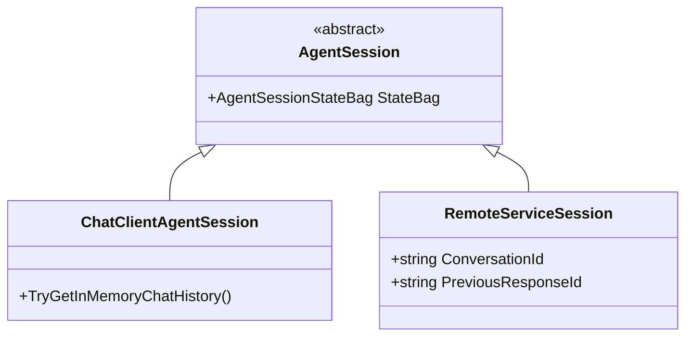
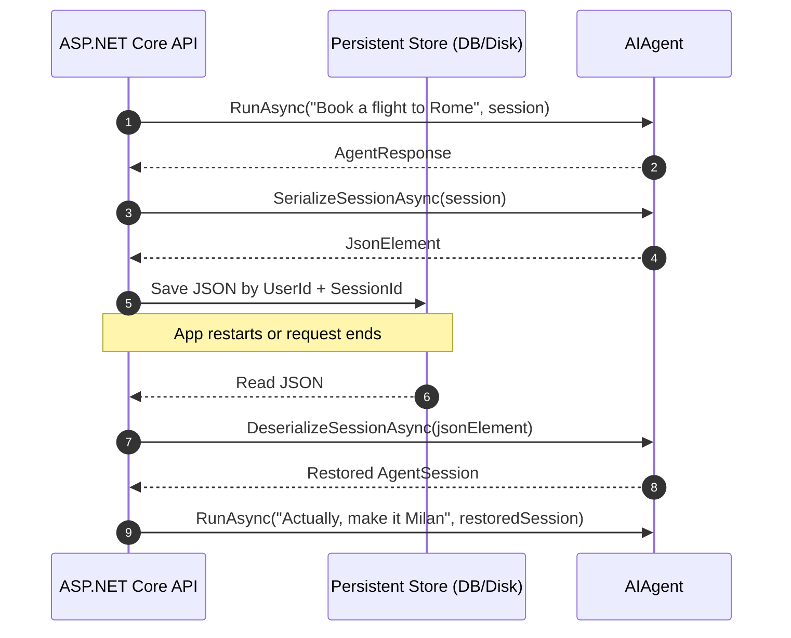

# Module 04 — Conversations and Sessions

> **Time:** ~25 min · **Level:** Intermediate · **Prerequisites:** [Module 02 — Your First Agent](02-first-agent.md)
> **Packages:** `Microsoft.Agents.AI.OpenAI` 1.28.0 (GA)

## Learning objectives
- Explain why legacy "AgentThread" was renamed to `AgentSession` and describe the role of sessions in multi-turn conversations.
- Differentiate between client-side (local) chat history and service-managed (server-side) conversation state.
- Create and resume conversations using `CreateSessionAsync()` and service conversation identifiers.
- Persist conversation state to disk or external stores using `SerializeSessionAsync` and `DeserializeSessionAsync`.
- Store and retrieve arbitrary domain data across turns using the thread-safe `StateBag`.
- Apply concurrency constraints and security boundary rules to protect multi-tenant session data.

---

## Concepts

### The evolution: From "AgentThread" to `AgentSession`
In early AI frameworks (such as Semantic Kernel agents and early experimental MAF previews), multi-turn conversation state was called an `AgentThread`. However, that name caused significant friction for .NET developers because "Thread" is heavily overloaded with operating system threads (`System.Threading.Thread`), thread pools, and concurrency primitives.

In Microsoft Agent Framework 1.28.0, the conversation state container is unified and standardized as **`AgentSession`**:

```csharp
// Modern MAF 1.28.0 syntax:
AgentSession session = await agent.CreateSessionAsync();
AgentResponse response = await agent.RunAsync("Hello!", session);
```

`AgentSession` represents an ongoing dialogue between a user and an agent. It encapsulates:
1. Conversation history (either stored in-memory locally or referenced by service identifiers).
2. The state of attached context providers and middleware.
3. Custom user and domain state stored in `StateBag`.



---

### Local vs. service-managed history
MAF agents support two fundamentally different conversation models depending on the underlying AI provider:

```mermaid
flowchart TD
    subgraph LocalHistory["Client-Managed (Local) History"]
        A1["User Turn"] --> B1["Client accumulates messages in session"]
        B1 --> C1["Client sends entire message array to LLM"]
        C1 --> D1["LLM replies stateless"]
        D1 --> E1["Client stores assistant response in session"]
    end

    subgraph ServiceHistory["Service-Managed (Server) History"]
        A2["User Turn"] --> B2["Client sends only latest user message + conversation_id"]
        B2 --> C2["Provider Server maintains conversation thread"]
        C2 --> D2["Server appends to remote thread and replies"]
        D2 --> E2["Client session updates server ID (e.g. conv_*, resp_*)"]
    end
```



1. **Client-managed (Local) history:**
   - Standard with chat completion models (e.g., OpenAI `ChatClient`, Azure OpenAI Chat Completions, Anthropic, Ollama).
   - The LLM endpoint itself is stateless.
   - On turn 1, the client sends Turn 1.
   - On turn 2, MAF automatically packages Turn 1 (User), Turn 1 (Assistant), and Turn 2 (User) into the request payload.
   - You can inspect this history at any time using `session.TryGetInMemoryChatHistory(out var history)`.

2. **Service-managed (Remote) history:**
   - Used with OpenAI Responses API, OpenAI Assistants/Conversations API, Microsoft Foundry Agents, or Copilot Studio.
   - The provider maintains history on remote servers.
   - The client sends only the new message alongside a server-issued identifier: `conversation_id` or `previous_response_id`.
   - The session object holds the service ID rather than an in-memory list of raw messages.

---

### Resuming existing conversations
When an agent interacts with a service that tracks conversation IDs server-side, you can re-attach to an existing conversation by passing the conversation identifier to `CreateSessionAsync`:

```csharp
// Reconnect to an existing server conversation
AgentSession session = await chatClientAgent.CreateSessionAsync(conversationId);
```

For specialized protocol agents (such as `A2AAgent` in agent-to-agent architectures), you can attach to specific context and task IDs:
```csharp
AgentSession session = await a2aAgent.CreateSessionAsync(contextId, taskId);
```

> [!CAUTION]
> **Service Session ID Scoping and Multi-Tenant Security:**
> Cloud providers (like OpenAI or Azure) scope conversation IDs to the backing API key or Project client. If your backend service uses a single API key to serve multiple users, **never trust a client-supplied conversation ID directly from the frontend**. A malicious user could supply another user's conversation ID to read or hijack their chat history.
>
> Always authenticate the end-user, store service-side conversation IDs in your trusted internal database mapped to verified `UserId` / `TenantId` records, and only restore IDs that belong to the caller.

---

### Session serialization and persistence
In production web apps and microservices, an agent cannot keep in-memory `AgentSession` instances alive forever. Conversations must survive container restarts, deployments, and horizontal scaling.

MAF provides built-in asynchronous serialization:
```csharp
// 1. Serialize session to a System.Text.Json JsonElement
JsonElement serializedSession = await agent.SerializeSessionAsync(session);

// 2. Deserialize session back into an active AgentSession
AgentSession restoredSession = await agent.DeserializeSessionAsync(serializedSession);
```

Because `SerializeSessionAsync` produces a `System.Text.Json.JsonElement`, you can store the JSON directly into PostgreSQL, Azure Cosmos DB, Redis, or disk:



> [!NOTE]
> **Agent-Session Affinity:** Sessions are bound to the agent configuration that produced them. Deserializing a session created with Agent A into Agent B (with different prompts, tools, or providers) can cause deserialization errors or unexpected context corruption.

---

### Session StateBag
Every `AgentSession` includes an `AgentSessionStateBag` accessed via `session.StateBag`. It is a thread-safe dictionary designed to store application-specific domain state that survives serialization.

```csharp
// Storing domain state
session.StateBag.SetValue("UserId", "usr_9981");
session.StateBag.SetValue("Cart", new ShoppingCart { ItemCount = 3 });

// Retrieving domain state
if (session.StateBag.TryGetValue<ShoppingCart>("Cart", out var cart))
{
    Console.WriteLine($"Cart has {cart?.ItemCount} items");
}
```

Key features of `StateBag`:
- **Strongly-typed:** Supports any reference type (`where T : class`).
- **Automatic serialization:** All objects stored in `StateBag` are automatically serialized and restored when calling `SerializeSessionAsync` and `DeserializeSessionAsync`.
- **Decoupled from prompts:** Information in `StateBag` is not automatically sent to the LLM as prompt tokens unless an `AIContextProvider` or tool explicitly reads it.

---

### Concurrency rules
> [!IMPORTANT]
> **No Concurrent Runs on the Same Session:**
> A single `AgentSession` is **NOT thread-safe for concurrent invocations**. Never call `agent.RunAsync(..., session)` or `agent.RunStreamingAsync(..., session)` concurrently on the same session from multiple parallel threads or tasks.
>
> If multiple requests attempt to run against the same session simultaneously, message ordering will be corrupted and tool invocations will collide. Consecutive turns on the same session must be awaited sequentially. If parallel runs are needed, create a separate session for each concurrent thread of execution.

---

## Hands-on

### Example 1 — Multi-turn conversation and inspecting local history

This example demonstrates managing a multi-turn conversation and inspecting client-side message history using `TryGetInMemoryChatHistory`.

#### Setup
```powershell
dotnet new console -n MultiTurnBasics -f net10.0
cd MultiTurnBasics
dotnet add package Microsoft.Agents.AI.OpenAI --version 1.28.0
```

#### Program.cs
```csharp
using Microsoft.Agents.AI;
using Microsoft.Extensions.AI;
using OpenAI;
using OpenAI.Chat;

string apiKey = Environment.GetEnvironmentVariable("OPENAI_API_KEY") ?? "mock-key";
string model = Environment.GetEnvironmentVariable("OPENAI_MODEL") ?? "gpt-5.4-mini";

AIAgent agent = new OpenAIClient(apiKey)
    .GetChatClient(model)
    .AsAIAgent(
        instructions: "You are a concise geography tutor.",
        name: "GeographyTutor");

// 1. Create a new multi-turn conversation session
AgentSession session = await agent.CreateSessionAsync();
Console.WriteLine($"Session created. Session Type: {session.GetType().Name}");

// Note: In an application with an active API key:
// AgentResponse turn1 = await agent.RunAsync("What is the capital of Scotland?", session);
// AgentResponse turn2 = await agent.RunAsync("What is its population?", session);

// 2. Local chat history can be inspected when using local history providers
if (session.TryGetInMemoryChatHistory(out var history))
{
    Console.WriteLine($"Current messages in session history: {history.Count}");
}
else
{
    Console.WriteLine("No in-memory history available yet (history populates after first model call).");
}
```

#### What's happening
- `agent.CreateSessionAsync()` allocates an `AgentSession`. For a `ChatClientAgent`, this initializes an in-memory history provider.
- `session.TryGetInMemoryChatHistory(out var history)` lets you inspect the raw messages (`ChatMessage` items) stored in client memory.

---

### Example 2 — Persisting and restoring sessions across process restarts

This example demonstrates serializing session state to disk as JSON and rehydrating it into an active session.

#### Setup
```powershell
dotnet new console -n SessionPersistence -f net10.0
cd SessionPersistence
dotnet add package Microsoft.Agents.AI.OpenAI --version 1.28.0
```

#### Program.cs
```csharp
using System.Text.Json;
using Microsoft.Agents.AI;
using OpenAI;
using OpenAI.Chat;

string apiKey = Environment.GetEnvironmentVariable("OPENAI_API_KEY") ?? "mock-key";
string model = Environment.GetEnvironmentVariable("OPENAI_MODEL") ?? "gpt-5.4-mini";

AIAgent agent = new OpenAIClient(apiKey)
    .GetChatClient(model)
    .AsAIAgent(
        instructions: "You are an AI research assistant.",
        name: "ResearchAgent");

// 1. Create a session and set some session state
AgentSession originalSession = await agent.CreateSessionAsync();
originalSession.StateBag.SetValue("UserId", "user-12345");
originalSession.StateBag.SetValue("SearchTopic", "Quantum Computing");

// 2. Serialize the session
JsonElement serializedElement = await agent.SerializeSessionAsync(originalSession);
string jsonFilePath = Path.Combine(AppContext.BaseDirectory, "session_state.json");

string jsonText = JsonSerializer.Serialize(serializedElement, new JsonSerializerOptions { WriteIndented = true });
await File.WriteAllTextAsync(jsonFilePath, jsonText);
Console.WriteLine($"Session state saved to {jsonFilePath}");

// 3. Simulate process restart: read from disk and deserialize
string loadedText = await File.ReadAllTextAsync(jsonFilePath);
using JsonDocument doc = JsonDocument.Parse(loadedText);
AgentSession resumedSession = await agent.DeserializeSessionAsync(doc.RootElement);

// 4. Verify state was preserved in StateBag
string? userId = resumedSession.StateBag.GetValue<string>("UserId");
string? topic = resumedSession.StateBag.GetValue<string>("SearchTopic");

Console.WriteLine($"Resumed session successfully! User: {userId}, Topic: {topic}");
```

#### Output
```text
Session state saved to ...\session_state.json
Resumed session successfully! User: user-12345, Topic: Quantum Computing
```

#### What's happening
- `agent.SerializeSessionAsync(originalSession)` gathers the session's internal state, history, and `StateBag` into a `JsonElement`.
- `File.WriteAllTextAsync` persists the JSON representation.
- `agent.DeserializeSessionAsync` reconstructs the concrete `AgentSession`, restoring all `StateBag` values.

---

### Example 3 — Carrying domain models in the session `StateBag`

This example demonstrates how to store strongly typed domain objects inside `StateBag` and verify they survive session serialization.

#### Setup
```powershell
dotnet new console -n StateBagBasics -f net10.0
cd StateBagBasics
dotnet add package Microsoft.Agents.AI.OpenAI --version 1.28.0
```

#### Program.cs
```csharp
using System.Text.Json;
using Microsoft.Agents.AI;
using OpenAI;
using OpenAI.Chat;

string apiKey = Environment.GetEnvironmentVariable("OPENAI_API_KEY") ?? "mock-key";
string model = Environment.GetEnvironmentVariable("OPENAI_MODEL") ?? "gpt-5.4-mini";

AIAgent agent = new OpenAIClient(apiKey)
    .GetChatClient(model)
    .AsAIAgent(
        instructions: "You are a personalized shopping advisor.",
        name: "ShoppingAdvisor");

AgentSession session = await agent.CreateSessionAsync();

// Store a strongly-typed domain model in StateBag
var userPreferences = new UserPreferences
{
    PreferredLanguage = "es-ES",
    Currency = "EUR",
    Interests = ["Electronics", "Smart Home"],
    MaxBudget = 250.00m
};

session.StateBag.SetValue("UserPrefs", userPreferences);

// Retrieve and verify
if (session.StateBag.TryGetValue<UserPreferences>("UserPrefs", out var retrieved))
{
    Console.WriteLine($"Preferences retrieved for session:");
    Console.WriteLine($" - Language: {retrieved?.PreferredLanguage}");
    Console.WriteLine($" - Currency: {retrieved?.Currency}");
    Console.WriteLine($" - Budget: {retrieved?.MaxBudget}");
}

// Serialize and deserialize to ensure custom types in StateBag survive
JsonElement serialized = await agent.SerializeSessionAsync(session);
AgentSession restored = await agent.DeserializeSessionAsync(serialized);

if (restored.StateBag.TryGetValue<UserPreferences>("UserPrefs", out var restoredPrefs))
{
    Console.WriteLine($"StateBag roundtrip verified! Budget: {restoredPrefs?.MaxBudget} {restoredPrefs?.Currency}");
}

public class UserPreferences
{
    public string PreferredLanguage { get; set; } = "en-US";
    public string Currency { get; set; } = "USD";
    public List<string> Interests { get; set; } = [];
    public decimal MaxBudget { get; set; }
}
```

#### Output
```text
Preferences retrieved for session:
 - Language: es-ES
 - Currency: EUR
 - Budget: 250.00
StateBag roundtrip verified! Budget: 250.00 EUR
```

---

## Common pitfalls

- **Running parallel turns on a single session:**
  - *Symptom:* `InvalidOperationException`, duplicated tool executions, or corrupted conversation order.
  - *Cause:* Triggering `agent.RunAsync(..., session)` from multiple `Task.Run` workers concurrently on the same session.
  - *Fix:* Always `await` calls against a session sequentially. Use a semaphore or actor pattern if requests arrive asynchronously for the same user.

- **Mixing sessions between different agents:**
  - *Symptom:* `KeyNotFoundException` or runtime failures during deserialization.
  - *Cause:* Passing a session serialized by an agent with Tool A into an agent configured with Tool B and different middleware.
  - *Fix:* Ensure the receiving agent's type and configuration match the originating agent.

- **Trusting client-provided conversation IDs directly:**
  - *Symptom:* Security vulnerability where user A can access user B's previous conversations.
  - *Cause:* Exposing raw cloud service conversation IDs (e.g., `conv_123`) to browser clients and resuming them without authorization checks.
  - *Fix:* Map service-side conversation IDs to authenticated user identities in your database before calling `CreateSessionAsync(conversationId)`.

- **Expecting in-memory history with service-managed backends:**
  - *Symptom:* `session.TryGetInMemoryChatHistory` returns `false` or an empty list.
  - *Cause:* When using service-managed backends (like Foundry Agents or OpenAI Responses), chat history lives on the remote server, not inside client memory.
  - *Fix:* Query the service's conversation endpoint or rely on MAF's provider-specific history synchronization.

---

## When to use / when not to use

| Approach | When to use | When NOT to use |
|---|---|---|
| **Local In-Memory Session (`AgentSession`)** | Standard web chat apps, console apps, single-tenant services where chat history fits easily in model context. | Scenarios requiring enterprise audit storage or when process restarts must preserve hours of chat history (persist the session instead). |
| **Serialized Session (`SerializeSessionAsync`)** | Saving conversation state to PostgreSQL, Redis, Cosmos DB, or disk between HTTP requests or background jobs. | Real-time streaming within a single, continuous in-memory process turn. |
| **Service-Managed History (`CreateSessionAsync(convId)`)** | Using OpenAI Responses, Assistants, or Foundry hosted agents where conversation state is stored and indexed in the cloud. | Purely local or offline models (Ollama, local SLMs) where client-side history is required. |
| **Session `StateBag`** | Attaching domain models (user IDs, cart contents, preferences) to the conversation lifecycle without bloating prompt tokens. | Heavy binary assets (images, video files) that should instead be stored in blob storage with references in `StateBag`. |

---

## Exercises

1. **Multi-Turn Booking Concierge:**
   Create an agent named `BookingConcierge`. Create a session, attach an initial `BookingDetails` object (`City = "Rome"`, `Nights = 3`, `Guests = 2`) in `session.StateBag`, and verify that the session object properly maintains this state.

2. **File-Backed Session Repository:**
   Implement a `JsonFileSessionStore` class with two methods:
   - `Task SaveSessionAsync(AIAgent agent, AgentSession session, string conversationId)`
   - `Task<AgentSession> LoadSessionAsync(AIAgent agent, string conversationId)`
   Verify that saving and re-loading a session through this store restores all `StateBag` values.

3. **User Preferences Tracking:**
   Create an `AgentSession`, populate `session.StateBag` with a `UserLocalePreferences` record (`Language = "French"`, `Currency = "EUR"`), serialize the session, deserialize it, and assert that the restored session still contains the exact locale configuration.

---

## Summary
- In MAF 1.28.0, conversation state is represented by `AgentSession` (replacing legacy `AgentThread`).
- Client-managed history stores messages in client memory and sends the accumulated history on every turn; service-managed history delegates state storage to the cloud provider.
- Sessions are serialized to `JsonElement` via `agent.SerializeSessionAsync(session)` and restored with `agent.DeserializeSessionAsync(jsonElement)`.
- `session.StateBag` provides a thread-safe, strongly typed domain state repository that automatically roundtrips with session serialization.
- A single `AgentSession` must **never** be invoked concurrently.

---

## Further reading
- [Sessions in Agent Framework (Learn)](https://learn.microsoft.com/agent-framework/concepts/agents/conversations/session)
- [Conversation Storage (Learn)](https://learn.microsoft.com/agent-framework/concepts/agents/conversations/storage)
- [Official Sample: Persisted Conversations](https://github.com/microsoft/agent-framework/tree/main/dotnet/samples/02-agents/Agents/Agent_Step03_PersistedConversations)
- [Official Sample: 3rd Party Chat History Storage](https://github.com/microsoft/agent-framework/tree/main/dotnet/samples/02-agents/Agents/Agent_Step04_3rdPartyChatHistoryStorage)

---

## Solutions

### Complete verified solutions (Exercises 1, 2, and 3)

```csharp
using System.Text.Json;
using Microsoft.Agents.AI;
using OpenAI;
using OpenAI.Chat;

string apiKey = Environment.GetEnvironmentVariable("OPENAI_API_KEY") ?? "mock-key";
string model = Environment.GetEnvironmentVariable("OPENAI_MODEL") ?? "gpt-5.4-mini";

var openAIClient = new OpenAIClient(apiKey);
var chatClient = openAIClient.GetChatClient(model);

// === SOLUTION 1: Multi-Turn Booking Session ===
AIAgent bookingAgent = chatClient.AsAIAgent(
    instructions: "You are a hotel booking concierge. Maintain details: city, nights, and guests.",
    name: "BookingConcierge");

AgentSession bookingSession = await bookingAgent.CreateSessionAsync();

// Store initial intent in StateBag
bookingSession.StateBag.SetValue("BookingIntent", new BookingDetails
{
    City = "Rome",
    Nights = 3,
    Guests = 2
});

Console.WriteLine("Booking session initialized.");

// === SOLUTION 2: File-Backed Session Store ===
var sessionStore = new JsonFileSessionStore(AppContext.BaseDirectory);
string sessionId = "session_user_42";

// Save session
await sessionStore.SaveSessionAsync(bookingAgent, bookingSession, sessionId);

// Restore session
AgentSession restoredBookingSession = await sessionStore.LoadSessionAsync(bookingAgent, sessionId);
Console.WriteLine($"Restored session from file store. Has StateBag items: {restoredBookingSession.StateBag.Count > 0}");

// === SOLUTION 3: StateBag User Preferences Tracker ===
AgentSession prefsSession = await bookingAgent.CreateSessionAsync();
prefsSession.StateBag.SetValue("UserPrefs", new UserLocalePreferences { Language = "French", Currency = "EUR" });

if (prefsSession.StateBag.TryGetValue<UserLocalePreferences>("UserPrefs", out var prefs) && prefs is not null)
{
    Console.WriteLine($"Session configured with User Language: {prefs.Language}, Currency: {prefs.Currency}");
}

// === Domain Types & Helper Classes ===

public class BookingDetails
{
    public string City { get; set; } = string.Empty;
    public int Nights { get; set; }
    public int Guests { get; set; }
}

public class UserLocalePreferences
{
    public string Language { get; set; } = "French";
    public string Currency { get; set; } = "EUR";
}

public class JsonFileSessionStore
{
    private readonly string _storageDir;

    public JsonFileSessionStore(string storageDir)
    {
        _storageDir = storageDir;
        Directory.CreateDirectory(_storageDir);
    }

    public async Task SaveSessionAsync(AIAgent agent, AgentSession session, string conversationId)
    {
        string filePath = Path.Combine(_storageDir, $"{conversationId}.json");
        JsonElement serialized = await agent.SerializeSessionAsync(session);
        string json = JsonSerializer.Serialize(serialized, new JsonSerializerOptions { WriteIndented = true });
        await File.WriteAllTextAsync(filePath, json);
    }

    public async Task<AgentSession> LoadSessionAsync(AIAgent agent, string conversationId)
    {
        string filePath = Path.Combine(_storageDir, $"{conversationId}.json");
        if (!File.Exists(filePath))
        {
            throw new FileNotFoundException($"Session file not found for conversation {conversationId}");
        }

        string json = await File.ReadAllTextAsync(filePath);
        using JsonDocument doc = JsonDocument.Parse(json);
        return await agent.DeserializeSessionAsync(doc.RootElement);
    }
}
```
