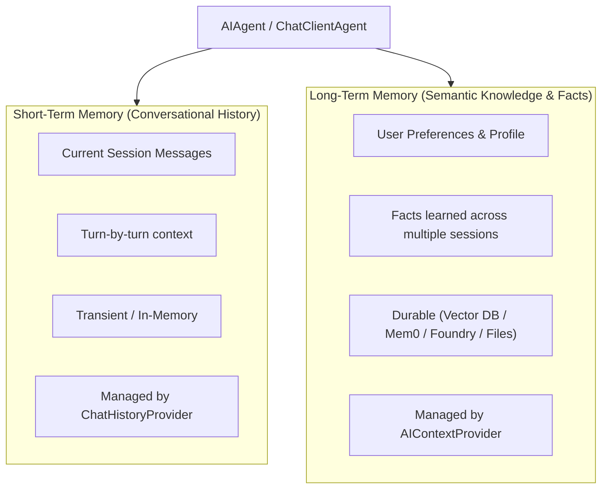
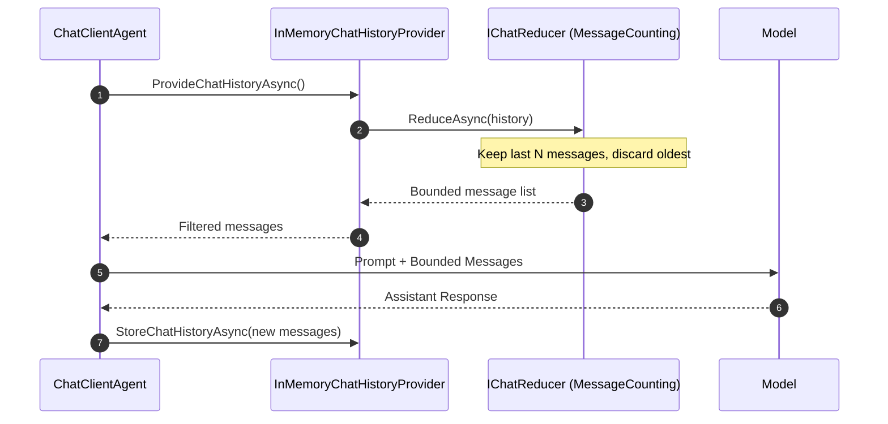
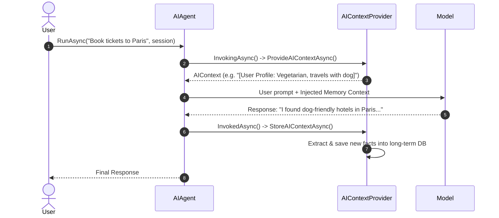

# Module 05 — Memory

> **Time:** ~30 min · **Level:** Intermediate · **Prerequisites:** [Module 04 — Conversations and Sessions](04-conversations-and-threads.md)
> **Packages:** `Microsoft.Agents.AI.OpenAI` 1.28.0 (GA), `Microsoft.Agents.AI.Mem0` 1.0.0-preview.251028.1 (Preview)

## Learning objectives
- Differentiate between short-term conversational history and long-term semantic memory.
- Configure bounded chat history with `InMemoryChatHistoryProvider` and `MessageCountingChatReducer` to keep conversations within model token limits.
- Implement custom `AIContextProvider` classes to inject dynamic facts and extract long-term state across sessions.
- Configure `ChatHistoryMemoryProvider` with vector stores (such as `Microsoft.Extensions.VectorData`) for semantic memory recall.
- Evaluate enterprise memory options including Mem0, Microsoft Foundry Memory, Cosmos DB, Valkey, and `FileMemoryProvider`.
- Apply tenant and user scoping to prevent cross-tenant memory leakage and mitigate indirect prompt injection risks.

---

## Concepts

### The memory spectrum: Short-term vs. long-term
AI agents require two fundamentally distinct categories of memory to operate effectively:



1. **Short-Term Memory (Chat History):**
   - Retains the immediate sequence of user and assistant messages for the current conversation.
   - Preserves local dialogue flow within an `AgentSession`.
   - Constrained by the model's context window. As the dialogue grows, older messages must be truncated, summarized, or compacted.

2. **Long-Term Memory (Semantic & Episodic Memory):**
   - Endures across completely independent sessions, restarts, and days.
   - Stores learned preferences (e.g., "User prefers C# over Python", "User travels with a dog").
   - Retrieved on demand using semantic vector search or key-value lookups when a new conversation begins.

---

### Short-term memory: `ChatHistoryProvider` and bounded history
In MAF, short-term history is managed by `ChatHistoryProvider`. When you create a `ChatClientAgent`, it defaults to using `InMemoryChatHistoryProvider`, which stores chat messages inside the `AgentSession`.



#### Chat reduction and compaction
If left unbounded, long conversations will eventually exceed the model's context token limit or incur excessive token costs. MAF integrates with `Microsoft.Extensions.AI.IChatReducer` to trim conversation history before it is sent to the model:

- `MessageCountingChatReducer(targetCount)`: Preserves the original system prompt while retaining only the last *N* messages.
- Custom `IChatReducer`: Enables custom sliding-window algorithms or summarization policies.

> [!NOTE]
> **Experimental API (MEAI001):**
> `MessageCountingChatReducer` and `IChatReducer` are marked with `[Experimental]` in `Microsoft.Extensions.AI`. Suppress the warning with `#pragma warning disable MEAI001` when using chat reducers.

---

### Long-term memory: The `AIContextProvider` model
MAF introduces `AIContextProvider` as the core abstraction for injecting external context and long-term knowledge into agent invocations.

An `AIContextProvider` participates in a two-phase invocation lifecycle:
1. **`ProvideAIContextAsync(InvokingContext context)` (Invoking phase):**
   Called *before* the model runs. The provider can fetch relevant user notes, search a knowledge base, or look up vector embeddings, returning an `AIContext` with additional instructions, messages, or tools.
2. **`StoreAIContextAsync(InvokedContext context)` (Invoked phase):**
   Called *after* the model finishes. The provider inspects the user query and the model's response to extract new facts or update long-term storage.



> [!WARNING]
> **Security & Indirect Prompt Injection:**
> Context providers inject messages directly into the prompt with high authority. If memories are retrieved from external databases or untrusted inputs, malicious content stored in memory could manipulate the agent via indirect prompt injection (ADR 0024). Always validate and sanitize memory sources before injecting them into the agent's context.

---

### Enterprise memory providers

| Provider | Package | Status | Storage Mechanism | Best Use Case |
|---|---|---|---|---|
| **`ChatHistoryMemoryProvider`** | `Microsoft.Agents.AI` | GA | `VectorStore` (`Microsoft.Extensions.VectorData`) | Vector-based semantic search over past conversation exchanges. |
| **`Mem0Provider`** | `Microsoft.Agents.AI.Mem0` | **Preview** | Mem0 Cloud / Self-hosted Mem0 service | Managed semantic memory extraction and user profiling. |
| **`FoundryMemoryProvider`** | `Microsoft.Agents.AI.Foundry` | **Preview** | Microsoft Azure AI Foundry Memory Store | Native enterprise Azure memory extraction and indexing. |
| **`FileMemoryProvider`** | `Microsoft.Agents.AI` | **Experimental (MAAI001)** | `AgentFileStore` (local filesystem or blob) | Agent-driven file-based scratchpad memory (`file_memory_write`, `read`). |
| **Cosmos DB / Valkey** | Custom `ChatHistoryProvider` | Custom | NoSQL documents / Redis-compatible cache | High-throughput distributed session and history persistence. |

#### Semantic memory with `ChatHistoryMemoryProvider`
`ChatHistoryMemoryProvider` stores conversation turns in a vector store (such as `InMemoryVectorStore`, Qdrant, or Azure Cosmos DB Vector Search). On subsequent conversations, it embeds the incoming user query, searches the vector database for semantically similar past turns, and injects them into the prompt.

Scopes are configured per session:
- `storageScope`: Sets the partition key under which messages are saved (e.g., `UserId = "usr_1"`, `SessionId = "sess_10"`).
- `searchScope`: Defines the boundaries for memory recall (e.g., searching across all sessions belonging to `UserId = "usr_1"`).

---

## Hands-on

### Example 1 — Bounding chat history with `MessageCountingChatReducer`

This example demonstrates how to configure an `InMemoryChatHistoryProvider` with a reducer that retains only the 4 most recent messages.

#### Setup
```powershell
dotnet new console -n BoundedChatHistory -f net10.0
cd BoundedChatHistory
dotnet add package Microsoft.Agents.AI.OpenAI --version 1.28.0
```

#### Program.cs
```csharp
#pragma warning disable MEAI001 // MessageCountingChatReducer is experimental in Microsoft.Extensions.AI

using Microsoft.Agents.AI;
using Microsoft.Extensions.AI;
using OpenAI;
using OpenAI.Chat;

string apiKey = Environment.GetEnvironmentVariable("OPENAI_API_KEY") ?? "mock-key";
string model = Environment.GetEnvironmentVariable("OPENAI_MODEL") ?? "gpt-5.4-mini";

// Configure agent with an InMemoryChatHistoryProvider that bounds history to 4 messages
AIAgent agent = new OpenAIClient(apiKey)
    .GetChatClient(model)
    .AsAIAgent(new ChatClientAgentOptions
    {
        ChatOptions = new() { Instructions = "You are a concise trivia assistant." },
        Name = "TriviaBot",
        ChatHistoryProvider = new InMemoryChatHistoryProvider(new InMemoryChatHistoryProviderOptions
        {
            ChatReducer = new MessageCountingChatReducer(4)
        })
    });

AgentSession session = await agent.CreateSessionAsync();
Console.WriteLine($"Agent {agent.Name} initialized with bounded in-memory chat history provider.");
```

#### What's happening
- `InMemoryChatHistoryProviderOptions` accepts an `IChatReducer`.
- `MessageCountingChatReducer(4)` ensures that when `ProvideChatHistoryAsync` is invoked, only the latest 4 conversational messages (plus system instructions) are forwarded to the LLM, protecting against context-window exhaustion.

---

### Example 2 — Custom `AIContextProvider` for user profile injection

This example demonstrates creating a custom `AIContextProvider` that loads user profile information and injects it into every turn.

#### Setup
```powershell
dotnet new console -n CustomContextProvider -f net10.0
cd CustomContextProvider
dotnet add package Microsoft.Agents.AI.OpenAI --version 1.28.0
```

#### Program.cs
```csharp
using Microsoft.Agents.AI;
using Microsoft.Extensions.AI;
using OpenAI;
using OpenAI.Chat;
using ChatMessage = Microsoft.Extensions.AI.ChatMessage;

string apiKey = Environment.GetEnvironmentVariable("OPENAI_API_KEY") ?? "mock-key";
string model = Environment.GetEnvironmentVariable("OPENAI_MODEL") ?? "gpt-5.4-mini";

// Create user profile store
var profileStore = new Dictionary<string, string>
{
    ["user-42"] = "Prefers technical explanations with code snippets. Works in C# / .NET 10."
};

var provider = new UserProfileAIContextProvider("user-42", profileStore);

AIAgent agent = new OpenAIClient(apiKey)
    .GetChatClient(model)
    .AsAIAgent(new ChatClientAgentOptions
    {
        ChatOptions = new() { Instructions = "You are a software engineering mentor." },
        Name = "EngineeringMentor",
        AIContextProviders = [provider]
    });

AgentSession session = await agent.CreateSessionAsync();
Console.WriteLine($"Agent {agent.Name} configured with {nameof(UserProfileAIContextProvider)}.");

public class UserProfileAIContextProvider(string userId, Dictionary<string, string> profiles) : AIContextProvider
{
    protected override ValueTask<AIContext> ProvideAIContextAsync(InvokingContext context, CancellationToken cancellationToken = default)
    {
        if (profiles.TryGetValue(userId, out var profileText))
        {
            return new ValueTask<AIContext>(new AIContext
            {
                Messages = [new ChatMessage(ChatRole.User, $"[User Profile Context: {profileText}]")]
            });
        }

        return new ValueTask<AIContext>(new AIContext());
    }
}
```

#### What's happening
- `UserProfileAIContextProvider` inherits from `AIContextProvider`.
- When the agent runs, MAF calls `ProvideAIContextAsync`.
- The provider looks up the user profile and injects a contextual message into the active invocation.

---

### Example 3 — Semantic long-term memory with `ChatHistoryMemoryProvider` and vector stores

This example demonstrates configuring long-term cross-session memory using `ChatHistoryMemoryProvider` backed by an in-memory vector store.

#### Setup
```powershell
dotnet new console -n VectorMemory -f net10.0
cd VectorMemory
dotnet add package Microsoft.Agents.AI.OpenAI --version 1.28.0
dotnet add package Microsoft.Extensions.AI.OpenAI --version 10.11.0
dotnet add package CommunityToolkit.VectorData.InMemory --version 1.0.1
```

#### Program.cs
```csharp
using CommunityToolkit.VectorData.InMemory;
using Microsoft.Agents.AI;
using Microsoft.Extensions.AI;
using Microsoft.Extensions.VectorData;
using OpenAI;
using OpenAI.Chat;
using OpenAI.Embeddings;

string apiKey = Environment.GetEnvironmentVariable("OPENAI_API_KEY") ?? "mock-key";
string model = Environment.GetEnvironmentVariable("OPENAI_MODEL") ?? "gpt-5.4-mini";
string embeddingModel = Environment.GetEnvironmentVariable("OPENAI_EMBEDDING_MODEL") ?? "text-embedding-3-small";

var openAIClient = new OpenAIClient(apiKey);

// 1. Create vector store with embedding generator
VectorStore vectorStore = new InMemoryVectorStore(new InMemoryVectorStoreOptions
{
    EmbeddingGenerator = openAIClient.GetEmbeddingClient(embeddingModel).AsIEmbeddingGenerator()
});

// 2. Configure ChatHistoryMemoryProvider
string currentUserId = "user-101";
var memoryProvider = new ChatHistoryMemoryProvider(
    vectorStore,
    collectionName: "user_chat_memories",
    vectorDimensions: 1536,
    stateInitializer: session => new ChatHistoryMemoryProvider.State(
        storageScope: new() { UserId = currentUserId, SessionId = Guid.NewGuid().ToString() },
        searchScope: new() { UserId = currentUserId }));

// 3. Attach provider to AIAgent
AIAgent agent = openAIClient.GetChatClient(model).AsAIAgent(new ChatClientAgentOptions
{
    ChatOptions = new() { Instructions = "You are a personalized assistant with long-term memory across sessions." },
    Name = "MemoryEnabledAssistant",
    AIContextProviders = [memoryProvider]
});

AgentSession session = await agent.CreateSessionAsync();
Console.WriteLine($"Agent {agent.Name} initialized with semantic ChatHistoryMemoryProvider.");
```

#### What's happening
- `InMemoryVectorStore` uses an `IEmbeddingGenerator` from `Microsoft.Extensions.AI.OpenAI` to compute vector embeddings for chat messages.
- `ChatHistoryMemoryProvider` stores every message turn under `UserId = "user-101"` and `SessionId`.
- The `searchScope` is configured with `UserId = "user-101"`. When the user starts a completely new session tomorrow, the agent searches past conversations for this user and recalls relevant memories.

---

## Common pitfalls

- **Ambiguous ChatMessage type reference:**
  - *Symptom:* `error CS0104: 'ChatMessage' is an ambiguous reference between 'Microsoft.Extensions.AI.ChatMessage' and 'OpenAI.Chat.ChatMessage'`.
  - *Cause:* Both `using Microsoft.Extensions.AI;` and `using OpenAI.Chat;` define a `ChatMessage` class.
  - *Fix:* Explicitly alias the MAF message type: `using ChatMessage = Microsoft.Extensions.AI.ChatMessage;`.

- **Confusing short-term chat history with long-term memory:**
  - *Symptom:* An agent cannot recall facts told to it in a previous session, even though "history is enabled".
  - *Cause:* `InMemoryChatHistoryProvider` only preserves history within a single `AgentSession`. Once a new session is created, previous history is absent.
  - *Fix:* Use `ChatHistoryMemoryProvider`, `Mem0Provider`, or a custom `AIContextProvider` for cross-session durability.

- **Missing tenant isolation in vector search scopes:**
  - *Symptom:* Tenant A's agent recalls confidential facts or chat messages from Tenant B.
  - *Cause:* Storing vector embeddings in a shared collection without prefixing or partitioning by `TenantId`.
  - *Fix:* Always include the tenant identifier in `storageScope` and `searchScope` (e.g. `UserId = $"{tenantId}:{userId}"`) or use separate vector collections per tenant.

- **Asynchronous memory indexing latency:**
  - *Symptom:* Querying the agent immediately after telling it a fact in the same session does not retrieve the newly stored memory.
  - *Cause:* Cloud memory services (such as Microsoft Foundry Memory or Mem0) perform LLM memory extraction asynchronously in the background.
  - *Fix:* For immediate recall within the active turn, rely on short-term chat history; wait for updates to index before querying cross-session memory (e.g., awaiting `WhenUpdatesCompletedAsync()` in Foundry).

---

## When to use / when not to use

| Memory Component | When to use | When NOT to use |
|---|---|---|
| **`InMemoryChatHistoryProvider`** | Standard single-session chat dialogues. | Durability across process restarts or memory recall across distinct conversations. |
| **`MessageCountingChatReducer`** | Long-running conversational sessions where older messages must be truncated to prevent token limit crashes. | Regulated domains where every turn must be retained for auditing (persist to DB instead). |
| **Custom `AIContextProvider`** | Injecting deterministic database records, user profiles, or CRM data into every invocation. | Unstructured natural language chat recall (use vector stores instead). |
| **`ChatHistoryMemoryProvider` (VectorStore)** | Searching prior conversation turns semantically across sessions without managed third-party services. | Low-resource applications where running an embedding model on every turn is too costly. |
| **`Mem0Provider` *(preview)* / `FoundryMemoryProvider` *(preview)*** | Cloud-managed automatic extraction of user preferences, facts, and relationships. | Fully offline or air-gapped environments without cloud access. |
| **`FileMemoryProvider` *(experimental)*** | Agents executing research or code synthesis that benefit from creating, reading, and editing workspace files. | High-concurrency microservices requiring sub-50ms turn latency. |

---

## Exercises

1. **Sliding-Window Chat Reducer:**
   Implement a custom `IChatReducer` named `SlidingWindowChatReducer(int maxNonSystemMessages)` that preserves all `ChatRole.System` messages while keeping only the latest *N* non-system messages. Attach it to an agent via `InMemoryChatHistoryProvider`.

2. **User Notes AIContextProvider:**
   Implement an `AIContextProvider` named `UserNotesAIContextProvider` that takes a `userName` and an in-memory dictionary of notes. In `ProvideAIContextAsync`, inject the user's notes into the invocation context as a user message.

3. **Multi-Tenant Memory Scoping:**
   Configure a `ChatHistoryMemoryProvider` where the `UserId` partition key is composed of `{tenantId}:{userId}` and the vector collection name is isolated per tenant (`$"memories_{tenantId}"`). Ensure that sessions belonging to different tenants cannot query each other's memories.

---

## Summary
- Short-term memory (`ChatHistoryProvider`) maintains turn-by-turn dialogue within a session; long-term memory (`AIContextProvider`) preserves facts across sessions.
- `MessageCountingChatReducer` prevents context-window exhaustion by discarding older non-system messages.
- `AIContextProvider` exposes a two-phase lifecycle (`ProvideAIContextAsync` before model execution, `StoreAIContextAsync` after model execution).
- `ChatHistoryMemoryProvider` integrates with `Microsoft.Extensions.VectorData` to enable semantic memory search across historical conversations.
- Managed providers (Mem0, Foundry Memory) automate fact extraction in cloud environments.
- Always scope storage and search keys by `TenantId` and `UserId` to maintain multi-tenant data isolation.

---

## Further reading
- [Adding Context Providers (Learn)](https://learn.microsoft.com/agent-framework/journey/adding-context-providers)
- [Chat History Memory Provider (Learn)](https://learn.microsoft.com/agent-framework/concepts/agents/conversations/chat-history-memory-provider)
- [Conversation Compaction (Learn)](https://learn.microsoft.com/agent-framework/concepts/agents/conversations/compaction)
- [Official Sample: Chat History Memory](https://github.com/microsoft/agent-framework/tree/main/dotnet/samples/02-agents/AgentWithMemory/AgentWithMemory_Step01_ChatHistoryMemory)
- [Official Sample: Bounded Chat History](https://github.com/microsoft/agent-framework/tree/main/dotnet/samples/02-agents/AgentWithMemory/AgentWithMemory_Step05_BoundedChatHistory)
- [Official Sample: Mem0 Memory Provider](https://github.com/microsoft/agent-framework/tree/main/dotnet/samples/02-agents/AgentWithMemory/AgentWithMemory_Step02_MemoryUsingMem0)
- [Official Sample: Foundry Memory Provider](https://github.com/microsoft/agent-framework/tree/main/dotnet/samples/02-agents/AgentWithMemory/AgentWithMemory_Step04_MemoryUsingFoundry)
- [Official Sample: File Memory Provider](https://github.com/microsoft/agent-framework/tree/main/dotnet/samples/02-agents/AgentWithMemory/AgentWithMemory_Step07_FileMemoryProvider)

---

## Solutions

### Complete verified solutions (Exercises 1, 2, and 3)

```csharp
#pragma warning disable MEAI001 // MessageCountingChatReducer and IChatReducer are experimental in Microsoft.Extensions.AI

using CommunityToolkit.VectorData.InMemory;
using Microsoft.Agents.AI;
using Microsoft.Extensions.AI;
using Microsoft.Extensions.VectorData;
using OpenAI;
using OpenAI.Chat;
using OpenAI.Embeddings;
using ChatMessage = Microsoft.Extensions.AI.ChatMessage;

string apiKey = Environment.GetEnvironmentVariable("OPENAI_API_KEY") ?? "mock-key";
string model = Environment.GetEnvironmentVariable("OPENAI_MODEL") ?? "gpt-5.4-mini";
var openAIClient = new OpenAIClient(apiKey);
var chatClient = openAIClient.GetChatClient(model);

// === SOLUTION 1: Custom Sliding-Window IChatReducer ===
var customReducer = new SlidingWindowChatReducer(maxNonSystemMessages: 4);
AIAgent boundedAgent = chatClient.AsAIAgent(new ChatClientAgentOptions
{
    ChatOptions = new() { Instructions = "You are a concise chatbot with bounded history." },
    Name = "BoundedAgent",
    ChatHistoryProvider = new InMemoryChatHistoryProvider(new InMemoryChatHistoryProviderOptions
    {
        ChatReducer = customReducer
    })
});

Console.WriteLine("Solution 1 verified: Bounded agent configured.");

// === SOLUTION 2: Custom Notes AIContextProvider ===
var notesDb = new Dictionary<string, string>
{
    ["Alice"] = "Prefers Python and TypeScript for scripting, C# for enterprise backends."
};

var notesProvider = new UserNotesAIContextProvider("Alice", notesDb);
AIAgent notesAgent = chatClient.AsAIAgent(new ChatClientAgentOptions
{
    ChatOptions = new() { Instructions = "You are an intelligent dev assistant." },
    Name = "NotesAssistant",
    AIContextProviders = [notesProvider]
});

Console.WriteLine("Solution 2 verified: UserNotesAIContextProvider configured.");

// === SOLUTION 3: Multi-Tenant Scoped ChatHistoryMemoryProvider ===
VectorStore vectorStore = new InMemoryVectorStore(new InMemoryVectorStoreOptions
{
    EmbeddingGenerator = openAIClient.GetEmbeddingClient("text-embedding-3-small").AsIEmbeddingGenerator()
});

string tenantId = "tenant-contoso";
string userId = "user-99";

var multiTenantMemory = new ChatHistoryMemoryProvider(
    vectorStore,
    collectionName: $"memories_{tenantId}", // Tenant-isolated collection or compound scope key
    vectorDimensions: 1536,
    stateInitializer: session => new ChatHistoryMemoryProvider.State(
        storageScope: new() { UserId = $"{tenantId}:{userId}", SessionId = Guid.NewGuid().ToString() },
        searchScope: new() { UserId = $"{tenantId}:{userId}" }));

AIAgent multiTenantAgent = chatClient.AsAIAgent(new ChatClientAgentOptions
{
    ChatOptions = new() { Instructions = "Tenant-isolated assistant." },
    Name = "TenantAgent",
    AIContextProviders = [multiTenantMemory]
});

Console.WriteLine("Solution 3 verified: Multi-tenant memory configured.");

// === Helper Classes & Implementations ===

public class SlidingWindowChatReducer(int maxNonSystemMessages) : IChatReducer
{
    public Task<IEnumerable<ChatMessage>> ReduceAsync(IEnumerable<ChatMessage> messages, CancellationToken cancellationToken = default)
    {
        var messageList = messages.ToList();
        var systemMessages = messageList.Where(m => m.Role == ChatRole.System).ToList();
        var nonSystemMessages = messageList.Where(m => m.Role != ChatRole.System).ToList();

        if (nonSystemMessages.Count <= maxNonSystemMessages)
        {
            return Task.FromResult<IEnumerable<ChatMessage>>(messageList);
        }

        var retainedNonSystem = nonSystemMessages.TakeLast(maxNonSystemMessages);
        var result = systemMessages.Concat(retainedNonSystem).ToList();
        return Task.FromResult<IEnumerable<ChatMessage>>(result);
    }
}

public class UserNotesAIContextProvider(string userName, Dictionary<string, string> store) : AIContextProvider
{
    protected override ValueTask<AIContext> ProvideAIContextAsync(InvokingContext context, CancellationToken cancellationToken = default)
    {
        if (store.TryGetValue(userName, out var note))
        {
            return new ValueTask<AIContext>(new AIContext
            {
                Messages = [new ChatMessage(ChatRole.User, $"[User Notes: {note}]")]
            });
        }

        return new ValueTask<AIContext>(new AIContext());
    }
}
```
