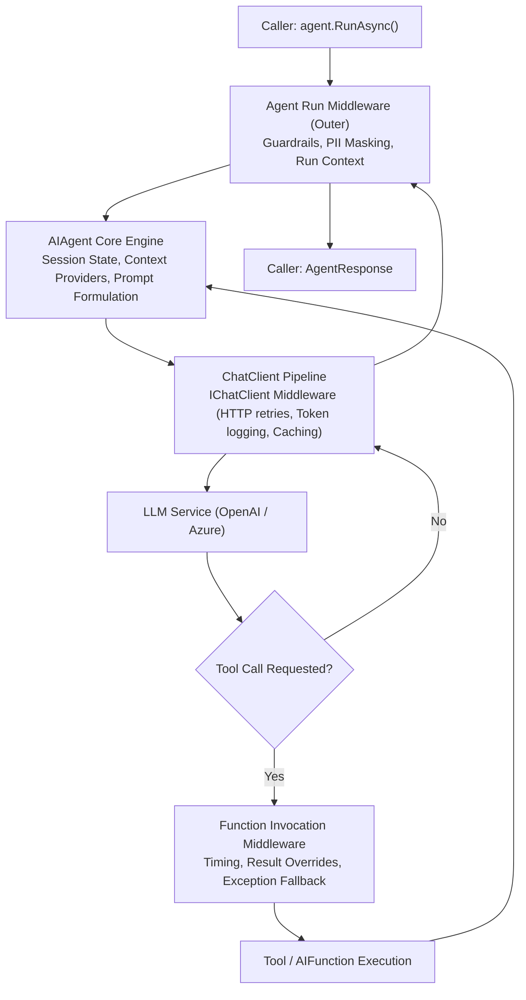
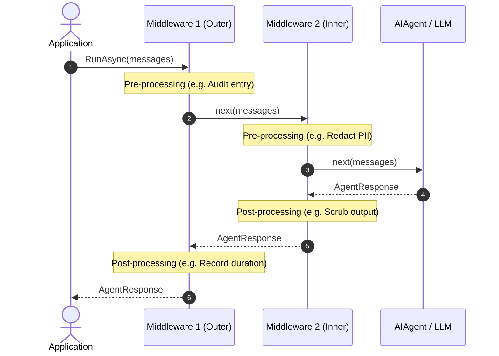

# Module 06 — Middleware

> **Time:** ~35 min · **Level:** Intermediate · **Prerequisites:** [Module 02](02-first-agent.md), [Module 03](03-tools.md)
> **Packages:** `Microsoft.Agents.AI` 1.28.0 (GA), `Microsoft.Agents.AI.OpenAI` 1.28.0 (GA), `Microsoft.Extensions.AI` 10.11.0 (GA), `OpenAI` 2.15.0 (GA)

## Learning objectives
- Explain the multi-layered middleware architecture in MAF across agent run, function invocation, and chat client levels.
- Implement agent run middleware to inspect, redact, or short-circuit requests using `AsBuilder().Use(...)`.
- Intercept tool calls using function invocation middleware to log metrics, override return values, and handle exceptions.
- Configure lower-level `IChatClient` middleware using `ChatClientBuilder` and access ambient run metadata via `AIAgent.CurrentRunContext`.
- Build custom reusable agent decorators by deriving from `DelegatingAIAgent`.
- Differentiate between agent-scoped and per-run scoped middleware pipelines.

---

## Concepts

In production agent applications, cross-cutting concerns—such as safety guardrails, PII redaction, audit logging, rate limiting, and result overrides—must not clutter business logic or prompt instructions. The Microsoft Agent Framework provides an extensible middleware pipeline modeled after the classic ASP.NET Core Russian doll (or onion) design pattern.

### The Three Middleware Layers

MAF separates interception into three distinct tiers:



1. **Agent Run Middleware (`AIAgent` level):**
   Intercepts calls to `agent.RunAsync` and `agent.RunStreamingAsync`. This layer sees incoming `ChatMessage` collections, the `AgentSession`, and `AgentRunOptions`. It can short-circuit execution (returning a synthetic `AgentResponse` immediately without calling the LLM), redact inputs, or post-process final agent messages.
2. **Function Invocation Middleware (Tool level):**
   Intercepts each individual `AIFunction` invocation during the agent's tool execution loop. It inspects `FunctionInvocationContext` (function name, arguments), can measure execution time, catch tool errors, or substitute synthetic results.
3. **Chat Client Middleware (`IChatClient` level):**
   Operates beneath the agent engine at the raw model transport boundary from `Microsoft.Extensions.AI`. It inspects low-level `ChatOptions`, tracks raw prompt/completion tokens, handles HTTP-level retries, or talks to model proxies.

### Key Types Table

| Type / Member | Layer | Purpose |
|---|---|---|
| `AIAgentBuilder` | Agent Run | Fluent builder returned by `agent.AsBuilder()` to assemble agent pipeline stages. |
| `AIAgentBuilder.Use(runFunc, runStreamingFunc)` | Agent Run | Adds an anonymous delegating agent with separate non-streaming and streaming delegates. |
| `AIAgentBuilder.Use(sharedFunc)` | Agent Run | Adds an anonymous delegating agent using a unified delegate for both execution modes. |
| `DelegatingAIAgent` | Agent Run | Abstract base class implementing the decorator pattern for `AIAgent`. |
| `FunctionInvocationContext` | Tool | Provides metadata about the pending tool execution (`Function`, `Arguments`). |
| `AIAgentBuilder.Use(callback)` | Tool | Extension method registering function invocation middleware on agents backed by a `FunctionInvokingChatClient`. |
| `ChatClientBuilder` | Chat Client | Fluent builder returned by `chatClient.AsBuilder()` to compose `IChatClient` delegating decorators. |
| `AIAgent.CurrentRunContext` | Ambient | `AsyncLocal<AgentRunContext?>` flowing active agent, session, request messages, and options across the entire call chain. |

### Pipeline Ordering and Execution Semantics

When you register middleware using `AIAgentBuilder.Use`, components execute in the order they are added during request entry, and in reverse order during response return:



### Ambient Context: `AIAgent.CurrentRunContext`

When `RunAsync` executes, MAF sets `AIAgent.CurrentRunContext`. Because this property is stored in an `AsyncLocal`, lower-level components—including deep `IChatClient` middleware and custom tools—can inspect:
- `CurrentRunContext.Agent`: The running `AIAgent` instance (its `Id`, `Name`, and metadata).
- `CurrentRunContext.Session`: The active `AgentSession?` and its `StateBag`.
- `CurrentRunContext.RequestMessages`: The original message collection supplied to the run.
- `CurrentRunContext.Options`: The current `AgentRunOptions?`.

### Agent Scope vs. Run Scope

Middleware can be established at two scopes:
1. **Agent Scope (Global):** Configured on the agent pipeline once via `agent.AsBuilder().Use(...).Build()`. Every call to `RunAsync` flows through this pipeline.
2. **Run Scope (Per-Request):** Configured for a single invocation using `ChatClientAgentRunOptions`. You can supply request-specific tools, per-run chat options, or wrap the per-request chat client without mutating the shared agent instance.

---

## Hands-on

### Example 1 — Agent Run Middleware: Guardrails and PII Redaction

This example configures two agent-run middleware delegates: a guardrail that inspects incoming queries and short-circuits prohibited topics, and a PII mask that sanitizes sensitive data before transmission and cleanses output messages.

#### Project Configuration

Create a directory named `example1-run-middleware` and create `example1-run-middleware.csproj`:

```xml
<Project Sdk="Microsoft.NET.Sdk">

  <PropertyGroup>
    <OutputType>Exe</OutputType>
    <TargetFramework>net10.0</TargetFramework>
    <ImplicitUsings>enable</ImplicitUsings>
    <Nullable>enable</Nullable>
  </PropertyGroup>

  <ItemGroup>
    <PackageReference Include="Microsoft.Agents.AI.OpenAI" Version="1.28.0" />
    <PackageReference Include="OpenAI" Version="2.15.0" />
  </ItemGroup>

</Project>
```

#### Program.cs

```csharp
using System.Text.RegularExpressions;
using Microsoft.Agents.AI;
using Microsoft.Extensions.AI;
using OpenAI;
using OpenAI.Chat;
using ChatMessage = Microsoft.Extensions.AI.ChatMessage;

string apiKey = Environment.GetEnvironmentVariable("OPENAI_API_KEY") ?? "mock-key";
string model = Environment.GetEnvironmentVariable("OPENAI_MODEL") ?? "gpt-5.4-mini";

// 1. Create base agent
AIAgent baseAgent = new OpenAIClient(apiKey)
    .GetChatClient(model)
    .AsAIAgent(instructions: "You are a customer service assistant.", name: "SupportAgent");

// 2. Build agent with run middleware pipeline
AIAgent agent = baseAgent
    .AsBuilder()
    .Use(GuardrailMiddleware, null)
    .Use(PiiRedactionMiddleware, null)
    .Build();

AgentSession session = await agent.CreateSessionAsync();

// Guardrail violation short-circuits before LLM call
AgentResponse blockedResponse = await agent.RunAsync("How do I perform an exploit on the server?", session);
Console.WriteLine($"Guardrail test: {blockedResponse.Text}");

// Normal query flows through PII redaction and downstream agent
AgentResponse okResponse = await agent.RunAsync("My email is user@example.com. Can I get a refund?", session);
Console.WriteLine($"Agent response: {okResponse.Text}");

// --- Middleware Definitions ---

// Guardrail middleware: Inspects input, short-circuits if prohibited keywords are detected
static async Task<AgentResponse> GuardrailMiddleware(
    IEnumerable<ChatMessage> messages,
    AgentSession? session,
    AgentRunOptions? options,
    AIAgent innerAgent,
    CancellationToken cancellationToken)
{
    string[] forbiddenWords = ["exploit", "hack", "bypass security"];
    foreach (var message in messages)
    {
        if (forbiddenWords.Any(w => message.Text.Contains(w, StringComparison.OrdinalIgnoreCase)))
        {
            // Short-circuit: Return synthetic AgentResponse immediately without calling innerAgent
            return new AgentResponse(new ChatMessage(
                ChatRole.Assistant,
                "Request blocked by safety guardrails: prohibited content detected."));
        }
    }

    return await innerAgent.RunAsync(messages, session, options, cancellationToken);
}

// PII redaction middleware: Masks sensitive data before sending and on response
static async Task<AgentResponse> PiiRedactionMiddleware(
    IEnumerable<ChatMessage> messages,
    AgentSession? session,
    AgentRunOptions? options,
    AIAgent innerAgent,
    CancellationToken cancellationToken)
{
    // Redact incoming messages
    var sanitizedMessages = messages.Select(m => new ChatMessage(m.Role, RedactPii(m.Text))).ToList();

    AgentResponse response = await innerAgent.RunAsync(sanitizedMessages, session, options, cancellationToken);

    // Redact outgoing messages
    response.Messages = response.Messages
        .Select(m => new ChatMessage(m.Role, RedactPii(m.Text)))
        .ToList();

    return response;
}

static string RedactPii(string text)
{
    // Simple email redaction
    return Regex.Replace(text, @"\b[\w\.-]+@[\w\.-]+\.\w+\b", "[REDACTED_EMAIL]");
}
```

#### What's happening
- `AIAgent.AsBuilder()` returns an `AIAgentBuilder` wrapping `baseAgent`.
- `Use(GuardrailMiddleware, null)` registers the first stage. When a query contains `"exploit"`, the delegate returns a synthetic `AgentResponse` without calling `innerAgent.RunAsync`. The underlying model is never queried, consuming 0 tokens.
- `Use(PiiRedactionMiddleware, null)` sanitizes text matching the regex pattern before delegating to `innerAgent`, then redacts any sensitive tokens reflected in `response.Messages`.

---

### Example 2 — Function-Calling Middleware: Timing, Result Overrides & Exception Interception

This example registers tool invocation middleware using `AIAgentBuilder.Use` with a `FunctionInvocationContext` callback. It instruments tool execution, overrides values for specific parameters, and catches tool errors gracefully.

#### Project Configuration

Create a directory named `example2-function-middleware` and create `example2-function-middleware.csproj`:

```xml
<Project Sdk="Microsoft.NET.Sdk">

  <PropertyGroup>
    <OutputType>Exe</OutputType>
    <TargetFramework>net10.0</TargetFramework>
    <ImplicitUsings>enable</ImplicitUsings>
    <Nullable>enable</Nullable>
  </PropertyGroup>

  <ItemGroup>
    <PackageReference Include="Microsoft.Agents.AI.OpenAI" Version="1.28.0" />
    <PackageReference Include="OpenAI" Version="2.15.0" />
  </ItemGroup>

</Project>
```

#### Program.cs

```csharp
using System.ComponentModel;
using System.Diagnostics;
using Microsoft.Agents.AI;
using Microsoft.Extensions.AI;
using OpenAI;
using OpenAI.Chat;

string apiKey = Environment.GetEnvironmentVariable("OPENAI_API_KEY") ?? "mock-key";
string model = Environment.GetEnvironmentVariable("OPENAI_MODEL") ?? "gpt-5.4-mini";

// Create base agent with a tool
AIAgent baseAgent = new OpenAIClient(apiKey)
    .GetChatClient(model)
    .AsAIAgent(
        instructions: "You are a customer service assistant with tool access.",
        name: "ServiceAgent",
        tools: [AIFunctionFactory.Create(GetAccountBalance, nameof(GetAccountBalance))]);

// Build agent with function-calling middleware pipeline
AIAgent agent = baseAgent
    .AsBuilder()
    .Use(FunctionTimingAndLoggingMiddleware)
    .Use(FunctionResultOverrideMiddleware)
    .Use(FunctionExceptionHandlingMiddleware)
    .Build();

AgentSession session = await agent.CreateSessionAsync();
AgentResponse response = await agent.RunAsync("What is the account balance for user 42?", session);
Console.WriteLine($"Agent response: {response.Text}");

// --- Tools ---

[Description("Fetches the account balance for a given customer identifier.")]
static string GetAccountBalance(string customerId)
{
    if (customerId == "error")
    {
        throw new InvalidOperationException("Database connection timeout.");
    }

    return "$1,250.00 USD";
}

// --- Function Invocation Middleware ---

// Middleware 1: Logs function calls, arguments, and execution duration
static async ValueTask<object?> FunctionTimingAndLoggingMiddleware(
    AIAgent agent,
    FunctionInvocationContext context,
    Func<FunctionInvocationContext, CancellationToken, ValueTask<object?>> next,
    CancellationToken cancellationToken)
{
    Console.WriteLine($"[Tool Invoking] Agent={agent.Name}, Function={context.Function.Name}");
    var sw = Stopwatch.StartNew();

    var result = await next(context, cancellationToken);

    sw.Stop();
    Console.WriteLine($"[Tool Invoked] Function={context.Function.Name}, Elapsed={sw.ElapsedMilliseconds}ms, Result={result}");
    return result;
}

// Middleware 2: Result override / VIP bonus injection
static async ValueTask<object?> FunctionResultOverrideMiddleware(
    AIAgent agent,
    FunctionInvocationContext context,
    Func<FunctionInvocationContext, CancellationToken, ValueTask<object?>> next,
    CancellationToken cancellationToken)
{
    var result = await next(context, cancellationToken);

    // If customer 42 is queried, override with VIP account balance
    if (context.Function.Name == nameof(GetAccountBalance) &&
        context.Arguments.TryGetValue("customerId", out var idObj) &&
        idObj?.ToString() == "42")
    {
        return "$10,000.00 USD (VIP Platinum Status)";
    }

    return result;
}

// Middleware 3: Graceful exception handling
static async ValueTask<object?> FunctionExceptionHandlingMiddleware(
    AIAgent agent,
    FunctionInvocationContext context,
    Func<FunctionInvocationContext, CancellationToken, ValueTask<object?>> next,
    CancellationToken cancellationToken)
{
    try
    {
        return await next(context, cancellationToken);
    }
    catch (Exception ex)
    {
        Console.WriteLine($"[Tool Error] Intercepted exception in {context.Function.Name}: {ex.Message}");
        // Return a friendly string rather than letting unhandled exception crash the agent run
        return $"Error: Unable to fetch data for {context.Function.Name} at this time. Please try again later.";
    }
}
```

#### What's happening
- `context.Function.Name` and `context.Arguments` allow inspection of the tool selected by the model.
- `FunctionResultOverrideMiddleware` awaits `next(...)` and replaces the return value if `customerId == "42"`. The LLM receives the overridden string as the tool output.
- `FunctionExceptionHandlingMiddleware` wraps tool invocation in a `try/catch` block. Rather than crashing the entire conversation turn, it returns an error string, giving the model an opportunity to inform the user or try an alternative strategy.

---

### Example 3 — ChatClient Middleware, DelegatingAIAgent & CurrentRunContext

This example demonstrates the lowest layer: using `ChatClientBuilder` to install transport middleware, accessing ambient `AIAgent.CurrentRunContext`, and implementing a custom `DelegatingAIAgent` class.

#### Project Configuration

Create a directory named `example3-delegating-and-chatclient` and create `example3-delegating-and-chatclient.csproj`:

```xml
<Project Sdk="Microsoft.NET.Sdk">

  <PropertyGroup>
    <OutputType>Exe</OutputType>
    <TargetFramework>net10.0</TargetFramework>
    <ImplicitUsings>enable</ImplicitUsings>
    <Nullable>enable</Nullable>
  </PropertyGroup>

  <ItemGroup>
    <PackageReference Include="Microsoft.Agents.AI.OpenAI" Version="1.28.0" />
    <PackageReference Include="OpenAI" Version="2.15.0" />
  </ItemGroup>

</Project>
```

#### Program.cs

```csharp
using System.Runtime.CompilerServices;
using Microsoft.Agents.AI;
using Microsoft.Extensions.AI;
using OpenAI;
using OpenAI.Chat;
using ChatMessage = Microsoft.Extensions.AI.ChatMessage;

string apiKey = Environment.GetEnvironmentVariable("OPENAI_API_KEY") ?? "mock-key";
string model = Environment.GetEnvironmentVariable("OPENAI_MODEL") ?? "gpt-5.4-mini";

// 1. Configure ChatClient pipeline with ChatClientBuilder.Use
AIAgent baseAgent = new OpenAIClient(apiKey)
    .GetChatClient(model)
    .AsAIAgent(
        instructions: "You are a concise financial advisory agent.",
        name: "FinancialAdvisor",
        clientFactory: innerClient => innerClient
            .AsBuilder()
            .Use(ChatClientLoggingMiddleware, null)
            .Build());

// 2. Wrap the agent in a custom DelegatingAIAgent class
AIAgent auditedAgent = new AuditAgent(baseAgent);

AgentSession session = await auditedAgent.CreateSessionAsync();
AgentResponse response = await auditedAgent.RunAsync("What is dollar-cost averaging?", session);
Console.WriteLine($"Response: {response.Text}");

// --- ChatClient Middleware ---
// Runs at the raw LLM transport layer, inspecting AIAgent.CurrentRunContext
static async Task<ChatResponse> ChatClientLoggingMiddleware(
    IEnumerable<ChatMessage> messages,
    ChatOptions? options,
    IChatClient innerChatClient,
    CancellationToken cancellationToken)
{
    // Access the ambient AgentRunContext flowed by AIAgent
    AgentRunContext? runContext = AIAgent.CurrentRunContext;
    string agentName = runContext?.Agent.Name ?? "UnknownAgent";
    bool hasSession = runContext?.Session is not null;

    Console.WriteLine($"[ChatClient] LLM call initiated for Agent '{agentName}', HasSession={hasSession}");

    ChatResponse response = await innerChatClient.GetResponseAsync(messages, options, cancellationToken);

    Console.WriteLine($"[ChatClient] LLM responded with {response.Usage?.TotalTokenCount ?? 0} tokens");
    return response;
}

// --- Custom DelegatingAIAgent ---
public sealed class AuditAgent : DelegatingAIAgent
{
    public AuditAgent(AIAgent innerAgent) : base(innerAgent)
    {
    }

    protected override async Task<AgentResponse> RunCoreAsync(
        IEnumerable<ChatMessage> messages,
        AgentSession? session = null,
        AgentRunOptions? options = null,
        CancellationToken cancellationToken = default)
    {
        Console.WriteLine($"[AuditAgent] Run starting for agent '{this.Name}'");
        var startTime = DateTimeOffset.UtcNow;

        AgentResponse response = await base.RunCoreAsync(messages, session, options, cancellationToken);

        var duration = DateTimeOffset.UtcNow - startTime;
        Console.WriteLine($"[AuditAgent] Run completed in {duration.TotalMilliseconds:F1}ms");
        return response;
    }

    protected override async IAsyncEnumerable<AgentResponseUpdate> RunCoreStreamingAsync(
        IEnumerable<ChatMessage> messages,
        AgentSession? session = null,
        AgentRunOptions? options = null,
        [EnumeratorCancellation] CancellationToken cancellationToken = default)
    {
        Console.WriteLine($"[AuditAgent] Streaming run starting for agent '{this.Name}'");
        await foreach (var update in base.RunCoreStreamingAsync(messages, session, options, cancellationToken))
        {
            yield return update;
        }
        Console.WriteLine($"[AuditAgent] Streaming run completed");
    }
}
```

#### What's happening
- `clientFactory` on `AsAIAgent` configures `IChatClient` middleware before the agent is instantiated.
- `AIAgent.CurrentRunContext` bridges the gap between the high-level agent runtime and low-level transport, providing access to the current `Agent` and `Session`.
- `AuditAgent` derives from `DelegatingAIAgent`, intercepting both `RunCoreAsync` and `RunCoreStreamingAsync` while automatically forwarding state serialization and session creation to `InnerAgent`.

---

## Common pitfalls

- **Ambiguous ChatMessage type**:
  - *Symptom:* Compiler error `CS0104: 'ChatMessage' is an ambiguous reference between 'Microsoft.Extensions.AI.ChatMessage' and 'OpenAI.Chat.ChatMessage'`.
  - *Cause:* Importing both `Microsoft.Extensions.AI` and `OpenAI.Chat` simultaneously.
  - *Fix:* Disambiguate using a type alias at the top of your file: `using ChatMessage = Microsoft.Extensions.AI.ChatMessage;`.
- **Function invocation middleware throws `InvalidOperationException`**:
  - *Symptom:* `The function invocation middleware can only be used with decorations of an AIAgent that support usage of FunctionInvokingChatClient`.
  - *Cause:* Calling `.Use(FunctionInvocationCallback)` on a custom agent that does not wrap an inner `ChatClientAgent`.
  - *Fix:* Ensure the innermost agent is created via `AsAIAgent` from a chat client, or that `InnerAgent.GetService<FunctionInvokingChatClient>()` resolves non-null.
- **Forgetting both streaming and non-streaming handlers**:
  - *Symptom:* Agent streams output when calling `RunStreamingAsync`, but custom middleware logic (e.g. logging) is skipped.
  - *Cause:* Supplying only `runFunc` and passing `null` for `runStreamingFunc` in `AIAgentBuilder.Use`.
  - *Fix:* Either provide both delegates, or use the single `sharedFunc` overload (`AIAgentBuilder.Use(sharedFunc)`) which MAF applies to both non-streaming and streaming executions.
- **Tools registered directly on `FunctionInvokingChatClient.AdditionalTools` bypass middleware**:
  - *Symptom:* Function invocation middleware does not fire for certain tools.
  - *Cause:* Bypassing `ChatOptions.Tools` by adding tools directly to `FunctionInvokingChatClient.AdditionalTools`.
  - *Fix:* Register tools on `ChatClientAgentOptions.ChatOptions.Tools` or the `tools` parameter of `AsAIAgent`.

---

## When to use / when not to use

| Approach | When to use | When not to use | Alternatives |
|---|---|---|---|
| **Agent Run Middleware** (`AIAgentBuilder.Use`) | Pre/post processing of full prompts and responses; guardrail short-circuiting; PII masking. | Intercepting individual tool calls during a multi-tool reasoning loop. | `DelegatingAIAgent` for reusable classes; see [Module 09](09-agent-harness.md). |
| **Function Invocation Middleware** | Tool call metrics; argument validation; result overrides; tool error recovery. | Modifying the model prompt or intercepting LLM network traffic. | Tool-level approval wrappers; see [Module 14](14-human-in-the-loop.md). |
| **Chat Client Middleware** (`ChatClientBuilder.Use`) | HTTP retries; raw token telemetry; LLM response caching; third-party gateway authentication. | Business validation or session-specific conversation rules. | OpenTelemetry middleware; see [Module 19](19-observability.md). |
| **Custom `DelegatingAIAgent`** | Distributing reusable agent decorators as packaged libraries; managing persistent state decorators. | Simple one-off logging delegates. | Fluent `AIAgentBuilder.Use(...)`. |

---

## Exercises

1. **Shared Delegate Middleware** — Use `AIAgentBuilder.Use(sharedFunc)` to implement a lightweight middleware that records when any agent run starts and finishes regardless of whether the caller invokes `RunAsync` or `RunStreamingAsync`.
2. **Token Budget Guardrail** — Implement an agent run middleware that inspects `AgentResponse.Usage` after execution. If `TotalTokenCount` exceeds a specified limit (e.g., 4,000 tokens), throw an `InvalidOperationException` to alert the host system.
3. **Dynamic Per-Request Middleware** — Configure a per-request execution using `ChatClientAgentRunOptions`. Attach a dynamic tool available only for that specific run, and verify the tool invocation middleware intercepts it.

---

## Summary

- MAF provides three tiers of middleware: **Agent Run** (conversation level), **Function Invocation** (tool execution level), and **Chat Client** (model transport level).
- `AIAgentBuilder.Use` allows registering `runFunc` and `runStreamingFunc`, or a single `sharedFunc` that handles both execution modes.
- Agent run middleware can short-circuit by returning an immediate `AgentResponse` without calling `innerAgent.RunAsync`.
- Function invocation middleware inspects `FunctionInvocationContext` to measure execution time, override tool return values, and catch exceptions.
- `AIAgent.CurrentRunContext` is an ambient `AsyncLocal` property providing access to the current `Agent`, `Session`, messages, and options throughout downstream middleware and chat clients.
- `DelegatingAIAgent` offers an object-oriented decorator base for authoring reusable, distributable agent middleware classes.

---

## Further reading

- [Microsoft Learn: Agent Middleware](https://learn.microsoft.com/agent-framework/concepts/agents/middleware/chat-middleware)
- [Microsoft Learn: Defining Middleware](https://learn.microsoft.com/agent-framework/concepts/agents/middleware/defining-middleware)
- [Official GitHub Sample: Agent_Step11_Middleware](https://github.com/microsoft/agent-framework/tree/main/dotnet/samples/02-agents/Agents/Agent_Step11_Middleware)

---

## Solutions

### Exercise 1 — Shared Delegate Middleware

```csharp
using Microsoft.Agents.AI;
using Microsoft.Extensions.AI;
using OpenAI;
using OpenAI.Chat;

string apiKey = Environment.GetEnvironmentVariable("OPENAI_API_KEY") ?? "mock-key";
string model = Environment.GetEnvironmentVariable("OPENAI_MODEL") ?? "gpt-5.4-mini";

AIAgent baseAgent = new OpenAIClient(apiKey)
    .GetChatClient(model)
    .AsAIAgent(instructions: "You are a helpful assistant.", name: "SharedMiddlewareAgent");

// Register a single sharedFunc that applies to both RunAsync and RunStreamingAsync
AIAgent agent = baseAgent
    .AsBuilder()
    .Use(async (messages, session, options, next, ct) =>
    {
        Console.WriteLine($"[SharedMiddleware] Run starting with {messages.Count()} messages");
        await next(messages, session, options, ct);
        Console.WriteLine("[SharedMiddleware] Run completed");
    })
    .Build();

AgentSession session = await agent.CreateSessionAsync();
AgentResponse response = await agent.RunAsync("Hello!", session);
```

### Exercise 2 — Token Budget Guardrail

```csharp
using Microsoft.Agents.AI;
using Microsoft.Extensions.AI;
using OpenAI;
using OpenAI.Chat;
using ChatMessage = Microsoft.Extensions.AI.ChatMessage;

string apiKey = Environment.GetEnvironmentVariable("OPENAI_API_KEY") ?? "mock-key";
string model = Environment.GetEnvironmentVariable("OPENAI_MODEL") ?? "gpt-5.4-mini";

AIAgent baseAgent = new OpenAIClient(apiKey)
    .GetChatClient(model)
    .AsAIAgent(instructions: "You are a helpful assistant.", name: "BudgetAgent");

AIAgent agent = baseAgent
    .AsBuilder()
    .Use(TokenBudgetGuardrailMiddleware, null)
    .Build();

static async Task<AgentResponse> TokenBudgetGuardrailMiddleware(
    IEnumerable<ChatMessage> messages,
    AgentSession? session,
    AgentRunOptions? options,
    AIAgent innerAgent,
    CancellationToken cancellationToken)
{
    const int maxAllowedTokens = 4000;
    AgentResponse response = await innerAgent.RunAsync(messages, session, options, cancellationToken);

    if (response.Usage?.TotalTokenCount > maxAllowedTokens)
    {
        throw new InvalidOperationException(
            $"Token budget exceeded: Run consumed {response.Usage.TotalTokenCount} tokens (limit: {maxAllowedTokens}).");
    }

    return response;
}
```

### Exercise 3 — Dynamic Per-Request Middleware

```csharp
using System.ComponentModel;
using Microsoft.Agents.AI;
using Microsoft.Extensions.AI;
using OpenAI;
using OpenAI.Chat;

string apiKey = Environment.GetEnvironmentVariable("OPENAI_API_KEY") ?? "mock-key";
string model = Environment.GetEnvironmentVariable("OPENAI_MODEL") ?? "gpt-5.4-mini";

AIAgent baseAgent = new OpenAIClient(apiKey)
    .GetChatClient(model)
    .AsAIAgent(instructions: "You are an assistant.", name: "PerRequestAgent");

[Description("Gets system operational status.")]
static string GetStatus() => "System Normal";

// Configure dynamic per-request tool
var perRequestOptions = new ChatClientAgentRunOptions(new()
{
    Tools = [AIFunctionFactory.Create(GetStatus, nameof(GetStatus))]
});

// Build agent with function-calling middleware
AIAgent agent = baseAgent
    .AsBuilder()
    .Use(async (agent, context, next, ct) =>
    {
        Console.WriteLine($"[PerRequestToolMiddleware] Intercepted call to: {context.Function.Name}");
        return await next(context, ct);
    })
    .Build();

AgentSession session = await agent.CreateSessionAsync();
AgentResponse response = await agent.RunAsync("Check system status.", session, perRequestOptions);
Console.WriteLine(response.Text);
```
