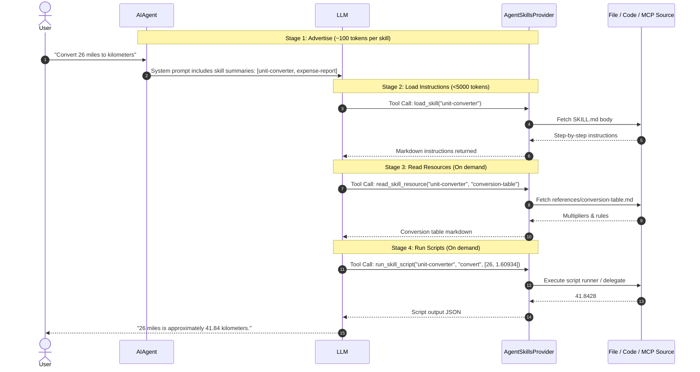
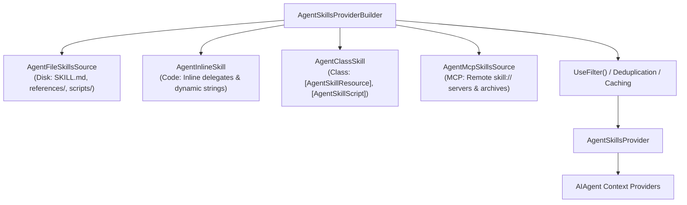

# Module 08 — Agent Skills

> **Time:** ~40 min · **Level:** Intermediate · **Prerequisites:** [Module 02](02-first-agent.md), [Module 03](03-tools.md)
> **Packages:** `Microsoft.Agents.AI` 1.28.0 (GA), `Microsoft.Agents.AI.OpenAI` 1.28.0 (GA), `Microsoft.Agents.AI.Mcp` 1.28.0-alpha.261106.1 (Alpha), `ModelContextProtocol` 2.2.0 (GA), `OpenAI` 2.15.0 (GA)

## Learning objectives
- Explain the open Agent Skills specification and how progressive disclosure minimizes context window consumption.
- Differentiate between atomic tools and packaged agent skills.
- Author file-based skills with valid YAML frontmatter, markdown instructions, reference resources, and executable scripts.
- Implement code-defined (`AgentInlineSkill`) and class-based (`AgentClassSkill<T>`) skills with Dependency Injection.
- Compose multi-source skill providers using `AgentSkillsProviderBuilder` and consume remote skills via MCP.
- Configure tool auto-approval rules (`ReadOnlyToolsAutoApprovalRule`) to protect against unauthorized script execution.
- Identify security risks associated with untrusted skills, arbitrary script execution, and indirect prompt injection.

---

## Concepts

As agents handle increasingly complex business workflows, providing hundreds of tool functions or thousands of lines of prompt instructions directly into the system prompt causes context bloat, degrades model attention, and drives up token costs.

**Agent Skills** ([agentskills.io](https://agentskills.io/)) solve this problem by packaging specialized domain expertise—instructions, reference documents, templates, and scripts—into modular units governed by **progressive disclosure**.

### Skills vs. Tools

Developers often ask how an Agent Skill differs from an `AIFunction` tool:

| Aspect | Tool (`AIFunction`) | Skill (`AgentSkill`) |
|---|---|---|
| **Scope** | Atomic function call (e.g. `GetWeather`, `QueryDatabase`). | Modular package of domain expertise (e.g. `expense-report`, `tax-filing`). |
| **Context footprint** | Full JSON Schema definition is present in every model turn. | Progressive disclosure: only metadata is advertised initially (~100 tokens). |
| **Components** | Method signature + parameter metadata only. | Instructions (`SKILL.md`), reference documents (`references/`), and scripts (`scripts/`). |
| **Discovery** | Advertised as callable tools in `ChatOptions.Tools`. | Advertised in prompt; agent loads instructions and resources on demand. |
| **Distribution** | C# code delegates or OpenAPI specifications. | Filesystem directories, NuGet packages, or Model Context Protocol (MCP) servers. |

### Progressive Disclosure

Agent Skills utilize a four-stage progressive disclosure workflow to load only what the agent needs, when it needs it:



1. **Advertise**: At startup, `AgentSkillsProvider` injects a compact summary (name and description) of all available skills into the system prompt.
2. **Load (`load_skill`)**: When a user's prompt matches a skill's domain, the LLM calls `load_skill` to retrieve the markdown instructions from `SKILL.md`.
3. **Read resources (`read_skill_resource`)**: If the task requires supplementary data (rate sheets, policy FAQs, templates), the agent reads specific resources on demand.
4. **Run scripts (`run_skill_script`)**: If deterministic computation or code execution is required, the agent calls `run_skill_script` to run bundled scripts.

### Skill Sources

MAF supports four skill sources:



1. **File-based (`AgentFileSkillsSource`)**: Discovers skills on the filesystem. A skill is a directory containing `SKILL.md` with optional `references/` and `scripts/` subdirectories.
2. **Code-defined (`AgentInlineSkill`)**: Programmatically constructed skills where instructions, dynamic resources, and scripts are defined as in-memory C# delegates.
3. **Class-based (`AgentClassSkill<T>`)**: Strongly typed C# classes deriving from `AgentClassSkill<T>` that use attributes (`[AgentSkillResource]`, `[AgentSkillScript]`) to expose properties and methods. Ideal for distributing skills via NuGet.
4. **MCP-based (`AgentMcpSkillsSource`)**: Discovers skills dynamically from Model Context Protocol servers exposing the `skill://` URI scheme.

> [!WARNING]
> **Preview / Alpha API:** MCP skill support requires `Microsoft.Agents.AI.Mcp` (`1.28.0-alpha.261106.1`). Remote scripts downloaded in archive-type MCP skills are **never executed** by MAF as a fundamental security boundary.

### File-Based Skill Structure

```
skills/
└── unit-converter/
    ├── SKILL.md                          # Required: Frontmatter + instructions
    ├── references/
    │   └── conversion-table.md           # Loaded via read_skill_resource
    └── scripts/
        └── convert.py                    # Executed via run_skill_script
```

The `SKILL.md` file requires YAML frontmatter:

```yaml
---
name: unit-converter
description: Converts between imperial and metric units. Use when asked about distances, weights, or temperatures.
compatibility: requires python3 or local script runner
metadata:
  version: "1.0"
---
# Unit Converter Instructions
When asked to convert units:
1. Read the conversion-table resource to find the correct multiplier.
2. Run the convert script with value and factor.
```

### Dependency Injection with Skills

Skills frequently require access to database contexts, HTTP clients, or configuration options. MAF automatically injects `IServiceProvider` into:
- Code-defined delegates: `(double amount, IServiceProvider sp) => ...`
- Class-based methods: `public string Calculate(double val, IServiceProvider sp) => ...`
- Class constructors when the skill class itself is registered in the DI container.

### Permissions and Tool Auto-Approval

By default, all three skill tools (`load_skill`, `read_skill_resource`, `run_skill_script`) require user approval. MAF provides pre-configured rules via `AgentSkillsProvider`:
- `AgentSkillsProvider.ReadOnlyToolsAutoApprovalRule`: Auto-approves `load_skill` and `read_skill_resource` (safe, read-only operations), but pauses and prompts the user before executing `run_skill_script`.
- `AgentSkillsProvider.AllToolsAutoApprovalRule`: Auto-approves all skill tools including script execution (only use for fully trusted internal skills).
- `AgentSkillsProviderOptions.DisableLoadSkillApproval`: Completely removes approval checks at the provider level for specified tools.

---

## Hands-on

### Example 1 — File-Based Skills Discovery and Subprocess Script Runner

This example creates a local skill on disk, configures file discovery options, and supplies an `AgentFileSkillScriptRunner` to handle script execution.

#### Project Configuration

Create a directory named `example1-file-skills` and create `example1-file-skills.csproj`:

```xml
<Project Sdk="Microsoft.NET.Sdk">

  <PropertyGroup>
    <OutputType>Exe</OutputType>
    <TargetFramework>net10.0</TargetFramework>
    <ImplicitUsings>enable</ImplicitUsings>
    <Nullable>enable</Nullable>
  </PropertyGroup>

  <ItemGroup>
    <PackageReference Include="Microsoft.Agents.AI.OpenAI" Version="1.28.0" />
    <PackageReference Include="OpenAI" Version="2.15.0" />
  </ItemGroup>

</Project>
```

#### Program.cs

```csharp
using System.Text.Json;
using Microsoft.Agents.AI;
using Microsoft.Extensions.AI;
using OpenAI;
using OpenAI.Chat;

string apiKey = Environment.GetEnvironmentVariable("OPENAI_API_KEY") ?? "mock-key";
string model = Environment.GetEnvironmentVariable("OPENAI_MODEL") ?? "gpt-5.4-mini";

// 1. Locate the skills root directory
string skillsDirectory = Path.Combine(AppContext.BaseDirectory, "skills");
Directory.CreateDirectory(Path.Combine(skillsDirectory, "unit-converter", "references"));

// Create a sample SKILL.md
string skillMdContent = """
---
name: unit-converter
description: Converts between imperial and metric units. Use when asked about distances, weights, or temperatures.
compatibility: requires python3 or local script runner
---
# Unit Converter Instructions
When the user asks to convert units:
1. Read the conversion-table reference to obtain the exact conversion factor.
2. If available, run the convert script with value and factor.
3. Return the converted value clearly with original and target units.
""";
await File.WriteAllTextAsync(Path.Combine(skillsDirectory, "unit-converter", "SKILL.md"), skillMdContent);

// Create reference document
string refContent = """
# Unit Conversion Table
- miles to kilometers: multiply by 1.60934
- kilometers to miles: multiply by 0.621371
- pounds to kilograms: multiply by 0.453592
- kilograms to pounds: multiply by 2.20462
""";
await File.WriteAllTextAsync(Path.Combine(skillsDirectory, "unit-converter", "references", "conversion-table.md"), refContent);

// 2. Configure file skills source options
AgentFileSkillsSourceOptions fileOptions = new()
{
    AllowedResourceExtensions = [".md", ".json", ".txt"],
    AllowedScriptExtensions = [".py", ".sh", ".ps1", ".cs"],
    SearchDepth = 3
};

// 3. Create the skills provider pointing to the skills folder
AgentSkillsProvider skillsProvider = new(
    skillsDirectory,
    scriptRunner: CustomScriptRunnerAsync,
    fileOptions: fileOptions);

// 4. Create the agent with AgentSkillsProvider
AIAgent agent = new OpenAIClient(apiKey)
    .GetChatClient(model)
    .AsAIAgent(new ChatClientAgentOptions
    {
        Name = "SkillsSpecialist",
        ChatOptions = new()
        {
            Instructions = "You are a versatile assistant. Consult available skills whenever you need domain instructions or reference data."
        },
        AIContextProviders = [skillsProvider]
    });

AgentSession session = await agent.CreateSessionAsync();
AgentResponse response = await agent.RunAsync("Convert 15 miles into kilometers using the available skill.", session);
Console.WriteLine(response.Text);

// Custom script runner implementation
static Task<object?> CustomScriptRunnerAsync(
    AgentFileSkill skill,
    AgentFileSkillScript script,
    JsonElement? arguments,
    IServiceProvider? services,
    CancellationToken cancellationToken)
{
    Console.WriteLine($"[ScriptRunner] Executing script '{script.Name}' for skill '{skill.Frontmatter.Name}'");
    // For demonstration, return synthetic output or execute in a sandbox
    return Task.FromResult<object?>("Execution output: success");
}
```

#### What's happening
- `skillsDirectory` contains subdirectories named after each skill with a valid `SKILL.md`.
- `AgentFileSkillsSourceOptions` scans up to 3 directory levels for recognized resource and script extensions.
- `CustomScriptRunnerAsync` intercepts execution of bundled scripts, providing an execution point for sandboxing or process isolation.

---

### Example 2 — Code-Defined and Class-Based Skills with Dependency Injection

This example demonstrates in-memory skills authored in C#, demonstrating how both `AgentInlineSkill` and `AgentClassSkill<T>` automatically resolve application services from `IServiceProvider`.

#### Project Configuration

Create a directory named `example2-code-and-class-skills` and create `example2-code-and-class-skills.csproj`:

```xml
<Project Sdk="Microsoft.NET.Sdk">

  <PropertyGroup>
    <OutputType>Exe</OutputType>
    <TargetFramework>net10.0</TargetFramework>
    <ImplicitUsings>enable</ImplicitUsings>
    <Nullable>enable</Nullable>
  </PropertyGroup>

  <ItemGroup>
    <PackageReference Include="Microsoft.Agents.AI.OpenAI" Version="1.28.0" />
    <PackageReference Include="Microsoft.Extensions.DependencyInjection" Version="10.0.0" />
    <PackageReference Include="OpenAI" Version="2.15.0" />
  </ItemGroup>

</Project>
```

#### Program.cs

```csharp
using System.ComponentModel;
using System.Text.Json;
using Microsoft.Agents.AI;
using Microsoft.Extensions.AI;
using Microsoft.Extensions.DependencyInjection;
using OpenAI;
using OpenAI.Chat;

string apiKey = Environment.GetEnvironmentVariable("OPENAI_API_KEY") ?? "mock-key";
string model = Environment.GetEnvironmentVariable("OPENAI_MODEL") ?? "gpt-5.4-mini";

// 1. Setup Dependency Injection container
ServiceCollection services = new();
services.AddSingleton<TaxCalculatorService>();
services.AddSingleton<ShippingCalculatorService>();
IServiceProvider serviceProvider = services.BuildServiceProvider();

// 2. Approach A: Code-defined skill with DI (AgentInlineSkill)
var taxSkill = new AgentInlineSkill(
    name: "tax-calculator",
    description: "Calculates sales and income tax. Use when asked to determine tax amounts or brackets.",
    instructions: """
        Use this skill to calculate tax obligations:
        1. Consult the tax-rules resource to identify applicable tax rates.
        2. Execute the calculate-tax script with the taxable amount.
        3. Present the estimated tax clearly.
        """)
    .AddResource("tax-rules", (IServiceProvider sp) =>
    {
        var taxService = sp.GetRequiredService<TaxCalculatorService>();
        return taxService.GetTaxRules();
    })
    .AddScript("calculate-tax", (double amount, IServiceProvider sp) =>
    {
        var taxService = sp.GetRequiredService<TaxCalculatorService>();
        return taxService.CalculateTaxJson(amount);
    });

// 3. Approach B: Class-based skill with DI (AgentClassSkill<T>)
var shippingSkill = new ShippingPolicySkill();

// 4. Register both skills with the provider
AgentSkillsProvider skillsProvider = new(taxSkill, shippingSkill);

// 5. Build agent, passing serviceProvider for runtime resolution
AIAgent agent = new OpenAIClient(apiKey)
    .GetChatClient(model)
    .AsAIAgent(
        options: new ChatClientAgentOptions
        {
            Name = "ContosoEnterpriseAgent",
            ChatOptions = new()
            {
                Instructions = "You are a Contoso enterprise assistant with specialized skills for taxes and shipping."
            },
            AIContextProviders = [skillsProvider]
        },
        services: serviceProvider);

AgentSession session = await agent.CreateSessionAsync();
AgentResponse response = await agent.RunAsync("How much sales tax is due on a $250 purchase?", session);
Console.WriteLine(response.Text);

// --- Application Services (DI) ---

public class TaxCalculatorService
{
    public string GetTaxRules() => "Standard flat sales tax rate is 8.5% across Contoso regions.";
    public string CalculateTaxJson(double amount)
    {
        double tax = Math.Round(amount * 0.085, 2);
        return JsonSerializer.Serialize(new { Amount = amount, Rate = 0.085, TaxDue = tax, Total = amount + tax });
    }
}

public class ShippingCalculatorService
{
    public string CalculateRates(double weight)
    {
        double cost = Math.Round(5.00 + (weight * 1.25), 2);
        return JsonSerializer.Serialize(new { WeightPounds = weight, ShippingCost = cost });
    }
}

// --- Class-based Skill Definition ---

public sealed class ShippingPolicySkill : AgentClassSkill<ShippingPolicySkill>
{
    public override AgentSkillFrontmatter Frontmatter { get; } = new(
        "shipping-policy",
        "Calculates shipping rates and delivery schedules. Use when asked about freight, shipping costs, or package weight.");

    protected override string Instructions => """
        Use this skill to determine package shipping rates:
        1. Read the rate-card resource for baseline delivery tiers.
        2. Run calculate-shipping script passing package weight in pounds.
        """;

    [AgentSkillResource("rate-card")]
    [Description("Overview of standard and expedited shipping base rates.")]
    public string RateCard => """
        # Standard Shipping Rates
        Base fee: $5.00
        Per-pound surcharge: $1.25
        Estimated delivery: 3-5 business days
        """;

    [AgentSkillScript("calculate-shipping")]
    [Description("Calculates shipping cost based on weight in pounds.")]
    private static string CalculateShipping(double weightPounds, IServiceProvider serviceProvider)
    {
        var service = serviceProvider.GetRequiredService<ShippingCalculatorService>();
        return service.CalculateRates(weightPounds);
    }
}
```

#### What's happening
- `AgentInlineSkill` registers inline delegates for resources and scripts. Adding an `IServiceProvider` parameter allows direct resolution of registered services without global variables.
- `ShippingPolicySkill` derives from `AgentClassSkill<ShippingPolicySkill>`, using `[AgentSkillResource]` on a property and `[AgentSkillScript]` on a static method.
- `AsAIAgent(..., services: serviceProvider)` wires the DI container into the agent invocation pipeline.

---

### Example 3 — Mixed Skills Provider with AgentSkillsProviderBuilder and Tool Approval

This example uses `AgentSkillsProviderBuilder` to aggregate file-based skills, in-memory skills, and MCP sources, applying filtering and standing tool auto-approval rules.

#### Project Configuration

Create a directory named `example3-mixed-skills` and create `example3-mixed-skills.csproj`:

```xml
<Project Sdk="Microsoft.NET.Sdk">

  <PropertyGroup>
    <OutputType>Exe</OutputType>
    <TargetFramework>net10.0</TargetFramework>
    <ImplicitUsings>enable</ImplicitUsings>
    <Nullable>enable</Nullable>
  </PropertyGroup>

  <ItemGroup>
    <PackageReference Include="Microsoft.Agents.AI.Mcp" Version="1.28.0-alpha.261106.1" />
    <PackageReference Include="Microsoft.Agents.AI.OpenAI" Version="1.28.0" />
    <PackageReference Include="ModelContextProtocol" Version="2.2.0" />
    <PackageReference Include="OpenAI" Version="2.15.0" />
  </ItemGroup>

</Project>
```

#### Program.cs

```csharp
#pragma warning disable MAAI001 // Experimental MAF features (if any)
using Microsoft.Agents.AI;
using Microsoft.Extensions.AI;
using OpenAI;
using OpenAI.Chat;

string apiKey = Environment.GetEnvironmentVariable("OPENAI_API_KEY") ?? "mock-key";
string model = Environment.GetEnvironmentVariable("OPENAI_MODEL") ?? "gpt-5.4-mini";

// 1. Create an inline skill
var inlineSkill = new AgentInlineSkill(
    name: "format-helper",
    description: "Formats text responses into Markdown tables and bulleted executive summaries.",
    instructions: "Always format tabular data cleanly in Markdown with bold headers.");

// 2. Build mixed skills provider using AgentSkillsProviderBuilder
string localSkillsDir = Path.Combine(AppContext.BaseDirectory, "skills");
Directory.CreateDirectory(localSkillsDir);

AgentSkillsProvider skillsProvider = new AgentSkillsProviderBuilder()
    .UseFileSkill(localSkillsDir)
    .UseSkill(inlineSkill)
    .UseFilter((skill, context) => !skill.Frontmatter.Name.StartsWith("deprecated-"))
    .Build();

// 3. Create the agent with Skills Provider and Tool Approval middleware
AIAgent agent = new OpenAIClient(apiKey)
    .GetChatClient(model)
    .AsAIAgent(new ChatClientAgentOptions
    {
        Name = "EnterpriseAssistant",
        ChatOptions = new() { Instructions = "You are a helpful assistant with modular skills." },
        AIContextProviders = [skillsProvider]
    })
    .AsBuilder()
    .UseToolApproval(new ToolApprovalAgentOptions
    {
        // Auto-approve load_skill and read_skill_resource (read-only operations),
        // but require explicit user approval for any run_skill_script calls.
        AutoApprovalRules = [AgentSkillsProvider.ReadOnlyToolsAutoApprovalRule]
    })
    .Build();

AgentSession session = await agent.CreateSessionAsync();
AgentResponse response = await agent.RunAsync("Summarize the quarterly revenue table using markdown formatting.", session);
Console.WriteLine(response.Text);
```

#### What's happening
- `AgentSkillsProviderBuilder` combines file skills and inline skills while applying `UseFilter` to exclude deprecated skills.
- `.UseToolApproval(new ToolApprovalAgentOptions { AutoApprovalRules = [AgentSkillsProvider.ReadOnlyToolsAutoApprovalRule] })` permits automatic loading of documentation and resources while guarding script invocation behind explicit human consent.

---

## Common pitfalls

- **Invalid SKILL.md Frontmatter Syntax**:
  - *Symptom:* The skill is never advertised in the agent's prompt, and no tools are generated.
  - *Cause:* Frontmatter field names must use exact lowercase characters (`name:`, `description:`, `compatibility:`). Invalid YAML or uppercase field names prevent the loader from parsing the file.
  - *Fix:* Ensure YAML frontmatter is fenced with triple dashes `---` and matches the schema: `name`, `description`, `license`, `compatibility`, `metadata`.
- **Directory Name Mismatch**:
  - *Symptom:* Skill fails to load during `load_skill`.
  - *Cause:* The `name` attribute in `SKILL.md` must exactly match the parent folder name (e.g. `skills/unit-converter/SKILL.md` must have `name: unit-converter`).
  - *Fix:* Rename the directory or update `name` in frontmatter to be identical.
- **Missing Script Runner for File Skills**:
  - *Symptom:* When the agent calls `run_skill_script`, an exception is thrown stating that no script runner is registered.
  - *Cause:* File-based scripts (.py, .sh, .ps1) are external files; MAF does not execute arbitrary binaries unless you explicitly supply an `AgentFileSkillScriptRunner`.
  - *Fix:* Pass a script runner delegate to the `AgentSkillsProvider` constructor or call `.UseFileScriptRunner(...)` on the builder.
- **Untrusted Script Execution Risk**:
  - *Symptom:* Security audit failure or compromised host environment.
  - *Cause:* Executing scripts from downloaded skills directly on the host machine without process sandboxing or isolation.
  - *Fix:* Always isolate script runners in locked-down containers (e.g., Docker, Hyperlight, or gVisor) with CPU/memory limits and disabled network access.

---

## When to use / when not to use

| Approach | Best used when | Avoid when | Alternatives |
|---|---|---|---|
| **File-based Skills** | Portable skills shared across teams and coding tools (Claude Code, Cursor, Copilot). | Dynamic, user-specific skills computed at runtime. | Code-defined skills (`AgentInlineSkill`). |
| **Code-defined Skills** | Dynamic instructions generated from a database or session state; closures over local state. | Standardized company-wide skills maintained in Git repositories. | File-based skills. |
| **Class-based Skills** | Reusable libraries packaged into internal NuGet feeds; enterprise DI integration. | Rapid prototyping or plain markdown documentation. | Plain `AIFunction` tools; see [Module 03](03-tools.md). |
| **MCP-based Skills** | Centralized skill repositories exposed over standard Model Context Protocol servers. | Offline/isolated environments with strict firewall rules. | Direct file discovery. |

---

## Exercises

1. **Dynamic Environment Diagnostics Skill** — Create an `AgentInlineSkill` named `system-diagnostics` that provides a dynamic resource `health-status`. The resource delegate should query live process metrics (working set memory, thread count, timestamp) and return a JSON health payload.
2. **Context-Aware Role-Based Skill Filter** — Use `AgentSkillsProviderBuilder.UseFilter` to inspect `AgentSkillsSourceContext.Session.StateBag`. If a skill is named `admin-operations`, ensure it is only exposed if the session contains `Role == "Admin"`.
3. **Safe Timeout-Protected Script Runner** — Implement an `AgentFileSkillScriptRunner` delegate that enforces a strict 5-second wall-clock timeout using a linked `CancellationTokenSource`, throwing a `TimeoutException` if execution exceeds the budget.

---

## Summary

- Agent Skills represent an open standard for modular agent capabilities combining instructions (`SKILL.md`), references, and scripts.
- **Progressive disclosure** reduces context window overhead by advertising only ~100 tokens initially, fetching instructions and resources only when requested.
- MAF supports four skill sources: File-based, Code-defined (`AgentInlineSkill`), Class-based (`AgentClassSkill<T>`), and MCP-based.
- `AgentSkillsProviderBuilder` provides fluent aggregation, filtering, caching, and source composition.
- Dependency injection is natively supported: delegates and class methods receive `IServiceProvider` automatically.
- Security is paramount: all skill tools require approval by default. Use `ReadOnlyToolsAutoApprovalRule` to auto-approve documentation reads while requiring human authorization for script executions.

---

## Further reading

- [Microsoft Learn: Agent Skills](https://learn.microsoft.com/agent-framework/agents/skills)
- [Microsoft Learn: Adding Skills to Agents](https://learn.microsoft.com/agent-framework/journey/adding-skills)
- [Agent Skills Open Specification](https://agentskills.io/)
- [Official GitHub Sample: AgentSkills Directory](https://github.com/microsoft/agent-framework/tree/main/dotnet/samples/02-agents/AgentSkills)

---

## Solutions

### Exercise 1 — Dynamic Environment Diagnostics Skill

```csharp
using System.Diagnostics;
using System.Text.Json;
using Microsoft.Agents.AI;

var healthSkill = new AgentInlineSkill(
    name: "system-diagnostics",
    description: "Inspects live system performance, memory, and status metrics.",
    instructions: "Read the health-status resource to evaluate infrastructure health.")
    .AddResource("health-status", () =>
    {
        var proc = Process.GetCurrentProcess();
        var status = new
        {
            Timestamp = DateTimeOffset.UtcNow,
            WorkingSetMB = proc.WorkingSet64 / (1024 * 1024),
            Threads = proc.Threads.Count,
            Status = "Healthy"
        };
        return JsonSerializer.Serialize(status);
    });
```

### Exercise 2 — Context-Aware Role-Based Skill Filter

```csharp
using Microsoft.Agents.AI;

var adminSkill = new AgentInlineSkill(
    name: "admin-operations",
    description: "Performs privileged administrative cluster tasks.",
    instructions: "Execute cluster operations.");

var skillsProvider = new AgentSkillsProviderBuilder()
    .UseSkill(adminSkill)
    .UseFilter((skill, context) =>
    {
        // Admin skill requires "Admin" role in session StateBag
        if (skill.Frontmatter.Name == "admin-operations")
        {
            return context.Session?.StateBag.TryGetValue<string>("Role", out var role) == true && role == "Admin";
        }

        return true;
    })
    .Build();
```

### Exercise 3 — Safe Timeout-Protected Script Runner

```csharp
using System.Text.Json;
using Microsoft.Agents.AI;

static async Task<object?> SafeTimeoutScriptRunnerAsync(
    AgentFileSkill skill,
    AgentFileSkillScript script,
    JsonElement? args,
    IServiceProvider? services,
    CancellationToken cancellationToken)
{
    using var cts = CancellationTokenSource.CreateLinkedTokenSource(cancellationToken);
    cts.CancelAfter(TimeSpan.FromSeconds(5)); // Strict 5-second wall-clock timeout

    try
    {
        Console.WriteLine($"Running script '{script.Name}' with timeout protection...");
        // Simulate execution or launch sandboxed process with cts.Token
        await Task.Delay(100, cts.Token);
        return "Script completed safely within budget.";
    }
    catch (OperationCanceledException)
    {
        throw new TimeoutException($"Script '{script.Name}' exceeded execution limit of 5 seconds.");
    }
}
```
