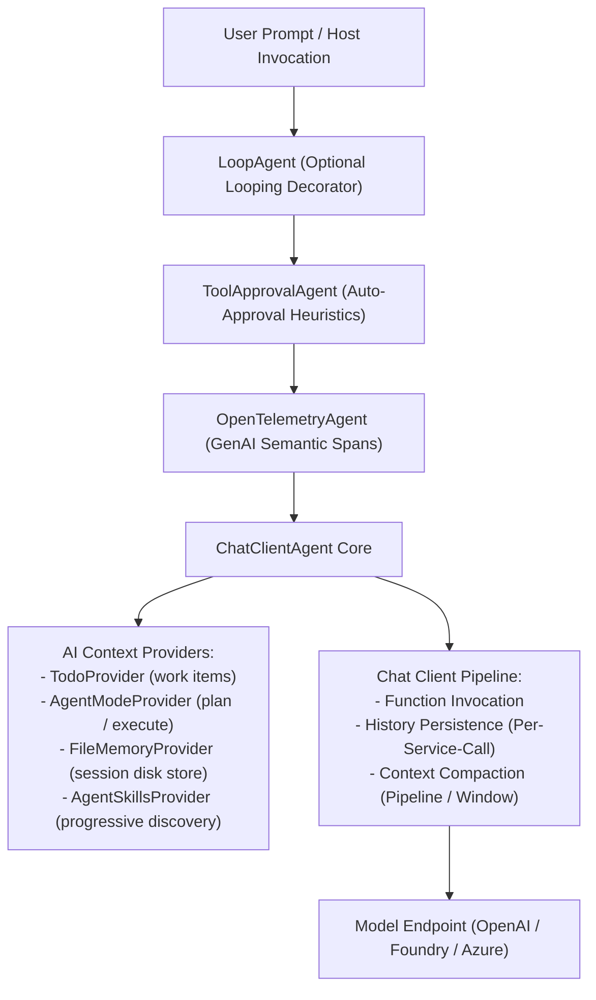
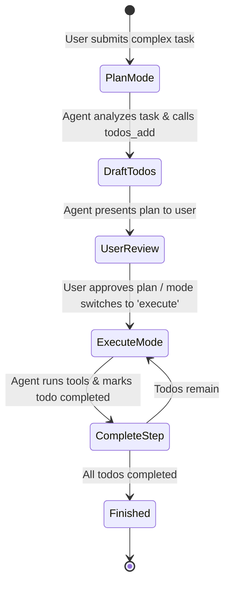
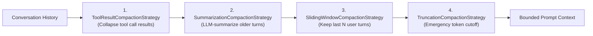
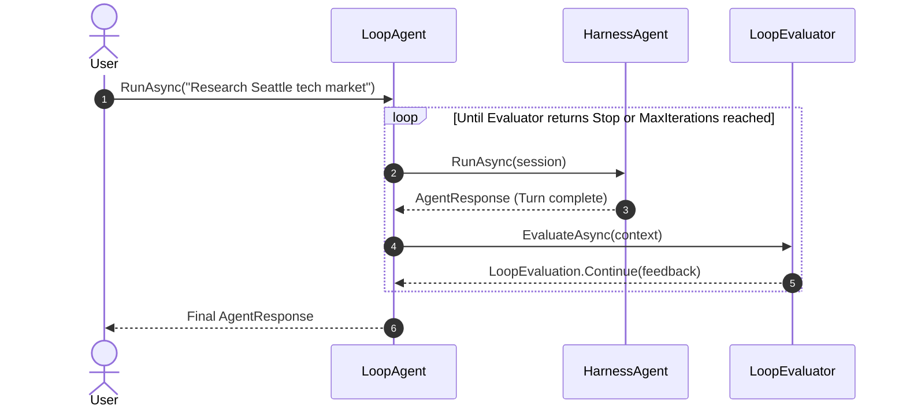

# Module 09 — The Agent Harness

> **Time:** ~35 min · **Level:** Intermediate · **Prerequisites:** [Module 04](04-conversations-and-threads.md), [Module 05](05-memory.md), [Module 08](08-agent-skills.md)
> **Packages:** `Microsoft.Agents.AI.Harness` 1.28.0 (GA, contains experimental APIs), `Microsoft.Agents.AI.OpenAI` 1.28.0 (GA), `Microsoft.Agents.AI.Tools.Shell` 1.28.0-preview.261106.1 (Preview)

## Learning objectives

- Explain the architecture of an AI harness and why complex autonomous tasks require pre-composed scaffolding beyond a bare chat client.
- Instantiate and configure `HarnessAgent` via `AsHarnessAgent` and `HarnessAgentOptions`.
- Leverage harness default capabilities: todo lists (`TodoProvider`), operating modes (`AgentModeProvider`), session file memory (`FileSystemAgentFileStore`), agent skills (`AgentSkillsProvider`), and web search (`HostedWebSearchTool`).
- Configure context window bounds and multi-tier context compaction using `MaxContextWindowTokens` and `PipelineCompactionStrategy`.
- Apply safety policies: tool auto-approval rules, standing approvals, file store boundaries, and shell tool permissions.
- Implement iterative and autonomous workflows using `LoopAgent` with `TodoCompletionLoopEvaluator` and `DelegateLoopEvaluator`.

---

## Concepts

### What is an Agent Harness?

A bare LLM agent responds to single prompts or executes one round of function calls. When building realistic autonomous assistants—such as deep researchers, software developers, or compliance auditors—you quickly realize that model calls are only 20% of the solution. The remaining 80% is the **runtime scaffolding**:

1. **State Persistence:** Saving conversation history after every service call so intermediate tool progress is never lost.
2. **Context Window Management:** Compacting prompt history before tokens overflow the model's physical window limit.
3. **Structured Work Tracking:** Maintaining explicit todos so the agent remembers what remains to be done across turns.
4. **Phased Operating Modes:** Enforcing planning before execution (e.g., plan first, seek approval, then execute).
5. **Durable File Memory:** Storing artifacts in local files that survive compaction and context truncation.
6. **Permission & Approvals:** Gating dangerous tool calls with standing approval policies and interactive human sign-off.
7. **Autonomous Looping:** Driving multiple agent turns until an evaluator confirms the goal has been achieved.

The `Microsoft.Agents.AI.Harness` package provides this opinionated, batteries-included scaffolding as `HarnessAgent`. Crucially, `HarnessAgent` inherits directly from `AIAgent`, meaning it integrates seamlessly with sessions, context providers, and middleware.



### The Harness Capability Matrix

By default, creating a harness agent activates the full suite of production capabilities. Each feature can be selectively disabled or customized through properties on `HarnessAgentOptions`:

| Capability | Default State | `HarnessAgentOptions` Toggle | Description |
|---|---|---|---|
| **Function Invocation** | Enabled | `MaximumIterationsPerRequest` | Drives model tool calls with configurable turn iteration caps. |
| **History Persistence** | Enabled | `ChatHistoryProvider` | Persists conversation history after each service call within a tool loop. |
| **Context Compaction** | Automatic | `MaxContextWindowTokens`, `DisableCompaction` | In-loop compaction prevents token budget overflow. |
| **Todo Tracking** | Enabled | `DisableTodoProvider` | Exposes tools for adding, listing, updating, and completing todos. |
| **Agent Modes** | Enabled | `DisableAgentModeProvider`, `AgentModeProviderOptions` | Defaults to `"plan"` and `"execute"` modes. |
| **Session File Memory** | Enabled | `DisableFileMemory`, `FileMemoryStore` | Session-isolated file store rooted in `./agent-file-memory/`. |
| **Shared File Access** | Opt-in | `FileAccessStore`, `FileAccessProviderOptions` | Exposes read/write file tools to a specified host folder. |
| **Tool Approval** | Enabled | `DisableToolAutoApproval`, `ToolApprovalAgentOptions` | Standing rules and auto-approval heuristics for tool calls. |
| **OpenTelemetry** | Enabled | `DisableOpenTelemetry`, `OpenTelemetrySourceName` | Emits tracing spans using Generative AI semantic conventions. |
| **Web Search** | Enabled | `DisableWebSearch` | Adds `HostedWebSearchTool` when supported by the provider. |
| **Agent Skills** | Enabled | `DisableAgentSkillsProvider`, `AgentSkillsSource` | Progressive tool discovery from directory or skills source. |
| **Background Agents** | Opt-in | `BackgroundAgents`, `BackgroundAgentsProviderOptions` | Parallel delegation to child agents *(see [Module 10](10-background-agents.md))*. |
| **Autonomous Looping** | Opt-in | `LoopEvaluators`, `LoopAgentOptions` | Wraps agent in `LoopAgent` to re-invoke until satisfied. |

> [!NOTE]
> **Experimental API (MAAI001):** Several advanced harness features—including `MaxContextWindowTokens`, `CompactionStrategy`, `LoopEvaluators`, `BackgroundAgents`, and `FileAccessStore`—are flagged with `[Experimental("MAAI001")]`. Suppress this diagnostic in your code with `#pragma warning disable MAAI001`.

---

### Planning and Operating Modes

Complex tasks suffer when models jump straight into execution. The Harness includes two complementary context providers that guide structured reasoning:

1. **`AgentModeProvider`:** Establishes operating modes. The built-in defaults are `"plan"` and `"execute"`.
   - In `"plan"` mode, the model is instructed to review the goal, investigate prerequisites, and formulate a step-by-step roadmap without making destructive tool modifications.
   - In `"execute"` mode, the model systematically executes the roadmap.
2. **`TodoProvider`:** Provides tools allowing the agent to manage its own todo list (`todos_add`, `todos_list`, `todos_update`). The todo list is stored in the `AgentSession` state and injected into the prompt context on each turn.



---

### Context Window & Compaction

Long-running agent sessions accumulate extensive conversation history, system prompt instructions, tool definitions, and verbose tool outputs (e.g., search results, web pages, code listings). Without compaction, the token count eventually exceeds the model's physical context window limit (e.g., 128,000 tokens for GPT-4o or 1,050,000 for GPT-5.4), causing hard API failures.

`HarnessAgent` provides two ways to manage context:

#### 1. Automatic Context Window Compaction

By specifying `MaxContextWindowTokens` and `MaxOutputTokens`, the harness automatically constructs a `ContextWindowCompactionStrategy`:

```csharp
AIAgent agent = chatClient.AsHarnessAgent(new HarnessAgentOptions
{
    MaxContextWindowTokens = 128_000,
    MaxOutputTokens = 16_384,
});
```

When prompt tokens exceed the safe threshold (`MaxContextWindowTokens - MaxOutputTokens`), the harness triggers in-loop compaction before making the next model call.

#### 2. Multi-Tier Compaction Pipeline

For fine-grained control, configure a `PipelineCompactionStrategy` with layered reduction strategies, ordered from least to most aggressive:



1. **`ToolResultCompactionStrategy`:** Collapses verbose tool output groups into concise textual summaries once message count exceeds a threshold (`CompactionTriggers.MessagesExceed(8)`).
2. **`SummarizationCompactionStrategy`:** Uses an auxiliary chat client to compress historical conversation turns into an executive summary once token count exceeds a budget (`CompactionTriggers.TokensExceed(4000)`).
3. **`SlidingWindowCompactionStrategy`:** Retains only the most recent $N$ user turns and their responses (`CompactionTriggers.TurnsExceed(4)`).
4. **`TruncationCompactionStrategy`:** Acts as the emergency backstop, dropping the oldest non-system messages until the total token count fits inside the hard budget (`CompactionTriggers.TokensExceed(64_000)`).

---

### Security, Approvals, and File Store Boundaries

Autonomous agents executing tools need strict authorization boundaries:

- **Session File Memory (`FileMemoryStore`):** Designed for internal agent scratch space. Stored under a temporary per-session directory (`./agent-file-memory/{timestamp}_{guid}/`). The agent can freely read and write its own notes here without prompting the user.
- **Shared File Access (`FileAccessStore`):** Opt-in. When configured with a host folder, it grants the agent read/write tools to actual workspace files. Dangerous operations should be paired with tool approval.
- **Tool Auto-Approval (`ToolApprovalAgentOptions`):** Tools wrapped with `ApprovalRequiredAIFunction` pause execution until approved. In autonomous or looped scenarios, you can define `AutoApprovalRules` to grant standing approvals to safe operations (such as read-only tools or specific safe directories):

```csharp
ToolApprovalAgentOptions approvalOptions = new()
{
    AutoApprovalRules =
    [
        // Standing approval for read-only actions
        context => ValueTask.FromResult(
            context.FunctionCallContent.Name.StartsWith("read_", StringComparison.OrdinalIgnoreCase))
    ]
};
```

---

### Autonomous Looping with LoopAgent

By default, an `AIAgent` executes a single run: the user sends input, the agent runs a tool loop, and it returns a final response. If the agent's work was incomplete (for instance, it only completed 2 of 5 todo items), a standard agent stops and waits for the user to prompt it again.

`LoopAgent` is an agent decorator that evaluates the outcome of each agent turn and automatically re-invokes the agent if more work is needed:



The framework provides several built-in evaluators:
- **`TodoCompletionLoopEvaluator`:** Re-invokes the agent while uncompleted todos remain. It can be restricted to specific modes (e.g. only loop during `"execute"` mode).
- **`CompletionMarkerLoopEvaluator`:** Re-invokes until a sentinel string (such as `<promise>COMPLETE</promise>`) appears in the response.
- **`AIJudgeLoopEvaluator`:** Employs an independent model to evaluate whether the original user request was adequately answered.
- **`DelegateLoopEvaluator`:** Executes custom C# logic to inspect the response text, session state, or tools.

---

## Hands-on

### Example 1 — Full Research HarnessAgent

Let's build a fully equipped research agent with todo tracking, plan/execute modes, and local session file memory.

#### 1. Setup

Create a new console application and install the required packages:

```bash
dotnet new console -n HarnessResearchApp
cd HarnessResearchApp
dotnet add package Microsoft.Agents.AI.Harness --version 1.28.0
dotnet add package Microsoft.Agents.AI.OpenAI --version 1.28.0
dotnet add package OpenAI --version 2.15.0
```

#### 2. Program.cs

```csharp
#pragma warning disable MAAI001  // Suppress experimental warning for Agents AI experiments
#pragma warning disable OPENAI001 // Suppress experimental warning for OpenAI SDK

using Microsoft.Agents.AI;
using Microsoft.Extensions.AI;
using OpenAI;
using OpenAI.Chat;

string apiKey = Environment.GetEnvironmentVariable("OPENAI_API_KEY")
    ?? throw new InvalidOperationException("Set OPENAI_API_KEY.");
string model = Environment.GetEnvironmentVariable("OPENAI_MODEL") ?? "gpt-5.4-mini";

// Create the underlying chat client
IChatClient chatClient = new OpenAIClient(apiKey)
    .GetChatClient(model)
    .AsIChatClient();

// Configure the agent file storage path
string filesPath = Path.Combine(AppContext.BaseDirectory, "research-files");
Directory.CreateDirectory(filesPath);

// Create the HarnessAgent with research-specific instructions
AIAgent researchAgent = chatClient.AsHarnessAgent(new HarnessAgentOptions
{
    Name = "MarketResearchAgent",
    Description = "Plans and conducts comprehensive market research.",
    HarnessInstructions = "Be thorough, verify sources, and record key findings to file memory.",
    ChatOptions = new ChatOptions
    {
        Instructions =
            """
            You are a senior market analyst.
            When assigned a research topic:
            1. In 'plan' mode: break down the topic into concrete questions and populate your todo list.
            2. In 'execute' mode: investigate each question, take notes in file memory, and mark items complete.
            3. When finished, produce an executive summary.
            """,
    },
    MaxContextWindowTokens = 128_000,
    MaxOutputTokens = 8_192,
    FileMemoryStore = new FileSystemAgentFileStore(filesPath),
});

// Create a persistent multi-turn session
AgentSession session = await researchAgent.CreateSessionAsync();

Console.WriteLine($"Initialized HarnessAgent: {researchAgent.Name}");
Console.WriteLine("Submitting task in 'plan' mode...");

// Turn 1: Planning
AgentResponse planResponse = await researchAgent.RunAsync(
    "Develop a research plan to analyze the growth of Small Language Models (SLMs) in 2026.",
    session);

Console.WriteLine("\n=== AGENT PLAN ===");
Console.WriteLine(planResponse.Text);

// Turn 2: Transition to execute mode
Console.WriteLine("\nTransitioning to 'execute' mode...");
AgentModeProvider modeProvider = researchAgent.GetService<AgentModeProvider>()
    ?? throw new InvalidOperationException("AgentModeProvider not found.");

await modeProvider.SetModeAsync(session, "execute");

AgentResponse executeResponse = await researchAgent.RunAsync(
    "Begin executing the first item on your todo list.",
    session);

Console.WriteLine("\n=== EXECUTION STEP ===");
Console.WriteLine(executeResponse.Text);
```

#### What's happening?

- `chatClient.AsHarnessAgent(...)` automatically wires up function calling, per-service-call persistence, compaction, `TodoProvider`, `AgentModeProvider`, `FileMemoryProvider`, and `ToolApprovalAgent`.
- `FileMemoryStore` assigns a dedicated directory for agent notes and generated artifacts.
- In Turn 1, the agent operates in the default `"plan"` mode, formulating a roadmap and populating its internal todo items.
- In Turn 2, `researchAgent.GetService<AgentModeProvider>()` accesses the context provider to switch the active session mode to `"execute"`.

---

### Example 2 — Multi-Tier Compaction Pipeline

When building an agent designed to run hundreds of iterations, relying on default truncation can erase critical early context. Here we construct a custom 3-tier `PipelineCompactionStrategy`.

#### 1. Setup

```bash
dotnet new console -n HarnessCompactionApp
cd HarnessCompactionApp
dotnet add package Microsoft.Agents.AI.Harness --version 1.28.0
dotnet add package Microsoft.Agents.AI.OpenAI --version 1.28.0
dotnet add package OpenAI --version 2.15.0
```

#### 2. Program.cs

```csharp
#pragma warning disable MAAI001
#pragma warning disable OPENAI001

using System.ComponentModel;
using Microsoft.Agents.AI;
using Microsoft.Agents.AI.Compaction;
using Microsoft.Extensions.AI;
using OpenAI;
using OpenAI.Chat;

string apiKey = Environment.GetEnvironmentVariable("OPENAI_API_KEY")
    ?? throw new InvalidOperationException("Set OPENAI_API_KEY.");
string model = Environment.GetEnvironmentVariable("OPENAI_MODEL") ?? "gpt-5.4-mini";

IChatClient chatClient = new OpenAIClient(apiKey)
    .GetChatClient(model)
    .AsIChatClient();

// Define a sample tool that returns verbose data
[Description("Fetches detailed sensor log telemetry.")]
static string GetSensorLogs(int count)
{
    return string.Join("\n", Enumerable.Range(1, count)
        .Select(i => $"[ENTRY {i}] Timestamp={DateTime.UtcNow:O} Temp={20 + i % 5}C Pressure=101.3kPa Status=Nominal PayloadData=0x{i:X8}"));
}

// Build a 3-tier compaction pipeline from gentle to emergency
PipelineCompactionStrategy customPipeline = new(
    // Tier 1 (Gentle): If more than 6 tool messages accumulate, collapse old tool results
    new ToolResultCompactionStrategy(CompactionTriggers.MessagesExceed(6)),

    // Tier 2 (Moderate): Keep only the last 4 user conversational turns
    new SlidingWindowCompactionStrategy(CompactionTriggers.TurnsExceed(4)),

    // Tier 3 (Emergency): Drop oldest messages if total prompt exceeds 50,000 tokens
    new TruncationCompactionStrategy(CompactionTriggers.TokensExceed(50_000)));

AIAgent monitorAgent = chatClient.AsHarnessAgent(new HarnessAgentOptions
{
    Name = "TelemetryMonitor",
    CompactionStrategy = customPipeline,
    MaxOutputTokens = 4096,
    ChatOptions = new ChatOptions
    {
        Instructions = "You monitor telemetry. Query the sensor logs as requested and report anomalies.",
        Tools = [AIFunctionFactory.Create(GetSensorLogs)],
    },
});

AgentSession session = await monitorAgent.CreateSessionAsync();

Console.WriteLine("Running multi-turn interaction with in-loop compaction enabled...");
for (int turn = 1; turn <= 3; turn++)
{
    Console.WriteLine($"\n--- Turn {turn} ---");
    AgentResponse response = await monitorAgent.RunAsync(
        $"Query 10 sensor log entries and summarize them (Run #{turn}).",
        session);
    Console.WriteLine(response.Text);
}

Console.WriteLine("\nSession completed within token limits under active compaction.");
```

---

### Example 3 — Autonomous Workflows with LoopAgent

In this example, we configure an autonomous agent that drafts and self-corrects until all todo items are checked off.

#### 1. Setup

```bash
dotnet new console -n HarnessLoopApp
cd HarnessLoopApp
dotnet add package Microsoft.Agents.AI.Harness --version 1.28.0
dotnet add package Microsoft.Agents.AI.OpenAI --version 1.28.0
dotnet add package OpenAI --version 2.15.0
```

#### 2. Program.cs

```csharp
#pragma warning disable MAAI001
#pragma warning disable OPENAI001

using Microsoft.Agents.AI;
using Microsoft.Extensions.AI;
using OpenAI;
using OpenAI.Chat;

string apiKey = Environment.GetEnvironmentVariable("OPENAI_API_KEY")
    ?? throw new InvalidOperationException("Set OPENAI_API_KEY.");
string model = Environment.GetEnvironmentVariable("OPENAI_MODEL") ?? "gpt-5.4-mini";

IChatClient chatClient = new OpenAIClient(apiKey)
    .GetChatClient(model)
    .AsIChatClient();

// Step 1: Create the inner HarnessAgent
AIAgent harnessAgent = chatClient.AsHarnessAgent(new HarnessAgentOptions
{
    Name = "AutonomousDocumenter",
    DisableAgentModeProvider = true, // Simplify to single mode
    ChatOptions = new ChatOptions
    {
        Instructions =
            """
            You are a technical documentation assistant.
            When assigned a documentation task:
            1. First create todos for each required chapter using your todo tools.
            2. Then, iteratively write each section and mark that todo item as completed.
            3. Work through one item per turn until all items are completed.
            """,
    },
});

// Step 2: Wrap the agent in LoopAgent with a TodoCompletionLoopEvaluator
AIAgent loopedAgent = new LoopAgent(
    harnessAgent,
    new TodoCompletionLoopEvaluator(),
    new LoopAgentOptions
    {
        MaxIterations = 6,              // Safety cap preventing infinite loops
        FreshContextPerIteration = false // Maintain session state across loop iterations
    });

Console.WriteLine("Starting autonomous looped execution...");
AgentSession session = await loopedAgent.CreateSessionAsync();

AgentResponse finalResponse = await loopedAgent.RunAsync(
    "Create a 3-part micro-guide on 'Configuring Azure Key Vault with .NET 10'.",
    session);

Console.WriteLine("\n=== FINAL LOOP RESPONSE ===");
Console.WriteLine(finalResponse.Text);
```

---

## Common pitfalls

- **Symptom:** `LoopAgent` executes continuously until hitting `MaxIterations` even though the agent claims it finished.
  - **Cause:** The evaluator (e.g. `TodoCompletionLoopEvaluator`) checks whether todo items remain in the open state. If the model merely says "I am done" in English without invoking `todos_update` or `todos_complete`, the provider state remains uncompleted.
  - **Fix:** Explicitly instruct the model in `ChatOptions.Instructions`: *"You MUST invoke the todo tools to mark every completed item as done before concluding."*

- **Symptom:** `System.InvalidOperationException: The context window limit has been exceeded.`
  - **Cause:** Neither `MaxContextWindowTokens` nor a custom `CompactionStrategy` was set, or `DisableCompaction = true` was specified.
  - **Fix:** Supply `MaxContextWindowTokens` (e.g. `128_000`) and `MaxOutputTokens` (e.g. `8_192`) in `HarnessAgentOptions`.

- **Symptom:** The agent stalls or deadlocks during an autonomous `LoopAgent` pass waiting for tool approval.
  - **Cause:** A tool requires approval (`ApprovalRequiredAIFunction`), but there is no human present on autonomous loop iterations.
  - **Fix:** Provide `AutoApprovalRules` in `ToolApprovalAgentOptions` on the inner agent to automatically approve trusted tools during background runs.

- **Symptom:** `LocalShellExecutor` throws `System.InvalidOperationException: Unsafe execution must be acknowledged.`
  - **Cause:** `LocalShellExecutor` runs real operating system commands on the host machine. By default, it requires explicit code confirmation.
  - **Fix:** Pass `AcknowledgeUnsafe = true` in `LocalShellExecutorOptions`, and run in sandboxed Docker containers (`DockerShellExecutor`) in production.

- **Symptom:** Agent cannot see files placed in the current application folder.
  - **Cause:** Confusing `FileMemoryStore` with `FileAccessStore`. `FileMemoryStore` is an isolated per-session scratch directory.
  - **Fix:** Configure `FileAccessStore = new FileSystemAgentFileStore("./workspace")` if you want the agent to read and modify host files.

---

## When to use / when not to use

| Scenario | Recommendation | Alternative |
|---|---|---|
| **Multi-step research, coding, or data processing** | **Use `HarnessAgent`** — built-in todos, persistence, and compaction prevent common failure modes. | None; ideal fit. |
| **Simple single-turn question answering or text transformation** | **Do NOT use `HarnessAgent`** — harness providers add prompt and execution overhead. | Use plain `ChatClientAgent` ([Module 02](02-first-agent.md)). |
| **Rigid deterministic business workflows (e.g., A → B → C approval gates)** | **Do NOT use `HarnessAgent`** — model may deviate from sequence. | Use Workflows ([Module 11](11-workflows.md)). |
| **Autonomous agents that must self-correct until criteria are met** | **Use `HarnessAgent` + `LoopAgent`** with custom or todo evaluators. | Sequential orchestrations ([Module 13](13-orchestrations.md)). |
| **Sandboxed code execution or shell environment probing** | **Use `LocalShellExecutor` or `DockerShellExecutor`** with `ShellEnvironmentProvider`. | Custom function tools ([Module 03](03-tools.md)). |

---

## Exercises

1. **The Lean Coding Assistant:**
   Construct a lean `HarnessAgent` specialized for local code inspection. Disable `TodoProvider`, `AgentModeProvider`, and `WebSearch`. Configure an opt-in `FileAccessStore` rooted in a local `./workspace` folder. Add a standing `AutoApprovalRule` that automatically approves any tool call where the function name contains `"read"`.

2. **Multi-Tier Compaction Strategy:**
   Construct a `HarnessAgent` configured with a 3-tier `PipelineCompactionStrategy`:
   - Tier 1: Collapse tool messages once message count exceeds 8.
   - Tier 2: Slide the window to keep only the last 5 turns once turn count exceeds 5.
   - Tier 3: Truncate messages if total tokens exceed 64,000.
   Verify that your agent compiles and accepts bounded token configurations.

3. **Quality-Gated Drafting Loop:**
   Implement an autonomous technical writer using `LoopAgent` and `DelegateLoopEvaluator`. The evaluator must inspect `context.LastResponse.Text` to verify that three mandatory Markdown headings are present: `## Overview`, `## Changes`, and `## Verification`. If any heading is missing, the evaluator returns `LoopEvaluation.Continue` with specific instructions explaining what is missing. Cap the loop at 4 iterations.

---

## Summary

- An **AI Harness** provides the essential scaffolding—history persistence, context compaction, todo tracking, modes, file stores, approvals, and observability—needed for robust autonomous agents.
- `HarnessAgent` inherits from `AIAgent`, meaning it integrates with existing sessions, context providers, and middleware.
- Configure all harness capabilities via `HarnessAgentOptions`; disable unneeded features using `Disable*` flags (`DisableTodoProvider`, `DisableAgentModeProvider`, etc.).
- Prevent context window exhaustion with `MaxContextWindowTokens` or build custom multi-tier reduction pipelines with `PipelineCompactionStrategy`.
- Use `LoopAgent` with evaluators (`TodoCompletionLoopEvaluator`, `CompletionMarkerLoopEvaluator`, or `DelegateLoopEvaluator`) to drive multi-turn autonomous convergence.

---

## Further reading

- [Microsoft Learn: Agent Harness Concepts](https://learn.microsoft.com/en-us/agent-framework/concepts/harness?pivots=programming-language-csharp)
- [Microsoft Learn: Planning and Todos](https://learn.microsoft.com/en-us/agent-framework/agents/planning-and-todos?pivots=programming-language-csharp)
- [Microsoft Learn: Context Compaction](https://learn.microsoft.com/en-us/agent-framework/concepts/agents/conversations/compaction?pivots=programming-language-csharp)
- [Microsoft Learn: Agent Looping](https://learn.microsoft.com/en-us/agent-framework/agents/looping?pivots=programming-language-csharp)
- [GitHub: Harness Research Sample](https://github.com/microsoft/agent-framework/tree/main/dotnet/samples/02-agents/Harness/Harness_Step01_Research)
- [GitHub: Harness Looping Sample](https://github.com/microsoft/agent-framework/tree/main/dotnet/samples/02-agents/Harness/Harness_Step05_Loop)

---

## Solutions

### Exercise 1 — The Lean Coding Assistant

```csharp
#pragma warning disable MAAI001
#pragma warning disable OPENAI001

using Microsoft.Agents.AI;
using Microsoft.Extensions.AI;
using OpenAI;
using OpenAI.Chat;

string apiKey = Environment.GetEnvironmentVariable("OPENAI_API_KEY") ?? "mock-key";
string model = Environment.GetEnvironmentVariable("OPENAI_MODEL") ?? "gpt-5.4-mini";

IChatClient chatClient = new OpenAIClient(apiKey)
    .GetChatClient(model)
    .AsIChatClient();

string workspaceDir = Path.Combine(AppContext.BaseDirectory, "workspace");
Directory.CreateDirectory(workspaceDir);

var fileStore = new FileSystemAgentFileStore(workspaceDir);

AIAgent leanCodingAgent = chatClient.AsHarnessAgent(new HarnessAgentOptions
{
    Name = "LeanCoder",
    Description = "Specialized coding assistant with local file access",
    DisableTodoProvider = true,
    DisableAgentModeProvider = true,
    DisableWebSearch = true,
    FileAccessStore = fileStore,
    ToolApprovalAgentOptions = new ToolApprovalAgentOptions
    {
        AutoApprovalRules =
        [
            context => ValueTask.FromResult(
                context.FunctionCallContent.Name.Contains("read", StringComparison.OrdinalIgnoreCase))
        ],
    },
    ChatOptions = new ChatOptions
    {
        Instructions = "You are an expert developer. Read workspace files and implement clean code.",
    },
});

Console.WriteLine($"Lean coding agent created: {leanCodingAgent.Name}");
```

### Exercise 2 — Multi-Tier Compaction Strategy

```csharp
#pragma warning disable MAAI001
#pragma warning disable OPENAI001

using Microsoft.Agents.AI;
using Microsoft.Agents.AI.Compaction;
using Microsoft.Extensions.AI;
using OpenAI;
using OpenAI.Chat;

string apiKey = Environment.GetEnvironmentVariable("OPENAI_API_KEY") ?? "mock-key";
string model = Environment.GetEnvironmentVariable("OPENAI_MODEL") ?? "gpt-5.4-mini";

IChatClient chatClient = new OpenAIClient(apiKey)
    .GetChatClient(model)
    .AsIChatClient();

PipelineCompactionStrategy compactionPipeline = new(
    new ToolResultCompactionStrategy(CompactionTriggers.MessagesExceed(8)),
    new SlidingWindowCompactionStrategy(CompactionTriggers.TurnsExceed(5)),
    new TruncationCompactionStrategy(CompactionTriggers.TokensExceed(64_000)));

AIAgent compactingAgent = chatClient.AsHarnessAgent(new HarnessAgentOptions
{
    Name = "LongConversationAgent",
    CompactionStrategy = compactionPipeline,
    MaxOutputTokens = 4096,
});

Console.WriteLine($"Compacting agent configured with 3-tier pipeline: {compactingAgent.Name}");
```

### Exercise 3 — Quality-Gated Drafting Loop

```csharp
#pragma warning disable MAAI001
#pragma warning disable OPENAI001

using Microsoft.Agents.AI;
using Microsoft.Extensions.AI;
using OpenAI;
using OpenAI.Chat;

string apiKey = Environment.GetEnvironmentVariable("OPENAI_API_KEY") ?? "mock-key";
string model = Environment.GetEnvironmentVariable("OPENAI_MODEL") ?? "gpt-5.4-mini";

IChatClient chatClient = new OpenAIClient(apiKey)
    .GetChatClient(model)
    .AsIChatClient();

AIAgent drafterAgent = chatClient.AsHarnessAgent(new HarnessAgentOptions
{
    Name = "Drafter",
    DisableTodoProvider = true,
    DisableAgentModeProvider = true,
    ChatOptions = new ChatOptions
    {
        Instructions = "You write technical release notes. Always include sections: ## Overview, ## Changes, and ## Verification.",
    },
});

AIAgent qualityLoopAgent = new LoopAgent(
    drafterAgent,
    new DelegateLoopEvaluator((context, cancellationToken) =>
    {
        string text = context.LastResponse?.Text ?? string.Empty;
        bool hasOverview = text.Contains("## Overview", StringComparison.OrdinalIgnoreCase);
        bool hasChanges = text.Contains("## Changes", StringComparison.OrdinalIgnoreCase);
        bool hasVerification = text.Contains("## Verification", StringComparison.OrdinalIgnoreCase);

        if (!hasOverview || !hasChanges || !hasVerification)
        {
            List<string> missing = [];
            if (!hasOverview) missing.Add("## Overview");
            if (!hasChanges) missing.Add("## Changes");
            if (!hasVerification) missing.Add("## Verification");

            return new ValueTask<LoopEvaluation>(LoopEvaluation.Continue(
                $"The draft is missing required sections: {string.Join(", ", missing)}. Please revise to include all three sections."));
        }

        return new ValueTask<LoopEvaluation>(LoopEvaluation.Stop());
    }),
    new LoopAgentOptions
    {
        MaxIterations = 4,
        FreshContextPerIteration = false,
    });

Console.WriteLine($"Quality loop agent ready: {qualityLoopAgent.Name}");
```
