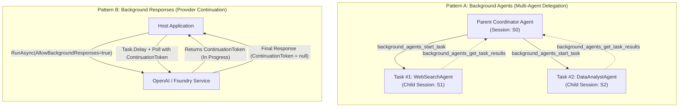
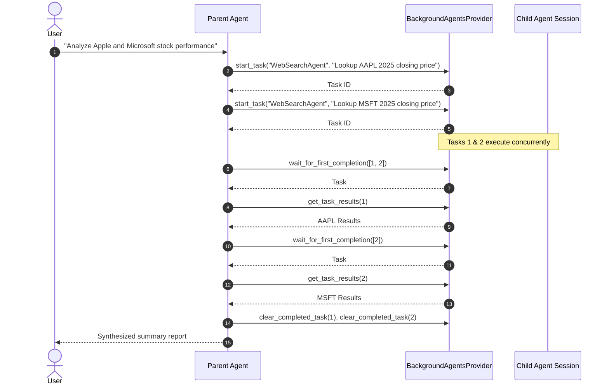
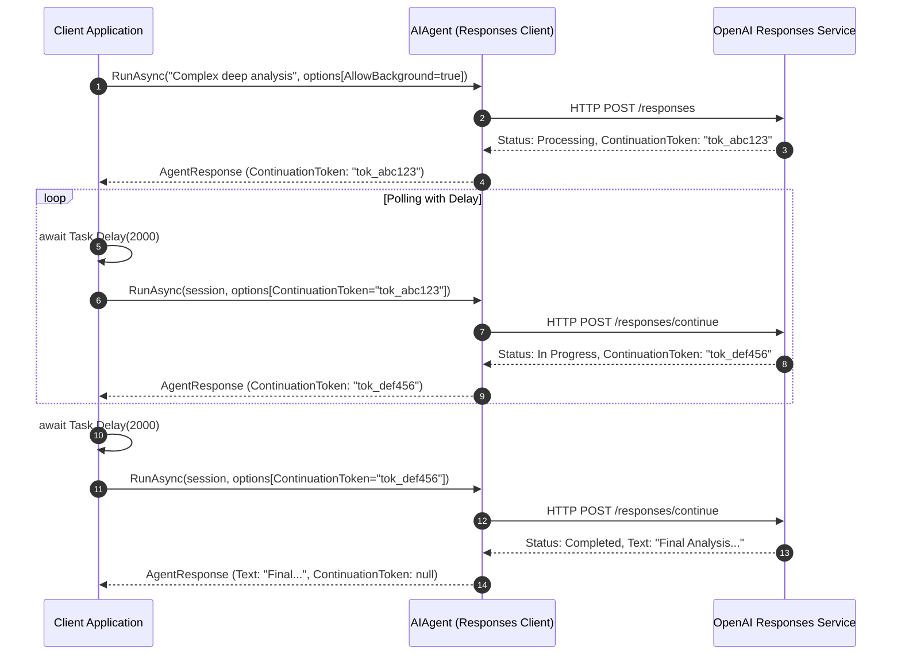

# Module 10 — Background Agents and Responses

> **Time:** ~30 min · **Level:** Intermediate · **Prerequisites:** [Module 02](02-first-agent.md), [Module 04](04-conversations-and-threads.md), [Module 09](09-agent-harness.md)
> **Packages:** `Microsoft.Agents.AI` 1.28.0 (GA), `Microsoft.Agents.AI.Harness` 1.28.0 (GA, experimental APIs), `Microsoft.Agents.AI.OpenAI` 1.28.0 (GA)

## Learning objectives

- Differentiate between **Background Agents** (multi-agent concurrent task delegation) and **Background Responses** (provider-managed continuation tokens for long-running model operations).
- Implement parent-child delegation using `BackgroundAgentsProvider` and configure child agents with isolated sessions.
- Explain the model-facing task lifecycle tools (`start_task`, `wait_for_first_completion`, `get_task_results`, `continue_task`, `clear_completed_task`).
- Automate task monitoring using `LoopAgent` paired with `BackgroundTaskCompletionLoopEvaluator`.
- Handle long-running model execution by enabling `AllowBackgroundResponses` in non-streaming polling scenarios.
- Implement fault-tolerant streaming consumers that recover from network disconnects using `AgentResponseUpdate.ContinuationToken`.

---

## Concepts

### The Two "Background" Concepts in MAF

Developers frequently confuse **Background Agents** with **Background Responses**. While both involve asynchronous execution, they solve fundamentally different architectural problems:

| Dimension | Background Agents | Background Responses |
|---|---|---|
| **What is executing?** | Independent child `AIAgent` instances running tasks concurrently in the host application. | A single model provider request executing server-side on the provider's infrastructure. |
| **Primary Abstraction** | `BackgroundAgentsProvider`, `BackgroundTaskCompletionLoopEvaluator` | `AgentRunOptions.AllowBackgroundResponses`, `ContinuationToken` |
| **Tracking Mechanism** | Host-assigned integer Task IDs (`taskId: 1, 2, ...`) | Cryptographic continuation tokens (`string`) from the model provider |
| **Interaction Flow** | Parent agent invokes tools to start, wait for, inspect, and continue child agent tasks. | Host application polls the endpoint or resumes an interrupted token stream. |
| **Failure States** | `running`, `completed`, `failed`, `lost` | Network timeout, rate limit, provider error |
| **Diagnostic Code** | `MAAI001` (Experimental MAF feature) | `MEAI001` / `OPENAI001` (Experimental provider APIs) |



---

### Deep Dive: Background Agents

A **Background Agent** setup enables a coordinator agent to spawn, supervise, and gather results from multiple subordinate agents without blocking the coordinator's primary conversation turn.

#### 1. Registration & Identification

Every child agent passed to `BackgroundAgentsProvider` must have a non-empty, case-insensitively unique `Name`. For example, `WebSearchAgent` and `DataAnalystAgent`. The provider injects instructions into the parent prompt listing the available agents and their descriptions:

```csharp
AIAgent researcher = chatClient.AsAIAgent(instructions: "...", name: "WebSearchAgent");
AIAgent analyst = chatClient.AsAIAgent(instructions: "...", name: "DataAnalystAgent");

BackgroundAgentsProvider provider = new([researcher, analyst]);
```

#### 2. The Model-Facing Task Lifecycle

When `BackgroundAgentsProvider` is registered as an `AIContextProvider`, it dynamically registers six lifecycle tools on the parent agent:

| Tool Name | Action | Description |
|---|---|---|
| `background_agents_start_task` | Start | Launches a non-blocking background task on a named child agent; returns an integer `taskId`. |
| `background_agents_wait_for_first_completion` | Wait | Blocks the tool call until at least one task in the specified set reaches a terminal state. |
| `background_agents_get_task_results` | Inspect | Retrieves the completed text, error message, or current status for a given task ID. |
| `background_agents_get_all_tasks` | List | Returns all tasks, statuses, agent names, and task descriptions. |
| `background_agents_continue_task` | Follow-up | Sends follow-up input to the existing child session after a task has completed or failed. |
| `background_agents_clear_completed_task` | Cleanup | Deletes a terminal task and releases its associated child session. |



#### 3. Task States and the `lost` State

Tasks traverse four states:
- **`running`:** Active in-flight execution on a background task thread.
- **`completed`:** The child agent successfully concluded its run and returned text.
- **`failed`:** The child agent encountered an unhandled exception.
- **`lost`:** The in-memory task handle or child session is unavailable.

> [!WARNING]
> **Understanding Lost Tasks:** Serializable task metadata (IDs, agent names, prompts) persists in the parent's `AgentSession`. However, in-flight .NET `Task` handles and running thread contexts do **not** survive process restarts or rehydration from disk. If a parent session is deserialized while child tasks were running, those tasks transition to `lost`.

#### 4. Automated Waiting with BackgroundTaskCompletionLoopEvaluator

If a parent agent launches background tasks but does not actively call `wait_for_first_completion` in the same turn, its run will finish while tasks are still `running`.

To automate progression, wrap the parent agent in `LoopAgent` with `BackgroundTaskCompletionLoopEvaluator`:

```csharp
AIAgent loopingCoordinator = new LoopAgent(
    parentAgent,
    new BackgroundTaskCompletionLoopEvaluator(),
    new LoopAgentOptions { MaxIterations = 10 });
```

This evaluator automatically re-invokes the parent agent as long as any child task remains in the `running` state. Once all tasks reach a terminal state (`completed`, `failed`, or `lost`), the evaluator returns `LoopEvaluation.Stop()`, allowing the parent to synthesize the final answer.

---

### Deep Dive: Background Responses

Certain advanced reasoning models (e.g. OpenAI o-series or deep-thinking deployments) take 30 to 180 seconds to complete complex reasoning trees. Standard HTTP connections frequently encounter gateway timeouts, socket resets, or network disconnects over such intervals.

**Background Responses** decouple prompt submission from completion using server-side **Continuation Tokens**.

#### 1. Enabling Background Responses

Background responses are opted into per-run by configuring `AgentRunOptions`:

```csharp
AgentRunOptions options = new()
{
    AllowBackgroundResponses = true,
};
```

> [!NOTE]
> Currently, background responses are supported by agents utilizing the OpenAI Responses API (`Microsoft.Agents.AI.OpenAI` or `Microsoft.Agents.AI.Foundry`). If a model completes rapidly, it returns the final response immediately with `ContinuationToken == null`. If the model decides background processing is required, it returns intermediate status with a non-null `ContinuationToken`.

#### 2. Non-Streaming Polling Pattern

In non-streaming scenarios, your application checks the `ContinuationToken` in a polling loop until the token becomes `null`:



#### 3. Streaming Resumption Pattern

In streaming scenarios (`RunStreamingAsync`), tokens are streamed live to the caller. However, if the client connection drops or the process experiences an unexpected disconnect, the stream can be seamlessly resumed without re-running the entire prompt from scratch.

Each `AgentResponseUpdate` carries the latest `ContinuationToken`. By recording this token, the client can resume streaming from the exact point of interruption:

```csharp
AgentResponseUpdate? lastUpdate = null;

try
{
    await foreach (AgentResponseUpdate update in agent.RunStreamingAsync(prompt, session, options))
    {
        Console.Write(update.Text);
        lastUpdate = update;
        // If an exception or break occurs here...
    }
}
catch (HttpRequestException)
{
    // Resume stream from the last valid continuation token
    if (lastUpdate?.ContinuationToken is not null)
    {
        options.ContinuationToken = lastUpdate.ContinuationToken;
        await foreach (AgentResponseUpdate update in agent.RunStreamingAsync(session, options))
        {
            Console.Write(update.Text);
        }
    }
}
```

---

## Hands-on

### Example 1 — Research Coordinator with Background Agents

Let's build a parent coordinator agent that delegates research tasks across two specialized child agents in parallel and uses `BackgroundTaskCompletionLoopEvaluator` to await completion.

#### 1. Setup

```bash
dotnet new console -n BackgroundAgentsApp
cd BackgroundAgentsApp
dotnet add package Microsoft.Agents.AI.Harness --version 1.28.0
dotnet add package Microsoft.Agents.AI.OpenAI --version 1.28.0
dotnet add package OpenAI --version 2.15.0
```

#### 2. Program.cs

```csharp
#pragma warning disable MAAI001  // Agents AI experiments
#pragma warning disable OPENAI001 // OpenAI SDK experiments

using Microsoft.Agents.AI;
using Microsoft.Extensions.AI;
using OpenAI;
using OpenAI.Chat;

string apiKey = Environment.GetEnvironmentVariable("OPENAI_API_KEY")
    ?? throw new InvalidOperationException("Set OPENAI_API_KEY.");
string model = Environment.GetEnvironmentVariable("OPENAI_MODEL") ?? "gpt-5.4-mini";

IChatClient chatClient = new OpenAIClient(apiKey)
    .GetChatClient(model)
    .AsIChatClient();

// Step 1: Create specialized child agents with distinct names
AIAgent marketAnalyst = chatClient.AsAIAgent(
    name: "MarketAnalyst",
    instructions: "You analyze market growth, customer adoption, and enterprise market trends. Keep answers factual and brief.");

AIAgent techEvaluator = chatClient.AsAIAgent(
    name: "TechEvaluator",
    instructions: "You evaluate technical architecture, scalability, latency, and engineering trade-offs. Keep answers factual and brief.");

// Step 2: Create the BackgroundAgentsProvider
BackgroundAgentsProvider bgProvider = new([marketAnalyst, techEvaluator]);

// Step 3: Create the Parent Coordinator Agent
AIAgent parentCoordinator = chatClient.AsAIAgent(new ChatClientAgentOptions
{
    Name = "ResearchCoordinator",
    ChatOptions = new ChatOptions
    {
        Instructions =
            """
            You are a research coordinator.
            When given an evaluation prompt:
            1. Start two background tasks concurrently:
               - One for MarketAnalyst focusing on market potential.
               - One for TechEvaluator focusing on technical viability.
            2. Wait for completions and retrieve the results.
            3. Synthesize both findings into a unified comparison table.
            4. Clear the completed tasks.
            """,
    },
    AIContextProviders = [bgProvider],
});

// Step 4: Wrap the coordinator in LoopAgent with BackgroundTaskCompletionLoopEvaluator
AIAgent autonomousCoordinator = new LoopAgent(
    parentCoordinator,
    new BackgroundTaskCompletionLoopEvaluator(),
    new LoopAgentOptions { MaxIterations = 10 });

// Step 5: Execute the multi-agent task
AgentSession session = await autonomousCoordinator.CreateSessionAsync();

Console.WriteLine("Dispatching concurrent background research...");
AgentResponse response = await autonomousCoordinator.RunAsync(
    "Evaluate the feasibility of deploying WebAssembly (Wasm) microservices in high-throughput payment gateways.",
    session);

Console.WriteLine("\n=== SYNTHESIZED COORDINATOR REPORT ===");
Console.WriteLine(response.Text);
```

---

### Example 2 — Non-Streaming Background Responses Polling

This example demonstrates how to interact with models requiring long reasoning times by safely polling using `ContinuationToken` and exponential backoff.

#### 1. Setup

```bash
dotnet new console -n BackgroundResponsesApp
cd BackgroundResponsesApp
dotnet add package Microsoft.Agents.AI.OpenAI --version 1.28.0
dotnet add package OpenAI --version 2.15.0
```

#### 2. Program.cs

```csharp
#pragma warning disable MAAI001
#pragma warning disable MEAI001
#pragma warning disable OPENAI001

using Microsoft.Agents.AI;
using Microsoft.Extensions.AI;
using OpenAI;
using OpenAI.Chat;

string apiKey = Environment.GetEnvironmentVariable("OPENAI_API_KEY")
    ?? throw new InvalidOperationException("Set OPENAI_API_KEY.");
string model = Environment.GetEnvironmentVariable("OPENAI_MODEL") ?? "gpt-5.4-mini";

IChatClient chatClient = new OpenAIClient(apiKey)
    .GetChatClient(model)
    .AsIChatClient();

AIAgent agent = chatClient.AsAIAgent(
    name: "ArchitectAgent",
    instructions: "You are an enterprise software architect. Provide comprehensive technical blueprints.");

AgentSession session = await agent.CreateSessionAsync();

// Enable background processing on this run
AgentRunOptions options = new()
{
    AllowBackgroundResponses = true,
};

Console.WriteLine("Submitting complex architectural blueprint request...");

// Initial call may return immediately or initiate background processing
AgentResponse response = await agent.RunAsync(
    "Design a zero-trust multi-region banking ledger architecture on Azure.",
    session,
    options);

// Polling loop with exponential backoff
TimeSpan delay = TimeSpan.FromSeconds(2);
TimeSpan maxDelay = TimeSpan.FromSeconds(16);
int maxPollAttempts = 15;
int attempts = 0;

while (response.ContinuationToken is not null && attempts++ < maxPollAttempts)
{
    Console.WriteLine($"[Poll #{attempts}] Background processing active. Token: {response.ContinuationToken[..12]}... Waiting {delay.TotalSeconds}s");
    await Task.Delay(delay);

    // Increase delay exponentially up to maxDelay
    delay = TimeSpan.FromTicks(Math.Min(delay.Ticks * 2, maxDelay.Ticks));

    // Feed the previous continuation token back into options
    options.ContinuationToken = response.ContinuationToken;
    response = await agent.RunAsync(session, options);
}

if (response.ContinuationToken is not null)
{
    Console.WriteLine("Error: Background processing exceeded maximum polling attempts.");
}
else
{
    Console.WriteLine("\n=== COMPLETED BLUEPRINT ===");
    Console.WriteLine(response.Text);
}
```

---

### Example 3 — Resilient Streaming with Stream Resumption

This example demonstrates how to capture continuation tokens during live streaming and resume after a simulated network interruption.

#### 1. Program.cs

```csharp
#pragma warning disable MAAI001
#pragma warning disable MEAI001
#pragma warning disable OPENAI001

using Microsoft.Agents.AI;
using Microsoft.Extensions.AI;
using OpenAI;
using OpenAI.Chat;

string apiKey = Environment.GetEnvironmentVariable("OPENAI_API_KEY")
    ?? throw new InvalidOperationException("Set OPENAI_API_KEY.");
string model = Environment.GetEnvironmentVariable("OPENAI_MODEL") ?? "gpt-5.4-mini";

IChatClient chatClient = new OpenAIClient(apiKey)
    .GetChatClient(model)
    .AsIChatClient();

AIAgent agent = chatClient.AsAIAgent(
    name: "StoryTeller",
    instructions: "You write rich descriptive stories.");

AgentSession session = await agent.CreateSessionAsync();

AgentRunOptions options = new()
{
    AllowBackgroundResponses = true,
};

Console.WriteLine("--- Starting Initial Stream ---");

AgentResponseUpdate? lastUpdate = null;
int chunkIndex = 0;

// Part 1: Stream initial chunks and simulate an interruption
await foreach (AgentResponseUpdate update in agent.RunStreamingAsync(
    "Write a 4-paragraph history of deep-sea exploration submersible Alvin.",
    session,
    options))
{
    Console.Write(update.Text);
    lastUpdate = update;

    // Simulate an unexpected socket disconnect after 5 chunks
    if (++chunkIndex >= 5)
    {
        Console.ForegroundColor = ConsoleColor.Yellow;
        Console.WriteLine("\n\n[!] Network connection dropped unexpectedly!");
        Console.ResetColor();
        break;
    }
}

// Part 2: Resume stream using continuation token
if (lastUpdate?.ContinuationToken is not null)
{
    Console.ForegroundColor = ConsoleColor.Green;
    Console.WriteLine($"[✓] Resuming stream from continuation token ({lastUpdate.ContinuationToken[..12]}...)\n");
    Console.ResetColor();

    options.ContinuationToken = lastUpdate.ContinuationToken;

    // Call RunStreamingAsync without repeating prompt, passing the resumed options
    await foreach (AgentResponseUpdate update in agent.RunStreamingAsync(session, options))
    {
        Console.Write(update.Text);
    }
}

Console.WriteLine("\n\nStream concluded successfully.");
```

---

## Common pitfalls

- **Symptom:** `System.ArgumentException: Child agent names must be non-empty and unique.`
  - **Cause:** Two agents passed to `BackgroundAgentsProvider` share identical names, or an agent name was null/empty.
  - **Fix:** Assign distinct, explicit names (`name: "AgentA"`, `name: "AgentB"`) when creating child agents.

- **Symptom:** Parent agent finishes its run immediately, outputting `"I have started the tasks"`, but results are never collected.
  - **Cause:** In a single agent turn, the parent issued `start_task` but the turn concluded before child tasks completed.
  - **Fix:** Wrap the parent in `LoopAgent` with `BackgroundTaskCompletionLoopEvaluator` to automatically re-invoke the parent until tasks reach a terminal state.

- **Symptom:** Child tasks transition to the `lost` state.
  - **Cause:** The parent `AgentSession` was serialized, the process was restarted, or the in-memory .NET `Task` was aborted.
  - **Fix:** Acknowledge that in-flight background tasks cannot survive process boundaries. Allow child tasks to complete or check for `lost` status and restart them if necessary.

- **Symptom:** `AllowBackgroundResponses = true` was set, but `response.ContinuationToken` is always `null`.
  - **Cause:** Not an error. Fast models or short prompts complete within the initial HTTP request window. A non-null token is emitted only when the provider decides extended asynchronous processing is needed.
  - **Fix:** Write your loop to check `while (response.ContinuationToken is not null)`. If null immediately, the operation is already done.

- **Symptom:** Interactive tool approvals inside a child agent fail silently.
  - **Cause:** `BackgroundAgentsProvider` communicates with child agents strictly via text input/output. It cannot surface interactive tool approval prompts across the parent-child boundary.
  - **Fix:** Configure child agents to use only pre-approved tools or supply `AutoApprovalRules` on child agents so they execute unattended.

---

## When to use / when not to use

| Requirement | Use Background Agents | Use Background Responses | Use Workflows ([Module 11](11-workflows.md)) |
|---|---|---|---|
| **Multiple child agents running parallel reasoning tasks** | **Yes** — Native fit for parent-child delegation. | No — Single request only. | Possible, but requires building a graph. |
| **Model request taking 2+ minutes to process** | No — Solves agent delegation, not HTTP timeouts. | **Yes** — Built for continuation tokens & polling. | Can be used inside workflow executors. |
| **Strict deterministic pipeline with rollback and checkpointing** | No — Parent controls child dynamically via LLM. | No — Provider specific. | **Yes** — Superstep graph engine with checkpoints. |
| **Resuming streaming after network drop** | No. | **Yes** — Stream resumption via token. | No. |

---

## Exercises

1. **Multi-Agent Research Coordinator:**
   Create a parent agent that uses `BackgroundAgentsProvider` to delegate queries concurrently to a `WebSearchAgent` and a `FactCheckerAgent`. Wrap the parent in `LoopAgent` with `BackgroundTaskCompletionLoopEvaluator` and verify that the coordinator executes autonomously until both child tasks finish.

2. **Resilient Polling with Exponential Backoff:**
   Implement a resilient polling helper function `Task<string> PollBackgroundResponseAsync(AIAgent agent, AgentSession session, string prompt)`. Configure `AllowBackgroundResponses = true` and implement exponential backoff (starting at 1 second, doubling up to 16 seconds max, with a cap of 10 attempts). Raise a `TimeoutException` if the token does not resolve.

3. **Streaming Interruption & Resume Simulator:**
   Write a console application that streams a long generation using `RunStreamingAsync` with `AllowBackgroundResponses = true`. Count chunks and deliberately break out of the stream after 3 chunks. Catch the break, extract `update.ContinuationToken`, and resume the stream seamlessly to the end of the generation.

---

## Summary

- **Background Agents** provide multi-agent task delegation: a parent agent starts, monitors, and collects results from named child agents via injected tools.
- Each child agent task runs concurrently in its own isolated `AgentSession`. Tasks report status as `running`, `completed`, `failed`, or `lost`.
- Automate parent supervision by wrapping the coordinator in `LoopAgent` with `BackgroundTaskCompletionLoopEvaluator`.
- **Background Responses** solve server-side model latency: setting `AllowBackgroundResponses = true` yields a `ContinuationToken` for polling or stream resumption.
- Capture `AgentResponseUpdate.ContinuationToken` in streaming loops to recover smoothly from client-side network interruptions without re-running the entire generation.

---

## Further reading

- [Microsoft Learn: Background Agents](https://learn.microsoft.com/en-us/agent-framework/agents/background-agents?pivots=programming-language-csharp)
- [Microsoft Learn: Background Responses](https://learn.microsoft.com/en-us/agent-framework/agents/background-responses?pivots=programming-language-csharp)
- [GitHub: Background Agents Sample](https://github.com/microsoft/agent-framework/tree/main/dotnet/samples/02-agents/Harness/Harness_Step02_Research_WithBackgroundAgents)
- [GitHub: Background Responses Sample](https://github.com/microsoft/agent-framework/tree/main/dotnet/samples/02-agents/Agents/Agent_Step14_BackgroundResponses)

---

## Solutions

### Exercise 1 — Multi-Agent Research Coordinator

```csharp
#pragma warning disable MAAI001
#pragma warning disable OPENAI001

using Microsoft.Agents.AI;
using Microsoft.Extensions.AI;
using OpenAI;
using OpenAI.Chat;

string apiKey = Environment.GetEnvironmentVariable("OPENAI_API_KEY") ?? "mock-key";
string model = Environment.GetEnvironmentVariable("OPENAI_MODEL") ?? "gpt-5.4-mini";

IChatClient chatClient = new OpenAIClient(apiKey)
    .GetChatClient(model)
    .AsIChatClient();

// Create child agents with distinct, non-empty names
AIAgent searchAgent = chatClient.AsAIAgent(
    instructions: "Perform web searches and extract key facts.",
    name: "WebSearchAgent");

AIAgent factChecker = chatClient.AsAIAgent(
    instructions: "Verify factual claims against authoritative records.",
    name: "FactCheckerAgent");

// Register in BackgroundAgentsProvider
BackgroundAgentsProvider bgProvider = new([searchAgent, factChecker]);

AIAgent coordinatorAgent = chatClient.AsAIAgent(new ChatClientAgentOptions
{
    Name = "ResearchCoordinator",
    ChatOptions = new ChatOptions
    {
        Instructions = "Delegate web search and fact verification in parallel. Collect all results before synthesizing.",
    },
    AIContextProviders = [bgProvider],
});

// Wrap coordinator with LoopAgent and BackgroundTaskCompletionLoopEvaluator
AIAgent loopingCoordinator = new LoopAgent(
    coordinatorAgent,
    new BackgroundTaskCompletionLoopEvaluator(),
    new LoopAgentOptions { MaxIterations = 12 });

Console.WriteLine($"Coordinator ready: {loopingCoordinator.Name}");
```

### Exercise 2 — Resilient Polling with Exponential Backoff

```csharp
#pragma warning disable MAAI001
#pragma warning disable MEAI001
#pragma warning disable OPENAI001

using Microsoft.Agents.AI;
using Microsoft.Extensions.AI;

static async Task<string> PollBackgroundResponseAsync(AIAgent agent, AgentSession session, string prompt)
{
    AgentRunOptions options = new() { AllowBackgroundResponses = true };
    AgentResponse response = await agent.RunAsync(prompt, session, options);

    TimeSpan delay = TimeSpan.FromSeconds(1);
    TimeSpan maxDelay = TimeSpan.FromSeconds(16);
    int maxAttempts = 10;
    int attempt = 0;

    while (response.ContinuationToken is not null && attempt++ < maxAttempts)
    {
        await Task.Delay(delay);
        // Exponential backoff
        delay = TimeSpan.FromTicks(Math.Min(delay.Ticks * 2, maxDelay.Ticks));

        options.ContinuationToken = response.ContinuationToken;
        response = await agent.RunAsync(session, options);
    }

    if (response.ContinuationToken is not null)
    {
        throw new TimeoutException("Background response operation timed out after maximum polling attempts.");
    }

    return response.Text;
}
```

### Exercise 3 — Streaming Interruption & Resume Simulator

```csharp
#pragma warning disable MAAI001
#pragma warning disable MEAI001
#pragma warning disable OPENAI001

using Microsoft.Agents.AI;
using Microsoft.Extensions.AI;

static async Task StreamWithResumeAsync(AIAgent agent, AgentSession session, string prompt)
{
    AgentRunOptions options = new() { AllowBackgroundResponses = true };
    AgentResponseUpdate? lastUpdate = null;
    int chunkCount = 0;

    Console.WriteLine("--- Initial Streaming Pass ---");
    await foreach (AgentResponseUpdate update in agent.RunStreamingAsync(prompt, session, options))
    {
        Console.Write(update.Text);
        lastUpdate = update;

        // Simulate network interruption after 3 chunks
        if (++chunkCount >= 3)
        {
            Console.WriteLine("\n[Simulated socket reset triggered]");
            break;
        }
    }

    // Resume from the captured continuation token
    if (lastUpdate?.ContinuationToken is not null)
    {
        Console.WriteLine($"\n[Resuming stream with ContinuationToken: {lastUpdate.ContinuationToken[..10]}...]");
        options.ContinuationToken = lastUpdate.ContinuationToken;

        await foreach (AgentResponseUpdate update in agent.RunStreamingAsync(session, options))
        {
            Console.Write(update.Text);
        }
    }
}
```
