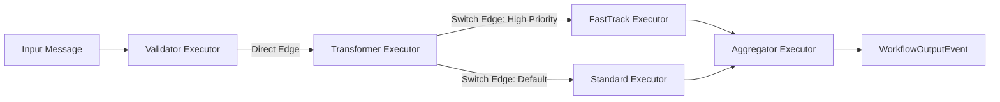

# Module 11 — Workflows: Graph Engine & Executors

> **Time:** ~40 min · **Level:** Intermediate · **Prerequisites:** [Module 02](02-first-agent.md), [Module 06](06-middleware.md)
> **Packages:** `Microsoft.Agents.AI.Workflows` 1.28.0 (GA), `Microsoft.Agents.AI.Workflows.Generators` 1.28.0 (GA), `Microsoft.Agents.AI.OpenAI` 1.28.0 (GA)

## Learning objectives

- Explain the architecture of the Microsoft Agent Framework Workflow engine and its Bulk Synchronous Parallel (BSP) superstep model.
- Implement workflow executors using `[MessageHandler]` with compile-time source generation, typed bases (`Executor<TIn, TOut>`), and lightweight function bindings (`BindAsExecutor`).
- Configure message routing using direct edges, conditional branches, switch-case constructs, fan-out parallel dispatch, and fan-in synchronization barriers.
- Manage workflow state across steps using `QueueStateUpdateAsync` and `ReadStateAsync` with explicit scope boundaries.
- Stream and inspect workflow lifecycle events (`WorkflowStartedEvent`, `ExecutorCompletedEvent`, `WorkflowOutputEvent`) using `InProcessExecution.RunStreamingAsync`.
- Visualize workflow topologies programmatically in Mermaid and Graphviz DOT formats.

---

## Concepts

### Why Workflows?

Autonomous agents excel at unstructured reasoning, but production software architectures frequently require deterministic execution:

- **Strict Control Flow:** Guarantees that step A always runs before step B, and step C only executes if a specific condition evaluates to true.
- **Explicit Parallelism:** Concurrently runs multiple tasks (fan-out) and synchronizes them at a barrier (fan-in) before proceeding.
- **Traceable Message Routing:** Every payload between components is typed, validated, and logged.
- **Isolation & Shared State:** Executors communicate via discrete messages while retaining access to scoped shared state.

In MAF, a **Workflow** is a directed graph where **Executors** form the vertices (nodes) and **Edges** form the directed transitions.



---

### Executors: The Building Blocks

An **Executor** is an autonomous processing unit that receives a typed input message, processes it, and either emits messages to downstream executors or yields final workflow outputs.

There are three ways to define executors in C#:

#### 1. Source-Generated Executors (`[MessageHandler]`) — Recommended

Derive from `Executor`, declare your class as `partial`, and decorate message handling methods with `[MessageHandler]`. The `Microsoft.Agents.AI.Workflows.Generators` package generates registration code at compile time, ensuring Native AOT compatibility and zero reflection overhead:

```csharp
using Microsoft.Agents.AI.Workflows;

internal sealed partial class UppercaseExecutor() : Executor("UppercaseExecutor")
{
    [MessageHandler]
    private ValueTask<string> HandleAsync(string input, IWorkflowContext context)
    {
        // Returning a non-void value automatically forwards the result to downstream connected executors
        return ValueTask.FromResult(input.ToUpperInvariant());
    }
}
```

A single executor can handle multiple distinct message types by declaring multiple `[MessageHandler]` methods:

```csharp
internal sealed partial class MultiTypeExecutor() : Executor("MultiTypeExecutor")
{
    [MessageHandler]
    private ValueTask<string> HandleTextAsync(string text, IWorkflowContext context)
        => ValueTask.FromResult($"Processed string: {text}");

    [MessageHandler]
    private ValueTask<int> HandleNumberAsync(int number, IWorkflowContext context)
        => ValueTask.FromResult(number * 10);
}
```

#### 2. Strongly Typed Base Classes (`Executor<TIn>` and `Executor<TIn, TOut>`)

For simple, single-purpose executors with fixed input and output contracts:

```csharp
internal sealed class SuffixExecutor() : Executor<string, string>("SuffixExecutor")
{
    public override ValueTask<string> HandleAsync(
        string message,
        IWorkflowContext context,
        CancellationToken cancellationToken = default)
    {
        return ValueTask.FromResult($"{message} [PROCESSED]");
    }
}
```

#### 3. Function Executors (`BindAsExecutor`)

Turn standard C# delegates (`Func<TIn, TOut>`, `Func<TIn, ValueTask<TOut>>`, or `Action<TIn>`) directly into workflow nodes using the `BindAsExecutor` extension method:

```csharp
Func<string, string> reverseFunc = text => new string(text.Reverse().ToArray());
ExecutorBinding reverseNode = reverseFunc.BindAsExecutor("ReverseExecutor");
```

---

### Declaring Protocol Types and `YieldOutputAsync`

Executors declare the types of messages they are permitted to emit. The workflow runtime validates calls at runtime and throws `System.InvalidOperationException` if an undeclared type is surfaced.

- **Automatic Protocol Inference:** When an executor method returns a non-void type (such as `ValueTask<string>`), the return type is automatically declared as a sent message and an output type.
- **Manual Protocol Declaration:** When an executor uses `context.SendMessageAsync(...)` or `context.YieldOutputAsync(...)` inside a `void` or `ValueTask` handler, you **must** decorate the executor class with `[SendsMessage(typeof(...))]` and/or `[YieldsOutput(typeof(...))]`:

```csharp
[YieldsOutput(typeof(string))]
internal sealed partial class TerminalOutputExecutor() : Executor("TerminalOutputExecutor")
{
    [MessageHandler]
    private async ValueTask HandleAsync(string result, IWorkflowContext context)
    {
        // Emits output directly to the caller watching the workflow stream
        await context.YieldOutputAsync(result);
    }
}
```

---

### Edges & Routing Patterns

Edges connect executors and govern how messages travel across the graph.

```mermaid
flowchart TD
  subgraph DirectEdge["1. Direct Edge"]
    D1["Source"] -->|AddEdge| D2["Target"]
  end

  subgraph ConditionalEdge["2. Conditional Edge"]
    C1["Source"] -->|AddEdge(condition)| C2["True Branch"]
  end

  subgraph SwitchEdge["3. Switch-Case Edge"]
    S1["Source"] -->|AddCase<T>(is A)| S2["Handler A"]
    S1 -->|AddCase<T>(is B)| S3["Handler B"]
    S1 -->|WithDefault| S4["Default Handler"]
  end

  subgraph FanOutIn["4. Fan-Out / Fan-In Barrier"]
    F1["Dispatcher"] -->|AddFanOutEdge| W1["Worker 1"]
    F1 -->|AddFanOutEdge| W2["Worker 2"]
    W1 -->|AddFanInBarrierEdge| Agg["Aggregator"]
    W2 -->|AddFanInBarrierEdge| Agg
  end
```

#### 1. Direct Edges

Simple point-to-point connections:

```csharp
builder.AddEdge(sourceExecutor, targetExecutor);
```

#### 2. Conditional Edges

Evaluates a predicate before routing messages to the target:

```csharp
builder.AddEdge(sourceExecutor, targetExecutor, condition: msg => msg is Order o && o.Total > 100);
```

#### 3. Switch-Case Edges

Multi-branch routing where messages evaluate against typed conditions:

```csharp
builder.AddSwitch(triageExecutor, switchBuilder =>
    switchBuilder
        .AddCase<Ticket>(t => t?.Priority == Priority.High, urgentHandler)
        .AddCase<Ticket>(t => t?.Priority == Priority.Medium, standardHandler)
        .WithDefault(generalHandler));
```

#### 4. Fan-Out and Fan-In Barrier Edges

- **Fan-Out (`AddFanOutEdge`):** A single source sends copies of a message to multiple targets in parallel.
- **Fan-In Barrier (`AddFanInBarrierEdge`):** Synchronizes multiple worker nodes. Messages from all sources are held at the barrier until **every** source has produced at least one message. Once satisfied, the aggregated messages are delivered to the target executor in the next superstep:

```csharp
ExecutorBinding[] workers = [workerA, workerB, workerC];

builder.AddFanOutEdge(dispatcher, targets: workers)
       .AddFanInBarrierEdge(sources: workers, target: aggregator);
```

> [!IMPORTANT]
> In MAF 1.28.0, the non-obsolete signature for `AddFanInBarrierEdge` takes the sources collection first and the target executor second: `AddFanInBarrierEdge(IEnumerable<ExecutorBinding> sources, ExecutorBinding target)`.

---

### The Execution Model: Supersteps (Bulk Synchronous Parallel)

MAF workflows operate on a **Bulk Synchronous Parallel (BSP)** superstep model inspired by Google Pregel:

```text
               SUPERSTEP N                                 SUPERSTEP N + 1
┌───────────────────────────────────────┐   ┌───────────────────────────────────────┐
│ 1. Collect pending messages           │   │ 1. Collect routed messages            │
│ 2. Evaluate edges & route to targets  │   │ 2. Evaluate edges & route to targets  │
│ 3. Execute target executors concurrently ───▶ 3. Execute downstream executors      │
│ 4. Barrier: Wait for ALL to finish    │   │ 4. Barrier: Wait for ALL to finish    │
│ 5. Queue new messages & state updates │   │ 5. Queue new messages & state updates │
└───────────────────────────────────────┘   └───────────────────────────────────────┘
```

Within a single superstep:
1. Pending messages are collected from the inbound queue.
2. Edge predicates are evaluated to determine target executors.
3. All target executors run concurrently on worker threads.
4. Execution pauses at a synchronization barrier until all running executors in the step finish.
5. Emitted messages and state updates are staged for delivery in the next superstep.

---

### Shared State: Scopes and Superstep Visibility

Executors frequently need to store data out-of-band without passing bulky payloads through intermediate edges.

`IWorkflowContext` provides scoped state management:
- **Private Scope (`scopeName: null`):** Accessible only by the executor that wrote it.
- **Shared Scope (`scopeName: "ScopeName"`):** Accessible by any executor specifying the same scope name.

```csharp
// Writing state in Executor A
await context.QueueStateUpdateAsync("customerProfile", profile, scopeName: "SharedBilling");

// Reading state in Executor B
CustomerProfile? profile = await context.ReadStateAsync<CustomerProfile>("customerProfile", scopeName: "SharedBilling");
```

> [!WARNING]
> **Superstep State Visibility Rule:** An executor that calls `QueueStateUpdateAsync` can immediately read its own update within the same handler. However, peer or downstream executors will **not** see the updated value until the **next superstep**.

---

### Workflow Events & Streaming Execution

Workflows can run in two modes:

1. **Non-Streaming (`InProcessExecution.RunAsync`):** Waits for complete execution and returns a `Run` object containing all recorded events.
2. **Streaming (`InProcessExecution.RunStreamingAsync`):** Returns a `StreamingRun` that yields events live via an asynchronous enumerable:

```csharp
StreamingRun run = await InProcessExecution.RunStreamingAsync(workflow, initialMessage);

await foreach (WorkflowEvent evt in run.WatchStreamAsync())
{
    switch (evt)
    {
        case WorkflowStartedEvent:
            Console.WriteLine("[Workflow Started]");
            break;
        case SuperStepStartedEvent s:
            Console.WriteLine($"[Superstep #{s.StepNumber} Started]");
            break;
        case ExecutorInvokedEvent inv:
            Console.WriteLine($"  Executing {inv.ExecutorId}...");
            break;
        case ExecutorCompletedEvent comp:
            Console.WriteLine($"  Completed {comp.ExecutorId}");
            break;
        case WorkflowOutputEvent output:
            Console.WriteLine($"\n[Workflow Output]: {output.Data}");
            break;
        case WorkflowErrorEvent err:
            Console.WriteLine($"[Error]: {err.Exception.Message}");
            break;
    }
}
```

---

### Workflow Visualization

Verify your workflow design visually before executing it. MAF provides built-in exporters:

```csharp
Workflow workflow = builder.Build();

// Generate Mermaid flowchart
string mermaidGraph = workflow.ToMermaidString();
Console.WriteLine(mermaidGraph);

// Generate Graphviz DOT format
string dotGraph = workflow.ToDotString();
```

---

## Hands-on

### Example 1 — Type-Safe Document Translation Pipeline

Let's build a multi-stage sequential pipeline using source-generated executors, strongly typed records, and `YieldOutputAsync`.

#### 1. Setup

Create a new console application:

```bash
dotnet new console -n WorkflowPipelineApp
cd WorkflowPipelineApp
dotnet add package Microsoft.Agents.AI.Workflows --version 1.28.0
dotnet add package Microsoft.Agents.AI.Workflows.Generators --version 1.28.0
```

#### 2. Program.cs

```csharp
using Microsoft.Agents.AI.Workflows;

// 1. Instantiate executors
var parser = new DocumentParserExecutor();
var translator = new TranslatorExecutor();
var terminalOutput = new TerminalOutputExecutor();

// 2. Build the workflow graph
WorkflowBuilder builder = new(parser);
builder.AddEdge(parser, translator);
builder.AddEdge(translator, terminalOutput);
builder.WithOutputFrom(terminalOutput); // Register terminal output source

Workflow workflow = builder.Build();

// 3. Print Mermaid visualization
Console.WriteLine("=== WORKFLOW TOPOLOGY ===");
Console.WriteLine(workflow.ToMermaidString());
Console.WriteLine();

// 4. Execute the workflow
Console.WriteLine("=== EXECUTING PIPELINE ===");
Run run = await InProcessExecution.RunAsync(workflow, "  ## Release Notes: Version 2.0 introduces speed improvements.  ");

foreach (WorkflowEvent evt in run.NewEvents)
{
    if (evt is WorkflowOutputEvent outputEvt)
    {
        Console.WriteLine($"Final Workflow Output:\n{outputEvt.Data}");
    }
}

// ----------------------------------------------------
// Executors & Data Contracts
// ----------------------------------------------------
internal sealed record Document(string Title, string Body);

internal sealed partial class DocumentParserExecutor() : Executor("DocumentParser")
{
    [MessageHandler]
    private ValueTask<Document> HandleAsync(string rawInput, IWorkflowContext context)
    {
        string cleaned = rawInput.Trim();
        string title = cleaned.StartsWith("##") ? cleaned[2..cleaned.IndexOf(':')].Trim() : "Untitled";
        string body = cleaned.Contains(':') ? cleaned[(cleaned.IndexOf(':') + 1)..].Trim() : cleaned;

        Console.WriteLine($"[Parser] Extracted Document: '{title}'");
        return ValueTask.FromResult(new Document(title, body));
    }
}

internal sealed partial class TranslatorExecutor() : Executor("Translator")
{
    [MessageHandler]
    private ValueTask<string> HandleAsync(Document doc, IWorkflowContext context)
    {
        Console.WriteLine($"[Translator] Translating document '{doc.Title}' to Spanish...");
        string translated = $"[ES] {doc.Title}: {doc.Body.Replace("introduces speed improvements", "introduce mejoras de velocidad")}";
        return ValueTask.FromResult(translated);
    }
}

[YieldsOutput(typeof(string))]
internal sealed partial class TerminalOutputExecutor() : Executor("TerminalOutput")
{
    [MessageHandler]
    private async ValueTask HandleAsync(string translatedText, IWorkflowContext context)
    {
        Console.WriteLine("[TerminalOutput] Yielding final output to caller.");
        await context.YieldOutputAsync(translatedText);
    }
}
```

---

### Example 2 — Support Ticket Routing with Switch-Case & Shared State

This example demonstrates switch-case routing based on ticket categories, persisting original ticket metadata in shared state.

#### 1. Setup

```bash
dotnet new console -n WorkflowSwitchApp
cd WorkflowSwitchApp
dotnet add package Microsoft.Agents.AI.Workflows --version 1.28.0
dotnet add package Microsoft.Agents.AI.Workflows.Generators --version 1.28.0
```

#### 2. Program.cs

```csharp
using Microsoft.Agents.AI.Workflows;

var triage = new TriageExecutor();
var billing = new BillingExecutor();
var tech = new TechnicalExecutor();
var general = new GeneralSupportExecutor();

WorkflowBuilder builder = new(triage);

builder.AddSwitch(triage, switchBuilder =>
    switchBuilder
        .AddCase<Ticket>(t => t?.Category == "Billing", billing)
        .AddCase<Ticket>(t => t?.Category == "Technical", tech)
        .WithDefault(general))
    .WithOutputFrom(billing, tech, general);

Workflow workflow = builder.Build();

Console.WriteLine("=== TICKET ROUTING WORKFLOW ===");
Console.WriteLine(workflow.ToMermaidString());
Console.WriteLine();

// Test Ticket 1: Billing
Ticket t1 = new("TCK-101", "Billing", "Customer charged twice for invoice #902.");
Run r1 = await InProcessExecution.RunAsync(workflow, t1);
PrintOutput(r1);

// Test Ticket 2: Technical
Ticket t2 = new("TCK-102", "Technical", "Database connection pool exhausted.");
Run r2 = await InProcessExecution.RunAsync(workflow, t2);
PrintOutput(r2);

static void PrintOutput(Run run)
{
    foreach (var evt in run.NewEvents)
    {
        if (evt is WorkflowOutputEvent outEvt)
        {
            Console.WriteLine($"[Result]: {outEvt.Data}");
        }
    }
}

// ----------------------------------------------------
// Types
// ----------------------------------------------------
internal sealed record Ticket(string Id, string Category, string Description);

internal sealed partial class TriageExecutor() : Executor("TriageExecutor")
{
    [MessageHandler]
    private async ValueTask<Ticket> HandleAsync(Ticket ticket, IWorkflowContext context)
    {
        // Store raw ticket description in shared state
        await context.QueueStateUpdateAsync(ticket.Id, ticket.Description, scopeName: "TicketAuditScope");
        Console.WriteLine($"[Triage] Ticket {ticket.Id} triaged into category: {ticket.Category}");
        return ticket;
    }
}

[YieldsOutput(typeof(string))]
internal sealed partial class BillingExecutor() : Executor("BillingExecutor")
{
    [MessageHandler]
    private async ValueTask HandleAsync(Ticket ticket, IWorkflowContext context)
    {
        string? auditDesc = await context.ReadStateAsync<string>(ticket.Id, scopeName: "TicketAuditScope");
        await context.YieldOutputAsync($"[BILLING DESK] Resolved {ticket.Id} - Audit: '{auditDesc}'");
    }
}

[YieldsOutput(typeof(string))]
internal sealed partial class TechnicalExecutor() : Executor("TechnicalExecutor")
{
    [MessageHandler]
    private async ValueTask HandleAsync(Ticket ticket, IWorkflowContext context)
    {
        await context.YieldOutputAsync($"[TIER-3 TECH] Investigating system fault on {ticket.Id}");
    }
}

[YieldsOutput(typeof(string))]
internal sealed partial class GeneralSupportExecutor() : Executor("GeneralSupportExecutor")
{
    [MessageHandler]
    private async ValueTask HandleAsync(Ticket ticket, IWorkflowContext context)
    {
        await context.YieldOutputAsync($"[GENERAL HELP] Routing {ticket.Id} to standard queue.");
    }
}
```

---

### Example 3 — Parallel Fan-Out / Fan-In Barrier with Live Event Streaming

In this example, a dispatcher broadcasts code to three specialized auditor functions in parallel. The fan-in barrier holds execution until all three auditors complete, and an aggregator combines the reports.

#### 1. Setup

```bash
dotnet new console -n WorkflowFanOutApp
cd WorkflowFanOutApp
dotnet add package Microsoft.Agents.AI.Workflows --version 1.28.0
dotnet add package Microsoft.Agents.AI.Workflows.Generators --version 1.28.0
```

#### 2. Program.cs

```csharp
using Microsoft.Agents.AI.Workflows;

// 1. Dispatcher executor
var dispatcher = new CodeDispatcherExecutor();

// 2. Micro-auditors using BindAsExecutor delegates
ExecutorBinding secAuditor = ((Func<string, string>)(code => $"[Security: Clean, no SQL injection detected in {code.Length} chars]"))
    .BindAsExecutor("SecurityAuditor");

ExecutorBinding perfAuditor = ((Func<string, string>)(code => $"[Performance: Optimal, O(1) allocation overhead]"))
    .BindAsExecutor("PerformanceAuditor");

ExecutorBinding styleAuditor = ((Func<string, string>)(code => $"[Style: Follows C# 10 naming conventions]"))
    .BindAsExecutor("StyleAuditor");

// 3. Synthesis aggregator executor
var synthesisAggregator = new SynthesisAggregatorExecutor();

ExecutorBinding[] auditorNodes = [secAuditor, perfAuditor, styleAuditor];

// 4. Build graph with fan-out and fan-in barrier
WorkflowBuilder builder = new(dispatcher);
builder.AddFanOutEdge(dispatcher, targets: auditorNodes);
builder.AddFanInBarrierEdge(sources: auditorNodes, target: synthesisAggregator);
builder.WithOutputFrom(synthesisAggregator);

Workflow workflow = builder.Build();

Console.WriteLine("=== AUDIT WORKFLOW TOPOLOGY ===");
Console.WriteLine(workflow.ToMermaidString());
Console.WriteLine();

// 5. Stream execution events live
string sampleCode = "public record User(string Name, string Role);";
Console.WriteLine("=== STREAMING EXECUTION ===");

StreamingRun streamingRun = await InProcessExecution.RunStreamingAsync(workflow, sampleCode);

await foreach (WorkflowEvent evt in streamingRun.WatchStreamAsync())
{
    switch (evt)
    {
        case SuperStepStartedEvent step:
            Console.WriteLine($"\n--> Superstep #{step.StepNumber} Started");
            break;
        case ExecutorInvokedEvent inv:
            Console.WriteLine($"    Executing: {inv.ExecutorId}");
            break;
        case ExecutorCompletedEvent comp:
            Console.WriteLine($"    Completed: {comp.ExecutorId}");
            break;
        case WorkflowOutputEvent output:
            Console.ForegroundColor = ConsoleColor.Green;
            Console.WriteLine($"\n[FINAL AUDIT REPORT]:\n{output.Data}");
            Console.ResetColor();
            break;
    }
}

// ----------------------------------------------------
// Executors
// ----------------------------------------------------
internal sealed partial class CodeDispatcherExecutor() : Executor("CodeDispatcher")
{
    [MessageHandler]
    private ValueTask<string> HandleAsync(string codeSnippet, IWorkflowContext context)
    {
        Console.WriteLine("[Dispatcher] Dispatching code snippet to audit nodes...");
        return ValueTask.FromResult(codeSnippet);
    }
}

[YieldsOutput(typeof(string))]
internal sealed partial class SynthesisAggregatorExecutor() : Executor("SynthesisAggregator")
{
    private readonly List<string> _findings = [];

    [MessageHandler]
    private async ValueTask HandleAsync(string finding, IWorkflowContext context)
    {
        this._findings.Add(finding);

        // When all 3 reports arrive, yield the composite result
        if (this._findings.Count == 3)
        {
            string compositeReport = string.Join("\n", this._findings);
            await context.YieldOutputAsync(compositeReport);
        }
    }
}
```

---

## Common pitfalls

- **Symptom:** `System.InvalidOperationException: Cannot output object of type String. Expecting one of [].`
  - **Cause:** An executor called `context.YieldOutputAsync(data)` inside a handler that returns `ValueTask` (void return), and the executor class was not decorated with `[YieldsOutput(typeof(String))]`.
  - **Fix:** Add `[YieldsOutput(typeof(YourType))]` at the class level of the executor.

- **Symptom:** `error CS0121: The call is ambiguous between AddFanInBarrierEdge(...) overloads.`
  - **Cause:** Calling `AddFanInBarrierEdge(target, sources)` which conflicts with the newer `AddFanInBarrierEdge(sources, target)`.
  - **Fix:** Pass sources first as a typed array or collection, and target second: `builder.AddFanInBarrierEdge(sources: [node1, node2], target: aggregator)`.

- **Symptom:** Executor B reads shared state written by Executor A in the same superstep, but gets `null`.
  - **Cause:** State queued with `QueueStateUpdateAsync` is staged during the current superstep. Sibling and downstream executors only see state updates starting in the **next superstep**.
  - **Fix:** Ensure an edge transition or intermediate step separates the writer executor from reader executors.

- **Symptom:** `System.InvalidOperationException: Cannot use a running Workflow as a subworkflow.`
  - **Cause:** An existing `Workflow` instance was executed via `InProcessExecution.RunAsync(workflow, ...)` and then subsequently bound as a sub-workflow using `workflow.BindAsExecutor("Sub")`.
  - **Fix:** Build a fresh `Workflow` instance specifically for embedding as a sub-workflow.

- **Symptom:** `error CS0411: The type arguments for method SwitchBuilder.AddCase<T> cannot be inferred.`
  - **Cause:** Calling `switchBuilder.AddCase(msg => ...)` without explicitly declaring the message type `<T>`.
  - **Fix:** Supply the generic type parameter: `switchBuilder.AddCase<Ticket>(t => t?.Category == "Billing", target)`.

---

## When to use / when not to use

| Scenario | Recommendation | Alternative |
|---|---|---|
| **Deterministic business logic with strict branch conditions** | **Use Workflows** — predictable routing, explicit edge rules. | Avoid autonomous Harness. |
| **Parallel fan-out execution with synchronization barriers** | **Use Workflows** (`AddFanOutEdge` + `AddFanInBarrierEdge`). | Sequential orchestrations ([Module 13](13-orchestrations.md)). |
| **Open-ended research, planning, or iterative debugging** | **Do NOT use Workflows** — rigid graph cannot spontaneously plan steps. | Use `HarnessAgent` ([Module 09](09-agent-harness.md)). |
| **Multi-agent conversation with dynamic speaker selection** | **Do NOT use Workflows** — graph transitions are fixed. | Use Group Chat Orchestration ([Module 13](13-orchestrations.md)). |
| **Auditable corporate pipeline with checkpointing & event streaming** | **Use Workflows** — complete event stream, state scopes, and replayable supersteps. | Custom middleware ([Module 06](06-middleware.md)). |

---

## Exercises

1. **Document Translation Pipeline:**
   Build a sequential workflow using `WorkflowBuilder` that takes a raw Markdown string, passes it to a `DocumentParserExecutor` that produces a `Document` record (`Title`, `Content`), routes it to a `TranslatorExecutor` that translates the content, and outputs the result via an executor with `[YieldsOutput(typeof(string))]`.

2. **Conditional Support Escalation with Shared State:**
   Implement a support triage workflow where incoming `Ticket` objects are triaged. Use `AddSwitch` to route tickets to `BillingExecutor`, `TechnicalExecutor`, or `GeneralSupportExecutor`. In `TriageExecutor`, queue the ticket description in a shared state scope named `"TicketScope"`. Each handler must read the shared description and yield an escalation confirmation.

3. **Parallel Micro-Auditors with Fan-Out / Fan-In:**
   Construct a code analysis workflow. A `DispatcherExecutor` fans out an incoming code string to three function executors bound with `BindAsExecutor` (`SecurityAuditor`, `PerformanceAuditor`, `StyleAuditor`). Connect all three auditors to a `SynthesisAggregatorExecutor` using `AddFanInBarrierEdge`. Stream the execution events to the console and verify that the aggregator yields the consolidated audit report.

---

## Summary

- **Workflows** provide deterministic, inspectable graph coordination for agents and business logic.
- **Executors** derive from `Executor` with `[MessageHandler]` attributes for source-generated handlers, or from `Executor<TIn, TOut>`, or delegates via `BindAsExecutor`.
- Any executor calling `YieldOutputAsync` without returning that type directly must declare `[YieldsOutput(typeof(...))]` on the class.
- The **Superstep Execution Model** (BSP) ensures parallel execution of active executors, synchronization barriers, and phased state visibility.
- Edges support direct transitions, conditions, typed switch-cases, parallel fan-out, and synchronized fan-in barriers.
- Workflows export native Mermaid (`ToMermaidString()`) and Graphviz DOT (`ToDotString()`) diagrams.

---

## Further reading

- [Microsoft Learn: Workflow Concepts](https://learn.microsoft.com/en-us/agent-framework/concepts/workflows/?pivots=programming-language-csharp)
- [Microsoft Learn: Workflow Executors](https://learn.microsoft.com/en-us/agent-framework/concepts/workflows/executors?pivots=programming-language-csharp)
- [Microsoft Learn: Workflow Edges & Routing](https://learn.microsoft.com/en-us/agent-framework/concepts/workflows/edges?pivots=programming-language-csharp)
- [Microsoft Learn: Workflow State Management](https://learn.microsoft.com/en-us/agent-framework/concepts/workflows/state?pivots=programming-language-csharp)
- [Microsoft Learn: Workflow Visualization](https://learn.microsoft.com/en-us/agent-framework/workflows/visualization?pivots=programming-language-csharp)
- [GitHub: Workflow Visualization Sample](https://github.com/microsoft/agent-framework/tree/main/dotnet/samples/03-workflows/Visualization)

---

## Solutions

### Exercise 1 — Document Translation Pipeline

```csharp
using Microsoft.Agents.AI.Workflows;

var parser = new DocumentParserExecutor();
var translator = new TranslatorExecutor();
var docOutput = new DocOutputExecutor();

var workflow = new WorkflowBuilder(parser)
    .AddEdge(parser, translator)
    .AddEdge(translator, docOutput)
    .WithOutputFrom(docOutput)
    .Build();

Run run = await InProcessExecution.RunAsync(workflow, "  ## Release 1.0: Everything is operational.  ");

foreach (WorkflowEvent evt in run.NewEvents)
{
    if (evt is WorkflowOutputEvent outEvt)
    {
        Console.WriteLine($"Result: {outEvt.Data}");
    }
}

// --- Types ---
internal sealed record Document(string Title, string Content);

internal sealed partial class DocumentParserExecutor() : Executor("DocumentParser")
{
    [MessageHandler]
    private ValueTask<Document> HandleAsync(string rawInput, IWorkflowContext context)
    {
        return ValueTask.FromResult(new Document("ReleaseNotes", rawInput.Trim()));
    }
}

internal sealed partial class TranslatorExecutor() : Executor("Translator")
{
    [MessageHandler]
    private ValueTask<string> HandleAsync(Document doc, IWorkflowContext context)
    {
        return ValueTask.FromResult($"[ES] {doc.Title}: {doc.Content}");
    }
}

[YieldsOutput(typeof(string))]
internal sealed partial class DocOutputExecutor() : Executor("DocOutput")
{
    [MessageHandler]
    private async ValueTask HandleAsync(string translatedText, IWorkflowContext context)
    {
        await context.YieldOutputAsync(translatedText);
    }
}
```

### Exercise 2 — Conditional Support Escalation with Shared State

```csharp
using Microsoft.Agents.AI.Workflows;

var triage = new TriageExecutor();
var billing = new BillingExecutor();
var tech = new TechExecutor();
var general = new GeneralExecutor();

var builder = new WorkflowBuilder(triage);
builder.AddSwitch(triage, s => s
    .AddCase<Ticket>(t => t?.Category == "Billing", billing)
    .AddCase<Ticket>(t => t?.Category == "Technical", tech)
    .WithDefault(general))
    .WithOutputFrom(billing, tech, general);

var workflow = builder.Build();

Ticket sampleTicket = new("TCK-999", "Technical", "Out of memory exception during batch sync.");
Run run = await InProcessExecution.RunAsync(workflow, sampleTicket);

foreach (var evt in run.NewEvents)
{
    if (evt is WorkflowOutputEvent outEvt)
    {
        Console.WriteLine(outEvt.Data);
    }
}

// --- Types ---
internal sealed record Ticket(string Id, string Category, string Description);

internal sealed partial class TriageExecutor() : Executor("Triage")
{
    [MessageHandler]
    private async ValueTask<Ticket> HandleAsync(Ticket ticket, IWorkflowContext context)
    {
        await context.QueueStateUpdateAsync(ticket.Id, ticket.Description, scopeName: "TicketScope");
        return ticket;
    }
}

[YieldsOutput(typeof(string))]
internal sealed partial class BillingExecutor() : Executor("Billing")
{
    [MessageHandler]
    private async ValueTask HandleAsync(Ticket ticket, IWorkflowContext context)
    {
        string? desc = await context.ReadStateAsync<string>(ticket.Id, scopeName: "TicketScope");
        await context.YieldOutputAsync($"[Billing Dept] Handled {ticket.Id}: '{desc}'");
    }
}

[YieldsOutput(typeof(string))]
internal sealed partial class TechExecutor() : Executor("Technical")
{
    [MessageHandler]
    private async ValueTask HandleAsync(Ticket ticket, IWorkflowContext context)
    {
        string? desc = await context.ReadStateAsync<string>(ticket.Id, scopeName: "TicketScope");
        await context.YieldOutputAsync($"[Tier 3 Support] Escalated {ticket.Id}: '{desc}'");
    }
}

[YieldsOutput(typeof(string))]
internal sealed partial class GeneralExecutor() : Executor("General")
{
    [MessageHandler]
    private async ValueTask HandleAsync(Ticket ticket, IWorkflowContext context)
    {
        await context.YieldOutputAsync($"[General Desk] Received {ticket.Id}");
    }
}
```

### Exercise 3 — Parallel Micro-Auditors with Fan-Out / Fan-In

```csharp
using Microsoft.Agents.AI.Workflows;

var dispatcher = new DispatcherExecutor();
var secAuditor = ((Func<string, string>)(c => $"[Security: Passed - Clean parameters in '{c}']")).BindAsExecutor("SecurityAuditor");
var perfAuditor = ((Func<string, string>)(c => $"[Performance: Passed - Low memory allocation in '{c}']")).BindAsExecutor("PerfAuditor");
var styleAuditor = ((Func<string, string>)(c => $"[Style: Passed - Correct casing in '{c}']")).BindAsExecutor("StyleAuditor");
var synthesis = new SynthesisAggregatorExecutor();

ExecutorBinding[] auditors = [secAuditor, perfAuditor, styleAuditor];

var workflow = new WorkflowBuilder(dispatcher)
    .AddFanOutEdge(dispatcher, targets: auditors)
    .AddFanInBarrierEdge(sources: auditors, target: synthesis)
    .WithOutputFrom(synthesis)
    .Build();

StreamingRun run = await InProcessExecution.RunStreamingAsync(workflow, "public record Order(int Id);");

await foreach (WorkflowEvent evt in run.WatchStreamAsync())
{
    if (evt is WorkflowOutputEvent outEvt)
    {
        Console.WriteLine($"\nConsolidated Audit Finding:\n{outEvt.Data}");
    }
}

// --- Types ---
internal sealed partial class DispatcherExecutor() : Executor("Dispatcher")
{
    [MessageHandler]
    private ValueTask<string> HandleAsync(string codeSnippet, IWorkflowContext context)
    {
        return ValueTask.FromResult(codeSnippet);
    }
}

[YieldsOutput(typeof(string))]
internal sealed partial class SynthesisAggregatorExecutor() : Executor("SynthesisAggregator")
{
    [MessageHandler]
    private async ValueTask HandleAsync(string auditFinding, IWorkflowContext context)
    {
        await context.YieldOutputAsync($"Synthesized finding: {auditFinding}");
    }
}
```
