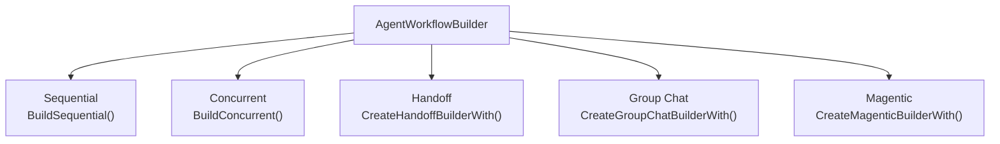
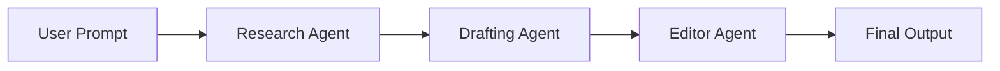
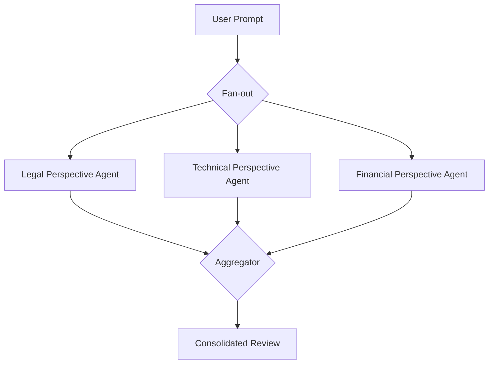
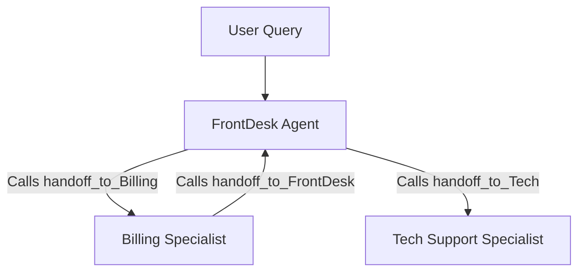
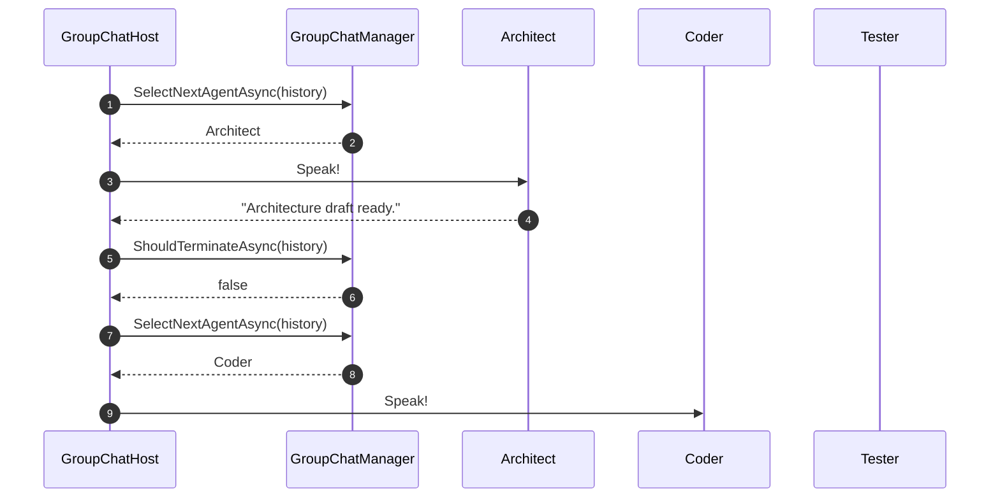
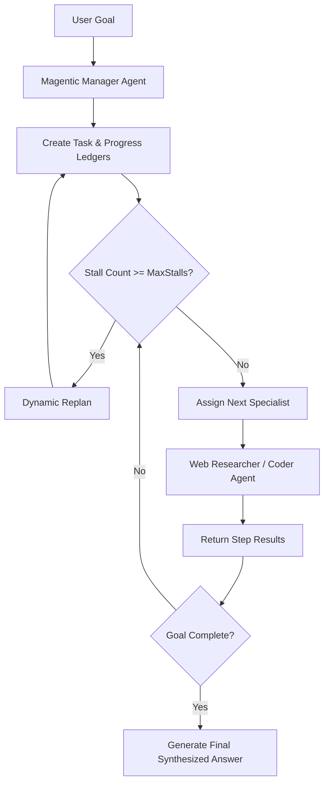

# Module 13 — Orchestrations

> **Time:** ~35 min · **Level:** Intermediate to Advanced · **Prerequisites:** [Module 11 — Workflows](11-workflows.md), [Module 12 — Agents in Workflows](12-agents-in-workflows.md)  
> **Packages:** `Microsoft.Agents.AI` 1.28.0 (GA), `Microsoft.Agents.AI.Workflows` 1.28.0 (GA), `Microsoft.Agents.AI.OpenAI` 1.28.0 (GA), `Microsoft.Extensions.AI` 10.11.0 (GA), `OpenAI` 2.15.0 (GA)

---

## Learning objectives

- Build multi-agent workflows using the high-level `AgentWorkflowBuilder` utility factory.
- Construct sequential agent pipelines and configure `chainOnlyAgentResponses` to control context window accumulation.
- Execute parallel agent tasks with `BuildConcurrent` and implement custom multi-agent message aggregator functions.
- Configure dynamic delegation with `CreateHandoffBuilderWith`, examining `handoff_to_<agent_id>` tool calling and `EnableReturnToPrevious()`.
- Implement collaborative multi-agent group discussions using `RoundRobinGroupChatManager` and customized `GroupChatManager` subclasses.
- Deploy Magentic-One planning workflows in C# using `CreateMagenticBuilderWith` with progress ledger tracking and signoff governance.

---

## Concepts

### The `AgentWorkflowBuilder` abstraction

In [Module 11](11-workflows.md) and [Module 12](12-agents-in-workflows.md), you constructed workflow graphs using raw `WorkflowBuilder`, manually declaring edges, message adapters, switches, and outputs. 

While raw `WorkflowBuilder` offers infinite flexibility for heterogeneous systems, multi-agent systems overwhelmingly follow five standard architectural topologies:
1. **Sequential:** Linear pipelines where output passes from agent to agent.
2. **Concurrent:** Parallel fan-out to multiple agents running simultaneously on identical input, followed by fan-in aggregation.
3. **Handoff:** Dynamic delegation where agents transfer control via LLM tool calls.
4. **Group Chat:** Multi-party conversation moderated by a deterministic or LLM-driven manager.
5. **Magentic (Magentic-One):** Dynamic task decomposition, progress ledgers, and replanning coordinated by an executive manager agent.

The **`AgentWorkflowBuilder`** class provides first-class fluent builders for these patterns, configuring underlying executors, state management, message routing, and turn-token propagation automatically.



---

### 1. Sequential orchestration

Sequential orchestration links agents in an ordered chain. Each agent receives input, processes it, and passes its response to the next agent.



#### Context accumulation vs `chainOnlyAgentResponses`

A critical architectural consideration in sequential pipelines is **context management**:
- `chainOnlyAgentResponses: false` (Default): The full conversation history accumulates along the pipeline. Agent 3 sees the initial user prompt, Agent 1's full reply, and Agent 2's full reply.
- `chainOnlyAgentResponses: true`: Only the immediately preceding agent's output is delivered to the next agent. Downstream agents never see earlier turns or the original raw user prompt, preventing token bloat and preventing prompt confusion.

```csharp
// Passes ONLY Agent 1's output to Agent 2:
Workflow workflow = AgentWorkflowBuilder.BuildSequential(
    chainOnlyAgentResponses: true,
    researchAgent, draftingAgent, editorAgent);
```

---

### 2. Concurrent orchestration & aggregators

Concurrent orchestration distributes the exact same user input to multiple agents in parallel (fan-out), then merges their responses into a single combined output (fan-in).



#### Default vs custom aggregators

By default, `AgentWorkflowBuilder.BuildConcurrent(agents)` gathers the **last message** emitted by each participating agent that produced at least one message.

To customize how responses merge (e.g., prefixing author identities, sorting, or computing a consensus summary), provide a custom aggregator delegate:

```csharp
Func<IList<List<ChatMessage>>, List<ChatMessage>> customAggregator = agentResponses =>
{
    List<ChatMessage> consolidated = [];
    foreach (List<ChatMessage> messages in agentResponses)
    {
        if (messages.LastOrDefault() is { } lastMsg)
        {
            string author = lastMsg.AuthorName ?? "Specialist";
            consolidated.Add(new ChatMessage(ChatRole.Assistant, $"[{author}]: {lastMsg.Text}"));
        }
    }
    return consolidated;
};

Workflow concurrentWorkflow = AgentWorkflowBuilder.BuildConcurrent(
    agents: [legalAgent, techAgent, financeAgent],
    aggregator: customAggregator);
```

---

### 3. Handoff orchestration

In a **handoff workflow**, agents dynamically transfer the conversation to peers based on intent detection. 



#### How handoffs work under the hood

1. When you configure `.WithHandoff(fromAgent, toAgent, handoffReason)`, MAF dynamically injects a synthetic function tool into `fromAgent` named:
   ```
   handoff_to_<toAgent.Id>
   ```
2. The function description incorporates the target agent's description and the configured `handoffReason`.
3. When `fromAgent` determines that the user's inquiry belongs to another specialist, its LLM invokes `handoff_to_<targetId>`.
4. The workflow catches this tool call, halts `fromAgent`, preserves conversation history, and routes the turn directly to `toAgent`.

#### Key handoff features

- **`EnableReturnToPrevious()`:** By default, new user turns route back to the initial (triage) agent. Enabling return-to-previous ensures subsequent user messages in a multi-turn chat go directly to whichever specialist handled the last turn.
- **Autonomous Mode:** Allows agents to continue looping autonomously until a task is finalized without waiting for external human input between every handoff.
- **Termination Conditions:** A delegate `Func<IReadOnlyList<ChatMessage>, ValueTask<bool>>` that determines when the handoff sequence has completed.

---

### 4. Group Chat orchestration

In a **group chat**, three or more agents collaborate in a shared virtual room. A **`GroupChatManager`** governs the conversation, selecting which agent speaks next and evaluating termination criteria.



#### Core members of `GroupChatManager`

When subclassing `GroupChatManager`, you override:

| Method / Property | Access | Purpose |
|---|---|---|
| `MaximumIterationCount` | `int` (get/set) | Maximum speaking turns allowed before mandatory termination (defaults to 40). |
| `IterationCount` | `int` (get) | Current turn count in the session. |
| `SelectNextAgentAsync` | `protected override` | Returns the `AIAgent` that should take the next turn based on chat history. |
| `ShouldTerminateAsync` | `protected override` | Evaluates whether the chat has reached a natural conclusion or termination keyword. |
| `UpdateHistoryAsync` | `protected override` | Shapes or filters the message history broadcast to participants. |
| `Reset` | `protected override` | Resets manager state for new runs. |

MAF provides a built-in **`RoundRobinGroupChatManager`** that cycles through agents in order. For production use, you can build custom managers driven by rule-based keyword matching or LLM routing.

---

### 5. Magentic orchestration (Magentic-One in .NET)

> [!NOTE]
> **.NET Availability:** While Microsoft Magentic-One was originally popularized as a Python multi-agent system, the **Microsoft Agent Framework for .NET includes full, production-ready Magentic orchestration** in the GA `Microsoft.Agents.AI.Workflows` package via `AgentWorkflowBuilder.CreateMagenticBuilderWith(...)`.

Magentic-One uses an **executive manager agent** to oversee complex, multi-step problem solving:
1. **Task Ledger:** The manager breaks the user request into concrete task sub-goals.
2. **Agent Assignment:** The manager selects the most qualified specialist agent for the current sub-goal.
3. **Progress Ledger & Stall Detection:** The manager continuously assesses whether progress is being made. If agents stall (no progress for $N$ consecutive rounds), the manager forces a replan.
4. **Plan Signoff:** Optional human-in-the-loop review (`RequirePlanSignoff(true)`) allowing human approval before plan execution commences.



---

## Hands-on

### Example 1 — Sequential pipeline with `chainOnlyAgentResponses`

In this example, three agents form a content pipeline: `DraftingAgent` generates a product overview, `FactCheckAgent` verifies assertions, and `ExecutivePolishAgent` reformats the output into a brief. 

We enable `chainOnlyAgentResponses: true` so each agent only receives the immediate predecessor's output.

#### Setup commands

```bash
dotnet new console -n SequentialOrchestrationSample -f net10.0
cd SequentialOrchestrationSample
dotnet add package Microsoft.Agents.AI --version 1.28.0
dotnet add package Microsoft.Agents.AI.OpenAI --version 1.28.0
dotnet add package Microsoft.Agents.AI.Workflows --version 1.28.0
dotnet add package Microsoft.Extensions.AI --version 10.11.0
dotnet add package OpenAI --version 2.15.0
```

#### Project file (`SequentialOrchestrationSample.csproj`)

```xml
<Project Sdk="Microsoft.NET.Sdk">
  <PropertyGroup>
    <OutputType>Exe</OutputType>
    <TargetFramework>net10.0</TargetFramework>
    <Nullable>enable</Nullable>
    <ImplicitUsings>enable</ImplicitUsings>
  </PropertyGroup>

  <ItemGroup>
    <PackageReference Include="Microsoft.Agents.AI" Version="1.28.0" />
    <PackageReference Include="Microsoft.Agents.AI.OpenAI" Version="1.28.0" />
    <PackageReference Include="Microsoft.Agents.AI.Workflows" Version="1.28.0" />
    <PackageReference Include="Microsoft.Extensions.AI" Version="10.11.0" />
    <PackageReference Include="OpenAI" Version="2.15.0" />
  </ItemGroup>
</Project>
```

#### Application code (`Program.cs`)

```csharp
using Microsoft.Agents.AI;
using Microsoft.Agents.AI.Workflows;
using Microsoft.Extensions.AI;
using OpenAI;
using OpenAI.Chat;

using ChatMessage = Microsoft.Extensions.AI.ChatMessage;

string apiKey = Environment.GetEnvironmentVariable("OPENAI_API_KEY")
    ?? throw new InvalidOperationException("Set OPENAI_API_KEY.");
string model = Environment.GetEnvironmentVariable("OPENAI_MODEL") ?? "gpt-5.4-mini";

OpenAIClient openAIClient = new(apiKey);

// 1. Define specialist agents
AIAgent drafter = openAIClient.GetChatClient(model).AsAIAgent(
    instructions: "You are a copywriter. Write a 50-word introduction about electric vertical takeoff aircraft (eVTOL).",
    name: "Drafter");

AIAgent factChecker = openAIClient.GetChatClient(model).AsAIAgent(
    instructions: "You are a technical fact checker. Verify claims in the incoming text and append [VERIFIED] or [CORRECTION: ...].",
    name: "FactChecker");

AIAgent executivePolisher = openAIClient.GetChatClient(model).AsAIAgent(
    instructions: "You are an executive editor. Reformat the incoming verified draft into bulleted executive takeaways.",
    name: "ExecutivePolisher");

// 2. Build sequential pipeline with chainOnlyAgentResponses = true
Workflow sequentialWorkflow = AgentWorkflowBuilder.BuildSequential(
    workflowName: "ContentPublishingPipeline",
    chainOnlyAgentResponses: true,
    drafter, factChecker, executivePolisher);

Console.WriteLine($"Workflow '{sequentialWorkflow.Name}' created.\n");

// 3. Execute with streaming
ChatMessage prompt = new(ChatRole.User, "Prepare a brief on urban air mobility.");
await using StreamingRun run = await InProcessExecution.RunStreamingAsync(sequentialWorkflow, prompt);
await run.TrySendMessageAsync(new TurnToken(emitEvents: true));

string? currentSpeaker = null;
await foreach (WorkflowEvent evt in run.WatchStreamAsync())
{
    if (evt is AgentResponseUpdateEvent update)
    {
        if (currentSpeaker != update.ExecutorId)
        {
            currentSpeaker = update.ExecutorId;
            Console.WriteLine($"\n\n[{currentSpeaker}]:");
        }
        Console.Write(update.Update.Text);
    }
}
Console.WriteLine("\n\n=== Sequential Pipeline Finished ===");
```

---

### Example 2 — Concurrent orchestration with custom aggregator

Here, three specialist agents review an architectural proposal from Security, Performance, and Cloud Cost angles in parallel. A custom aggregator consolidates the critiques.

#### Application code (`Program.cs`)

```csharp
using Microsoft.Agents.AI;
using Microsoft.Agents.AI.Workflows;
using Microsoft.Extensions.AI;
using OpenAI;
using OpenAI.Chat;

using ChatMessage = Microsoft.Extensions.AI.ChatMessage;

string apiKey = Environment.GetEnvironmentVariable("OPENAI_API_KEY") ?? "mock-key";
string model = Environment.GetEnvironmentVariable("OPENAI_MODEL") ?? "gpt-5.4-mini";

OpenAIClient client = new(apiKey);

AIAgent securityReviewer = client.GetChatClient(model).AsAIAgent(
    instructions: "Analyze the proposal strictly from a cybersecurity and zero-trust perspective in 2 concise bullets.",
    name: "SecurityReviewer");

AIAgent performanceReviewer = client.GetChatClient(model).AsAIAgent(
    instructions: "Analyze the proposal strictly from a high-throughput, low-latency performance perspective in 2 bullets.",
    name: "PerformanceReviewer");

AIAgent costReviewer = client.GetChatClient(model).AsAIAgent(
    instructions: "Analyze the proposal strictly from an Azure consumption cost-optimization perspective in 2 bullets.",
    name: "CostReviewer");

// Custom Aggregator: Combines and formats the latest message from each reviewer
Func<IList<List<ChatMessage>>, List<ChatMessage>> multiPerspectiveAggregator = agentResponses =>
{
    List<ChatMessage> consolidated = [];
    List<string> sections = [];

    foreach (List<ChatMessage> responses in agentResponses)
    {
        if (responses.LastOrDefault() is { } last)
        {
            string speaker = last.AuthorName ?? "Specialist";
            sections.Add($"### {speaker} Evaluation\n{last.Text}");
        }
    }

    string combinedSummary = string.Join("\n\n", sections);
    consolidated.Add(new ChatMessage(ChatRole.Assistant, combinedSummary));
    return consolidated;
};

// Build concurrent workflow
Workflow concurrentWorkflow = AgentWorkflowBuilder.BuildConcurrent(
    workflowName: "ArchitectureReviewBoard",
    agents: [securityReviewer, performanceReviewer, costReviewer],
    aggregator: multiPerspectiveAggregator);

Console.WriteLine($"Concurrent workflow '{concurrentWorkflow.Name}' built.");

// Execute with sample proposal
string architectureProposal = "We will store customer session tokens in an unencrypted Redis cache with a 30-day TTL.";
await using StreamingRun run = await InProcessExecution.RunStreamingAsync(
    concurrentWorkflow,
    new ChatMessage(ChatRole.User, architectureProposal));

await run.TrySendMessageAsync(new TurnToken(emitEvents: true));

await foreach (WorkflowEvent evt in run.WatchStreamAsync())
{
    if (evt is WorkflowOutputEvent output && output.Data is List<ChatMessage> finalMsgs)
    {
        Console.WriteLine("\n=== CONSOLIDATED REVIEW BOARD OUTPUT ===\n");
        foreach (var msg in finalMsgs)
        {
            Console.WriteLine(msg.Text);
        }
    }
}
```

---

### Example 3 — Customer support desk with Handoff (`EnableReturnToPrevious`)

In this example, an initial `TriageAgent` determines user intent and delegates to either `BillingAgent` or `TechSupportAgent`. We call `EnableReturnToPrevious()` so follow-up inquiries stay pinned to the specialist.

#### Application code (`Program.cs`)

```csharp
using Microsoft.Agents.AI;
using Microsoft.Agents.AI.Workflows;
using Microsoft.Extensions.AI;
using OpenAI;
using OpenAI.Chat;

using ChatMessage = Microsoft.Extensions.AI.ChatMessage;

string apiKey = Environment.GetEnvironmentVariable("OPENAI_API_KEY") ?? "mock-key";
string model = Environment.GetEnvironmentVariable("OPENAI_MODEL") ?? "gpt-5.4-mini";

OpenAIClient client = new(apiKey);

// 1. Instantiate specialized agents
AIAgent triageAgent = client.GetChatClient(model).AsAIAgent(
    instructions: "You are the receptionist. Greet the customer and immediately hand off to Billing or TechSupport based on need.",
    name: "TriageAgent",
    description: "Front desk triage agent that routes incoming tickets.");

AIAgent billingAgent = client.GetChatClient(model).AsAIAgent(
    instructions: "You are a billing specialist. Assist with invoices, refunds, and subscriptions. Once resolved, say [RESOLVED].",
    name: "BillingAgent",
    description: "Specialist handling payments, invoices, credit card charges, and subscription renewals.");

AIAgent techAgent = client.GetChatClient(model).AsAIAgent(
    instructions: "You are a technical support engineer. Assist with server errors, bugs, and API keys. Once resolved, say [RESOLVED].",
    name: "TechAgent",
    description: "Specialist handling software bugs, crashes, 500 errors, and developer integrations.");

// 2. Build handoff relationships
Workflow handoffWorkflow = AgentWorkflowBuilder.CreateHandoffBuilderWith(triageAgent)
    .WithHandoff(triageAgent, billingAgent, "Hand off when the user asks about invoices, pricing, or charges.")
    .WithHandoff(triageAgent, techAgent, "Hand off when the user reports bugs, crashes, or technical glitches.")
    .WithHandoff(billingAgent, triageAgent, "Return to triage if the customer asks something unrelated to billing.")
    .WithHandoff(techAgent, triageAgent, "Return to triage if the customer asks something unrelated to technical issues.")
    .EnableReturnToPrevious()
    .Build();

Console.WriteLine("Handoff workflow ready. Tools 'handoff_to_BillingAgent' and 'handoff_to_TechAgent' injected automatically.");
```

---

### Example 4 — Multi-Agent Group Chat with custom manager

In this example, a custom `GroupChatManager` orchestrates an iterative debate between an `Author` and an `Editor`. The manager switches speakers based on the last message and terminates when the editor says `[APPROVED]`.

#### Application code (`Program.cs`)

```csharp
using Microsoft.Agents.AI;
using Microsoft.Agents.AI.Workflows;
using Microsoft.Extensions.AI;
using OpenAI;
using OpenAI.Chat;

using ChatMessage = Microsoft.Extensions.AI.ChatMessage;

string apiKey = Environment.GetEnvironmentVariable("OPENAI_API_KEY") ?? "mock-key";
string model = Environment.GetEnvironmentVariable("OPENAI_MODEL") ?? "gpt-5.4-mini";

OpenAIClient client = new(apiKey);

AIAgent author = client.GetChatClient(model).AsAIAgent(
    instructions: "You are a creative author. Draft or revise a 2-line slogan based on editor feedback.",
    name: "Author");

AIAgent editor = client.GetChatClient(model).AsAIAgent(
    instructions: "You are a strict editor. Review the slogan. If it is punchy and memorable, output [APPROVED]. Otherwise provide short feedback.",
    name: "Editor");

// Build group chat with custom manager factory
Workflow groupChat = AgentWorkflowBuilder
    .CreateGroupChatBuilderWith(agents => new EditorialGroupChatManager(agents))
    .AddParticipants(author, editor)
    .Build();

Console.WriteLine("Group chat workflow built successfully.");

// ==========================================
// Custom GroupChatManager
// ==========================================

public sealed class EditorialGroupChatManager : GroupChatManager
{
    private readonly IReadOnlyList<AIAgent> _agents;

    public EditorialGroupChatManager(IReadOnlyList<AIAgent> agents)
    {
        this._agents = agents;
        this.MaximumIterationCount = 6;
    }

    protected override ValueTask<AIAgent> SelectNextAgentAsync(
        IReadOnlyList<ChatMessage> history,
        CancellationToken cancellationToken = default)
    {
        // First turn: Author drafts
        if (history.Count <= 1)
        {
            return new ValueTask<AIAgent>(this._agents.First(a => a.Name == "Author"));
        }

        string lastSpeaker = history.LastOrDefault()?.AuthorName ?? string.Empty;

        // Alternate turns between Author and Editor
        AIAgent next = lastSpeaker.Equals("Author", StringComparison.OrdinalIgnoreCase)
            ? this._agents.First(a => a.Name == "Editor")
            : this._agents.First(a => a.Name == "Author");

        return new ValueTask<AIAgent>(next);
    }

    protected override ValueTask<bool> ShouldTerminateAsync(
        IReadOnlyList<ChatMessage> history,
        CancellationToken cancellationToken = default)
    {
        string lastText = history.LastOrDefault()?.Text ?? string.Empty;

        // Terminate immediately when Editor approves
        if (lastText.Contains("[APPROVED]", StringComparison.OrdinalIgnoreCase))
        {
            return new ValueTask<bool>(true);
        }

        // Fallback to maximum turn limit check
        return base.ShouldTerminateAsync(history, cancellationToken);
    }
}
```

---

### Example 5 — Magentic-One planning workflow

This example demonstrates Magentic orchestration in .NET. A `ManagerAgent` creates dynamic plans, tracks progress through a progress ledger, and directs a `Researcher` and a `Coder`.

#### Application code (`Program.cs`)

```csharp
using Microsoft.Agents.AI;
using Microsoft.Agents.AI.Workflows;
using Microsoft.Agents.AI.Workflows.Specialized.Magentic;
using Microsoft.Extensions.AI;
using OpenAI;
using OpenAI.Chat;

using ChatMessage = Microsoft.Extensions.AI.ChatMessage;

string apiKey = Environment.GetEnvironmentVariable("OPENAI_API_KEY") ?? "mock-key";
string model = Environment.GetEnvironmentVariable("OPENAI_MODEL") ?? "gpt-5.4-mini";

OpenAIClient client = new(apiKey);

// 1. Instantiate the team
AIAgent researcher = client.GetChatClient(model).AsAIAgent(
    instructions: "You are a research specialist. Gather technical facts and cite data sources.",
    name: "ResearcherAgent",
    description: "Specialist in information retrieval and factual research.");

AIAgent coder = client.GetChatClient(model).AsAIAgent(
    instructions: "You are a software engineer. Write clean, idiomatic algorithms and verify computations.",
    name: "CoderAgent",
    description: "Specialist in writing and testing computational code.");

AIAgent manager = client.GetChatClient(model).AsAIAgent(
    instructions: "You are the Magentic Executive Manager. Break down user goals into concrete subtasks and supervise execution.",
    name: "MagenticManager",
    description: "Executive orchestrator coordinating the team to solve complex problems.");

// 2. Build Magentic Workflow
Workflow magenticWorkflow = AgentWorkflowBuilder.CreateMagenticBuilderWith(manager)
    .AddParticipants(researcher, coder)
    .WithName("MagenticProblemSolver")
    .WithDescription("Coordinates research and code development to solve analytical tasks.")
    .RequirePlanSignoff(false) // Set to true to require human approval of initial plan
    .WithMaxRounds(8)
    .WithMaxStalls(2)          // Replan after 2 rounds without measurable progress
    .WithMaxResets(1)
    .Build();

Console.WriteLine($"Magentic workflow '{magenticWorkflow.Name}' configured and ready.");
```

---

## Common pitfalls

### 1. Context window explosion in long sequential pipelines
- **Symptom:** Token costs soar rapidly and the final agent in a 5-step pipeline hits the model's context window limit.
- **Cause:** `BuildSequential` defaults to `chainOnlyAgentResponses = false`, copying the cumulative history into each subsequent agent.
- **Fix:** Set `chainOnlyAgentResponses: true` when downstream agents only require the output of their immediate predecessor.

### 2. Ambiguity when overriding `GroupChatManager` methods
- **Symptom:** Compiler error `CS0507: 'MyManager.SelectNextAgentAsync': cannot change access modifiers when overriding 'protected internal' inherited member`.
- **Cause:** `GroupChatManager.SelectNextAgentAsync` is declared `protected internal` in the MAF package. In user application code residing in an external assembly, the proper override modifier is `protected override`.
- **Fix:** Use `protected override ValueTask<AIAgent> SelectNextAgentAsync(...)`.

### 3. Agent ignores handoff tool
- **Symptom:** An agent in a handoff workflow says "I am handing you over to Billing", but the workflow halts and never transitions to the `BillingAgent`.
- **Cause:** The agent model failed to call the synthetic tool `handoff_to_BillingAgent`.
- **Fix:** Ensure the agent's instructions emphasize tool calling: *"You must call handoff_to_<agent_id> rather than announcing a handoff in conversation."* Also verify the model deployment supports tool/function calling.

### 4. Overlapping agent descriptions in handoff workflows
- **Symptom:** The LLM randomly routes to the wrong agent or oscillates back and forth.
- **Cause:** Vague or overlapping `description` properties and `handoffReason` strings.
- **Fix:** Give every agent distinct, non-overlapping responsibility descriptions.

---

## When to use / when not to use

| Orchestration Pattern | When to use | When NOT to use |
|---|---|---|
| **Sequential** | Strict step-by-step pipelines (e.g., Ingest → Translate → Polish → Summarize). | Dynamic decisions where the sequence depends on content analysis. |
| **Concurrent** | Multi-perspective evaluations, independent parallel tasks, or consensus voting. | Tasks with causal dependencies where Step 2 requires Step 1's results. |
| **Handoff** | Interactive customer support, triage bots, and specialist escalation paths. | Fixed sequential chains where routing order is predetermined. |
| **Group Chat** | Brainstorming, multi-agent debates, and peer-review committees with flexible turn order. | Linear workflows with rigid compliance gates. |
| **Magentic** | Open-ended, complex research and synthesis requiring dynamic planning, progress monitoring, and automatic replanning. | Simple tasks where planning overhead introduces unnecessary latency and cost. |

---

## Exercises

1. **Exercise 1: Concurrent Consensus Voter**  
   Create a concurrent workflow with three evaluator agents: `StrictEvaluator`, `BalancedEvaluator`, and `PermissiveEvaluator`. Feed them an enterprise access request. Build a custom aggregator that calculates an approval consensus (passes only if at least 2 out of 3 approve).

2. **Exercise 2: Multi-Turn Handoff Helpdesk with Return-to-Previous**  
   Implement a support triage system with `Triage`, `HardwareSupport`, and `SoftwareSupport`. Ensure the triage agent delegates correctly based on keywords. Demonstrate with `EnableReturnToPrevious()` that subsequent user inputs route directly to the active specialist.

3. **Exercise 3: Round-Robin Code Generation and Review Group Chat**  
   Build a group chat workflow using `RoundRobinGroupChatManager` containing `DeveloperAgent`, `SecurityAuditor`, and `DocumentationAgent`. Configure `MaximumIterationCount = 3` so that each agent contributes exactly once to the final project deliverable.

---

## Summary

- `AgentWorkflowBuilder` provides high-level factory methods for standard multi-agent patterns, eliminating manual executor wiring.
- `BuildSequential` arranges agents in an orderly chain; use `chainOnlyAgentResponses: true` to prevent cumulative token bloat.
- `BuildConcurrent` fans out a single input across multiple agents concurrently and merges their outputs using default or custom aggregation functions.
- `CreateHandoffBuilderWith` enables dynamic routing via synthetic `handoff_to_<agent_id>` tool calls, supported by `EnableReturnToPrevious()`.
- `GroupChatWorkflowBuilder` enables conversational collaboration governed by `RoundRobinGroupChatManager` or custom `GroupChatManager` implementations.
- `CreateMagenticBuilderWith` brings Magentic-One dynamic task planning, stall detection, and replanning to .NET C# applications.

---

## Further reading

- [Microsoft Learn: Sequential Orchestration](https://learn.microsoft.com/agent-framework/workflows/orchestrations/sequential?pivots=programming-language-csharp)
- [Microsoft Learn: Concurrent Orchestration](https://learn.microsoft.com/agent-framework/workflows/orchestrations/concurrent?pivots=programming-language-csharp)
- [Microsoft Learn: Handoff Orchestration](https://learn.microsoft.com/agent-framework/workflows/orchestrations/handoff?pivots=programming-language-csharp)
- [Microsoft Learn: Group Chat Orchestration](https://learn.microsoft.com/agent-framework/workflows/orchestrations/group-chat?pivots=programming-language-csharp)
- [Microsoft Learn: Magentic Orchestration](https://learn.microsoft.com/agent-framework/workflows/orchestrations/magentic?pivots=programming-language-csharp)
- [GitHub: Handoff Sample Program](https://github.com/microsoft/agent-framework/blob/main/dotnet/samples/03-workflows/Orchestration/Handoff/Program.cs)
- [GitHub: Magentic Sample Program](https://github.com/microsoft/agent-framework/blob/main/dotnet/samples/03-workflows/Orchestration/Magentic/Program.cs)

---

## Solutions

### Exercise 1: Concurrent Consensus Voter

```csharp
using Microsoft.Agents.AI;
using Microsoft.Agents.AI.Workflows;
using Microsoft.Extensions.AI;
using OpenAI;
using OpenAI.Chat;

using ChatMessage = Microsoft.Extensions.AI.ChatMessage;

string apiKey = Environment.GetEnvironmentVariable("OPENAI_API_KEY") ?? "mock-key";
string model = Environment.GetEnvironmentVariable("OPENAI_MODEL") ?? "gpt-5.4-mini";

OpenAIClient client = new(apiKey);

AIAgent strict = client.GetChatClient(model).AsAIAgent(
    instructions: "Evaluate access request conservatively. Output VOTE: APPROVE or VOTE: REJECT followed by reason.",
    name: "StrictJudge");

AIAgent balanced = client.GetChatClient(model).AsAIAgent(
    instructions: "Evaluate access request balancing safety and developer velocity. Output VOTE: APPROVE or VOTE: REJECT.",
    name: "BalancedJudge");

AIAgent permissive = client.GetChatClient(model).AsAIAgent(
    instructions: "Evaluate access request favoring developer velocity unless obvious risk. Output VOTE: APPROVE or VOTE: REJECT.",
    name: "PermissiveJudge");

Func<IList<List<ChatMessage>>, List<ChatMessage>> consensusAggregator = results =>
{
    int approveCount = 0;
    List<string> votes = [];

    foreach (var agentMsgs in results)
    {
        if (agentMsgs.LastOrDefault() is { } last)
        {
            string text = last.Text ?? "";
            bool isApproved = text.Contains("VOTE: APPROVE", StringComparison.OrdinalIgnoreCase);
            if (isApproved) approveCount++;
            votes.Add($"[{last.AuthorName}]: {(isApproved ? "Approved" : "Rejected")}");
        }
    }

    bool passed = approveCount >= 2;
    string summary = $"CONSENSUS RESULT: {(passed ? "ACCESS GRANTED" : "ACCESS DENIED")} ({approveCount}/3 votes)\n\n" +
                     string.Join("\n", votes);

    return [new ChatMessage(ChatRole.Assistant, summary)];
};

Workflow voterWorkflow = AgentWorkflowBuilder.BuildConcurrent(
    workflowName: "ConsensusAccessReview",
    agents: [strict, balanced, permissive],
    aggregator: consensusAggregator);
```

### Exercise 2: Multi-Turn Handoff Helpdesk with Return-to-Previous

```csharp
using Microsoft.Agents.AI;
using Microsoft.Agents.AI.Workflows;
using Microsoft.Extensions.AI;
using OpenAI;
using OpenAI.Chat;

string apiKey = Environment.GetEnvironmentVariable("OPENAI_API_KEY") ?? "mock-key";
string model = Environment.GetEnvironmentVariable("OPENAI_MODEL") ?? "gpt-5.4-mini";

OpenAIClient client = new(apiKey);

AIAgent triage = client.GetChatClient(model).AsAIAgent(
    instructions: "You are FrontDesk. Hand off hardware issues to HardwareSupport and software issues to SoftwareSupport.",
    name: "FrontDesk",
    description: "Triage desk routing initial queries.");

AIAgent hardware = client.GetChatClient(model).AsAIAgent(
    instructions: "You are HardwareSupport. Assist with laptops, monitors, keyboards, and docks.",
    name: "HardwareSupport",
    description: "Specialist for physical equipment, broken screens, power issues, docks.");

AIAgent software = client.GetChatClient(model).AsAIAgent(
    instructions: "You are SoftwareSupport. Assist with VPN, credentials, OS updates, and installations.",
    name: "SoftwareSupport",
    description: "Specialist for applications, VPN, login failures, permissions.");

Workflow handoffWorkflow = AgentWorkflowBuilder.CreateHandoffBuilderWith(triage)
    .WithHandoff(triage, hardware, "Hand off if the issue involves physical equipment or power.")
    .WithHandoff(triage, software, "Hand off if the issue involves operating systems, logins, or apps.")
    .WithHandoff(hardware, triage, "Return to FrontDesk if user asks non-hardware question.")
    .WithHandoff(software, triage, "Return to FrontDesk if user asks non-software question.")
    .EnableReturnToPrevious()
    .Build();
```

### Exercise 3: Round-Robin Code Generation and Review Group Chat

```csharp
using Microsoft.Agents.AI;
using Microsoft.Agents.AI.Workflows;
using Microsoft.Extensions.AI;
using OpenAI;
using OpenAI.Chat;

string apiKey = Environment.GetEnvironmentVariable("OPENAI_API_KEY") ?? "mock-key";
string model = Environment.GetEnvironmentVariable("OPENAI_MODEL") ?? "gpt-5.4-mini";

OpenAIClient client = new(apiKey);

AIAgent developer = client.GetChatClient(model).AsAIAgent(
    instructions: "Write a C# extension method that sanitizes SQL identifiers.",
    name: "DeveloperAgent");

AIAgent security = client.GetChatClient(model).AsAIAgent(
    instructions: "Review the code from DeveloperAgent and append a security assessment block.",
    name: "SecurityAuditor");

AIAgent docs = client.GetChatClient(model).AsAIAgent(
    instructions: "Write XML documentation comments and usage instructions for the method.",
    name: "DocumentationAgent");

Workflow teamChat = AgentWorkflowBuilder
    .CreateGroupChatBuilderWith(agents => new RoundRobinGroupChatManager(agents)
    {
        MaximumIterationCount = 3 // Exactly 1 turn per participant
    })
    .AddParticipants(developer, security, docs)
    .Build();
```
