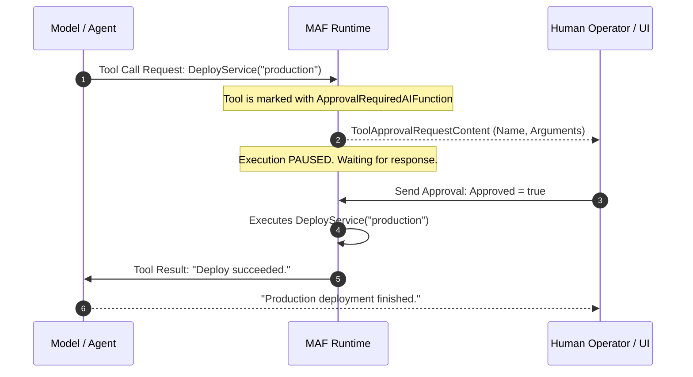
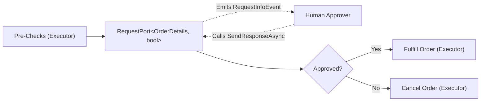

# Module 14 — Human-in-the-Loop

> **Time:** ~35 min · **Level:** Intermediate to Advanced · **Prerequisites:** [Module 03 — Tools](03-tools.md), [Module 11 — Workflows](11-workflows.md), [Module 12 — Agents in Workflows](12-agents-in-workflows.md)  
> **Packages:** `Microsoft.Agents.AI` 1.28.0 (GA), `Microsoft.Agents.AI.Workflows` 1.28.0 (GA), `Microsoft.Agents.AI.OpenAI` 1.28.0 (GA), `Microsoft.Extensions.AI` 10.11.0 (GA), `OpenAI` 2.15.0 (GA)

---

## Learning objectives

- Explain the Human-in-the-Loop (HITL) architectural paradigm and identify operations requiring human authorization.
- Wrap sensitive tools in `ApprovalRequiredAIFunction` and handle experimental diagnostic warnings (`MEAI001`).
- Intercept and evaluate `ToolApprovalRequestContent` in single-agent loops and formulate approved or rejected responses using `request.CreateResponse(approved)`.
- Implement asynchronous human pauses in workflows using `RequestPort.Create<TRequest, TResponse>`, `RequestInfoEvent`, and `run.SendResponseAsync`.
- Intercept and approve sensitive tool calls within multi-agent group chat workflows.
- Coordinate workflow checkpointing with pending HITL requests so executions can resume safely across server restarts.

---

## Concepts

### The Human-in-the-Loop (HITL) architecture

Autonomous agents excel at research, analysis, and synthesis. However, real-world systems must never allow an AI agent to autonomously execute irreversible, dangerous, or high-consequence operations without human supervision.

Examples of high-consequence actions:
- **Financial transactions:** Transferring money, processing refunds, purchasing cloud compute.
- **Infrastructure changes:** Deploying code to production, deleting database records, modifying DNS records.
- **Sensitive communications:** Sending external emails to clients or issuing public press releases.
- **Compliance boundaries:** Signing legal contracts or disclosing regulated health or identity data.

In the Microsoft Agent Framework, Human-in-the-Loop is achieved through two coordinated mechanisms:
1. **Tool Approval at the Agent level:** Functions marked with `ApprovalRequiredAIFunction` interrupt the model's tool execution loop and emit a `ToolApprovalRequestContent` to the caller.
2. **Request Ports at the Workflow level:** A `RequestPort` acts as an asynchronous suspension channel in the workflow graph, pausing execution, emitting a `RequestInfoEvent`, and waiting for an `ExternalResponse` before continuing.



---

### Approval-required tools: `ApprovalRequiredAIFunction`

> [!NOTE]
> **Experimental API (MEAI001):** The core tool approval primitives (`ApprovalRequiredAIFunction`, `ToolApprovalRequestContent`, and related response builders) are part of `Microsoft.Extensions.AI` and are marked with diagnostic code `MEAI001`. To use them in production code, add:
> ```csharp
> #pragma warning disable MEAI001
> ```
> at the top of your file.

Any standard `AIFunction` can be converted into an approval-required tool simply by wrapping it in `ApprovalRequiredAIFunction`:

```csharp
#pragma warning disable MEAI001

AIFunction baseTool = AIFunctionFactory.Create(DeployToProduction);
AIFunction guardedTool = new ApprovalRequiredAIFunction(baseTool);

AIAgent agent = openAIClient.GetChatClient("gpt-5.4-mini").AsAIAgent(
    instructions: "You are a deployment assistant.",
    name: "Deployer",
    tools: [guardedTool]);
```

When the LLM decides to call `DeployToProduction`, the framework halts tool invocation. Instead of returning the function's return value, `agent.RunAsync` finishes its current turn and returns a response containing a `ToolApprovalRequestContent`.

---

### Handling tool approvals in agent sessions

To handle approvals, your application checks the response contents for `ToolApprovalRequestContent`:

```csharp
#pragma warning disable MEAI001

AgentSession session = await agent.CreateSessionAsync();
AgentResponse response = await agent.RunAsync("Deploy build 412 to prod", session);

// 1. Scan for approval requests
var pendingApprovals = response.Messages
    .SelectMany(m => m.Contents)
    .OfType<ToolApprovalRequestContent>()
    .ToList();

if (pendingApprovals.Count > 0)
{
    ToolApprovalRequestContent request = pendingApprovals[0];
    FunctionCallContent toolCall = (FunctionCallContent)request.ToolCall;

    Console.WriteLine($"Approval requested for tool: {toolCall.Name}");
    Console.WriteLine($"Arguments: {JsonSerializer.Serialize(toolCall.Arguments)}");

    // 2. Obtain human decision (true = approve, false = reject)
    bool isApproved = GetOperatorDecision();

    // 3. Formulate response message
    ChatMessage approvalMessage = new(ChatRole.User, [request.CreateResponse(isApproved)]);

    // 4. Resume the session
    AgentResponse nextResponse = await agent.RunAsync(approvalMessage, session);
    Console.WriteLine(nextResponse.Text);
}
```

If approved (`isApproved = true`), the framework executes the underlying C# method and feeds the return value back to the model. If rejected (`isApproved = false`), the tool call is cancelled and an error or rejection signal is returned to the model so it can apologize or suggest alternatives.

---

### Workflows request/response: `RequestPort`

In structured workflows, you often need to pause between arbitrary steps to ask a human operator for input, confirmation, or clarification. Workflows accomplish this using a **`RequestPort`**.



#### Key components of workflow HITL

1. **`RequestPort.Create<TRequest, TResponse>(portId)`:** Declares an input port expecting request type `TRequest` and returning response type `TResponse`. The port acts as an executor node in the workflow graph.
2. **`RequestInfoEvent`:** Emitted by `InProcessExecution.RunStreamingAsync` when an executor forwards a message to the `RequestPort`. The event carries an `ExternalRequest` containing `request.PortInfo` and typed data (`request.TryGetDataAs<T>()`).
3. **`StreamingRun.SendResponseAsync(...)`:** Dispatches the human's response back into the active workflow run. The engine maps the response back to the waiting port, unpausing the workflow.

---

### Tool approvals in workflows and group chats

When agents participating in a workflow or group chat invoke approval-required tools, the workflow host automatically intercepts the tool call and surfaces it as a `RequestInfoEvent` on the workflow stream.

```csharp
await foreach (WorkflowEvent evt in run.WatchStreamAsync())
{
    switch (evt)
    {
        case RequestInfoEvent reqEvt:
            if (reqEvt.Request.TryGetDataAs(out ToolApprovalRequestContent? approvalContent))
            {
                var functionCall = (FunctionCallContent)approvalContent.ToolCall;
                Console.WriteLine($"Agent '{reqEvt.Request.PortInfo.PortId}' requires approval for '{functionCall.Name}'");

                // Approve the tool call
                await run.SendResponseAsync(
                    reqEvt.Request.CreateResponse(approvalContent.CreateResponse(approved: true)));
            }
            break;

        case AgentResponseUpdateEvent update:
            Console.Write(update.Update.Text);
            break;
    }
}
```

This unifies tool approvals with workflow request ports into a single, consistent event-handling loop!

---

### Checkpoints and HITL

In enterprise environments, human approvals can take minutes, hours, or days. Leaving a process in memory for days is fragile and unscalable.

MAF workflows integrate HITL with **Checkpoints** (detailed in [Module 15](15-checkpointing.md)):
- When a `RequestPort` emits a `RequestInfoEvent`, pending requests are stored in the workflow checkpoint.
- The hosting process can safely serialize the workflow state to disk or database and exit.
- When the human approves via a web portal days later, the workflow rehydrates from the checkpoint. The pending request is re-emitted, the response is delivered via `SendResponseAsync`, and the workflow resumes seamlessly.

---

## Hands-on

### Example 1 — Standalone agent with tool approval loop

In this example, an agent assists with bank wire transfers. The `TransferFunds` function is wrapped in `ApprovalRequiredAIFunction`. When invoked, execution pauses, asks the console operator for approval, and resumes with the human's decision.

#### Setup commands

```bash
dotnet new console -n AgentToolApprovalSample -f net10.0
cd AgentToolApprovalSample
dotnet add package Microsoft.Agents.AI --version 1.28.0
dotnet add package Microsoft.Agents.AI.OpenAI --version 1.28.0
dotnet add package Microsoft.Extensions.AI --version 10.11.0
dotnet add package OpenAI --version 2.15.0
```

#### Project file (`AgentToolApprovalSample.csproj`)

```xml
<Project Sdk="Microsoft.NET.Sdk">
  <PropertyGroup>
    <OutputType>Exe</OutputType>
    <TargetFramework>net10.0</TargetFramework>
    <Nullable>enable</Nullable>
    <ImplicitUsings>enable</ImplicitUsings>
  </PropertyGroup>

  <ItemGroup>
    <PackageReference Include="Microsoft.Agents.AI" Version="1.28.0" />
    <PackageReference Include="Microsoft.Agents.AI.OpenAI" Version="1.28.0" />
    <PackageReference Include="Microsoft.Extensions.AI" Version="10.11.0" />
    <PackageReference Include="OpenAI" Version="2.15.0" />
  </ItemGroup>
</Project>
```

#### Application code (`Program.cs`)

```csharp
#pragma warning disable MEAI001 // Microsoft.Extensions.AI tool approval APIs are experimental

using System.ComponentModel;
using System.Text.Json;
using Microsoft.Agents.AI;
using Microsoft.Extensions.AI;
using OpenAI;
using OpenAI.Chat;

using ChatMessage = Microsoft.Extensions.AI.ChatMessage;

string apiKey = Environment.GetEnvironmentVariable("OPENAI_API_KEY")
    ?? throw new InvalidOperationException("Set OPENAI_API_KEY.");
string model = Environment.GetEnvironmentVariable("OPENAI_MODEL") ?? "gpt-5.4-mini";

OpenAIClient openAIClient = new(apiKey);

// 1. Wrap the sensitive function in ApprovalRequiredAIFunction
AIFunction transferTool = new ApprovalRequiredAIFunction(
    AIFunctionFactory.Create(TransferFunds));

AIAgent bankingAgent = openAIClient
    .GetChatClient(model)
    .AsAIAgent(
        instructions: "You are a banking assistant. Transfer funds when instructed.",
        name: "BankingAssistant",
        tools: [transferTool]);

AgentSession session = await bankingAgent.CreateSessionAsync();

Console.WriteLine("User: Transfer $1,500.00 to account AC-9921 for server hardware.");
AgentResponse response = await bankingAgent.RunAsync(
    "Transfer $1,500.00 to account AC-9921 for server hardware.",
    session);

// 2. Check response for pending approval requests
var pendingApprovals = response.Messages
    .SelectMany(m => m.Contents)
    .OfType<ToolApprovalRequestContent>()
    .ToList();

if (pendingApprovals.Count > 0)
{
    ToolApprovalRequestContent request = pendingApprovals[0];
    FunctionCallContent call = (FunctionCallContent)request.ToolCall;

    Console.WriteLine($"\n[ACTION REQUIRED] Tool Approval Requested:");
    Console.WriteLine($"  Function:  {call.Name}");
    Console.WriteLine($"  Arguments: {JsonSerializer.Serialize(call.Arguments)}");

    Console.Write("\nApprove this financial transaction? (y/n): ");
    string? input = Console.ReadLine();
    bool approved = input?.Trim().Equals("y", StringComparison.OrdinalIgnoreCase) == true;

    // 3. Return the decision to the agent
    ChatMessage approvalMessage = new(ChatRole.User, [request.CreateResponse(approved)]);
    AgentResponse followUp = await bankingAgent.RunAsync(approvalMessage, session);

    Console.WriteLine($"\nAgent: {followUp.Text}");
}

// Sensitive tool definition
[Description("Transfers money from the user account to a destination bank account.")]
static string TransferFunds(
    [Description("The target destination account ID")] string destinationAccount,
    [Description("The exact dollar amount to transfer")] decimal amount)
{
    return $"SUCCESS: Transferred ${amount:F2} to {destinationAccount}. Confirmation Ref: TX-883719";
}
```

---

### Example 2 — Workflow `RequestPort` interactive game

In this deterministic example, a workflow plays a number guessing game. A `JudgeExecutor` evaluates guesses against a target number ($42$). When a new guess is needed, it dispatches a `NumberSignal` to a `RequestPort`. The operator handles `RequestInfoEvent` and responds with `SendResponseAsync`.

#### Project file (`WorkflowRequestPortSample.csproj`)

```xml
<Project Sdk="Microsoft.NET.Sdk">
  <PropertyGroup>
    <OutputType>Exe</OutputType>
    <TargetFramework>net10.0</TargetFramework>
    <Nullable>enable</Nullable>
    <ImplicitUsings>enable</ImplicitUsings>
  </PropertyGroup>

  <ItemGroup>
    <PackageReference Include="Microsoft.Agents.AI.Workflows" Version="1.28.0" />
    <PackageReference Include="Microsoft.Agents.AI.Workflows.Generators" Version="1.28.0" />
  </ItemGroup>
</Project>
```

#### Application code (`Program.cs`)

```csharp
using Microsoft.Agents.AI.Workflows;

// 1. Declare RequestPort expecting NumberSignal requests and returning int responses
RequestPort numberRequestPort = RequestPort.Create<NumberSignal, int>("GuessNumberPort");
JudgeExecutor judgeExecutor = new(targetNumber: 42);

// 2. Wire the workflow in a cycle between the request port and the judge
Workflow workflow = new WorkflowBuilder(numberRequestPort)
    .AddEdge(numberRequestPort, judgeExecutor)
    .AddEdge(judgeExecutor, numberRequestPort)
    .WithOutputFrom(judgeExecutor)
    .Build();

Console.WriteLine("Workflow running. Simulating human operator guesses (20 -> 50 -> 42)...");

// 3. Run workflow in streaming mode
await using StreamingRun handle = await InProcessExecution.RunStreamingAsync(workflow, NumberSignal.Init);

int[] automatedGuesses = [20, 50, 42];
int guessIndex = 0;

await foreach (WorkflowEvent evt in handle.WatchStreamAsync())
{
    switch (evt)
    {
        case RequestInfoEvent requestEvt:
            if (requestEvt.Request.TryGetDataAs<NumberSignal>(out var signal))
            {
                int nextGuess = automatedGuesses[guessIndex++];
                Console.WriteLine($"[OPERATOR PROMPT] Signal from Judge: '{signal}'. Providing guess: {nextGuess}");

                // Send response back to unpause the workflow
                await handle.SendResponseAsync(requestEvt.Request.CreateResponse(nextGuess));
            }
            break;

        case WorkflowOutputEvent outputEvt:
            Console.WriteLine($"\n[WORKFLOW RESULT] {outputEvt.Data}");
            return;
    }
}

// Signal types
internal enum NumberSignal { Init, Above, Below }

[SendsMessage(typeof(NumberSignal))]
[YieldsOutput(typeof(string))]
internal sealed partial class JudgeExecutor : Executor<int>
{
    private readonly int _targetNumber;
    private int _attempts;

    public JudgeExecutor(int targetNumber) : base("Judge")
    {
        this._targetNumber = targetNumber;
    }

    public override async ValueTask HandleAsync(int guess, IWorkflowContext context, CancellationToken cancellationToken = default)
    {
        this._attempts++;
        if (guess == this._targetNumber)
        {
            await context.YieldOutputAsync($"Target number {this._targetNumber} correctly identified in {this._attempts} tries!", cancellationToken);
        }
        else if (guess < this._targetNumber)
        {
            await context.SendMessageAsync(NumberSignal.Below, cancellationToken);
        }
        else
        {
            await context.SendMessageAsync(NumberSignal.Above, cancellationToken);
        }
    }
}
```

#### Actual execution output

```
Workflow running. Simulating human operator guesses (20 -> 50 -> 42)...
[OPERATOR PROMPT] Signal from Judge: 'Init'. Providing guess: 20
[OPERATOR PROMPT] Signal from Judge: 'Below'. Providing guess: 50
[OPERATOR PROMPT] Signal from Judge: 'Above'. Providing guess: 42

[WORKFLOW RESULT] Target number 42 correctly identified in 3 tries!
```

---

### Example 3 — Group chat orchestration with sensitive tool approval

In this production-like example, a `QAEngineer` runs automated test suites, and a `DevOpsEngineer` manages deployment. Deploying to production requires human approval.

#### Application code (`Program.cs`)

```csharp
#pragma warning disable MEAI001 // Microsoft.Extensions.AI tool approval APIs are experimental

using System.ComponentModel;
using System.Text.Json;
using Microsoft.Agents.AI;
using Microsoft.Agents.AI.Workflows;
using Microsoft.Extensions.AI;
using OpenAI;
using OpenAI.Chat;

using ChatMessage = Microsoft.Extensions.AI.ChatMessage;

string apiKey = Environment.GetEnvironmentVariable("OPENAI_API_KEY") ?? "mock-key";
string model = Environment.GetEnvironmentVariable("OPENAI_MODEL") ?? "gpt-5.4-mini";

OpenAIClient openAIClient = new(apiKey);

// 1. QA Engineer with autonomous testing tools
ChatClientAgent qaEngineer = openAIClient.GetChatClient(model).AsAIAgent(
    instructions: "You are a QA engineer. Run the automated test suite and report results.",
    name: "QAEngineer",
    description: "QA engineer running automated test suites",
    tools: [AIFunctionFactory.Create(RunAutomatedTests)]);

// 2. DevOps Engineer with sensitive approval-required deployment tool
ChatClientAgent devopsEngineer = openAIClient.GetChatClient(model).AsAIAgent(
    instructions: "You are a DevOps engineer. Check environment status, then call DeployToProduction.",
    name: "DevOpsEngineer",
    description: "DevOps engineer executing production deployments",
    tools:
    [
        AIFunctionFactory.Create(CheckEnvironmentHealth),
        new ApprovalRequiredAIFunction(AIFunctionFactory.Create(DeployToProduction))
    ]);

// 3. Assemble Group Chat Workflow
Workflow deploymentWorkflow = AgentWorkflowBuilder
    .CreateGroupChatBuilderWith(agents => new RoundRobinGroupChatManager(agents) { MaximumIterationCount = 4 })
    .AddParticipants(qaEngineer, devopsEngineer)
    .Build();

Console.WriteLine("Deployment workflow active. Monitoring events...\n");

List<ChatMessage> prompt = [new(ChatRole.User, "Deploy v3.1.0 to production after testing.")];

await using StreamingRun run = await InProcessExecution.Lockstep.RunStreamingAsync(deploymentWorkflow, prompt);
await run.TrySendMessageAsync(new TurnToken(emitEvents: true));

await foreach (WorkflowEvent evt in run.WatchStreamAsync())
{
    switch (evt)
    {
        case RequestInfoEvent reqEvt:
            if (reqEvt.Request.TryGetDataAs(out ToolApprovalRequestContent? approvalContent))
            {
                var toolCall = (FunctionCallContent)approvalContent.ToolCall;
                Console.WriteLine($"\n[SECURITY GATE] Agent '{reqEvt.Request.PortInfo.PortId}' requested tool: '{toolCall.Name}'");
                Console.WriteLine($"Arguments: {JsonSerializer.Serialize(toolCall.Arguments)}");

                Console.WriteLine("Authorizing production deployment...\n");
                // Submit human approval response
                await run.SendResponseAsync(
                    reqEvt.Request.CreateResponse(approvalContent.CreateResponse(approved: true)));
            }
            break;

        case AgentResponseUpdateEvent update:
            Console.Write(update.Update.Text);
            break;
    }
}

Console.WriteLine("\n\n=== Workflow Completed Successfully ===");

// Tool definitions
[Description("Executes full test suite.")]
static string RunAutomatedTests([Description("Target suite name")] string suite)
    => $"Test Suite '{suite}' passed: 128 tests passed, 0 failed.";

[Description("Checks cluster health and node capacity.")]
static string CheckEnvironmentHealth()
    => "Cluster status: GREEN. CPU: 22%, RAM: 34%, 6/6 nodes ready.";

[Description("Deploys application release package to live production servers.")]
static string DeployToProduction([Description("Release version number")] string version)
    => $"SUCCESS: Release {version} deployed to production cluster.";
```

---

## Common pitfalls

### 1. Missing experimental warning suppression
- **Symptom:** Compiler warning `MEAI001: 'ApprovalRequiredAIFunction' is for evaluation purposes only and is subject to change`.
- **Cause:** Tool approval classes in `Microsoft.Extensions.AI` are marked experimental.
- **Fix:** Add `#pragma warning disable MEAI001` at the top of any file referencing `ApprovalRequiredAIFunction` or `ToolApprovalRequestContent`.

### 2. Resuming an agent with a plain string instead of `ToolApprovalResponseContent`
- **Symptom:** When resuming after an approval request, the agent gets confused, repeats the tool request, or says "I don't have permission".
- **Cause:** The agent expects the exact `ToolApprovalResponseContent` payload created by `requestContent.CreateResponse(approved)` inside the `ChatMessage`. Sending plain text like `"I approve"` does not satisfy the underlying tool resolution protocol.
- **Fix:** Always use:
  ```csharp
  ChatMessage msg = new(ChatRole.User, [requestContent.CreateResponse(approved: true)]);
  ```

### 3. Workflow hangs on unhandled `RequestInfoEvent`
- **Symptom:** The workflow stops producing output, never finishes, and blocks the thread.
- **Cause:** An executor or tool raised a `RequestInfoEvent`, but the `WatchStreamAsync()` loop lacks a `case RequestInfoEvent:` handler. The engine waits forever for `SendResponseAsync`.
- **Fix:** Always handle `RequestInfoEvent` in your event consumer loop.

### 4. Overlooking `InProcessExecution.Lockstep`
- **Symptom:** Unpredictable race conditions in multi-agent group chats when tool approvals are triggered.
- **Cause:** Concurrent execution can attempt to advance turns before human approval responses have been fully ingested.
- **Fix:** Use `InProcessExecution.Lockstep` for interactive workflows with approval gates:
  ```csharp
  await using StreamingRun run = await InProcessExecution.Lockstep.RunStreamingAsync(workflow, input);
  ```

---

## When to use / when not to use

| Mechanism | When to use | When NOT to use |
|---|---|---|
| **`ApprovalRequiredAIFunction` (Agent Level)** | Guarding specific sensitive C# tool calls (SQL writes, payments, deployments) in an otherwise autonomous agent. | Gathering arbitrary free-text user feedback or multi-choice questionnaire responses. |
| **`RequestPort` (Workflow Level)** | Pausing workflow state between custom C# executors to collect structured operator decisions, approvals, or numbers. | Simply vetting a tool call inside a ChatClientAgent (use `ApprovalRequiredAIFunction` instead). |
| **Handoff to Human Agent** | Complex customer support escalation where an entire ongoing conversational thread is handed over to a human agent. | Simple binary yes/no confirmation on a single tool call. |
| **Fully Autonomous Tools** | Read-only tools (search, calculators, weather, database SELECT queries) with zero side effects. | Operations that alter state, incur financial cost, or publish irreversible content. |

---

## Exercises

1. **Exercise 1: Financial Wire Transfer Guard with Parameter Inspection**  
   Create an agent with an approval-required tool `ExecuteWireTransfer(string toAccount, decimal amount)`. In the event loop, write code that automatically approves transfers under $\$500.00$, but prompts the console operator for explicit approval for transfers $\$500.00$ and above.

2. **Exercise 2: Multi-Stage Order Approval RequestPort**  
   Build a custom workflow with a `RequestPort<OrderSummary, ApprovalDecision>`:
   - `OrderValidator` checks inventory and sends an `OrderSummary` to the `RequestPort`.
   - The operator inspects the order total. If approved, route to `PaymentProcessor`. If rejected, route to `OrderCancellation`.
   - Implement `ApprovalDecision` containing `bool Approved` and `string Reason`.

3. **Exercise 3: Database Migration Group Chat with Dual Signoff**  
   Construct a group chat with a `DataEngineerAgent` and a `DevOpsAgent`. The `DataEngineerAgent` calls an approval-required tool `ApplyDatabaseMigration(string scriptName)`. Write the event handling loop that verifies the tool call arguments and issues human approval via `run.SendResponseAsync`.

---

## Summary

- Human-in-the-Loop (HITL) ensures that high-consequence operations (financial, infrastructure, security) cannot execute without explicit authorization.
- `ApprovalRequiredAIFunction` wraps any standard `AIFunction`, intercepting tool calls and returning `ToolApprovalRequestContent`.
- Operators approve or reject tool calls using `requestContent.CreateResponse(approved)` passed back into the agent session.
- Workflows provide `RequestPort.Create<TRequest, TResponse>`, allowing arbitrary executors to emit `RequestInfoEvent` and pause until `run.SendResponseAsync` is called.
- In multi-agent workflows and group chats, `RequestInfoEvent` unifies both workflow request ports and agent tool approvals into a single reactive event loop.
- Pending external requests are stored within workflow checkpoints, allowing human reviews to take days across process recycles.

---

## Further reading

- [Microsoft Learn: Function Tools with Human-in-the-Loop Approvals](https://learn.microsoft.com/agent-framework/agents/tools/tool-approval?pivots=programming-language-csharp)
- [Microsoft Learn: Workflows Human-in-the-Loop](https://learn.microsoft.com/agent-framework/workflows/human-in-the-loop?pivots=programming-language-csharp)
- [GitHub: Basic Human-in-the-Loop Workflow Sample](https://github.com/microsoft/agent-framework/blob/main/dotnet/samples/03-workflows/HumanInTheLoop/HumanInTheLoopBasic/Program.cs)
- [GitHub: Group Chat Tool Approval Sample](https://github.com/microsoft/agent-framework/blob/main/dotnet/samples/03-workflows/Agents/GroupChatToolApproval/Program.cs)

---

## Solutions

### Exercise 1: Financial Wire Transfer Guard with Parameter Inspection

```csharp
#pragma warning disable MEAI001

using System.ComponentModel;
using System.Text.Json;
using Microsoft.Agents.AI;
using Microsoft.Extensions.AI;
using OpenAI;
using OpenAI.Chat;

using ChatMessage = Microsoft.Extensions.AI.ChatMessage;

string apiKey = Environment.GetEnvironmentVariable("OPENAI_API_KEY") ?? "mock-key";
string model = Environment.GetEnvironmentVariable("OPENAI_MODEL") ?? "gpt-5.4-mini";

OpenAIClient client = new(apiKey);

AIFunction transferFunc = new ApprovalRequiredAIFunction(
    AIFunctionFactory.Create(ExecuteWireTransfer));

AIAgent agent = client.GetChatClient(model).AsAIAgent(
    instructions: "You are a financial agent. Call ExecuteWireTransfer when asked.",
    name: "FinanceAgent",
    tools: [transferFunc]);

AgentSession session = await agent.CreateSessionAsync();
AgentResponse resp = await agent.RunAsync("Transfer $750 to AC-1234", session);

var approvals = resp.Messages
    .SelectMany(m => m.Contents)
    .OfType<ToolApprovalRequestContent>()
    .ToList();

if (approvals.Count > 0)
{
    ToolApprovalRequestContent req = approvals[0];
    FunctionCallContent call = (FunctionCallContent)req.ToolCall;

    decimal amount = 0;
    if (call.Arguments?.TryGetValue("amount", out object? rawAmount) == true)
    {
        amount = Convert.ToDecimal(rawAmount);
    }

    bool approved;
    if (amount < 500m)
    {
        Console.WriteLine($"[AUTO-APPROVED] Transfer under $500 threshold: ${amount}");
        approved = true;
    }
    else
    {
        Console.WriteLine($"[POLICY ALERT] Transfer of ${amount} exceeds $500 threshold.");
        Console.Write("Human authorization required. Approve? (y/n): ");
        string? input = Console.ReadLine();
        approved = input?.Trim().Equals("y", StringComparison.OrdinalIgnoreCase) == true;
    }

    ChatMessage decisionMsg = new(ChatRole.User, [req.CreateResponse(approved)]);
    AgentResponse finalResp = await agent.RunAsync(decisionMsg, session);
    Console.WriteLine(finalResp.Text);
}

[Description("Transfers money to another account.")]
static string ExecuteWireTransfer([Description("Target account")] string toAccount, [Description("Amount")] decimal amount)
    => $"Transferred ${amount} to {toAccount}. Ref: TX-{Guid.NewGuid():N}";
```

### Exercise 2: Multi-Stage Order Approval RequestPort

```csharp
using Microsoft.Agents.AI.Workflows;

RequestPort orderPort = RequestPort.Create<OrderSummary, ApprovalDecision>("OrderReviewPort");
OrderFulfillmentExecutor fulfillment = new();
OrderCancellationExecutor cancellation = new();

Workflow workflow = new WorkflowBuilder(orderPort)
    .AddSwitch(orderPort, sw => sw
        .AddCase<ApprovalDecision>(d => d?.Approved == true, fulfillment)
        .AddCase<ApprovalDecision>(d => d?.Approved == false, cancellation))
    .WithOutputFrom(fulfillment)
    .Build();

public sealed record OrderSummary(string OrderId, decimal TotalAmount);
public sealed record ApprovalDecision(bool Approved, string Reason);

internal sealed partial class OrderFulfillmentExecutor : Executor<ApprovalDecision, string>
{
    public OrderFulfillmentExecutor() : base("Fulfillment") { }
    public override ValueTask<string> HandleAsync(ApprovalDecision message, IWorkflowContext context, CancellationToken cancellationToken = default)
        => ValueTask.FromResult($"ORDER FULFILLED (Reason: {message.Reason})");
}

internal sealed partial class OrderCancellationExecutor : Executor<ApprovalDecision, string>
{
    public OrderCancellationExecutor() : base("Cancellation") { }
    public override ValueTask<string> HandleAsync(ApprovalDecision message, IWorkflowContext context, CancellationToken cancellationToken = default)
        => ValueTask.FromResult($"ORDER CANCELLED (Reason: {message.Reason})");
}
```

### Exercise 3: Database Migration Group Chat with Dual Signoff

```csharp
#pragma warning disable MEAI001

using System.ComponentModel;
using System.Text.Json;
using Microsoft.Agents.AI;
using Microsoft.Agents.AI.Workflows;
using Microsoft.Extensions.AI;
using OpenAI;
using OpenAI.Chat;

using ChatMessage = Microsoft.Extensions.AI.ChatMessage;

string apiKey = Environment.GetEnvironmentVariable("OPENAI_API_KEY") ?? "mock-key";
string model = Environment.GetEnvironmentVariable("OPENAI_MODEL") ?? "gpt-5.4-mini";

OpenAIClient client = new(apiKey);

ChatClientAgent dataEngineer = client.GetChatClient(model).AsAIAgent(
    instructions: "You are a database engineer. Apply database migration script V004__AddAuditIndex.",
    name: "DataEngineer",
    tools: [new ApprovalRequiredAIFunction(AIFunctionFactory.Create(ApplyDatabaseMigration))]);

Workflow groupChatWorkflow = AgentWorkflowBuilder
    .CreateGroupChatBuilderWith(agents => new RoundRobinGroupChatManager(agents) { MaximumIterationCount = 2 })
    .AddParticipants(dataEngineer)
    .Build();

await using StreamingRun run = await InProcessExecution.Lockstep.RunStreamingAsync(
    groupChatWorkflow,
    new List<ChatMessage> { new(ChatRole.User, "Execute pending migrations.") });

await run.TrySendMessageAsync(new TurnToken(emitEvents: true));

await foreach (WorkflowEvent evt in run.WatchStreamAsync())
{
    if (evt is RequestInfoEvent reqEvt &&
        reqEvt.Request.TryGetDataAs(out ToolApprovalRequestContent? approvalContent))
    {
        var call = (FunctionCallContent)approvalContent.ToolCall;
        Console.WriteLine($"[DBA APPROVAL REQUIRED] Tool: {call.Name}, Args: {JsonSerializer.Serialize(call.Arguments)}");

        // Submit approval
        await run.SendResponseAsync(
            reqEvt.Request.CreateResponse(approvalContent.CreateResponse(approved: true)));
    }
}

[Description("Applies SQL migration script to production database.")]
static string ApplyDatabaseMigration([Description("SQL migration file name")] string scriptName)
    => $"Successfully applied migration '{scriptName}'. Schema version updated.";
```
