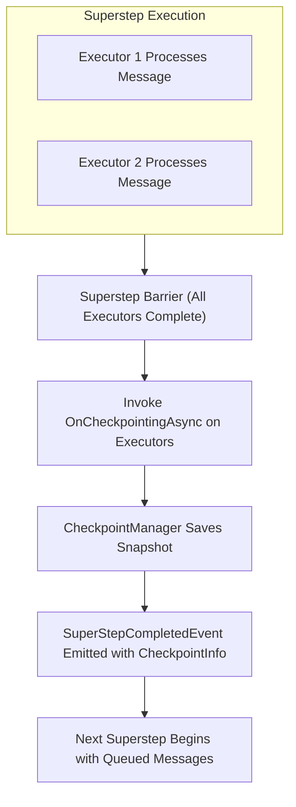
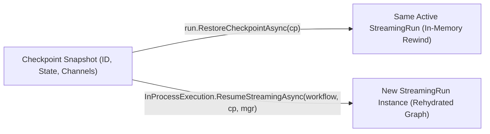

# Module 15 — Checkpointing

> **Time:** ~45 min · **Level:** Advanced · **Prerequisites:** [Module 11 — Workflows](11-workflows.md), [Module 14 — Human in the Loop](14-human-in-the-loop.md)  
> **Packages:** `Microsoft.Agents.AI.Workflows` 1.28.0 (GA), `Microsoft.Agents.AI.Workflows.Generators` 1.28.0 (GA), `Microsoft.Agents.AI.OpenAI` 1.28.0 (GA)

---

## Learning objectives

- Explain how superstep execution boundaries determine when workflow checkpoints are captured.
- Configure `CheckpointManager` using both in-memory and file system JSON stores (`FileSystemJsonCheckpointStore`).
- Implement custom executor state persistence and restoration using `OnCheckpointingAsync` and `OnCheckpointRestoredAsync`.
- Distinguish between **resuming** state on an active run and **rehydrating** a workflow graph into a fresh run instance.
- Coordinate checkpoints with Human-in-the-Loop (`RequestPort`) request/response cycles.
- Enforce stable executor IDs and serializable state types across application boundaries.
- Enable in-function-loop checkpointing on `ChatClientAgent` for tool-calling resilience.

---

## Concepts

Workflows in the Microsoft Agent Framework execute in discrete stages called **supersteps**. During each superstep, active executors process pending messages concurrently. When all executors in the current superstep finish their work and queue messages for downstream executors, the superstep concludes.

A **checkpoint** captures the exact runtime state of the workflow graph at that boundary:
1. **Executor State**: Private state saved by executors via `OnCheckpointingAsync`.
2. **Pending Messages**: Messages queued in the workflow channels for the subsequent superstep.
3. **Pending Requests**: Active `ExternalRequest` instances emitted by `RequestPort` waiting for human or external responses.
4. **Shared State**: Values stored in workflow-level context state bags.



### Resume vs. Rehydrate

The framework offers two distinct mechanisms to continue from a saved checkpoint:

| Operation | Target Object | Process Scope | Use Case |
|---|---|---|---|
| **Resume (`RestoreCheckpointAsync`)** | Existing `StreamingRun` instance | Same process, same memory space | Rewinding an in-flight workflow (e.g., retrying after human rejection, error backoff). |
| **Rehydrate (`ResumeStreamingAsync`)** | Newly constructed `Workflow` instance | New process, new container, or new DI scope | Recovering after process crashes, long-running human pauses across server restarts, or worker failover. |



### Key Types in Checkpointing

| Type | Namespace | Purpose |
|---|---|---|
| `CheckpointManager` | `Microsoft.Agents.AI.Workflows` | High-level facade for capturing, indexing, and looking up workflow checkpoints. |
| `CheckpointInfo` | `Microsoft.Agents.AI.Workflows` | Lightweight descriptor containing `CheckpointId` and lineage metadata. |
| `ICheckpointStore<T>` | `Microsoft.Agents.AI.Workflows.Checkpointing` | Storage contract implemented by checkpoint backends (in-memory, JSON file, database). |
| `FileSystemJsonCheckpointStore` | `Microsoft.Agents.AI.Workflows.Checkpointing` | Durable file system store that persists checkpoints and `index.jsonl` to disk. |
| `SuperStepCompletedEvent` | `Microsoft.Agents.AI.Workflows` | Event yielded during streaming execution carrying the latest checkpoint info. |

### Identity Stability Requirements for Rehydration

When rehydrating a workflow from storage, the runtime must match saved channel messages and executor state with the concrete executor instances in the newly built workflow graph:

1. **Fixed Executor IDs**: Executors inheriting from `Executor<T>` or `Executor` must specify a deterministic, hard-coded string identifier (for example, `Executor("Judge")`), rather than relying on auto-generated GUIDs.
2. **Stable Agent IDs & Names**: Workflows containing agents (`ChatClientAgent`) must assign explicit `ChatClientAgentOptions.Id` and `ChatClientAgentOptions.Name` properties. Changing either value changes the derived workflow executor identity, corrupting checkpoint lineage.
3. **Serializable State Types**: Custom state passed to `context.QueueStateUpdateAsync` must serialize cleanly. Prefer C# `record` or `class` types with public get/set properties over naked value tuples (`ValueTuple`), unless explicit JSON options (`IncludeFields = true`) are configured.

### Agent In-Function-Loop Checkpointing

Beyond graph-based workflow checkpointing, individual `ChatClientAgent` instances support **in-function-loop checkpointing**. When an agent invokes tools, an internal model loop executes:

$$\text{Model Response} \longrightarrow \text{Tool Invocation} \longrightarrow \text{Next Model Call}$$

By default, chat history is persisted atomically at the end of the entire run. Setting `RequirePerServiceCallChatHistoryPersistence = true` instructs `ChatClientAgent` to persist intermediate tool calls and tool responses after every individual model interaction. Combined with `EnableMessageInjection = true`, tools can inspect ambient state and inject follow-up messages mid-loop via `MessageInjectingChatClient`.

---

## Hands-on

### Example 1 — In-Memory Checkpoint & Same-Run Resume

This example constructs a number-guessing workflow containing two stateful executors (`GuessNumberExecutor` and `JudgeExecutor`). It runs to completion, captures checkpoints at each superstep, and then rewinds the active run to an earlier checkpoint using `run.RestoreCheckpointAsync`.

```bash
dotnet new console -n WorkflowResumeDemo
cd WorkflowResumeDemo
dotnet add package Microsoft.Agents.AI.Workflows --version 1.28.0
dotnet add package Microsoft.Agents.AI.Workflows.Generators --version 1.28.0
```

`Program.cs`:
```csharp
using Microsoft.Agents.AI.Workflows;

// Build the workflow with two stateful executors connected in a loop
GuessNumberExecutor guessExecutor = new(1, 100);
JudgeExecutor judgeExecutor = new(42);

Workflow workflow = new WorkflowBuilder(guessExecutor)
    .AddEdge(guessExecutor, judgeExecutor)
    .AddEdge(judgeExecutor, guessExecutor)
    .WithOutputFrom(judgeExecutor)
    .Build();

// Create an in-memory CheckpointManager
CheckpointManager checkpointManager = CheckpointManager.CreateInMemory();
List<CheckpointInfo> checkpoints = [];

Console.WriteLine("=== Initial Run ===");
await using StreamingRun run = await InProcessExecution.RunStreamingAsync(
    workflow,
    NumberSignal.Init,
    checkpointManager);

await foreach (WorkflowEvent evt in run.WatchStreamAsync())
{
    switch (evt)
    {
        case SuperStepCompletedEvent stepEvt:
            if (stepEvt.CompletionInfo?.Checkpoint is { } cp)
            {
                checkpoints.Add(cp);
                Console.WriteLine($"[Checkpoint] Superstep {checkpoints.Count} captured: {cp.CheckpointId}");
            }
            break;

        case WorkflowOutputEvent outputEvt:
            Console.WriteLine($"[Workflow Output] {outputEvt.Data}");
            break;
    }
}

Console.WriteLine($"\nCaptured {checkpoints.Count} checkpoints.");

// Resume from the 3rd checkpoint on the SAME run instance
const int resumeIndex = 2; // 3rd checkpoint (0-based)
CheckpointInfo resumeCheckpoint = checkpoints[resumeIndex];
Console.WriteLine($"\n=== Resuming Same Run from Step {resumeIndex + 1} ({resumeCheckpoint.CheckpointId}) ===");

await run.RestoreCheckpointAsync(resumeCheckpoint);

await foreach (WorkflowEvent evt in run.WatchStreamAsync())
{
    if (evt is WorkflowOutputEvent outputEvt)
    {
        Console.WriteLine($"[Resumed Output] {outputEvt.Data}");
    }
}

// ---------------- Supporting Types ----------------

internal enum NumberSignal
{
    Init,
    Above,
    Below
}

[SendsMessage(typeof(int))]
internal sealed partial class GuessNumberExecutor() : Executor<NumberSignal>("Guess")
{
    private const string StateKey = "GuessState";
    public int LowerBound { get; private set; } = 1;
    public int UpperBound { get; private set; } = 100;

    public GuessNumberExecutor(int lower, int upper) : this()
    {
        this.LowerBound = lower;
        this.UpperBound = upper;
    }

    private int NextGuess => (this.LowerBound + this.UpperBound) / 2;

    public override async ValueTask HandleAsync(NumberSignal message, IWorkflowContext context, CancellationToken cancellationToken = default)
    {
        switch (message)
        {
            case NumberSignal.Init:
                await context.SendMessageAsync(this.NextGuess, cancellationToken: cancellationToken);
                break;
            case NumberSignal.Above:
                this.UpperBound = this.NextGuess - 1;
                await context.SendMessageAsync(this.NextGuess, cancellationToken: cancellationToken);
                break;
            case NumberSignal.Below:
                this.LowerBound = this.NextGuess + 1;
                await context.SendMessageAsync(this.NextGuess, cancellationToken: cancellationToken);
                break;
        }
    }

    protected override ValueTask OnCheckpointingAsync(IWorkflowContext context, CancellationToken cancellationToken = default) =>
        context.QueueStateUpdateAsync(StateKey, (this.LowerBound, this.UpperBound), cancellationToken: cancellationToken);

    protected override async ValueTask OnCheckpointRestoredAsync(IWorkflowContext context, CancellationToken cancellationToken = default) =>
        (this.LowerBound, this.UpperBound) = await context.ReadStateAsync<(int, int)>(StateKey, cancellationToken: cancellationToken);
}

[SendsMessage(typeof(NumberSignal))]
[YieldsOutput(typeof(string))]
internal sealed partial class JudgeExecutor() : Executor<int>("Judge")
{
    private const string StateKey = "JudgeState";
    private readonly int _targetNumber = 42;
    private int _tries;

    public JudgeExecutor(int target) : this()
    {
        this._targetNumber = target;
    }

    public override async ValueTask HandleAsync(int message, IWorkflowContext context, CancellationToken cancellationToken = default)
    {
        this._tries++;
        Console.WriteLine($"   [Judge] Evaluated guess #{this._tries}: {message}");

        if (message == this._targetNumber)
        {
            await context.YieldOutputAsync($"Target {this._targetNumber} found in {this._tries} tries!", cancellationToken);
        }
        else if (message < this._targetNumber)
        {
            await context.SendMessageAsync(NumberSignal.Below, cancellationToken: cancellationToken);
        }
        else
        {
            await context.SendMessageAsync(NumberSignal.Above, cancellationToken: cancellationToken);
        }
    }

    protected override ValueTask OnCheckpointingAsync(IWorkflowContext context, CancellationToken cancellationToken = default) =>
        context.QueueStateUpdateAsync(StateKey, this._tries, cancellationToken: cancellationToken);

    protected override async ValueTask OnCheckpointRestoredAsync(IWorkflowContext context, CancellationToken cancellationToken = default) =>
        this._tries = await context.ReadStateAsync<int>(StateKey, cancellationToken: cancellationToken);
}
```

**What's happening:**
- `GuessNumberExecutor` and `JudgeExecutor` implement `OnCheckpointingAsync` and `OnCheckpointRestoredAsync` to serialize internal bounds and try counts into `context.QueueStateUpdateAsync`.
- `CheckpointManager.CreateInMemory()` records snapshots at every `SuperStepCompletedEvent`.
- `run.RestoreCheckpointAsync(resumeCheckpoint)` resets the workflow's state channels and executor state back to the 3rd superstep, immediately resuming execution to find 42 from that state.

Expected output:
```text
=== Initial Run ===
[Checkpoint] Superstep 1 captured: 19d66bf86e294029bd034cab575975ee
   [Judge] Evaluated guess #1: 50
[Checkpoint] Superstep 2 captured: ead9f3d9f83c447e8de0ba2523390a00
   [Judge] Evaluated guess #2: 25
...
[Workflow Output] Target 42 found in 7 tries!
Captured 14 checkpoints.

=== Resuming Same Run from Step 3 (eab1b936b2ca4e27b716dfc9b7018c59) ===
   [Judge] Evaluated guess #2: 25
   [Judge] Evaluated guess #3: 37
   ...
[Resumed Output] Target 42 found in 7 tries!
```

---

### Example 2 — File System JSON Storage & Cross-Instance Rehydration

In enterprise workflows, executions must survive container redeployments and server restarts. This example uses `FileSystemJsonCheckpointStore` to persist JSON snapshots to disk, and uses `InProcessExecution.ResumeStreamingAsync` to rehydrate a completely fresh workflow instance.

```bash
dotnet new console -n WorkflowRehydrateDemo
cd WorkflowRehydrateDemo
dotnet add package Microsoft.Agents.AI.Workflows --version 1.28.0
dotnet add package Microsoft.Agents.AI.Workflows.Generators --version 1.28.0
```

`Program.cs`:
```csharp
using Microsoft.Agents.AI.Workflows;
using Microsoft.Agents.AI.Workflows.Checkpointing;

string checkpointDir = Path.Combine(Path.GetTempPath(), "maf_checkpoints_" + Guid.NewGuid().ToString("N")[..8]);
Directory.CreateDirectory(checkpointDir);

try
{
    // Configure file system JSON checkpoint store
    using FileSystemJsonCheckpointStore store = new(new DirectoryInfo(checkpointDir));
    CheckpointManager checkpointManager = CheckpointManager.CreateJson(store);

    // Build the initial workflow instance
    Workflow workflow = BuildWorkflow();
    List<CheckpointInfo> capturedCheckpoints = [];

    Console.WriteLine($"Starting initial run with file store at: {checkpointDir}");
    await using (StreamingRun run = await InProcessExecution.RunStreamingAsync(
        workflow,
        NumberSignal.Init,
        checkpointManager))
    {
        await foreach (WorkflowEvent evt in run.WatchStreamAsync())
        {
            if (evt is SuperStepCompletedEvent step && step.CompletionInfo?.Checkpoint is { } cp)
            {
                capturedCheckpoints.Add(cp);
            }
            else if (evt is WorkflowOutputEvent output)
            {
                Console.WriteLine($"[Run 1 Output] {output.Data}");
            }
        }
    }

    Console.WriteLine($"Persisted {capturedCheckpoints.Count} checkpoints to disk.");

    // Pick a checkpoint to rehydrate from (e.g. index 5, matching step 6)
    const int targetIndex = 5;
    CheckpointInfo targetCheckpoint = capturedCheckpoints[targetIndex];
    Console.WriteLine($"\nRehydrating a NEW workflow instance from checkpoint index {targetIndex} (ID: {targetCheckpoint.CheckpointId})...");

    // For rehydration across processes, rebuild an identical workflow topology with stable executor IDs
    Workflow rehydratedWorkflow = BuildWorkflow();

    await using (StreamingRun rehydratedRun = await InProcessExecution.ResumeStreamingAsync(
        rehydratedWorkflow,
        targetCheckpoint,
        checkpointManager))
    {
        await foreach (WorkflowEvent evt in rehydratedRun.WatchStreamAsync())
        {
            if (evt is WorkflowOutputEvent output)
            {
                Console.WriteLine($"[Rehydrated Run Output] {output.Data}");
            }
        }
    }
}
finally
{
    if (Directory.Exists(checkpointDir))
    {
        Directory.Delete(checkpointDir, recursive: true);
    }
}

static Workflow BuildWorkflow()
{
    GuessNumberExecutor guess = new(1, 100);
    JudgeExecutor judge = new(42);

    return new WorkflowBuilder(guess)
        .AddEdge(guess, judge)
        .AddEdge(judge, guess)
        .WithOutputFrom(judge)
        .Build();
}

internal enum NumberSignal { Init, Above, Below }

// Custom state record with properties for reliable JSON serialization
internal record GuessBounds(int Lower, int Upper);

[SendsMessage(typeof(int))]
internal sealed partial class GuessNumberExecutor() : Executor<NumberSignal>("Guess")
{
    private const string StateKey = "GuessState";
    public int LowerBound { get; private set; } = 1;
    public int UpperBound { get; private set; } = 100;

    public GuessNumberExecutor(int lower, int upper) : this()
    {
        this.LowerBound = lower;
        this.UpperBound = upper;
    }

    private int NextGuess => (this.LowerBound + this.UpperBound) / 2;

    public override async ValueTask HandleAsync(NumberSignal message, IWorkflowContext context, CancellationToken cancellationToken = default)
    {
        switch (message)
        {
            case NumberSignal.Init:
                await context.SendMessageAsync(this.NextGuess, cancellationToken: cancellationToken);
                break;
            case NumberSignal.Above:
                this.UpperBound = this.NextGuess - 1;
                await context.SendMessageAsync(this.NextGuess, cancellationToken: cancellationToken);
                break;
            case NumberSignal.Below:
                this.LowerBound = this.NextGuess + 1;
                await context.SendMessageAsync(this.NextGuess, cancellationToken: cancellationToken);
                break;
        }
    }

    protected override ValueTask OnCheckpointingAsync(IWorkflowContext context, CancellationToken cancellationToken = default) =>
        context.QueueStateUpdateAsync(StateKey, new GuessBounds(this.LowerBound, this.UpperBound), cancellationToken: cancellationToken);

    protected override async ValueTask OnCheckpointRestoredAsync(IWorkflowContext context, CancellationToken cancellationToken = default)
    {
        if (await context.ReadStateAsync<GuessBounds>(StateKey, cancellationToken: cancellationToken) is { } bounds)
        {
            this.LowerBound = bounds.Lower;
            this.UpperBound = bounds.Upper;
        }
    }
}

[SendsMessage(typeof(NumberSignal))]
[YieldsOutput(typeof(string))]
internal sealed partial class JudgeExecutor() : Executor<int>("Judge")
{
    private const string StateKey = "JudgeState";
    private readonly int _targetNumber = 42;
    private int _tries;

    public JudgeExecutor(int target) : this()
    {
        this._targetNumber = target;
    }

    public override async ValueTask HandleAsync(int message, IWorkflowContext context, CancellationToken cancellationToken = default)
    {
        this._tries++;
        if (message == this._targetNumber)
        {
            await context.YieldOutputAsync($"Target {this._targetNumber} solved in {this._tries} tries!", cancellationToken);
        }
        else if (message < this._targetNumber)
        {
            await context.SendMessageAsync(NumberSignal.Below, cancellationToken: cancellationToken);
        }
        else
        {
            await context.SendMessageAsync(NumberSignal.Above, cancellationToken: cancellationToken);
        }
    }

    protected override ValueTask OnCheckpointingAsync(IWorkflowContext context, CancellationToken cancellationToken = default) =>
        context.QueueStateUpdateAsync(StateKey, this._tries, cancellationToken: cancellationToken);

    protected override async ValueTask OnCheckpointRestoredAsync(IWorkflowContext context, CancellationToken cancellationToken = default) =>
        this._tries = await context.ReadStateAsync<int>(StateKey, cancellationToken: cancellationToken);
}
```

**What's happening:**
- `FileSystemJsonCheckpointStore` creates a directory containing `index.jsonl` and individual superstep state files (`{sessionId}_{checkpointId}.json`).
- `GuessBounds` is declared as a C# `record`, ensuring `System.Text.Json` deserializes properties without reflection warnings or missing fields.
- `InProcessExecution.ResumeStreamingAsync(rehydratedWorkflow, targetCheckpoint, checkpointManager)` deserializes the checkpoint into the newly instantiated workflow graph and runs forward to completion.

---

### Example 3 — Checkpointing with Human-in-the-Loop (`RequestPort`)

In workflows requiring human approvals or external inputs, execution halts while waiting for user response. Checkpointing preserves in-flight workflow state across these pauses.

Each `RequestPort` interaction spans **two supersteps**:
1. **Superstep A**: `RequestPort` dispatches a `RequestInfoEvent` to the external host and suspends. A checkpoint is captured containing the pending request.
2. **Superstep B**: The host receives input and invokes `run.SendResponseAsync(...)`. The response is routed into the port, completing the interaction.

```bash
dotnet new console -n WorkflowHitlCheckpointDemo
cd WorkflowHitlCheckpointDemo
dotnet add package Microsoft.Agents.AI.Workflows --version 1.28.0
dotnet add package Microsoft.Agents.AI.Workflows.Generators --version 1.28.0
```

`Program.cs`:
```csharp
using Microsoft.Agents.AI.Workflows;

// Build workflow with RequestPort (Human-in-the-Loop) and stateful JudgeExecutor
RequestPort numberRequest = RequestPort.Create<SignalWithNumber, int>("GuessNumber");
JudgeExecutor judgeExecutor = new(42);

Workflow workflow = new WorkflowBuilder(numberRequest)
    .AddEdge(numberRequest, judgeExecutor)
    .AddEdge(judgeExecutor, numberRequest)
    .WithOutputFrom(judgeExecutor)
    .Build();

CheckpointManager checkpointManager = CheckpointManager.CreateInMemory();
List<CheckpointInfo> checkpoints = [];

// Pre-scripted human inputs: first guess 50, then 25, then 42
Queue<int> simulatedHumanGuesses = new([50, 25, 42]);

Console.WriteLine("=== Starting Checkpointed HITL Workflow ===");
await using (StreamingRun run = await InProcessExecution.RunStreamingAsync(
    workflow,
    new SignalWithNumber(NumberSignal.Init),
    checkpointManager))
{
    await foreach (WorkflowEvent evt in run.WatchStreamAsync())
    {
        switch (evt)
        {
            case RequestInfoEvent reqEvt:
                int nextGuess = simulatedHumanGuesses.Count > 0 ? simulatedHumanGuesses.Dequeue() : 42;
                Console.WriteLine($"[Human Input Requested] Port: {reqEvt.Request.PortInfo.PortId}. Responding with guess: {nextGuess}");
                ExternalResponse response = reqEvt.Request.CreateResponse(nextGuess);
                await run.SendResponseAsync(response);
                break;

            case SuperStepCompletedEvent stepEvt:
                if (stepEvt.CompletionInfo?.Checkpoint is { } cp)
                {
                    checkpoints.Add(cp);
                    Console.WriteLine($"[Checkpoint Saved] Step {checkpoints.Count} (ID: {cp.CheckpointId})");
                }
                break;

            case WorkflowOutputEvent outputEvt:
                Console.WriteLine($"[Workflow Output] {outputEvt.Data}");
                break;
        }
    }
}

Console.WriteLine($"\nCompleted with {checkpoints.Count} checkpoints.");

// ---------------- Supporting Types ----------------

internal enum NumberSignal { Init, Above, Below }

internal sealed class SignalWithNumber
{
    public NumberSignal Signal { get; }
    public int? Number { get; }

    public SignalWithNumber(NumberSignal signal, int? number = null)
    {
        this.Signal = signal;
        this.Number = number;
    }
}

[SendsMessage(typeof(SignalWithNumber))]
[YieldsOutput(typeof(string))]
internal sealed partial class JudgeExecutor() : Executor<int>("Judge")
{
    private readonly int _targetNumber = 42;
    private int _tries;
    private const string StateKey = "JudgeState";

    public JudgeExecutor(int target) : this()
    {
        this._targetNumber = target;
    }

    public override async ValueTask HandleAsync(int message, IWorkflowContext context, CancellationToken cancellationToken = default)
    {
        this._tries++;
        Console.WriteLine($"   [Judge] Evaluated human guess: {message} (Try #{this._tries})");

        if (message == this._targetNumber)
        {
            await context.YieldOutputAsync($"Target {this._targetNumber} found in {this._tries} tries!", cancellationToken);
        }
        else if (message < this._targetNumber)
        {
            await context.SendMessageAsync(new SignalWithNumber(NumberSignal.Below, message), cancellationToken);
        }
        else
        {
            await context.SendMessageAsync(new SignalWithNumber(NumberSignal.Above, message), cancellationToken);
        }
    }

    protected override ValueTask OnCheckpointingAsync(IWorkflowContext context, CancellationToken cancellationToken = default) =>
        context.QueueStateUpdateAsync(StateKey, this._tries, cancellationToken: cancellationToken);

    protected override async ValueTask OnCheckpointRestoredAsync(IWorkflowContext context, CancellationToken cancellationToken = default) =>
        this._tries = await context.ReadStateAsync<int>(StateKey, cancellationToken: cancellationToken);
}
```

**What's happening:**
- When `RequestPort` emits `RequestInfoEvent`, execution yields until `run.SendResponseAsync` delivers `ExternalResponse`.
- Superstep checkpoints are recorded both when the request is created and when the response is processed, allowing a interrupted human review to be resumed without re-prompting previously completed turns.

---

### Example 4 — Agent In-Function-Loop Checkpointing

When a `ChatClientAgent` invokes tools in a loop, standard sessions only persist chat history at the end of the entire run. This example enables per-service-call persistence and message injection.

```bash
dotnet new console -n AgentLoopCheckpointDemo
cd AgentLoopCheckpointDemo
dotnet add package Microsoft.Agents.AI.OpenAI --version 1.28.0
```

`Program.cs`:
```csharp
using System.ComponentModel;
using Microsoft.Agents.AI;
using Microsoft.Extensions.AI;
using OpenAI;

string apiKey = Environment.GetEnvironmentVariable("OPENAI_API_KEY") ?? "mock-key";
string model = Environment.GetEnvironmentVariable("OPENAI_MODEL") ?? "gpt-5.4-mini";

[Description("Get the current weather for a city.")]
static string GetWeather([Description("City name")] string city) =>
    $"Weather in {city}: 68°F, clear.";

[Description("Check travel advisories and inject follow-up messages if needed.")]
static async Task<string> CheckTravelAdvisory([Description("City name")] string city)
{
    if (city.Equals("London", StringComparison.OrdinalIgnoreCase))
    {
        // Access ambient run context and inject a user message during the tool loop
        if (AIAgent.CurrentRunContext is { } runContext &&
            runContext.Agent.GetService<MessageInjectingChatClient>() is { } injector &&
            runContext.Session is { } session)
        {
            await injector.EnqueueMessagesAsync(
                session,
                [new ChatMessage(ChatRole.User, $"Given the travel advisory for {city}, recommend alternative destinations.")]);
        }
        return $"Advisory for {city}: severe fog expected.";
    }
    return $"No advisories for {city}.";
}

// Build agent with in-function-loop history checkpointing enabled
AIAgent agent = new OpenAIClient(apiKey)
    .GetChatClient(model)
    .AsIChatClient()
    .AsAIAgent(new ChatClientAgentOptions
    {
        Name = "TravelAssistant",
        // Persists chat history after each individual model service call inside the function loop
        RequirePerServiceCallChatHistoryPersistence = true,
        EnableMessageInjection = true,
        ChatOptions = new()
        {
            Instructions = "You are a travel coordinator. Query tools when asked about destinations.",
            Tools =
            [
                AIFunctionFactory.Create(GetWeather),
                AIFunctionFactory.Create(CheckTravelAdvisory)
            ]
        }
    });

AgentSession session = await agent.CreateSessionAsync();
Console.WriteLine($"Agent '{agent.Name}' created with in-function-loop checkpointing enabled.");
```

**What's happening:**
- `RequirePerServiceCallChatHistoryPersistence = true` wraps the agent's chat client in `PerServiceCallChatHistoryPersistingChatClient`. If an exception occurs on turn 3 of a 5-turn tool invocation sequence, turns 1 and 2 remain stored in the session provider.
- `EnableMessageInjection = true` activates `MessageInjectingChatClient`, allowing tool code to enqueue new user messages that are automatically picked up by the next model service call in the same run.

---

## Common pitfalls

- **Symptom:** `InProcessExecution.ResumeStreamingAsync` throws an exception or hangs when rehydrating a workflow.  
  **Cause:** The reconstructed workflow graph does not match the original topology or executor identities. Changing an agent's `Name` or forgetting to specify a fixed `Id` produces randomized GUID identities that fail to resolve against stored checkpoints.  
  **Fix:** Always assign fixed string IDs to custom executors (`Executor("StableId")`) and explicit `ChatClientAgentOptions.Id` and `Name` properties to agents.

- **Symptom:** Custom executor state returns null or default values after `OnCheckpointRestoredAsync`.  
  **Cause:** The state object stored via `context.QueueStateUpdateAsync` uses non-serializable fields (like raw `ValueTuple`) under `System.Text.Json` reflection-free or default options.  
  **Fix:** Encapsulate executor state in public `record` or `class` types with property accessors.

- **Symptom:** Checkpoint store throws `InvalidOperationException: The store is already in use by another process`.  
  **Cause:** `FileSystemJsonCheckpointStore` opens `index.jsonl` with exclusive file sharing (`FileShare.None`) to prevent concurrent process corruption.  
  **Fix:** Ensure the preceding `FileSystemJsonCheckpointStore` instance is properly disposed (`using` block or `Dispose()`) before opening the same folder in another runner.

- **Symptom:** Compilation error `Class uses [SendsMessage] or [YieldsOutput] but is not declared as partial`.  
  **Cause:** The workflow source generator (`Microsoft.Agents.AI.Workflows.Generators`) generates companion code for compile-time message routing.  
  **Fix:** Declare all executor classes as `partial` (e.g. `internal sealed partial class MyExecutor : Executor<T>`).

---

## When to use / when not to use

| Feature | When to Use | When NOT to Use | Alternatives |
|---|---|---|---|
| **In-Memory Checkpoint** | Single-process rewind, unit testing workflows, testing branching/rollback logic. | Production distributed apps requiring durability across worker restarts or scale-out. | FileSystem store, Durable Extension ([Module 17](17-integrations.md)). |
| **FileSystem JSON Store** | Single-worker background jobs, local debugging, development state inspection. | Highly concurrent, multi-node cloud clusters sharing state across pods. | Cosmos DB, Azure Table Storage, or Durable Task. |
| **`RestoreCheckpointAsync`** | In-flight recovery or HITL re-prompting within the same active process. | Resuming a workflow hours or days later after host teardown. | `ResumeStreamingAsync`. |
| **In-Function-Loop Checkpointing** | Complex agent runs with multi-step tool calls where partial recovery or mid-loop message injection is required. | High-throughput, low-latency agents where extra persistence I/O overhead on every tool invocation is undesirable. | Default atomic end-of-run session persistence ([Module 04](04-conversations-and-threads.md)). |

---

## Exercises

1. **Superstep Inspection Utility**  
   Create a console utility that executes a multi-executor workflow with `CheckpointManager.CreateInMemory()`, intercepts every `SuperStepCompletedEvent`, and prints:
   - Superstep sequential index.
   - Generated `CheckpointId`.
   - The total number of checkpoints captured upon workflow completion.

2. **Durable File-Backed Failover Recovery**  
   Implement a two-phase workflow execution using `FileSystemJsonCheckpointStore`:
   - Phase 1 runs a multi-step workflow up to step 4, writes checkpoints to disk, and halts.
   - Phase 2 instantiates a fresh workflow instance in a separate method, retrieves the latest checkpoint from disk using `checkpointManager.GetLatestCheckpointAsync(...)`, and resumes execution to final output.

3. **Checkpoint Rollback on Human Rejection**  
   Build a HITL approval workflow where an executor generates an order proposal, pauses at a `RequestPort` for user approval, and:
   - If approved, yields output.
   - If rejected, uses `run.RestoreCheckpointAsync` to roll back to the pre-proposal checkpoint, re-evaluates with adjusted parameters, and re-submits for approval.

---

## Summary

- Checkpoints capture workflow snapshots at **superstep boundaries** after all executors in that step complete.
- `RestoreCheckpointAsync` restores state on the **same active run** instance (in-memory rewind).
- `ResumeStreamingAsync` rehydrates a **newly built workflow** instance across processes or server restarts.
- Rehydration requires deterministic executor identities: assign fixed string IDs to executors and stable `Id`/`Name` properties to agents.
- Custom state saved in `OnCheckpointingAsync` must use property-based types (`record`/`class`) for reliable JSON serialization.
- `ChatClientAgentOptions.RequirePerServiceCallChatHistoryPersistence` enables resilient, mid-loop chat persistence for function-calling agents.

---

## Further reading

- [Microsoft Agent Framework Workflows — Checkpoints](https://learn.microsoft.com/en-us/agent-framework/workflows/checkpoints?pivots=programming-language-csharp)
- [Workflow Checkpoint & Resume Sample](https://github.com/microsoft/agent-framework/tree/main/dotnet/samples/03-workflows/Checkpoint/CheckpointAndResume)
- [Workflow Checkpoint & Rehydrate Sample](https://github.com/microsoft/agent-framework/tree/main/dotnet/samples/03-workflows/Checkpoint/CheckpointAndRehydrate)
- [Workflow Checkpoint with Human in the Loop Sample](https://github.com/microsoft/agent-framework/tree/main/dotnet/samples/03-workflows/Checkpoint/CheckpointWithHumanInTheLoop)
- [Agent In-Function-Loop Checkpointing Sample](https://github.com/microsoft/agent-framework/tree/main/dotnet/samples/02-agents/Agents/Agent_Step19_InFunctionLoopCheckpointing)

---

## Solutions

### Solution 1 — Superstep Inspection Utility

```csharp
using Microsoft.Agents.AI.Workflows;

GuessNumberExecutor guess = new(1, 100);
JudgeExecutor judge = new(42);

Workflow workflow = new WorkflowBuilder(guess)
    .AddEdge(guess, judge)
    .AddEdge(judge, guess)
    .WithOutputFrom(judge)
    .Build();

CheckpointManager manager = CheckpointManager.CreateInMemory();
int stepCount = 0;

await using StreamingRun run = await InProcessExecution.RunStreamingAsync(
    workflow,
    NumberSignal.Init,
    manager);

await foreach (WorkflowEvent evt in run.WatchStreamAsync())
{
    if (evt is SuperStepCompletedEvent step && step.CompletionInfo?.Checkpoint is { } cp)
    {
        stepCount++;
        Console.WriteLine($"[Step {stepCount,2}] Checkpoint Captured: {cp.CheckpointId}");
    }
    else if (evt is WorkflowOutputEvent output)
    {
        Console.WriteLine($"[Result] {output.Data}");
    }
}

Console.WriteLine($"Execution completed with {stepCount} total checkpoints.");

internal enum NumberSignal { Init, Above, Below }

[SendsMessage(typeof(int))]
internal sealed partial class GuessNumberExecutor() : Executor<NumberSignal>("Guess")
{
    private int _lower = 1, _upper = 100;
    public override async ValueTask HandleAsync(NumberSignal msg, IWorkflowContext ctx, CancellationToken ct = default)
    {
        int guess = (_lower + _upper) / 2;
        if (msg == NumberSignal.Above) _upper = guess - 1;
        if (msg == NumberSignal.Below) _lower = guess + 1;
        guess = (_lower + _upper) / 2;
        await ctx.SendMessageAsync(guess, ct);
    }
}

[SendsMessage(typeof(NumberSignal))]
[YieldsOutput(typeof(string))]
internal sealed partial class JudgeExecutor() : Executor<int>("Judge")
{
    private readonly int _target = 42;
    private int _tries;
    public override async ValueTask HandleAsync(int guess, IWorkflowContext ctx, CancellationToken ct = default)
    {
        _tries++;
        if (guess == _target)
            await ctx.YieldOutputAsync($"Target found in {_tries} tries!", ct);
        else
            await ctx.SendMessageAsync(guess < _target ? NumberSignal.Below : NumberSignal.Above, ct);
    }
}
```

---

### Solution 2 — Durable File-Backed Failover Recovery

```csharp
using Microsoft.Agents.AI.Workflows;
using Microsoft.Agents.AI.Workflows.Checkpointing;

string storageDir = Path.Combine(Path.GetTempPath(), "checkpoint_failover_" + Guid.NewGuid().ToString("N")[..8]);
Directory.CreateDirectory(storageDir);

try
{
    // Phase 1: Run workflow and write checkpoints to disk
    CheckpointInfo lastCheckpoint;
    using (FileSystemJsonCheckpointStore store = new(new DirectoryInfo(storageDir)))
    {
        CheckpointManager manager = CheckpointManager.CreateJson(store);
        List<CheckpointInfo> checkpoints = [];

        await using (StreamingRun run = await InProcessExecution.RunStreamingAsync(BuildWorkflow(), NumberSignal.Init, manager))
        {
            await foreach (WorkflowEvent evt in run.WatchStreamAsync())
            {
                if (evt is SuperStepCompletedEvent s && s.CompletionInfo?.Checkpoint is { } cp)
                {
                    checkpoints.Add(cp);
                }
            }
        }
        // Save intermediate checkpoint
        lastCheckpoint = checkpoints[4];
        Console.WriteLine($"Phase 1 complete. Saved checkpoint index 4 ({lastCheckpoint.CheckpointId}).");
    }

    // Phase 2: Open file store again and rehydrate into fresh workflow instance
    using (FileSystemJsonCheckpointStore resumeStore = new(new DirectoryInfo(storageDir)))
    {
        CheckpointManager resumeManager = CheckpointManager.CreateJson(resumeStore);
        Workflow rehydratedWorkflow = BuildWorkflow();

        Console.WriteLine($"Phase 2: Rehydrating from checkpoint {lastCheckpoint.CheckpointId}...");
        await using StreamingRun resumedRun = await InProcessExecution.ResumeStreamingAsync(
            rehydratedWorkflow,
            lastCheckpoint,
            resumeManager);

        await foreach (WorkflowEvent evt in resumedRun.WatchStreamAsync())
        {
            if (evt is WorkflowOutputEvent output)
            {
                Console.WriteLine($"[Rehydrated Run Output] {output.Data}");
            }
        }
    }
}
finally
{
    if (Directory.Exists(storageDir)) Directory.Delete(storageDir, true);
}

static Workflow BuildWorkflow()
{
    GuessExecutor g = new();
    JudgeExecutor j = new();
    return new WorkflowBuilder(g).AddEdge(g, j).AddEdge(j, g).WithOutputFrom(j).Build();
}

internal enum NumberSignal { Init, Above, Below }
internal record GuessState(int Lower, int Upper);

[SendsMessage(typeof(int))]
internal sealed partial class GuessExecutor() : Executor<NumberSignal>("Guess")
{
    private int _lower = 1, _upper = 100;
    public override async ValueTask HandleAsync(NumberSignal msg, IWorkflowContext ctx, CancellationToken ct = default)
    {
        int guess = (_lower + _upper) / 2;
        if (msg == NumberSignal.Above) _upper = guess - 1;
        if (msg == NumberSignal.Below) _lower = guess + 1;
        await ctx.SendMessageAsync((_lower + _upper) / 2, ct);
    }
    protected override ValueTask OnCheckpointingAsync(IWorkflowContext ctx, CancellationToken ct = default) =>
        ctx.QueueStateUpdateAsync("state", new GuessState(_lower, _upper), ct);
    protected override async ValueTask OnCheckpointRestoredAsync(IWorkflowContext ctx, CancellationToken ct = default)
    {
        if (await ctx.ReadStateAsync<GuessState>("state", ct) is { } s) { _lower = s.Lower; _upper = s.Upper; }
    }
}

[SendsMessage(typeof(NumberSignal))]
[YieldsOutput(typeof(string))]
internal sealed partial class JudgeExecutor() : Executor<int>("Judge")
{
    private int _tries;
    public override async ValueTask HandleAsync(int guess, IWorkflowContext ctx, CancellationToken ct = default)
    {
        _tries++;
        if (guess == 42)
            await ctx.YieldOutputAsync($"Solved in {_tries} tries!", ct);
        else
            await ctx.SendMessageAsync(guess < 42 ? NumberSignal.Below : NumberSignal.Above, ct);
    }
    protected override ValueTask OnCheckpointingAsync(IWorkflowContext ctx, CancellationToken ct = default) =>
        ctx.QueueStateUpdateAsync("tries", _tries, ct);
    protected override async ValueTask OnCheckpointRestoredAsync(IWorkflowContext ctx, CancellationToken ct = default) =>
        _tries = await ctx.ReadStateAsync<int>("tries", ct);
}
```

---

### Solution 3 — Checkpoint Rollback on Human Rejection

```csharp
using Microsoft.Agents.AI.Workflows;

RequestPort approvalPort = RequestPort.Create<ProposalMessage, bool>("ApprovalPort");
ProposalExecutor proposer = new();

Workflow workflow = new WorkflowBuilder(proposer)
    .AddEdge(proposer, approvalPort)
    .AddEdge(approvalPort, proposer)
    .WithOutputFrom(proposer)
    .Build();

CheckpointManager manager = CheckpointManager.CreateInMemory();
List<CheckpointInfo> checkpoints = [];
bool simulatedHumanDecision = false; // First reject, then approve on retry

await using StreamingRun run = await InProcessExecution.RunStreamingAsync(
    workflow,
    "Start",
    manager);

await foreach (WorkflowEvent evt in run.WatchStreamAsync())
{
    switch (evt)
    {
        case SuperStepCompletedEvent step:
            if (step.CompletionInfo?.Checkpoint is { } cp)
            {
                checkpoints.Add(cp);
            }
            break;

        case RequestInfoEvent req:
            Console.WriteLine($"[Human Review] Decision: {(simulatedHumanDecision ? "APPROVE" : "REJECT")}");
            await run.SendResponseAsync(req.Request.CreateResponse(simulatedHumanDecision));

            if (!simulatedHumanDecision)
            {
                // Roll back to the checkpoint prior to proposal submission
                Console.WriteLine("[Rollback] Rewinding to pre-proposal checkpoint...");
                CheckpointInfo rollbackTarget = checkpoints[0];
                simulatedHumanDecision = true; // Approve on next attempt
                await run.RestoreCheckpointAsync(rollbackTarget);
            }
            break;

        case WorkflowOutputEvent output:
            Console.WriteLine($"[Workflow Result] {output.Data}");
            break;
    }
}

internal record ProposalMessage(string Text, decimal Amount);

[SendsMessage(typeof(ProposalMessage))]
[YieldsOutput(typeof(string))]
internal sealed partial class ProposalExecutor() : Executor("Proposer")
{
    private decimal _discount = 0.0m;

    [MessageHandler]
    public async ValueTask HandleStartAsync(string start, IWorkflowContext ctx)
    {
        await ctx.SendMessageAsync(new ProposalMessage("Standard Package", 1000m - (1000m * _discount)));
    }

    [MessageHandler]
    public async ValueTask HandleApprovalAsync(bool approved, IWorkflowContext ctx)
    {
        if (approved)
        {
            await ctx.YieldOutputAsync($"Order finalized at discount: {_discount:P0}");
        }
        else
        {
            // Increase discount and retry proposal
            _discount += 0.15m;
            await ctx.SendMessageAsync(new ProposalMessage("Discounted Package", 1000m - (1000m * _discount)));
        }
    }

    protected override ValueTask OnCheckpointingAsync(IWorkflowContext ctx, CancellationToken ct = default) =>
        ctx.QueueStateUpdateAsync("discount", _discount, ct);

    protected override async ValueTask OnCheckpointRestoredAsync(IWorkflowContext ctx, CancellationToken ct = default) =>
        _discount = await ctx.ReadStateAsync<decimal>("discount", ct);
}
```
