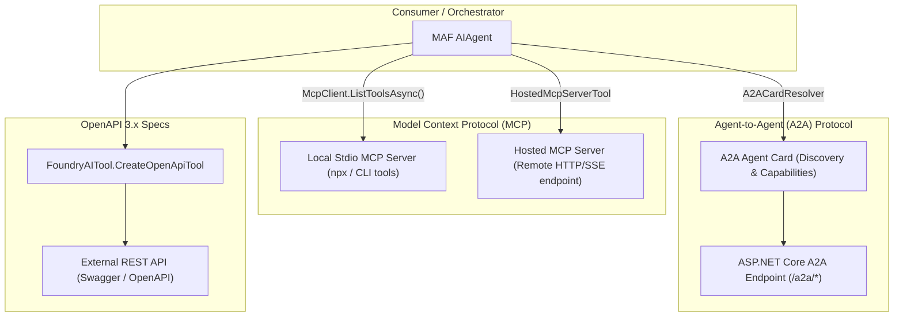

# Module 16 — Protocols (MCP, A2A, and OpenAPI)

> **Time:** ~50 min · **Level:** Advanced · **Prerequisites:** [Module 03 — Tools](03-tools.md), [Module 14 — Human in the Loop](14-human-in-the-loop.md)  
> **Packages:** `Microsoft.Agents.AI.OpenAI` 1.28.0 (GA), `ModelContextProtocol` 2.4.0 (GA), `Microsoft.Agents.AI.A2A` 1.28.0-preview.261106.1 *(preview)*, `Microsoft.Agents.AI.Hosting.A2A.AspNetCore` 1.28.0-preview.261106.1 *(preview)*, `Microsoft.Agents.AI.Foundry` 1.28.0-preview.261106.1 *(preview)*, `Azure.AI.Extensions.OpenAI` 3.0.0-beta.5 *(beta)*

---

## Learning objectives

- Connect to local and remote Model Context Protocol (MCP) servers using the official C# MCP SDK and expose discovered tools to an agent.
- Configure server-side hosted MCP tools (`HostedMcpServerTool`) with automatic and approval-required execution modes.
- Expose an `AIAgent` as an MCP server tool over standard I/O and HTTP transports.
- Consume remote Agent-to-Agent (A2A) services using `A2ACardResolver` and bind remote agents as local function tools.
- Host an A2A service in ASP.NET Core using `AddA2AServer` and route builders (`MapA2AHttpJson`, `MapA2AJsonRpc`).
- Integrate REST services via OpenAPI specifications using Microsoft Foundry OpenAPI tools (`FoundryAITool`).

---

## Concepts

Modern AI agent architectures rarely operate in complete isolation. Interoperability protocols establish standard conventions for tools, agent discovery, and service contracts across programming languages and organizational boundaries.



### 1. Model Context Protocol (MCP)

Model Context Protocol is an open standard designed to expose tools, prompts, and resources to LLMs in a structured format:
- **Local MCP Client**: The .NET host launches a local process (such as a Node.js CLI or Python script) communicating over `StdioClientTransport`. Discovered tools inherit from `AITool` and pass directly into `ChatOptions.Tools`.
- **Hosted MCP Tools (`HostedMcpServerTool`)**: Used with the OpenAI Responses API or Azure AI Foundry. The AI service itself directly initiates the HTTP connection to the MCP server. Tool approvals can be enforced prior to execution.
- **Agent as MCP Server**: You can wrap any MAF `AIAgent` as an `AIFunction` via `agent.AsAIFunction()`, convert it into an `McpServerTool`, and expose it over standard I/O so desktop assistants (like Claude Desktop or VS Code) can drive your MAF agent.

### 2. Agent-to-Agent (A2A) Protocol

The **A2A Protocol** (currently in Preview) standardizes communication between independent AI agent systems:
- **Agent Cards**: Machine-readable metadata describing an agent's skills, endpoint protocols, and authentication requirements (`AgentCard`).
- **Client Resolution**: `A2ACardResolver` fetches the agent card over HTTP/JSON and converts it into an `AIAgent` via `agentCard.AsAIAgent()`.
- **Agents as Tools**: A remote A2A agent can be attached to a local agent as a function tool via `a2aAgent.AsAIFunction()`.
- **ASP.NET Core Hosting**: An ASP.NET Core service can publish an agent as an A2A-compliant server using `AddA2AServer()` and `MapA2AHttpJson()`.

### 3. OpenAPI Function Tools

While MCP provides dynamic tool negotiation, millions of enterprise services are already defined via OpenAPI/Swagger specs:
- In MAF for .NET, OpenAPI tools are officially supported through **Microsoft Foundry** using `Microsoft.Agents.AI.Foundry` and `Azure.AI.Extensions.OpenAI`.
- An OpenAPI 3.x document (YAML or JSON) is passed as a `BinaryData` payload along with authentication credentials (`OpenApiAnonymousAuthenticationDetails` or API keys) to `FoundryAITool.CreateOpenApiTool(...)`.
- The Foundry backend interprets the schema and generates model-callable functions that execute HTTP requests directly.

---

## Hands-on

### Example 1 — Consuming Local MCP Server Tools

This example launches a local MCP server over standard I/O (using Node.js `npx`), discovers its exposed tools, and registers them on an agent.

```bash
dotnet new console -n McpLocalToolsDemo
cd McpLocalToolsDemo
dotnet add package Microsoft.Agents.AI.OpenAI --version 1.28.0
dotnet add package ModelContextProtocol --version 2.4.0
```

`Program.cs`:
```csharp
using Microsoft.Agents.AI;
using Microsoft.Extensions.AI;
using ModelContextProtocol.Client;
using OpenAI;

string apiKey = Environment.GetEnvironmentVariable("OPENAI_API_KEY") ?? "mock-key";
string model = Environment.GetEnvironmentVariable("OPENAI_MODEL") ?? "gpt-5.4-mini";

// 1. Configure and connect to a local MCP server over stdio transport
await using McpClient mcpClient = await McpClient.CreateAsync(new StdioClientTransport(new()
{
    Name = "LocalFileSystemMcp",
    Command = "npx",
    Arguments = ["-y", "@modelcontextprotocol/server-filesystem", "C:\\temp"]
}));

// 2. Discover available tools exposed by the MCP server
var mcpTools = await mcpClient.ListToolsAsync();

// 3. Register MCP tools on an agent by casting to AITool
AIAgent agent = new OpenAIClient(apiKey)
    .GetChatClient(model)
    .AsIChatClient()
    .AsAIAgent(
        instructions: "You are a filesystem assistant using tools discovered from an MCP server.",
        tools: [.. mcpTools.Cast<AITool>()]);

Console.WriteLine($"Discovered {mcpTools.Count} tools from MCP server for agent '{agent.Name}'.");
```

**What's happening:**
- `McpClient.CreateAsync` starts the specified executable process (`npx`) and completes the JSON-RPC initialization handshake.
- `mcpClient.ListToolsAsync()` queries the server's tool catalog.
- The returned tools (`McpClientTool`) implement `AITool`, allowing them to be spread into `tools: [.. mcpTools.Cast<AITool>()]`.

---

### Example 2 — Hosted MCP Tool with OpenAI Responses

> [!NOTE]
> **Experimental API (MEAI001 / OPENAI001):** Server-side hosted MCP tools and OpenAI Responses use experimental SDK extensions. Suppress with `#pragma warning disable MEAI001, OPENAI001`.

```bash
dotnet new console -n McpHostedToolDemo
cd McpHostedToolDemo
dotnet add package Microsoft.Agents.AI.OpenAI --version 1.28.0
dotnet add package Azure.Identity --version 1.21.0
```

`Program.cs`:
```csharp
#pragma warning disable OPENAI001 // OpenAI Responses API is experimental
#pragma warning disable MEAI001   // Hosted MCP tools are experimental in Microsoft.Extensions.AI

using Azure.Identity;
using Microsoft.Agents.AI;
using Microsoft.Extensions.AI;
using OpenAI;
using OpenAI.Responses;

string apiKey = Environment.GetEnvironmentVariable("OPENAI_API_KEY") ?? "mock-key";
string model = Environment.GetEnvironmentVariable("OPENAI_MODEL") ?? "gpt-5.4-mini";

// 1. Define a Hosted MCP Tool executed directly by the server-side model service
var mcpTool = new HostedMcpServerTool(
    serverName: "microsoft_learn",
    serverAddress: "https://learn.microsoft.com/api/mcp")
{
    AllowedTools = ["microsoft_docs_search"],
    ApprovalMode = HostedMcpServerToolApprovalMode.NeverRequire
};

// 2. Hosted MCP tools require the OpenAI Responses client backend
AIAgent agent = new OpenAIClient(apiKey)
    .GetResponsesClient()
    .AsAIAgent(
        model: model,
        instructions: "You answer questions by querying Microsoft Learn documentation via hosted MCP tools.",
        name: "LearnAgent",
        tools: [mcpTool]);

Console.WriteLine($"Agent '{agent.Name}' created with HostedMcpServerTool pointing to {mcpTool.ServerAddress}.");
```

**What's happening:**
- Unlike local MCP tools that execute on your machine, `HostedMcpServerTool` directs the cloud LLM runtime to make outbound calls directly to `https://learn.microsoft.com/api/mcp`.
- `ApprovalMode` can be set to `AlwaysRequire` to require user confirmation before the model executes remote queries.

---

### Example 3 — Exposing an Agent as an MCP Server Tool

You can expose any MAF agent as an MCP server tool so other applications (such as developer desktop shells or external orchestrators) can call it.

```bash
dotnet new console -n AgentAsMcpServerDemo
cd AgentAsMcpServerDemo
dotnet add package Microsoft.Agents.AI.OpenAI --version 1.28.0
dotnet add package ModelContextProtocol --version 2.4.0
dotnet add package Microsoft.Extensions.Hosting --version 10.0.0
```

`Program.cs`:
```csharp
using Microsoft.Agents.AI;
using Microsoft.Extensions.AI;
using Microsoft.Extensions.DependencyInjection;
using Microsoft.Extensions.Hosting;
using ModelContextProtocol.Server;
using OpenAI;

string apiKey = Environment.GetEnvironmentVariable("OPENAI_API_KEY") ?? "mock-key";
string model = Environment.GetEnvironmentVariable("OPENAI_MODEL") ?? "gpt-5.4-mini";

// 1. Build the core agent
AIAgent agent = new OpenAIClient(apiKey)
    .GetChatClient(model)
    .AsIChatClient()
    .AsAIAgent(
        instructions: "You are a code refactoring expert. Review snippets and suggest clean improvements.",
        name: "RefactorExpert");

// 2. Convert the AIAgent to an AIFunction and wrap as an McpServerTool
McpServerTool mcpTool = McpServerTool.Create(agent.AsAIFunction());

// 3. Register the MCP server over standard input/output (stdio)
HostApplicationBuilder builder = Host.CreateEmptyApplicationBuilder(settings: null);
builder.Services
    .AddMcpServer()
    .WithStdioServerTransport()
    .WithTools([mcpTool]);

Console.WriteLine($"Starting MCP Server hosting tool '{mcpTool.ProtocolTool.Name}'...");
// await builder.Build().RunAsync();
```

**What's happening:**
- `agent.AsAIFunction()` turns the multi-turn agent into a callable function tool.
- `McpServerTool.Create(...)` wraps that function into the MCP protocol format.
- `WithStdioServerTransport()` connects the MCP server loop to `Console.In` and `Console.Out`, making the agent discoverable by MCP clients.

---

### Example 4 — Consuming a Remote A2A Agent

> [!WARNING]
> **Preview:** `Microsoft.Agents.AI.A2A` ships as `1.28.0-preview.261106.1`. APIs are subject to change.

```bash
dotnet new console -n A2AClientDemo
cd A2AClientDemo
dotnet add package Microsoft.Agents.AI.OpenAI --version 1.28.0
dotnet add package Microsoft.Agents.AI.A2A --version 1.28.0-preview.261106.1
```

`Program.cs`:
```csharp
#pragma warning disable MAAI001 // Agent-to-Agent (A2A) APIs are currently in Preview

using A2A;
using Microsoft.Agents.AI;
using Microsoft.Extensions.AI;
using OpenAI;

string apiKey = Environment.GetEnvironmentVariable("OPENAI_API_KEY") ?? "mock-key";
string model = Environment.GetEnvironmentVariable("OPENAI_MODEL") ?? "gpt-5.4-mini";
string a2aHost = Environment.GetEnvironmentVariable("A2A_AGENT_HOST") ?? "http://localhost:5000";

// 1. Resolve remote agent definition using A2ACardResolver
A2ACardResolver cardResolver = new(new Uri(a2aHost));
AgentCard agentCard = await cardResolver.GetAgentCardAsync();

// 2. Wrap the remote A2A agent as an AIAgent instance
AIAgent remoteA2AAgent = agentCard.AsAIAgent();

// 3. Expose the remote agent as a function tool to a local coordinating agent
AIAgent orchestrator = new OpenAIClient(apiKey)
    .GetChatClient(model)
    .AsIChatClient()
    .AsAIAgent(
        instructions: "You are an orchestrator. Delegate specialized subtasks to the remote A2A agent tool.",
        name: "OrchestratorAgent",
        tools: [remoteA2AAgent.AsAIFunction()]);

Console.WriteLine($"Orchestrator '{orchestrator.Name}' initialized with A2A tool '{remoteA2AAgent.Name}'.");
```

---

### Example 5 — Hosting an A2A Server in ASP.NET Core

> [!WARNING]
> **Preview:** `Microsoft.Agents.AI.Hosting.A2A.AspNetCore` ships as `1.28.0-preview.261106.1`. Endpoint continuations require `#pragma warning disable MEAI001, MAAI001`.

```bash
dotnet new web -n A2AServerHostDemo
cd A2AServerHostDemo
dotnet add package Microsoft.Agents.AI.OpenAI --version 1.28.0
dotnet add package Microsoft.Agents.AI.Hosting.A2A.AspNetCore --version 1.28.0-preview.261106.1
```

`Program.cs`:
```csharp
#pragma warning disable MEAI001 // A2A hosting and AI response continuations are experimental
#pragma warning disable MAAI001 // Agent-to-Agent hosting is in Preview

using Microsoft.Agents.AI;
using Microsoft.Extensions.AI;
using OpenAI;

WebApplicationBuilder builder = WebApplication.CreateBuilder(args);

string apiKey = Environment.GetEnvironmentVariable("OPENAI_API_KEY") ?? "mock-key";
string model = Environment.GetEnvironmentVariable("OPENAI_MODEL") ?? "gpt-5.4-mini";

// 1. Define the AIAgent to be hosted
AIAgent agent = new OpenAIClient(apiKey)
    .GetChatClient(model)
    .AsIChatClient()
    .AsAIAgent(
        instructions: "You are a financial analysis assistant offering budgeting insights.",
        name: "FinanceAgent");

// 2. Register the A2A Server in DI
builder.AddA2AServer(agent);

WebApplication app = builder.Build();

// 3. Map A2A HTTP+JSON and JSON-RPC endpoints
app.MapA2AHttpJson(agent, "/a2a/finance");
app.MapA2AJsonRpc(agent, "/a2a/finance/rpc");

Console.WriteLine("A2A Server endpoints mapped at /a2a/finance and /a2a/finance/rpc");

// app.Run();
```

---

### Example 6 — Microsoft Foundry OpenAPI Tools

> [!WARNING]
> **Preview:** `Microsoft.Agents.AI.Foundry` ships as `1.28.0-preview.261106.1`.

```bash
dotnet new console -n OpenApiToolDemo
cd OpenApiToolDemo
dotnet add package Microsoft.Agents.AI.Foundry --version 1.28.0-preview.261106.1
dotnet add package Azure.AI.Extensions.OpenAI --version 3.0.0-beta.5
dotnet add package Azure.Identity --version 1.21.0
```

`Program.cs`:
```csharp
#pragma warning disable MAAI001 // Microsoft.Agents.AI.Foundry is currently in Preview

using Azure.AI.Extensions.OpenAI;
using Azure.AI.Projects;
using Azure.Identity;
using Microsoft.Agents.AI;
using Microsoft.Agents.AI.Foundry;
using Microsoft.Extensions.AI;

string endpoint = Environment.GetEnvironmentVariable("FOUNDRY_PROJECT_ENDPOINT") ?? "https://example.services.ai.azure.com/api/projects/my-project";
string model = Environment.GetEnvironmentVariable("FOUNDRY_MODEL") ?? "gpt-5.4-mini";

// 1. Define the OpenAPI specification string
const string CurrencyApiSpec = """
{
  "openapi": "3.1.0",
  "info": {
    "title": "Frankfurter Currency API",
    "version": "1.0.0"
  },
  "servers": [
    {
      "url": "https://api.frankfurter.dev/v1"
    }
  ],
  "paths": {
    "/latest": {
      "get": {
        "operationId": "GetLatestRates",
        "description": "Fetch current foreign exchange rates",
        "parameters": [
          {
            "name": "from",
            "in": "query",
            "description": "Base currency code (e.g. USD, EUR)",
            "required": false,
            "schema": { "type": "string" }
          }
        ],
        "responses": {
          "200": {
            "description": "Exchange rate results"
          }
        }
      }
    }
  }
}
""";

// 2. Create the OpenAPI Function Definition
OpenApiFunctionDefinition openApiDef = new(
    "get_latest_rates",
    BinaryData.FromString(CurrencyApiSpec),
    new OpenApiAnonymousAuthenticationDetails())
{
    Description = "Get live foreign exchange rates from the European Central Bank"
};

// 3. Wrap as an AITool using FoundryAITool
AITool openApiTool = FoundryAITool.CreateOpenApiTool(openApiDef);

// 4. Attach to a Foundry-backed AI Agent
AIProjectClient projectClient = new(new Uri(endpoint), new DefaultAzureCredential());

AIAgent agent = projectClient.AsAIAgent(
    model: model,
    instructions: "You are a financial advisor using live currency exchange rate tools.",
    name: "ForexAgent",
    tools: [openApiTool]);

Console.WriteLine($"Agent '{agent.Name}' created with OpenAPI tool '{openApiDef.Name}'.");
```

---

## Common pitfalls

- **Symptom:** `ListToolsAsync()` cannot be assigned to `IList<AITool>`.  
  **Cause:** `ListToolsAsync()` returns `IList<McpClientTool>`. In C#, generic lists are invariant (`IList<Derived>` does not implicitly convert to `IList<Base>`).  
  **Fix:** Cast the collection with LINQ: `tools: [.. mcpTools.Cast<AITool>()]`.

- **Symptom:** A2A server endpoint receives requests from multiple callers and mixes conversation states.  
  **Cause:** The A2A protocol `contextId` and `taskId` arrive from the wire and are treated as chain-resume identifiers, *not* authentication tokens. Multi-user hosts must isolate callers.  
  **Fix:** Register `AddHttpContextAccessor()` and configure claims-based isolation via `UseClaimsBasedAgentIsolation(...)` from `Microsoft.Agents.AI.Hosting.AspNetCore`.

- **Symptom:** `HostedMcpServerTool` throws an exception when invoked with standard OpenAI Chat Completions.  
  **Cause:** Hosted MCP tools require cloud provider tool execution, which is only supported by the OpenAI **Responses** client (`client.GetResponsesClient().AsAIAgent(...)`) or Microsoft Foundry.  
  **Fix:** Use `.GetResponsesClient().AsAIAgent(...)` instead of `.GetChatClient(...).AsAIAgent(...)`.

- **Symptom:** `OpenApiFunctionDefinition` compiler error `The best overload does not have a parameter named 'spec'`.  
  **Cause:** The SDK constructor parameters are positional: `(string name, BinaryData specification, OpenApiFunctionAuthenticationDetails auth)`.  
  **Fix:** Use positional arguments or the parameter name `specification`.

---

## When to use / when not to use

| Protocol / Tooling | When to Use | When NOT to Use | Alternatives |
|---|---|---|---|
| **Local MCP Server** | Integrating with local development tools, CLI utilities, and desktop MCP ecosystem plugins. | High-performance production microservices where spawning external subprocesses is prohibited. | Built-in C# function tools (`AIFunctionFactory`). |
| **Hosted MCP Tool** | Cloud-managed tool calling where provider services execute requests against remote MCP endpoints. | Environments requiring zero internet access or strictly private local network tools. | Local MCP clients or custom REST endpoints. |
| **A2A Client / Server** | Interconnecting disparate agents developed across teams or tech stacks via standardized discovery. | Simple agent-to-agent interactions inside a single .NET process. | Workflow handoff orchestrations ([Module 13](13-orchestrations.md)). |
| **Foundry OpenAPI Tools** | Calling existing enterprise REST endpoints documented by OpenAPI/Swagger specs. | Low-overhead internal APIs already written in C# and available in the same assembly. | Native `[Description]` C# methods with `AIFunctionFactory.Create`. |

---

## Exercises

1. **Filtered MCP Tool Gateway**  
   Connect to a local MCP server, query `ListToolsAsync()`, and dynamically filter the tools so that only functions starting with `"read_"` or `"get_"` are passed to the agent.

2. **Standalone MCP Server from Function Tools**  
   Create an agent with two local C# math tools (`Add` and `Multiply`). Convert the agent using `agent.AsAIFunction()`, wrap it into an `McpServerTool`, and configure a console host with `WithStdioServerTransport()`.

3. **Secure A2A Delegation Pipeline**  
   Build a two-agent architecture:
   - Host an expert `InventoryAgent` as an A2A server at `/a2a/inventory`.
   - Configure a client agent that resolves the card via `A2ACardResolver` and attaches `inventoryAgent.AsAIFunction()` to handle customer stock inquiries.

---

## Summary

- MCP standardizes tool and context delivery across runtimes. Use `ModelContextProtocol.Client` for local CLI tools and `HostedMcpServerTool` for cloud-hosted tools.
- Any MAF agent can be exposed as an MCP tool using `McpServerTool.Create(agent.AsAIFunction())`.
- A2A enables cross-network agent discovery via `AgentCard` and seamless function delegation via `a2aAgent.AsAIFunction()`.
- ASP.NET Core hosts agents as A2A endpoints via `builder.AddA2AServer(...)` and `app.MapA2AHttpJson(...)`.
- Microsoft Foundry OpenAPI tools (`FoundryAITool.CreateOpenApiTool`) convert existing Swagger/OpenAPI specifications directly into model tools.

---

## Further reading

- [Using MCP Tools with Agents (Microsoft Learn)](https://learn.microsoft.com/en-us/agent-framework/agents/tools/local-mcp-tools?pivots=programming-language-csharp)
- [Hosted MCP Tools (Microsoft Learn)](https://learn.microsoft.com/en-us/agent-framework/agents/tools/hosted-mcp-tools?pivots=programming-language-csharp)
- [Agent-to-Agent (A2A) Overview](https://learn.microsoft.com/en-us/agent-framework/journey/agent-to-agent?pivots=programming-language-csharp)
- [MCP Official C# SDK on GitHub](https://github.com/modelcontextprotocol/csharp-sdk)
- [MAF MCP Samples](https://github.com/microsoft/agent-framework/tree/main/dotnet/samples/02-agents/ModelContextProtocol)
- [MAF A2A Samples](https://github.com/microsoft/agent-framework/tree/main/dotnet/samples/02-agents/A2A)

---

## Solutions

### Solution 1 — Filtered MCP Tool Gateway

```csharp
using Microsoft.Agents.AI;
using Microsoft.Extensions.AI;
using ModelContextProtocol.Client;
using OpenAI;

string apiKey = Environment.GetEnvironmentVariable("OPENAI_API_KEY") ?? "mock-key";
string model = Environment.GetEnvironmentVariable("OPENAI_MODEL") ?? "gpt-5.4-mini";

await using McpClient mcpClient = await McpClient.CreateAsync(new StdioClientTransport(new()
{
    Name = "GitServer",
    Command = "npx",
    Arguments = ["-y", "@modelcontextprotocol/server-github"]
}));

// Retrieve all available tools
var allTools = await mcpClient.ListToolsAsync();

// Filter for read-only tools starting with 'read_' or 'get_'
var filteredTools = allTools
    .Where(t => t.ProtocolTool.Name.StartsWith("read_", StringComparison.OrdinalIgnoreCase) ||
                t.ProtocolTool.Name.StartsWith("get_", StringComparison.OrdinalIgnoreCase))
    .Cast<AITool>()
    .ToList();

AIAgent agent = new OpenAIClient(apiKey)
    .GetChatClient(model)
    .AsIChatClient()
    .AsAIAgent(
        instructions: "You are a read-only repository assistant.",
        tools: filteredTools);

Console.WriteLine($"Configured agent with {filteredTools.Count} read-only MCP tools out of {allTools.Count} total.");
```

---

### Solution 2 — Standalone MCP Server from Function Tools

```csharp
using System.ComponentModel;
using Microsoft.Agents.AI;
using Microsoft.Extensions.AI;
using Microsoft.Extensions.DependencyInjection;
using Microsoft.Extensions.Hosting;
using ModelContextProtocol.Server;
using OpenAI;

string apiKey = Environment.GetEnvironmentVariable("OPENAI_API_KEY") ?? "mock-key";
string model = Environment.GetEnvironmentVariable("OPENAI_MODEL") ?? "gpt-5.4-mini";

[Description("Add two numbers")]
static double Add(double a, double b) => a + b;

[Description("Multiply two numbers")]
static double Multiply(double a, double b) => a * b;

AIAgent mathAgent = new OpenAIClient(apiKey)
    .GetChatClient(model)
    .AsIChatClient()
    .AsAIAgent(
        instructions: "You perform exact mathematical calculations.",
        name: "MathCalculator",
        tools: [AIFunctionFactory.Create(Add), AIFunctionFactory.Create(Multiply)]);

McpServerTool mcpTool = McpServerTool.Create(mathAgent.AsAIFunction());

HostApplicationBuilder builder = Host.CreateEmptyApplicationBuilder(settings: null);
builder.Services
    .AddMcpServer()
    .WithStdioServerTransport()
    .WithTools([mcpTool]);

Console.WriteLine("Math Calculator MCP Server initialized over stdio.");
// await builder.Build().RunAsync();
```

---

### Solution 3 — Secure A2A Delegation Pipeline

```csharp
#pragma warning disable MEAI001
#pragma warning disable MAAI001

using A2A;
using Microsoft.Agents.AI;
using Microsoft.Extensions.AI;
using OpenAI;

// Part 1: ASP.NET Core Server setup for InventoryAgent
WebApplicationBuilder builder = WebApplication.CreateBuilder(args);

string apiKey = Environment.GetEnvironmentVariable("OPENAI_API_KEY") ?? "mock-key";
string model = Environment.GetEnvironmentVariable("OPENAI_MODEL") ?? "gpt-5.4-mini";

AIAgent inventoryAgent = new OpenAIClient(apiKey)
    .GetChatClient(model)
    .AsIChatClient()
    .AsAIAgent(
        instructions: "You are the warehouse inventory specialist. Answer queries about item availability.",
        name: "InventoryAgent");

builder.AddA2AServer(inventoryAgent);

WebApplication app = builder.Build();
app.MapA2AHttpJson(inventoryAgent, "/a2a/inventory");

Console.WriteLine("Inventory A2A endpoint mapped.");

// Part 2: Consumer Agent resolution
A2ACardResolver resolver = new(new Uri("http://localhost:5000/a2a/inventory"));
AgentCard card = await resolver.GetAgentCardAsync();
AIAgent remoteInventory = card.AsAIAgent();

AIAgent customerServiceAgent = new OpenAIClient(apiKey)
    .GetChatClient(model)
    .AsIChatClient()
    .AsAIAgent(
        instructions: "You are customer service. Delegate inventory questions to the Inventory tool.",
        name: "CustomerServiceAgent",
        tools: [remoteInventory.AsAIFunction()]);

Console.WriteLine($"Customer Service agent configured with remote tool: {remoteInventory.Name}");
```
