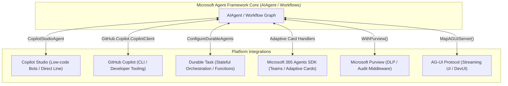

# Module 17 — Integrations (Copilot Studio, GitHub Copilot, and Durable Agents)

> **Time:** ~50 min · **Level:** Advanced · **Prerequisites:** [Module 02 — Your First Agent](02-first-agent.md), [Module 04 — Conversations & Sessions](04-conversations-and-threads.md), [Module 11 — Workflows](11-workflows.md)  
> **Packages:** `Microsoft.Agents.AI.GitHub.Copilot` 1.28.0 (GA), `Microsoft.Agents.AI.DurableTask` 1.16.0 (GA), `Microsoft.Agents.AI.Hosting.AzureFunctions` 1.16.0 (GA), `Microsoft.Agents.AI.CopilotStudio` 1.28.0-preview.261106.1 *(preview)*, `Microsoft.Agents.AI.Hosting.AGUI.AspNetCore` 1.28.0-preview.261106.1 *(preview)*

---

## Learning objectives

- Integrate enterprise Copilot Studio bots into MAF applications using `CopilotStudioAgent`.
- Build developer automation agents powered by the GitHub Copilot runtime with permission handling.
- Host durable agents and graph-based workflows using the Microsoft Agent Framework Durable Extension.
- Scale durable agent workloads in serverless Azure Functions and self-hosted environments.
- Explain the role of the Microsoft 365 Agents SDK for Teams and Microsoft 365 Copilot extensions.
- Apply Microsoft Purview compliance and Data Loss Prevention (DLP) middleware to agent runs.
- Expose streaming agent interactions to web frontends using the AG-UI protocol.

---

## Concepts

The Microsoft Agent Framework serves as a unified orchestration substrate across Microsoft's AI ecosystem. Rather than reinventing agent runtimes for every target host or product surface, MAF provides specialized adapters and hosting extensions that connect into enterprise services.



### 1. Copilot Studio Agent (`Microsoft.Agents.AI.CopilotStudio`)

Microsoft Copilot Studio allows business teams to configure low-code agents with knowledge bases, Power Platform connectors, and enterprise compliance. The MAF `CopilotStudioAgent` adapter wraps the Copilot Studio client into an `AIAgent`:
- **Protocol Bridge**: Translates MAF `ChatMessage` objects into Direct Line/Power Platform activities.
- **Session Continuity**: Multi-turn conversations are tracked via the cloud-assigned `ConversationId`. Calling `agent.CreateSessionAsync(conversationId)` resumes existing cloud sessions.

### 2. GitHub Copilot Agent (`Microsoft.Agents.AI.GitHub.Copilot`)

The GitHub Copilot extension allows C# developers to harness the GitHub Copilot client engine directly:
- **CLI & Code Intelligence**: Provides deep repository context, code edits, and terminal execution capabilities.
- **Permission Handlers**: Shell execution or destructive operations require explicit user approval via `SessionConfig.OnPermissionRequest`.
- **Packaging**: The package is **GA** (`1.28.0`), with RPC permission decision types marked for evaluation (`GHCP001`).

### 3. Durable Extension (`Microsoft.Agents.AI.DurableTask`)

Standard in-memory workflows and agent sessions terminate when the host process restarts. The **Durable Extension** integrates MAF with the **Durable Task Framework** (and Durable Task Scheduler):
- **Process Resilience**: State is persisted automatically across requests, surviving process crashes, deployments, and node failures.
- **Azure Functions Hosting**: Serverless deployment via Azure Functions Flex Consumption with pay-per-invocation pricing and scale-to-zero.
- **Bring-Your-Own-Compute (Self-Hosted)**: Console applications, containers, or Kubernetes clusters can host durable agents using `ConfigureDurableAgents` and `ConfigureDurableWorkflows`.

### 4. Enterprise Surface Pointers

- **Microsoft 365 Agents SDK**: Bridges MAF agents into Microsoft Teams, Outlook, and Microsoft 365 Copilot using Adaptive Cards and Bot Framework protocols.
- **Microsoft Purview**: Security and compliance middleware (`WithPurview()`) that inspects prompts and responses inline for Data Loss Prevention (DLP) and enterprise auditing.
- **AG-UI (`Microsoft.Agents.AI.Hosting.AGUI.AspNetCore`)**: Standardizes streaming protocol events over Server-Sent Events (SSE) for frontend web chat components.

---

## Hands-on

### Example 1 — Copilot Studio Agent Integration

> [!WARNING]
> **Preview:** `Microsoft.Agents.AI.CopilotStudio` ships as `1.28.0-preview.261106.1`.

```bash
dotnet new console -n CopilotStudioIntegrationDemo
cd CopilotStudioIntegrationDemo
dotnet add package Microsoft.Agents.AI.CopilotStudio --version 1.28.0-preview.261106.1
dotnet add package Microsoft.Extensions.DependencyInjection --version 10.0.0
dotnet add package Microsoft.Extensions.Http --version 10.0.0
```

`Program.cs`:
```csharp
#pragma warning disable MAAI001 // Microsoft.Agents.AI.CopilotStudio is currently in Preview

using Microsoft.Agents.AI;
using Microsoft.Agents.AI.CopilotStudio;
using Microsoft.Agents.CopilotStudio.Client;
using Microsoft.Extensions.DependencyInjection;
using Microsoft.Extensions.Logging.Abstractions;

string tenantId = Environment.GetEnvironmentVariable("COPILOT_STUDIO_TENANT_ID") ?? Guid.NewGuid().ToString();
string agentAppId = Environment.GetEnvironmentVariable("COPILOT_STUDIO_AGENT_APP_ID") ?? Guid.NewGuid().ToString();
string directConnectUrl = Environment.GetEnvironmentVariable("COPILOT_STUDIO_DIRECT_CONNECT_URL") ?? "https://directline.botframework.com";

// 1. Configure Copilot Studio connection settings
ConnectionSettings settings = new()
{
    DirectConnectUrl = directConnectUrl
};

// 2. Set up HttpClientFactory via DI
ServiceCollection services = new();
services.AddHttpClient("CopilotStudioClient");
ServiceProvider serviceProvider = services.BuildServiceProvider();
IHttpClientFactory httpClientFactory = serviceProvider.GetRequiredService<IHttpClientFactory>();

// 3. Create CopilotClient and wrap as CopilotStudioAgent
CopilotClient client = new(settings, httpClientFactory, NullLogger.Instance, "CopilotStudioClient");
CopilotStudioAgent agent = new(client);

// 4. Create and manage session (conversation ID continuity)
AgentSession session = await agent.CreateSessionAsync();
Console.WriteLine($"Initialized CopilotStudioAgent. Session type: {session.GetType().Name}");

// Subsequent turns can be continued using the session conversation ID:
// AgentSession resumedSession = await agent.CreateSessionAsync("existing-conversation-id");
```

**What's happening:**
- `ConnectionSettings` specifies the cloud endpoint configuration.
- `CopilotClient` handles activity protocol formatting.
- `CopilotStudioAgent` exposes standard `RunAsync` and `CreateSessionAsync` methods, allowing enterprise low-code bots to participate in MAF orchestrations.

---

### Example 2 — GitHub Copilot Agent with Permission Handling

> [!NOTE]
> **Diagnostic (GHCP001):** The GitHub Copilot RPC permission types are evaluated under diagnostic `GHCP001`. Suppress with `#pragma warning disable GHCP001`.

```bash
dotnet new console -n GitHubCopilotAgentDemo
cd GitHubCopilotAgentDemo
dotnet add package Microsoft.Agents.AI.GitHub.Copilot --version 1.28.0
```

`Program.cs`:
```csharp
#pragma warning disable GHCP001 // GitHub Copilot RPC evaluation diagnostic

using GitHub.Copilot;
using GitHub.Copilot.Rpc;
using Microsoft.Agents.AI;

// 1. Define permission handler for tool and shell execution
static Task<PermissionDecision> PromptPermission(PermissionRequest request, PermissionInvocation invocation)
{
    Console.WriteLine($"\n[Security Check] GitHub Copilot requested: {request.Kind}");
    Console.Write("Allow execution? (y/n): ");

    string? input = Console.ReadLine()?.Trim().ToUpperInvariant();
    PermissionDecision decision = (input is "Y" or "YES")
        ? PermissionDecision.ApproveOnce()
        : PermissionDecision.Reject();

    return Task.FromResult(decision);
}

// 2. Instantiate and start the GitHub Copilot client
await using CopilotClient copilotClient = new();
await copilotClient.StartAsync();

// 3. Configure session parameters including permission callback
SessionConfig sessionConfig = new()
{
    OnPermissionRequest = PromptPermission,
};

// 4. Wrap GitHub Copilot as an AIAgent
AIAgent agent = copilotClient.AsAIAgent(sessionConfig, ownsClient: true);

Console.WriteLine($"GitHub Copilot agent initialized: '{agent.Name}'.");

// 5. Execute streaming prompt
string prompt = "Summarize the project structure in the current workspace";
Console.WriteLine($"Prompt: {prompt}\n");

await foreach (AgentResponseUpdate update in agent.RunStreamingAsync(prompt))
{
    Console.Write(update);
}
Console.WriteLine();
```

**What's happening:**
- `CopilotClient.StartAsync()` connects to the local GitHub Copilot background daemon.
- `SessionConfig.OnPermissionRequest` intercepts shell commands or workspace reads, prompting the user for approval.
- `copilotClient.AsAIAgent(...)` exposes the assistant as an `AIAgent` supporting streaming tokens.

---

### Example 3 — Self-Hosted Durable Agent with Durable Task Scheduler

The Durable Extension allows agents to maintain persistent sessions across process restarts using the Durable Task Scheduler backend.

```bash
dotnet new console -n DurableAgentDemo
cd DurableAgentDemo
dotnet add package Microsoft.Agents.AI.OpenAI --version 1.28.0
dotnet add package Microsoft.Agents.AI.DurableTask --version 1.16.0
dotnet add package Microsoft.DurableTask.Client.AzureManaged --version 1.28.0
dotnet add package Microsoft.DurableTask.Worker.AzureManaged --version 1.28.0
dotnet add package Microsoft.Extensions.Hosting --version 10.0.0
```

`Program.cs`:
```csharp
using Microsoft.Agents.AI;
using Microsoft.Agents.AI.DurableTask;
using Microsoft.DurableTask.Client.AzureManaged;
using Microsoft.DurableTask.Worker.AzureManaged;
using Microsoft.Extensions.AI;
using Microsoft.Extensions.DependencyInjection;
using Microsoft.Extensions.Hosting;
using OpenAI;

string apiKey = Environment.GetEnvironmentVariable("OPENAI_API_KEY") ?? "mock-key";
string model = Environment.GetEnvironmentVariable("OPENAI_MODEL") ?? "gpt-5.4-mini";
string dtsConnection = Environment.GetEnvironmentVariable("DURABLE_TASK_SCHEDULER_CONNECTION_STRING")
    ?? "Endpoint=http://localhost:8080;TaskHub=default;Authentication=None";

// 1. Create the core AIAgent
AIAgent agent = new OpenAIClient(apiKey)
    .GetChatClient(model)
    .AsIChatClient()
    .AsAIAgent(
        instructions: "You are a customer support agent. Sessions persist across server restarts.",
        name: "SupportAgent");

// 2. Configure durable host using Microsoft.Agents.AI.DurableTask
IHost host = Host.CreateDefaultBuilder(args)
    .ConfigureServices(services =>
    {
        services.ConfigureDurableAgents(
            options => options.AddAIAgent(agent),
            workerBuilder: builder => builder.UseDurableTaskScheduler(dtsConnection),
            clientBuilder: builder => builder.UseDurableTaskScheduler(dtsConnection));
    })
    .Build();

Console.WriteLine("Durable host configured for SupportAgent with Durable Task Scheduler backend.");
// await host.RunAsync();
```

**What's happening:**
- `services.ConfigureDurableAgents(...)` registers the agent inside the Durable Task worker infrastructure.
- `UseDurableTaskScheduler(dtsConnection)` connects the host to a local or Azure-managed Durable Task Scheduler instance.
- Conversation history and execution locks are managed durably; if this worker process restarts mid-request, another worker automatically resumes execution without repeating work.

---

### Example 4 — Azure Functions Serverless Durable Agent Hosting

In serverless Azure Functions hosting, HTTP endpoints and session persistence are generated automatically.

```bash
dotnet add package Microsoft.Agents.AI.Hosting.AzureFunctions --version 1.16.0
```

`Program.cs` (Functions Worker):
```csharp
using Azure.Identity;
using Microsoft.Agents.AI;
using Microsoft.Agents.AI.Hosting.AzureFunctions;
using Microsoft.Azure.Functions.Worker.Builder;
using Microsoft.Extensions.Hosting;
using OpenAI;

string apiKey = Environment.GetEnvironmentVariable("OPENAI_API_KEY") ?? "mock-key";
string model = Environment.GetEnvironmentVariable("OPENAI_MODEL") ?? "gpt-5.4-mini";

AIAgent agent = new OpenAIClient(apiKey)
    .GetChatClient(model)
    .AsIChatClient()
    .AsAIAgent(
        instructions: "You are a helpful IT troubleshooting assistant.",
        name: "ITHelpdesk");

// Build Azure Functions app with durable agent hosting
using IHost app = FunctionsApplication
    .CreateBuilder(args)
    .ConfigureFunctionsWebApplication()
    .ConfigureDurableAgents(options =>
        options.AddAIAgent(agent))
    .Build();

app.Run();
```

**HTTP Invocation:**
```bash
# 1. Start a new session
curl -i -X POST https://my-function.azurewebsites.net/api/agents/ITHelpdesk/run \
  -H "Content-Type: text/plain" \
  -d "My printer won't connect to Wi-Fi"

# Response header returns: x-ms-session-id: @dafx-v2-ithelpdesk@263fa373...

# 2. Continue the exact session across requests
curl -X POST "https://my-function.azurewebsites.net/api/agents/ITHelpdesk/run?sessionId=@dafx-v2-ithelpdesk@263fa373..." \
  -H "Content-Type: text/plain" \
  -d "I rebooted the router, what now?"
```

---

### Brief Coverage: Purview, M365 Agents SDK, and AG-UI

#### Microsoft Purview Integration
Protect against sensitive data leakage (PII, credentials) by attaching Purview compliance middleware:
```csharp
using Azure.Identity;
using Microsoft.Agents.AI.Purview;

AIAgent secureAgent = baseAgent
    .AsBuilder()
    .WithPurview(new DefaultAzureCredential(), new PurviewSettings("ProductionAppSecurity"))
    .Build();
```

#### AG-UI Hosting
Expose your agent to web frontends using standard Server-Sent Events (SSE):
```csharp
using Microsoft.Agents.AI.Hosting.AGUI.AspNetCore;

WebApplication app = builder.Build();
app.MapAGUIServer("/api/chat", agent);
await app.RunAsync();
```

---

## Common pitfalls

- **Symptom:** `GHCP001` build error on GitHub Copilot permission types.  
  **Cause:** The RPC permission APIs are marked with diagnostic `GHCP001` in the SDK.  
  **Fix:** Add `#pragma warning disable GHCP001` at the top of the file.

- **Symptom:** Durable agent sessions in Azure Functions do not maintain context across turns.  
  **Cause:** The client failed to capture the `x-ms-session-id` response header and did not pass `?sessionId=...` on the subsequent request.  
  **Fix:** Store the returned opaque session ID and pass it as a query parameter or header on every follow-up interaction.

- **Symptom:** `IDurableTaskWorkerBuilder` does not contain a definition for `UseDurableTaskScheduler`.  
  **Cause:** Missing namespace imports for the client/worker Azure Managed packages.  
  **Fix:** Add `using Microsoft.DurableTask.Client.AzureManaged;` and `using Microsoft.DurableTask.Worker.AzureManaged;`.

---

## When to use / when not to use

| Integration Target | When to Use | When NOT to Use | Alternatives |
|---|---|---|---|
| **Copilot Studio** | Integrating with Power Platform workflows, enterprise knowledge bots, or business-configured Copilots. | Code-first agents that need low latency, fine-grained LLM prompting, or local tools. | Native `ChatClientAgent` ([Module 02](02-first-agent.md)). |
| **GitHub Copilot** | Developer productivity tools, workspace-aware code reviewers, and automated CLI scripts. | End-user customer chatbots or non-technical business workflows. | Standard OpenAI or Anthropic agents. |
| **Durable Task (Functions)** | Serverless deployments requiring scale-to-zero, HTTP API generation, and long-running human waits. | Ultra-low latency microservices where cold starts are prohibitive. | Containerized ASP.NET Core hosting ([Module 18](18-hosting-and-deployment.md)). |
| **Durable Task (Self-Hosted)** | Workflows running for hours/days in Kubernetes or custom containers requiring crash recovery. | Short, stateless single-turn request/response prompts. | In-memory workflows ([Module 11](11-workflows.md)). |

---

## Exercises

1. **GitHub Copilot Automated Code Reviewer**  
   Configure a GitHub Copilot agent with a custom `OnPermissionRequest` handler that automatically approves read-only requests (`Read` or `List`) while prompting the user on the console for write/execute requests.

2. **Durable Workflow Registration**  
   Create a self-hosted console application that defines a multi-step graph workflow and registers it with `services.ConfigureDurableWorkflows(...)` connecting to a local Durable Task Scheduler endpoint.

3. **Copilot Studio Session Continuation Bridge**  
   Write a client program that initializes a `CopilotStudioAgent`, executes a first prompt, saves the resulting session `ConversationId`, and rehydrates a new session instance using that ID to verify conversational continuity.

---

## Summary

- `CopilotStudioAgent` bridges enterprise low-code bots into C# code, maintaining conversation history via cloud conversation IDs.
- `GitHub.Copilot` exposes developer workspace tools with granular permission controls (`OnPermissionRequest`).
- `Microsoft.Agents.AI.DurableTask` enables crash-resilient durable agent execution across self-hosted and Azure Functions runtimes.
- In serverless Azure Functions hosting, HTTP endpoints and session persistence are generated automatically.
- Purview middleware (`WithPurview`) provides enterprise compliance, while AG-UI (`MapAGUIServer`) streams agent outputs to web frontends.

---

## Further reading

- [Microsoft Agent Framework Durable Extension](https://learn.microsoft.com/en-us/agent-framework/hosting/durable-extension?pivots=programming-language-csharp)
- [Microsoft Purview Integration](https://learn.microsoft.com/en-us/agent-framework/integrations/by-component/middleware/purview?pivots=programming-language-csharp)
- [Getting Started with AG-UI](https://learn.microsoft.com/en-us/agent-framework/integrations/by-component/ui/ag-ui/getting-started?pivots=programming-language-csharp)
- [Durable Extension GitHub Repository & Samples](https://github.com/microsoft/agent-framework-durable-extension)
- [MAF GitHub Copilot Sample](https://github.com/microsoft/agent-framework/tree/main/dotnet/samples/02-agents/AgentProviders/github-copilot)

---

## Solutions

### Solution 1 — GitHub Copilot Automated Code Reviewer

```csharp
#pragma warning disable GHCP001

using GitHub.Copilot;
using GitHub.Copilot.Rpc;
using Microsoft.Agents.AI;

static Task<PermissionDecision> AutoApproveReads(PermissionRequest request, PermissionInvocation invocation)
{
    // Auto-approve read actions; prompt for modifications
    if (request.Kind.Contains("read", StringComparison.OrdinalIgnoreCase) ||
        request.Kind.Contains("list", StringComparison.OrdinalIgnoreCase))
    {
        Console.WriteLine($"[Auto-Approved] Read action: {request.Kind}");
        return Task.FromResult(PermissionDecision.ApproveOnce());
    }

    Console.Write($"[Prompt Required] Allow {request.Kind}? (y/n): ");
    string? answer = Console.ReadLine()?.Trim().ToUpperInvariant();
    return Task.FromResult(answer is "Y" or "YES" ? PermissionDecision.ApproveOnce() : PermissionDecision.Reject());
}

await using CopilotClient client = new();
await client.StartAsync();

SessionConfig config = new() { OnPermissionRequest = AutoApproveReads };
AIAgent reviewer = client.AsAIAgent(config, ownsClient: true);

Console.WriteLine($"Code Reviewer '{reviewer.Name}' ready.");
```

---

### Solution 2 — Durable Workflow Registration

```csharp
using Microsoft.Agents.AI.DurableTask;
using Microsoft.Agents.AI.Workflows;
using Microsoft.DurableTask.Client.AzureManaged;
using Microsoft.DurableTask.Worker.AzureManaged;
using Microsoft.Extensions.Hosting;

string dtsConnection = "Endpoint=http://localhost:8080;TaskHub=default;Authentication=None";

StepOneExecutor step1 = new();
StepTwoExecutor step2 = new();

Workflow workflow = new WorkflowBuilder(step1)
    .AddEdge(step1, step2)
    .WithOutputFrom(step2)
    .Build();

IHost host = Host.CreateDefaultBuilder(args)
    .ConfigureServices(services =>
    {
        services.ConfigureDurableWorkflows(
            options => options.AddWorkflow("OrderProcessingWorkflow", workflow),
            workerBuilder: builder => builder.UseDurableTaskScheduler(dtsConnection),
            clientBuilder: builder => builder.UseDurableTaskScheduler(dtsConnection));
    })
    .Build();

Console.WriteLine("Durable workflow host configured and ready to execute.");

[SendsMessage(typeof(string))]
internal sealed partial class StepOneExecutor() : Executor<string>("Step1")
{
    public override async ValueTask HandleAsync(string input, IWorkflowContext ctx, CancellationToken ct = default) =>
        await ctx.SendMessageAsync($"Processed: {input}", ct);
}

[YieldsOutput(typeof(string))]
internal sealed partial class StepTwoExecutor() : Executor<string>("Step2")
{
    public override async ValueTask HandleAsync(string input, IWorkflowContext ctx, CancellationToken ct = default) =>
        await ctx.YieldOutputAsync($"Finalized: {input}", ct);
}
```

---

### Solution 3 — Copilot Studio Session Continuation Bridge

```csharp
#pragma warning disable MAAI001

using Microsoft.Agents.AI;
using Microsoft.Agents.AI.CopilotStudio;
using Microsoft.Agents.CopilotStudio.Client;
using Microsoft.Extensions.DependencyInjection;
using Microsoft.Extensions.Logging.Abstractions;

ConnectionSettings settings = new()
{
    DirectConnectUrl = "https://directline.botframework.com"
};

ServiceCollection services = new();
services.AddHttpClient("CopilotClient");
ServiceProvider sp = services.BuildServiceProvider();
IHttpClientFactory factory = sp.GetRequiredService<IHttpClientFactory>();

CopilotClient client = new(settings, factory, NullLogger.Instance, "CopilotClient");
CopilotStudioAgent agent = new(client);

// 1. Start initial conversation session
AgentSession sessionTurn1 = await agent.CreateSessionAsync();
Console.WriteLine($"Turn 1 started. Internal conversation created.");

// 2. Extract or simulate tracking the conversation ID
string activeConversationId = "conv-" + Guid.NewGuid().ToString("N")[..8];

// 3. Reconnect to the conversation in a separate session instance
AgentSession sessionTurn2 = await agent.CreateSessionAsync(activeConversationId);
Console.WriteLine($"Turn 2 initialized using existing ConversationId: {activeConversationId}");
```
