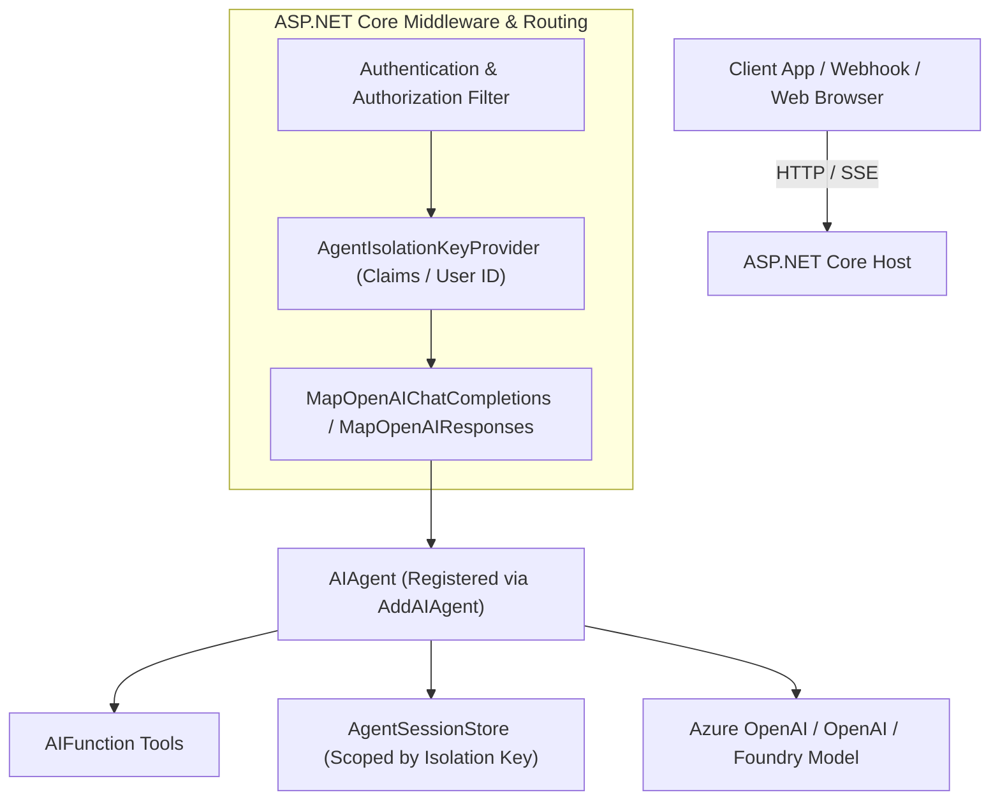

# Module 18 — Hosting and Deployment

> **Time:** ~40 min · **Level:** Intermediate · **Prerequisites:** [Module 02](02-first-agent.md), [Module 04](04-conversations-and-threads.md), [Module 06](06-middleware.md)  
> **Packages:** `Microsoft.Agents.AI` 1.28.0 (GA), `Microsoft.Agents.AI.OpenAI` 1.28.0 (GA), `Microsoft.Agents.AI.Hosting` 1.28.0-preview.261106.1 *(Preview)*, `Microsoft.Agents.AI.Hosting.AspNetCore` 1.28.0-preview.261106.1 *(Preview)*, `Microsoft.Agents.AI.Hosting.OpenAI` 1.28.0-alpha.261106.1 *(Alpha)*, `Microsoft.Agents.AI.Foundry.Hosting` 1.28.0-preview.261106.1 *(Preview)*

## Learning objectives

- Register `IChatClient` and `AIAgent` instances into the ASP.NET Core dependency injection container using `AddAIAgent` and appropriate lifetime scopes.
- Expose agents over standard OpenAI-compatible endpoints (`/v1/chat/completions` and `/v1/responses`) using `MapOpenAIChatCompletions` and `MapOpenAIResponses`.
- Partition agent sessions and tool approvals across multi-tenant callers using `UseClaimsBasedAgentIsolation` and `AgentIsolationKeyProvider`.
- Deploy agents as Azure AI Foundry Hosted Agents or containerized workloads on Azure Container Apps and Azure App Service.
- Configure production identity with `ManagedIdentityCredential` and coordinate multi-instance concurrency against shared session stores.

---

## Concepts

### Agent Hosting Architecture

Production agents do not run in isolation; they are deployed inside web services, microservices, or cloud containers. The Microsoft Agent Framework hosting layer provides clean abstractions to host agents in standard ASP.NET Core pipelines.



### Dependency Injection Registration

The `Microsoft.Agents.AI.Hosting` package introduces fluent extensions on `IServiceCollection` to register agents and manage their dependencies:

```csharp
builder.Services.AddAIAgent(
    name: "CustomerCareAgent",
    instructions: "You assist customer inquiries concisely.",
    lifetime: ServiceLifetime.Singleton)
    .WithAITool(AIFunctionFactory.Create(LookupOrder))
    .WithInMemorySessionStore(withIsolation: true);
```

Key points regarding lifetimes:
- **Agent Lifetime**: By default, agents are registered as `Singleton`. You can register them as `Scoped` if your agent holds request-specific resources.
- **Captive Dependency Prevention**: `WithAITool` validates that a tool's lifetime is at least as long as the agent's lifetime. A `Singleton` agent cannot depend on a `Scoped` tool; doing so throws an `InvalidOperationException` at startup.

### OpenAI Protocol Endpoints

The `Microsoft.Agents.AI.Hosting.OpenAI` package maps standard OpenAI REST endpoints to your agents, allowing any OpenAI-compatible SDK or client library to communicate with your agent:

| Endpoint | Mapping Method | Protocol Behavior |
|---|---|---|
| `/{agentName}/v1/chat/completions` | `MapOpenAIChatCompletions` | Stateless request/response per turn. Callers supply full message history. |
| `/{agentName}/v1/responses` | `MapOpenAIResponses` | Stateful Responses API with server-side sessions, streaming SSE events, and approval tracking. |

#### Chat Completions vs. Responses API
- **Chat Completions** (`MapOpenAIChatCompletions`): Ideal for backwards compatibility with existing clients that expect the standard OpenAI `/chat/completions` payload. History is managed by the client or re-sent on each request.
- **Responses API** (`MapOpenAIResponses`): The modern protocol for agents. It handles server-side continuation (`previous_response_id` snapshotting or mutable `conversation_id`), server-sent events (SSE) for streaming text and tool calls, and human-in-the-loop tool approvals.

### Multi-Tenant Caller Isolation

> [!CAUTION]
> In a multi-user or multi-tenant system, `AgentSessionStore` instances do not automatically segregate data by user. If multiple users query an agent using the same session identifier, they would access each other's conversation history and pending approvals unless caller isolation is configured.

To guarantee zero leakage across callers, MAF implements **Agent Isolation Keys** (ADR 0035):
1. An `AgentIsolationKeyProvider` resolves an opaque partition key from the authenticated caller context.
2. In ASP.NET Core, `services.UseClaimsBasedAgentIsolation()` extracts a trusted claim (such as `ClaimTypes.NameIdentifier` or Entra ID `oid`).
3. `IsolationKeyScopedAgentSessionStore` automatically hashes the isolation key into all session lookups and writes. Unauthenticated callers or requests lacking the claim are immediately rejected with strict validation.

### Brief: A2A and AG-UI Endpoints

In addition to OpenAI endpoints, MAF provides dedicated protocol adapters for agent-to-agent and UI integration:
- **Agent-to-Agent (A2A)**: `Microsoft.Agents.AI.Hosting.A2A.AspNetCore` maps A2A protocol endpoints via `endpoints.MapA2AHttpJson(...)` and `endpoints.MapA2AJsonRpc(...)` to facilitate cross-service agent collaboration.
- **AG-UI**: `Microsoft.Agents.AI.Hosting.AGUI.AspNetCore` maps frontend agent interface streams via `endpoints.MapAGUI(...)` to drive browser-based chat components.

### Cloud Deployment Options

| Target | Description | Best Suited For |
|---|---|---|
| **Azure AI Foundry Hosted Agents** | Direct source-code or ZIP deployment into Azure AI Foundry. Foundry builds and manages the hosting runtime with `AddFoundryResponses` / `MapFoundryResponses`. | Teams building agent platforms managed directly inside Azure AI Foundry. |
| **Azure Container Apps (ACA)** | Containerized Linux ASP.NET Core host deployed with scale-to-zero, HTTP ingress, and managed identities. | Microservice architectures, event-driven scaling, and Kubernetes-like flexibility without K8s complexity. |
| **Azure App Service** | Fully managed PaaS hosting for containerized or framework-dependent .NET applications. | Enterprise web apps requiring custom VNet integration, deployment slots, and legacy network infrastructure. |

### Production Identity & Credentials

In local development, `DefaultAzureCredential` is commonly used because it probes environment variables, Visual Studio, Azure CLI, and developer tokens. 

> [!WARNING]
> **Do not use `DefaultAzureCredential` without constraints in production environments.**  
> In production (such as Azure Container Apps or App Service), probing multiple credential mechanisms adds unnecessary startup latency, generates failure logs during credential checks, and creates security risks if fallbacks trigger unexpectedly.  
> Instead, explicitly configure `ManagedIdentityCredential`:
> ```csharp
> TokenCredential credential = new ManagedIdentityCredential(clientId: userAssignedClientId);
> ```

### Scaling & Concurrency Considerations

- **Stateless Compute**: ASP.NET Core replicas must remain stateless. Never store agent state in in-memory singletons across multiple web instances.
- **Distributed Session Storage**: Replace `InMemoryAgentSessionStore` with external distributed storage such as Azure Blob Storage, Azure Cosmos DB, or Valkey/Redis.
- **Per-Conversation Concurrency**: MAF sessions are single-threaded state machines. If two requests arrive concurrently for the same `conversation_id`, concurrent mutation will corrupt turn order. A production host must coordinate per-conversation execution (e.g., using distributed locks via Redis/Blob leases, or routing turns through an actor framework or message queue).

---

## Hands-on

### Example 1 — Minimal ASP.NET Core Host with Chat Completions

In this example, you will create a minimal ASP.NET Core web host that registers an agent with dependency injection using `AddAIAgent` and exposes an OpenAI-compatible `/chat/completions` route using `MapOpenAIChatCompletions`.

> [!WARNING]
> **Preview Packages:** `Microsoft.Agents.AI.Hosting` and `Microsoft.Agents.AI.Hosting.AspNetCore` are in Preview (`1.28.0-preview.261106.1`). `Microsoft.Agents.AI.Hosting.OpenAI` is in Alpha (`1.28.0-alpha.261106.1`). Suppress `MAAI001` where applied.

#### Project File (`ex1.csproj`)

```xml
<Project Sdk="Microsoft.NET.Sdk.Web">
  <PropertyGroup>
    <TargetFramework>net10.0</TargetFramework>
    <Nullable>enable</Nullable>
    <ImplicitUsings>enable</ImplicitUsings>
    <NoWarn>$(NoWarn);MAAI001;OPENAI001</NoWarn>
  </PropertyGroup>

  <ItemGroup>
    <PackageReference Include="Microsoft.Agents.AI.OpenAI" Version="1.28.0" />
    <PackageReference Include="Microsoft.Agents.AI.Hosting" Version="1.28.0-preview.261106.1" />
    <PackageReference Include="Microsoft.Agents.AI.Hosting.AspNetCore" Version="1.28.0-preview.261106.1" />
    <PackageReference Include="Microsoft.Agents.AI.Hosting.OpenAI" Version="1.28.0-alpha.261106.1" />
  </ItemGroup>
</Project>
```

#### Application Code (`Program.cs`)

```csharp
#pragma warning disable MAAI001 // Hosting packages are in preview / alpha

using System.ComponentModel;
using Microsoft.Agents.AI;
using Microsoft.Agents.AI.Hosting;
using Microsoft.Extensions.AI;
using OpenAI;

var builder = WebApplication.CreateBuilder(args);

// 1. Configure the underlying IChatClient
string apiKey = Environment.GetEnvironmentVariable("OPENAI_API_KEY") ?? "mock-key";
string model = Environment.GetEnvironmentVariable("OPENAI_MODEL") ?? "gpt-5.4-mini";

builder.Services.AddSingleton<IChatClient>(sp =>
    new OpenAIClient(apiKey).GetChatClient(model).AsIChatClient());

// 2. Register the AIAgent with DI and attach tools and in-memory session store
builder.Services.AddAIAgent("SupportAgent", instructions: "You are a customer support agent. Help users resolve tickets.", lifetime: ServiceLifetime.Singleton)
    .WithAITool(AIFunctionFactory.Create(LookupOrderStatus, name: "lookup_order"))
    .WithInMemorySessionStore(withIsolation: false);

var app = builder.Build();

// 3. Expose the agent via OpenAI-compatible Chat Completions endpoint
// Maps to: POST /SupportAgent/v1/chat/completions
var agent = app.Services.GetRequiredKeyedService<AIAgent>("SupportAgent");
app.MapOpenAIChatCompletions(agent);

app.Run();

[Description("Looks up current status for a customer order by id.")]
static string LookupOrderStatus([Description("The unique order id")] string orderId) =>
    $"Order {orderId} is currently Out for Delivery.";
```

#### What's happening
1. `AddSingleton<IChatClient>` adds the core LLM inference client into the container.
2. `builder.Services.AddAIAgent("SupportAgent", ...)` registers the agent keyed under its name and sets up its tool and session store dependencies via `WithAITool` and `WithInMemorySessionStore`.
3. `app.MapOpenAIChatCompletions(agent)` maps the route `/SupportAgent/v1/chat/completions`, translating OpenAI chat completion requests into `agent.RunAsync` or `agent.RunStreamingAsync` calls.

---

### Example 2 — Secured OpenAI Responses Host with Claims-Based Isolation

This example demonstrates how to host the modern OpenAI Responses protocol with authenticated caller isolation. Every session lookup and stored response is partitioned by the user's authenticated identity claim.

#### Project File (`ex2.csproj`)

```xml
<Project Sdk="Microsoft.NET.Sdk.Web">
  <PropertyGroup>
    <TargetFramework>net10.0</TargetFramework>
    <Nullable>enable</Nullable>
    <ImplicitUsings>enable</ImplicitUsings>
    <NoWarn>$(NoWarn);MAAI001;OPENAI001</NoWarn>
  </PropertyGroup>

  <ItemGroup>
    <PackageReference Include="Microsoft.Agents.AI.OpenAI" Version="1.28.0" />
    <PackageReference Include="Microsoft.Agents.AI.Hosting" Version="1.28.0-preview.261106.1" />
    <PackageReference Include="Microsoft.Agents.AI.Hosting.AspNetCore" Version="1.28.0-preview.261106.1" />
    <PackageReference Include="Microsoft.Agents.AI.Hosting.OpenAI" Version="1.28.0-alpha.261106.1" />
    <PackageReference Include="Microsoft.AspNetCore.Authentication.JwtBearer" Version="10.0.5" />
  </ItemGroup>
</Project>
```

#### Application Code (`Program.cs`)

```csharp
#pragma warning disable MAAI001 // Hosting packages are in preview / alpha

using System.Security.Claims;
using Microsoft.Agents.AI;
using Microsoft.Agents.AI.Hosting;
using Microsoft.Extensions.AI;
using OpenAI;

var builder = WebApplication.CreateBuilder(args);

// 1. Configure Chat Client
string apiKey = Environment.GetEnvironmentVariable("OPENAI_API_KEY") ?? "mock-key";
string model = Environment.GetEnvironmentVariable("OPENAI_MODEL") ?? "gpt-5.4-mini";

builder.Services.AddSingleton<IChatClient>(sp =>
    new OpenAIClient(apiKey).GetChatClient(model).AsIChatClient());

// 2. Configure HttpContext and Claims-based isolation provider
builder.Services.AddHttpContextAccessor();
builder.Services.UseClaimsBasedAgentIsolation(new()
{
    // Derive partition key from NameIdentifier claim (sub or oid from JWT)
    ClaimType = ClaimTypes.NameIdentifier
});

// 3. Register the agent with an isolated session store
var agentBuilder = builder.Services.AddAIAgent(
    name: "TriageAgent",
    instructions: "You are a triage assistant for customer incidents.",
    lifetime: ServiceLifetime.Singleton)
    .WithInMemorySessionStore(withIsolation: true);

// 4. Register Responses services
builder.Services.AddOpenAIResponses();

var app = builder.Build();

// 5. Expose OpenAI Responses endpoint with authorization
// Maps to: POST /TriageAgent/v1/responses
app.MapOpenAIResponses(agentBuilder)
   .RequireAuthorization();

app.Run();
```

#### What's happening
1. `UseClaimsBasedAgentIsolation` inspects the current request's `HttpContext.User` and derives a partition key from `ClaimTypes.NameIdentifier`.
2. `WithInMemorySessionStore(withIsolation: true)` wraps the session store in an `IsolationKeyScopedAgentSessionStore`. All reads and writes to sessions are scoped specifically to the calling user.
3. `AddOpenAIResponses()` registers the internal `IResponsesService` and conversation storage.
4. `app.MapOpenAIResponses(agentBuilder).RequireAuthorization()` enforces that requests must present valid authentication before reaching the agent.

---

### Example 3 — Azure AI Foundry Hosted Agent

When deploying an agent to Azure AI Foundry Hosted Agents, the platform manages compute and injects runtime configuration directly. This example uses `Microsoft.Agents.AI.Foundry.Hosting` to configure a Foundry Responses endpoint.

#### Project File (`ex3.csproj`)

```xml
<Project Sdk="Microsoft.NET.Sdk.Web">
  <PropertyGroup>
    <TargetFramework>net10.0</TargetFramework>
    <Nullable>enable</Nullable>
    <ImplicitUsings>enable</ImplicitUsings>
    <NoWarn>$(NoWarn);MAAI001;OPENAI001</NoWarn>
  </PropertyGroup>

  <ItemGroup>
    <PackageReference Include="Azure.AI.Projects" Version="3.0.0-beta.6" />
    <PackageReference Include="Azure.Identity" Version="1.21.0" />
    <PackageReference Include="Microsoft.Agents.AI.Foundry" Version="1.28.0-preview.261106.1" />
    <PackageReference Include="Microsoft.Agents.AI.Foundry.Hosting" Version="1.28.0-preview.261106.1" />
  </ItemGroup>
</Project>
```

#### Application Code (`Program.cs`)

```csharp
#pragma warning disable MAAI001 // Foundry packages are in preview

using Azure.AI.Projects;
using Azure.Core;
using Azure.Identity;
using Microsoft.Agents.AI;
using Microsoft.Agents.AI.Foundry.Hosting;

var builder = WebApplication.CreateBuilder(args);

string endpointStr = Environment.GetEnvironmentVariable("FOUNDRY_PROJECT_ENDPOINT") ?? "https://dummy.services.ai.azure.com/api/projects/sample";
string model = Environment.GetEnvironmentVariable("FOUNDRY_MODEL") ?? "gpt-5.4-mini";
string agentName = Environment.GetEnvironmentVariable("AGENT_NAME") ?? "billing-agent";

// Production note: In Azure Container Apps or App Service, ManagedIdentityCredential is preferred
// over DefaultAzureCredential to avoid fallback probing latency and security risks.
TokenCredential credential = new DefaultAzureCredential();

AIAgent agent = new AIProjectClient(new Uri(endpointStr), credential)
    .AsAIAgent(
        model: model,
        instructions: "You are a cloud billing assistant hosted on Azure AI Foundry.",
        name: agentName,
        description: "Assists users with Azure subscription billing queries");

// Register and map Foundry Responses protocol
builder.Services.AddFoundryResponses(agent);

var app = builder.Build();
app.MapFoundryResponses();

app.Run();
```

#### What's happening
1. The application reads environment variables injected by Foundry (`FOUNDRY_PROJECT_ENDPOINT` and `FOUNDRY_MODEL`).
2. `builder.Services.AddFoundryResponses(agent)` configures the Foundry Responses engine and session adapter.
3. `app.MapFoundryResponses()` registers the `/responses` and health check endpoints expected by the Foundry runtime.

---

## Common pitfalls

- **Unprotected endpoints without `.RequireAuthorization()`**:
  - *Symptom:* Unauthenticated requests can invoke tools and consume LLM tokens.
  - *Cause:* `MapOpenAIChatCompletions` and `MapOpenAIResponses` map endpoints without applying default authorization policies.
  - *Fix:* Always chain `.RequireAuthorization()` on the returned `IEndpointConventionBuilder`.
- **Cross-tenant session leakage in multi-user hosts**:
  - *Symptom:* User B submits a query and sees conversation history or tool outputs belonging to User A.
  - *Cause:* Using `WithInMemorySessionStore(withIsolation: false)` or omitting `AgentIsolationKeyProvider`.
  - *Fix:* Register `UseClaimsBasedAgentIsolation()` and specify `withIsolation: true` when configuring session stores.
- **Captive dependency on scoped tools**:
  - *Symptom:* Application crashes during startup with `InvalidOperationException: A tool with lifetime 'Scoped' cannot be registered for an agent with lifetime 'Singleton'`.
  - *Cause:* A singleton agent holds onto a scoped tool instance, which prevents proper disposal and leaks request scopes.
  - *Fix:* Either register the agent as `ServiceLifetime.Scoped` or make the tool `Singleton` or `Transient`.
- **Corrupted turn history under concurrent requests**:
  - *Symptom:* Model responses hallucinate missing turns or fail with sequence order exceptions.
  - *Cause:* Multiple web replicas or concurrent HTTP requests operate against the same mutable conversation ID simultaneously.
  - *Fix:* Implement distributed locking (e.g., Azure Blob leases or Redis distributed locks) on conversation IDs before calling `agent.RunAsync`.

---

## When to use / when not to use

| Approach | When to Use | When NOT to Use |
|---|---|---|
| **`MapOpenAIChatCompletions`** | Supporting third-party OpenAI client libraries, lightweight turn-by-turn chat without server-side thread management. | Advanced multi-step agent flows requiring long-running continuation or interactive tool approval. |
| **`MapOpenAIResponses`** | Modern stateful agents requiring server-side session persistence, streaming SSE, and Human-in-the-Loop approvals. | Purely stateless utility APIs that do not need conversation continuation. |
| **Foundry Hosted Agents** | Direct integration into Azure AI Foundry agent orchestration and enterprise agent catalogs. | On-premises hosting, air-gapped environments, or multi-cloud deployments requiring non-Azure compute. |
| **Azure Container Apps** | Scalable microservice architectures requiring scale-to-zero, custom networking, and custom container images. | High-frequency low-latency edge deployments where cold start overhead is unacceptable. |

---

## Exercises

1. **Secure Endpoint with API Key Middleware**: Create an ASP.NET Core minimal API endpoint that validates an `X-Agent-Api-Key` header before forwarding requests to `agent.RunAsync`.
2. **Custom Header-Based Isolation Key Provider**: Implement a custom `AgentIsolationKeyProvider` that isolates sessions based on a `X-Tenant-Id` header rather than JWT claims.
3. **Health Check with Model Probing**: Implement an ASP.NET Core `/healthz` endpoint that verifies connectivity to the underlying `IChatClient` before signaling readiness to a cloud load balancer.

---

## Summary

- Microsoft Agent Framework provides first-class ASP.NET Core integration via `Microsoft.Agents.AI.Hosting` and `Microsoft.Agents.AI.Hosting.AspNetCore`.
- Agents and tools are registered cleanly via `AddAIAgent`, enforcing lifetime validation to prevent captive dependencies.
- Standardized OpenAI protocol endpoints (`/v1/chat/completions` and `/v1/responses`) enable standard OpenAI SDK clients to seamlessly interact with MAF agents.
- Multi-user deployments must configure `UseClaimsBasedAgentIsolation` to partition session history and pending approvals per authenticated identity.
- Production deployments on Azure Container Apps or App Service should use `ManagedIdentityCredential` instead of `DefaultAzureCredential` to optimize latency and eliminate fallback vulnerabilities.

---

## Further reading

- [Microsoft Learn: Observability and Hosting](https://learn.microsoft.com/agent-framework/agents/observability)
- [Microsoft Learn: Running Agents](https://learn.microsoft.com/agent-framework/concepts/agents/running-agents)
- [Official GitHub Samples: 04-hosting](https://github.com/microsoft/agent-framework/tree/main/dotnet/samples/04-hosting)
- [Official GitHub Sample: Foundry Hosted Agents](https://github.com/microsoft/agent-framework/tree/main/dotnet/samples/04-hosting/FoundryHostedAgents)

---

## Solutions

### Exercise 1 — Secure Endpoint with API Key Middleware

```csharp
using Microsoft.Agents.AI;
using Microsoft.Extensions.AI;
using OpenAI;

var builder = WebApplication.CreateBuilder(args);

string apiKey = Environment.GetEnvironmentVariable("OPENAI_API_KEY") ?? "mock-key";
string model = Environment.GetEnvironmentVariable("OPENAI_MODEL") ?? "gpt-5.4-mini";
string expectedApiKey = Environment.GetEnvironmentVariable("SERVICE_API_KEY") ?? "secret-service-token";

IChatClient chatClient = new OpenAIClient(apiKey).GetChatClient(model).AsIChatClient();
AIAgent agent = chatClient.AsAIAgent(instructions: "You are a secure internal assistant.", name: "InternalAgent");

var app = builder.Build();

// Custom API Key Authentication Middleware
app.Use(async (context, next) =>
{
    if (!context.Request.Headers.TryGetValue("X-Agent-Api-Key", out var extractedKey) ||
        !string.Equals(extractedKey, expectedApiKey, StringComparison.Ordinal))
    {
        context.Response.StatusCode = StatusCodes.Status401Unauthorized;
        await context.Response.WriteAsync("Unauthorized: Invalid or missing X-Agent-Api-Key.");
        return;
    }

    await next(context);
});

app.MapPost("/ask", async (string prompt, CancellationToken ct) =>
{
    var response = await agent.RunAsync(prompt, cancellationToken: ct);
    return Results.Ok(new { response.Text });
});

app.Run();
```

---

### Exercise 2 — Custom Header-Based Isolation Key Provider

```csharp
#pragma warning disable MAAI001

using Microsoft.Agents.AI.Hosting;
using Microsoft.AspNetCore.Http;

public sealed class TenantHeaderAgentIsolationKeyProvider : AgentIsolationKeyProvider
{
    private readonly IHttpContextAccessor _httpContextAccessor;
    private const string TenantHeaderName = "X-Tenant-Id";

    public TenantHeaderAgentIsolationKeyProvider(IHttpContextAccessor httpContextAccessor)
    {
        _httpContextAccessor = httpContextAccessor;
    }

    public override Task<string?> GetIsolationKeyAsync(CancellationToken cancellationToken = default)
    {
        var httpContext = _httpContextAccessor.HttpContext;
        if (httpContext != null && httpContext.Request.Headers.TryGetValue(TenantHeaderName, out var tenantId) && !string.IsNullOrWhiteSpace(tenantId))
        {
            return Task.FromResult<string?>(tenantId.ToString().Trim());
        }

        // Return null if no tenant header is present (strict isolation mode will reject request)
        return Task.FromResult<string?>(null);
    }
}
```

---

### Exercise 3 — Health Check with Model Probing

```csharp
using Microsoft.Extensions.AI;
using Microsoft.Extensions.Diagnostics.HealthChecks;

public sealed class ModelConnectivityHealthCheck : IHealthCheck
{
    private readonly IChatClient _chatClient;

    public ModelConnectivityHealthCheck(IChatClient chatClient)
    {
        _chatClient = chatClient;
    }

    public async Task<HealthCheckResult> CheckHealthAsync(HealthCheckContext context, CancellationToken cancellationToken = default)
    {
        try
        {
            // Lightweight ping using 1-token response check
            var options = new ChatOptions { MaxOutputTokens = 1 };
            var response = await _chatClient.GetResponseAsync(
                [new ChatMessage(ChatRole.User, "ping")],
                options,
                cancellationToken);

            return HealthCheckResult.Healthy("LLM endpoint is responsive.");
        }
        catch (Exception ex)
        {
            return HealthCheckResult.Unhealthy("LLM endpoint failed health probe.", ex);
        }
    }
}
```
