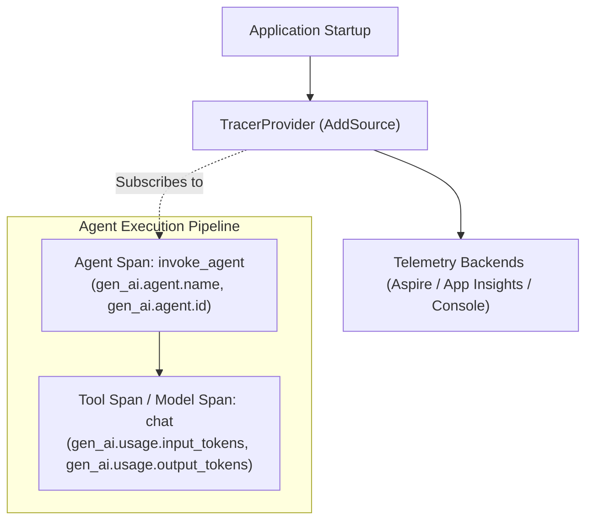

# Module 19 — Observability

> **Time:** ~35 min · **Level:** Intermediate · **Prerequisites:** [Module 02](02-first-agent.md), [Module 06](06-middleware.md), [Module 11](11-workflows.md)  
> **Packages:** `Microsoft.Agents.AI` 1.28.0 (GA), `Microsoft.Agents.AI.OpenAI` 1.28.0 (GA), `Microsoft.Agents.AI.Workflows` 1.28.0 (GA), `OpenTelemetry` 1.18.0 (GA), `OpenTelemetry.Exporter.Console` 1.18.0 (GA), `OpenTelemetry.Exporter.OpenTelemetryProtocol` 1.18.0 (GA), `Azure.Monitor.OpenTelemetry.Exporter` 1.4.0 (GA)

## Learning objectives

- Instrument agents and underlying chat clients with OpenTelemetry using `UseOpenTelemetry`.
- Understand and configure the OpenTelemetry Semantic Conventions for Generative AI (`gen_ai.*` attributes).
- Route distributed traces, metrics, and structured logs to Console, .NET Aspire Dashboard, and Azure Monitor / Application Insights.
- Trace complex multi-executor workflows using `WithOpenTelemetry` and inspect causal span links.
- Safely configure `EnableSensitiveData` to protect personally identifiable information (PII) across production environments.

---

## Concepts

### The Observability Triad in AI Systems

Traditional distributed tracing tracks HTTP requests and database queries. AI agent applications introduce non-deterministic execution paths, multi-turn loops, tool calls, and variable token consumption.

To make agentic systems observable, the Microsoft Agent Framework adheres to the **OpenTelemetry Generative AI Semantic Conventions**:



### OpenTelemetry Instrumentation Seams

Telemetry can be attached at two levels:

1. **Chat Client Level** (`Microsoft.Extensions.AI`):
   ```csharp
   IChatClient instrumentedClient = chatClient
       .AsBuilder()
       .UseOpenTelemetry(sourceName: "MyApp.ChatClient")
       .Build();
   ```
   Emits spans for low-level LLM calls, including model name, token usage (`gen_ai.usage.input_tokens`, `gen_ai.usage.output_tokens`), and raw HTTP latency.

2. **Agent Level** (`Microsoft.Agents.AI`):
   ```csharp
   AIAgent instrumentedAgent = agent
       .AsBuilder()
       .UseOpenTelemetry(sourceName: "MyApp.Agent")
       .Build();
   ```
   Emits higher-level agent spans (`invoke_agent`) covering the end-to-end multi-step tool reasoning loop, agent identifiers, and high-level outcomes.

> [!IMPORTANT]
> **Avoiding Span Duplication:**  
> If you call `UseOpenTelemetry` on both the inner `IChatClient` and the outer `AIAgent`, prompt and completion payloads may be recorded twice in your backend. In most architectures, instrumenting the **agent** provides complete visibility over both the agent run and the nested model interactions.

### Source Names and Semantic Conventions

OpenTelemetry in .NET uses `System.Diagnostics.ActivitySource`. A tracer provider must subscribe to the exact source name registered by the component:

| Component | Default Activity Source | Override Seam |
|---|---|---|
| `OpenTelemetryAgent` | `Experimental.Microsoft.Agents.AI` | `UseOpenTelemetry(sourceName: "...")` |
| `OpenTelemetryChatClient` | `Experimental.Microsoft.Extensions.AI` | `UseOpenTelemetry(sourceName: "...")` |
| `WorkflowBuilder` | `Microsoft.Agents.AI.Workflows` | `WithOpenTelemetry(activitySource: ...)` |

Key OpenTelemetry attributes emitted by MAF:
- `gen_ai.operation.name`: `invoke_agent`, `chat`
- `gen_ai.agent.name`: Configured agent name (e.g., `OrderAgent`)
- `gen_ai.agent.id`: Unique agent runtime identifier
- `gen_ai.usage.input_tokens`: Prompt token count
- `gen_ai.usage.output_tokens`: Generated completion token count

### Sensitive Data and Privacy

By default, MAF traces capture metadata and timing, but redact message contents, prompts, completions, and tool arguments.

To capture raw prompt text and tool arguments during local debugging:
```csharp
agent.AsBuilder().UseOpenTelemetry(configure: otelAgent =>
{
    otelAgent.EnableSensitiveData = true; // CAUTION: Non-production only
});
```

> [!CAUTION]
> Never set `EnableSensitiveData = true` in production environments handling user data. Doing so will export PII, passwords, authentication headers, and proprietary customer queries to your telemetry datastore, creating regulatory and compliance violations (GDPR, HIPAA, SOC 2).

### Workflow Tracing & Causal Span Links

Workflows built with `Microsoft.Agents.AI.Workflows` emit dedicated tracing spans:

| Span Display Name | Description |
|---|---|
| `workflow.build` | Emitted when the workflow graph is compiled and validated. Contains graph definition JSON. |
| `workflow.session` | Outer span representing the execution session. |
| `invoke_workflow` | Represents a single input-to-halt execution cycle. |
| `executor.process {id}` | Emitted while an individual executor processes a message. |
| `edge_group.process` | Emitted when messages are routed across connecting edges. |
| `message.send` | Emitted when an executor yields an output message to target executors. |

#### Span Linking vs. Hierarchical Nesting
In traditional tracing, child operations are nested under parents. However, workflows can branch, fan-out, and fan-in. If executor B runs after executor A, executor B is **not** a child of executor A; they run independently in the workflow runtime.  
MAF uses **OpenTelemetry Span Links**: the `executor.process` span for executor B is explicitly linked to the predecessor `message.send` span. This preserves causal dependency in trace viewers (such as Jaeger or Aspire) without imposing a false call-stack hierarchy.

---

## Hands-on

### Example 1 — Instrumenting an Agent with Console & OTLP Exporters

In this example, you will configure an OpenTelemetry `TracerProvider`, instrument a `ChatClientAgent` with a custom source name, and export traces to both the Console and a local OTLP collector (e.g., .NET Aspire Dashboard).

> [!NOTE]
> **Experimental API (MAAI001):** `OpenTelemetryAgent` is marked with `[Experimental]`. Suppress `MAAI001` with `#pragma warning disable MAAI001` at the top of the file.

#### Project File (`ex1.csproj`)

```xml
<Project Sdk="Microsoft.NET.Sdk">
  <PropertyGroup>
    <OutputType>Exe</OutputType>
    <TargetFramework>net10.0</TargetFramework>
    <Nullable>enable</Nullable>
    <ImplicitUsings>enable</ImplicitUsings>
    <NoWarn>$(NoWarn);MAAI001;OPENAI001</NoWarn>
  </PropertyGroup>

  <ItemGroup>
    <PackageReference Include="Microsoft.Agents.AI.OpenAI" Version="1.28.0" />
    <PackageReference Include="OpenTelemetry" Version="1.18.0" />
    <PackageReference Include="OpenTelemetry.Exporter.Console" Version="1.18.0" />
    <PackageReference Include="OpenTelemetry.Exporter.OpenTelemetryProtocol" Version="1.18.0" />
  </ItemGroup>
</Project>
```

#### Application Code (`Program.cs`)

```csharp
#pragma warning disable MAAI001 // OpenTelemetryAgent is experimental in MAF

using System.ComponentModel;
using Microsoft.Agents.AI;
using Microsoft.Extensions.AI;
using OpenAI;
using OpenTelemetry;
using OpenTelemetry.Resources;
using OpenTelemetry.Trace;

const string SourceName = "OrderProcessingApp";
const string ServiceName = "OrderAgentService";

// 1. Configure OpenTelemetry TracerProvider
using var tracerProvider = Sdk.CreateTracerProviderBuilder()
    .SetResourceBuilder(ResourceBuilder.CreateDefault().AddService(ServiceName))
    .AddSource(SourceName)
    .AddConsoleExporter()
    .AddOtlpExporter(opt => opt.Endpoint = new Uri("http://localhost:4317"))
    .Build();

// 2. Chat client setup
string apiKey = Environment.GetEnvironmentVariable("OPENAI_API_KEY") ?? "mock-key";
string model = Environment.GetEnvironmentVariable("OPENAI_MODEL") ?? "gpt-5.4-mini";

IChatClient chatClient = new OpenAIClient(apiKey).GetChatClient(model).AsIChatClient();

// 3. Instrument the AIAgent with OpenTelemetry
AIAgent agent = chatClient.AsAIAgent(
    instructions: "You are an order processing assistant. Answer status queries.",
    name: "OrderAgent")
    .AsBuilder()
    .UseOpenTelemetry(sourceName: SourceName, configure: otelAgent =>
    {
        // CAUTION: Enable only in non-production environments to avoid logging PII
        otelAgent.EnableSensitiveData = true;
    })
    .Build();

Console.WriteLine($"Agent '{agent.Name}' initialized with OpenTelemetry source '{SourceName}'.");
```

#### What's happening
1. `Sdk.CreateTracerProviderBuilder()` initializes the OpenTelemetry pipeline and registers `SourceName`.
2. `AddConsoleExporter()` prints every span to `stdout` for instant feedback.
3. `AddOtlpExporter()` exports traces over gRPC/Protobuf to standard collectors such as the .NET Aspire Dashboard on port `4317`.
4. `UseOpenTelemetry(sourceName: SourceName)` attaches the `OpenTelemetryAgent` middleware to the agent pipeline.

---

### Example 2 — Workflow Distributed Tracing with Causal Span Links

This example shows how workflows automatically emit structured spans (`workflow.build`, `workflow.session`, `invoke_workflow`, `executor.process`, `message.send`) and causal links without requiring an external LLM connection.

#### Project File (`ex2.csproj`)

```xml
<Project Sdk="Microsoft.NET.Sdk">
  <PropertyGroup>
    <OutputType>Exe</OutputType>
    <TargetFramework>net10.0</TargetFramework>
    <Nullable>enable</Nullable>
    <ImplicitUsings>enable</ImplicitUsings>
    <NoWarn>$(NoWarn);MAAI001</NoWarn>
  </PropertyGroup>

  <ItemGroup>
    <PackageReference Include="Microsoft.Agents.AI.Workflows" Version="1.28.0" />
    <PackageReference Include="OpenTelemetry" Version="1.18.0" />
    <PackageReference Include="OpenTelemetry.Exporter.Console" Version="1.18.0" />
  </ItemGroup>
</Project>
```

#### Application Code (`Program.cs`)

```csharp
using Microsoft.Agents.AI.Workflows;
using OpenTelemetry;
using OpenTelemetry.Resources;
using OpenTelemetry.Trace;

// 1. Configure OpenTelemetry listening to the workflow activity source
using var tracerProvider = Sdk.CreateTracerProviderBuilder()
    .SetResourceBuilder(ResourceBuilder.CreateDefault().AddService("WorkflowTracingDemo"))
    .AddSource("Microsoft.Agents.AI.Workflows")
    .AddConsoleExporter()
    .Build();

// 2. Define simple function executors using BindAsExecutor
Func<string, ValueTask<string>> step1Func = input => ValueTask.FromResult(input.Trim().ToUpperInvariant());
Func<string, ValueTask<string>> step2Func = upper => ValueTask.FromResult($"[PROCESSED]: {upper}");

var step1 = step1Func.BindAsExecutor("step1");
var step2 = step2Func.BindAsExecutor("step2");

// 3. Build workflow with OpenTelemetry enabled
var workflow = new WorkflowBuilder(step1)
    .AddEdge(step1, step2)
    .WithOutputFrom(step2)
    .WithOpenTelemetry()
    .Build();

// 4. Run the workflow and observe tracing spans in the console
await using var execution = await InProcessExecution.RunAsync(workflow, "hello open telemetry workflows");
var status = await execution.GetStatusAsync();
Console.WriteLine($"Workflow finished with status: {status}");
```

#### Actual Console Output
When executed, OpenTelemetry records the complete lifecycle of the workflow:

```text
Activity.DisplayName:        workflow.build
Activity.Tags:
    workflow.id: step1
    workflow.definition: {"executors":{"step1":...},"edges":...}
Activity.Events:
    build.started
    build.validation_completed
    build.completed

Activity.DisplayName:        workflow.session
Activity.Tags:
    workflow.id: step1
    session.id: 38f5abd6f07c4f0cbcfaf0b7b654e396

Activity.DisplayName:        executor.process step1
Activity.Tags:
    executor.id: step1
    message.type: System.String

Activity.DisplayName:        message.send
Activity.Tags:
    message.source_id: step1

Activity.DisplayName:        executor.process step2
Activity.Links:
    065005414e5c91fc81d4e157eaeaa2ad 02a4e7eb0d78988c
```

Notice that `executor.process step2` links directly to the `message.send` span of `step1`, establishing end-to-end causality across executors.

---

## Common pitfalls

- **Activity Source name mismatch**:
  - *Symptom:* The application runs and executes agent turns, but no traces appear in the console or Aspire dashboard.
  - *Cause:* `tracerProviderBuilder.AddSource("MySource")` was registered with a name that differs from `agent.UseOpenTelemetry(sourceName: "OtherSource")`.
  - *Fix:* Ensure the string passed to `AddSource` exactly matches the source name passed to `UseOpenTelemetry`. If omitted, default to `"Experimental.Microsoft.Agents.AI"` or `"Microsoft.Agents.AI.Workflows"`.
- **Sensitive data leakage in production**:
  - *Symptom:* Telemetry logs contain user passwords, credit card numbers, or proprietary business prompts.
  - *Cause:* `EnableSensitiveData = true` was left enabled in production deployment settings.
  - *Fix:* Guard sensitive data with environment checks: `otelAgent.EnableSensitiveData = builder.Environment.IsDevelopment();`.
- **Duplicate trace spans**:
  - *Symptom:* Every model interaction creates two near-identical spans with the same prompt and token counts.
  - *Cause:* Both `IChatClient.AsBuilder().UseOpenTelemetry()` and `AIAgent.AsBuilder().UseOpenTelemetry()` were enabled on the same pipeline.
  - *Fix:* Remove `UseOpenTelemetry` from the chat client and let the agent manage instrumentation, or vice versa.
- **Lost spans on process termination**:
  - *Symptom:* Spans created immediately before console exit are missing in backend collectors.
  - *Cause:* `TracerProvider` was not disposed or flushed before the application exited.
  - *Fix:* Wrap provider instantiation in `using var tracerProvider = ...` or explicitly call `tracerProvider.ForceFlush()`.

---

## When to use / when not to use

| Backend / Exporter | When to Use | When NOT to Use |
|---|---|---|
| **Console Exporter** (`AddConsoleExporter`) | Local unit testing, quick verification of span generation during development. | Production systems (creates severe stdout I/O contention). |
| **OTLP / Aspire Dashboard** (`AddOtlpExporter`) | Local and inner-loop development with .NET Aspire, Docker compose stacks, enterprise OpenTelemetry collectors. | Direct client-side mobile/desktop apps without network access to an OTLP collector. |
| **Azure Monitor / App Insights** (`AddAzureMonitorTraceExporter`) | Production Azure deployments (ACA, App Service, AKS) requiring managed indexing, Kusto queries, and SLA alerting. | Local offline development or non-Azure on-premises deployments. |

---

## Exercises

1. **Configure Azure Monitor Exporters**: Write an application configuration snippet that attaches Application Insights trace and metric exporters using `APPLICATION_INSIGHTS_CONNECTION_STRING`.
2. **Environment-Gated Sensitive Data Middleware**: Implement a helper method `ConfigureAgentTelemetry(AIAgentBuilder builder, IHostEnvironment env)` that automatically disables sensitive data in production.
3. **Custom Span Metric Enrichment**: Create a custom OpenTelemetry metric (`Meter`) that counts the total number of agent tool calls executed per tenant.

---

## Summary

- Microsoft Agent Framework adheres to the OpenTelemetry Generative AI Semantic Conventions, emitting standardized spans, attributes, and events.
- Use `UseOpenTelemetry` on `AIAgentBuilder` to trace the end-to-end agent loop, token consumption, and tool execution.
- Workflows emit specialized graph spans (`workflow.build`, `workflow.session`, `executor.process`, `message.send`) and connect non-hierarchical execution steps using OpenTelemetry span links.
- Keep `EnableSensitiveData = false` in production to prevent logging PII and user-supplied secrets.
- Telemetry backends are decoupled: swap between Console, Aspire Dashboard (OTLP), and Azure Application Insights simply by configuring exporters on the `TracerProviderBuilder`.

---

## Further reading

- [Microsoft Learn: Agent Observability](https://learn.microsoft.com/agent-framework/agents/observability)
- [Microsoft Learn: Workflow Observability](https://learn.microsoft.com/agent-framework/workflows/observability)
- [OpenTelemetry GenAI Semantic Conventions](https://opentelemetry.io/docs/specs/semconv/gen-ai/)
- [Official GitHub Sample: AgentOpenTelemetry](https://github.com/microsoft/agent-framework/tree/main/dotnet/samples/02-agents/AgentOpenTelemetry)

---

## Solutions

### Exercise 1 — Configure Azure Monitor Exporters

```csharp
using Azure.Monitor.OpenTelemetry.Exporter;
using OpenTelemetry;
using OpenTelemetry.Metrics;
using OpenTelemetry.Resources;
using OpenTelemetry.Trace;

string appInsightsConnectionString = Environment.GetEnvironmentVariable("APPLICATION_INSIGHTS_CONNECTION_STRING")
    ?? throw new InvalidOperationException("APPLICATION_INSIGHTS_CONNECTION_STRING is not set.");

var resourceBuilder = ResourceBuilder.CreateDefault().AddService("ProductionAgentService");

// 1. Trace Provider
using var tracerProvider = Sdk.CreateTracerProviderBuilder()
    .SetResourceBuilder(resourceBuilder)
    .AddSource("Experimental.Microsoft.Agents.AI")
    .AddAzureMonitorTraceExporter(opt => opt.ConnectionString = appInsightsConnectionString)
    .Build();

// 2. Metric Provider
using var meterProvider = Sdk.CreateMeterProviderBuilder()
    .SetResourceBuilder(resourceBuilder)
    .AddSource("Experimental.Microsoft.Agents.AI")
    .AddAzureMonitorMetricExporter(opt => opt.ConnectionString = appInsightsConnectionString)
    .Build();
```

---

### Exercise 2 — Environment-Gated Sensitive Data Middleware

```csharp
#pragma warning disable MAAI001

using Microsoft.Agents.AI;
using Microsoft.Extensions.Hosting;

public static class TelemetryConfigurationExtensions
{
    public static AIAgentBuilder ConfigureAgentTelemetry(this AIAgentBuilder builder, IHostEnvironment env, string sourceName)
    {
        return builder.UseOpenTelemetry(sourceName: sourceName, configure: otelAgent =>
        {
            // Only capture raw message content, prompts, and tool arguments in development
            otelAgent.EnableSensitiveData = env.IsDevelopment();
        });
    }
}
```

---

### Exercise 3 — Custom Span Metric Enrichment

```csharp
using System.Diagnostics.Metrics;

public sealed class AgentMetricsTracker
{
    private static readonly Meter s_meter = new("Enterprise.Agents", "1.0.0");
    private static readonly Counter<long> s_toolInvocationsCounter = s_meter.CreateCounter<long>(
        name: "agent.tool.invocations",
        unit: "{invocation}",
        description: "Number of function tools invoked by agents");

    public static void RecordToolInvocation(string agentName, string toolName, string tenantId)
    {
        s_toolInvocationsCounter.Add(1,
            new KeyValuePair<string, object?>("agent.name", agentName),
            new KeyValuePair<string, object?>("tool.name", toolName),
            new KeyValuePair<string, object?>("tenant.id", tenantId));
    }
}
```
