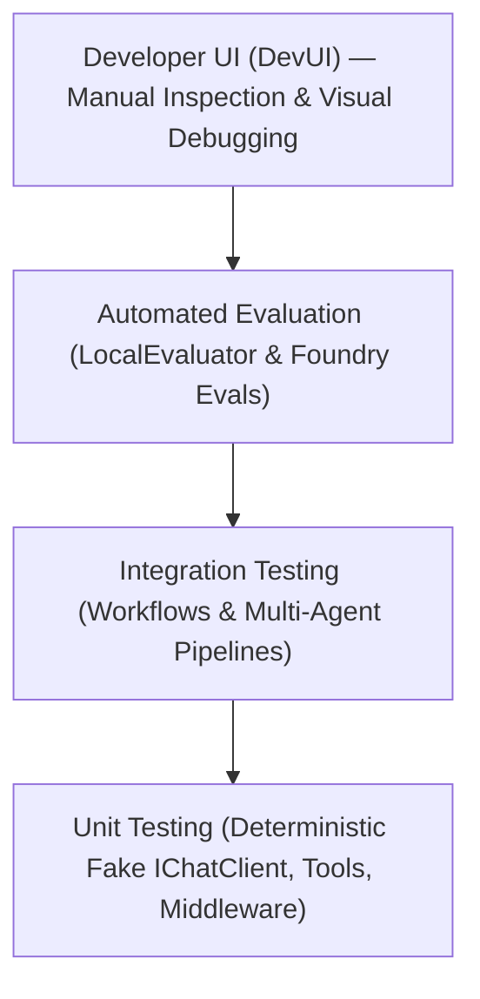
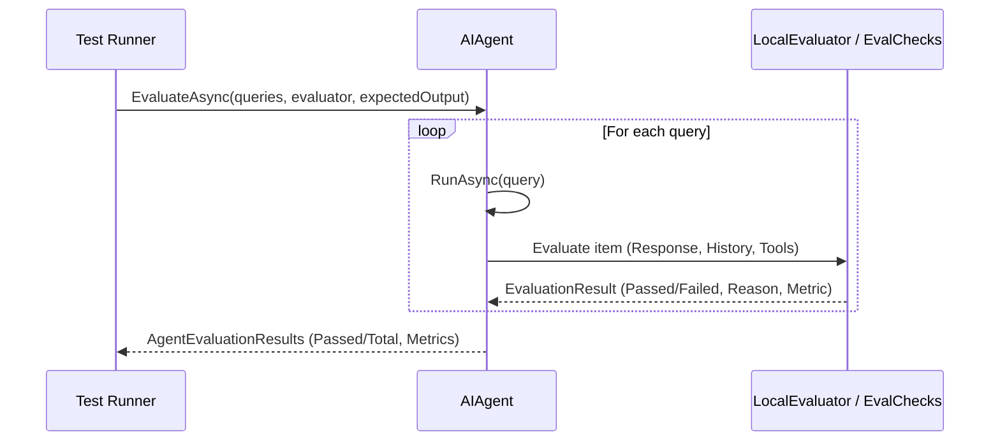

# Module 21 — Testing, Evaluation, and DevUI

> **Time:** ~50 min · **Level:** Advanced · **Prerequisites:** [Module 02](02-first-agent.md), [Module 03](03-tools.md), [Module 06](06-middleware.md), [Module 11](11-workflows.md)
> **Packages:** `Microsoft.Agents.AI.OpenAI` 1.28.0 (GA), `Microsoft.Extensions.AI.Evaluation` 10.11.0 (GA), `Microsoft.Extensions.AI.Evaluation.Quality` 10.11.0 (GA), `Microsoft.Agents.AI.DevUI` 1.28.0-preview.261106.1 *(preview)*, `Microsoft.Agents.AI.Hosting.AspNetCore` 1.28.0-preview.261106.1 *(preview)*

## Learning objectives

- Author deterministic unit tests for AI agents using a test double `IChatClient` without incurring network latency or API costs.
- Verify agent tool invocation, parameter schemas, and custom middleware pipelines under isolated test conditions.
- Implement response evaluations using built-in assertions (`LocalEvaluator`, `EvalChecks`) and domain-specific check functions (`FunctionEvaluator`).
- Score agent conversational quality using `Microsoft.Extensions.AI.Evaluation` adapters and Azure AI Foundry evaluators.
- Configure and launch the interactive Developer UI (`Microsoft.Agents.AI.DevUI`) for visual inspection and manual debugging in ASP.NET Core applications.

---

## Concepts

### The AI Agent Testing Pyramid

Testing non-deterministic LLM-backed applications requires a structured pyramid approach. Traditional assertions (`Assert.Equal`) work seamlessly for deterministic components (tool execution, middleware transformation, workflow routing), whereas probabilistic responses require automated evaluation checks and human-in-the-loop developer inspection.



| Layer | Focus Area | Technique | Execution Speed | Cost |
|---|---|---|---|---|
| **Unit Testing** | Tool functions, middleware, schema generation | Fake `IChatClient` returning predetermined `ChatResponse` | < 50ms | $0.00 |
| **Integration Testing** | Multi-agent workflows, checkpointing, routing | In-process execution with mock or local small models | < 500ms | $0.00 |
| **Automated Evaluation** | Output quality, relevance, safety, ground-truth comparison | `agent.EvaluateAsync(...)` with `LocalEvaluator` or LLM judge | Seconds to minutes | Low to Medium |
| **Developer UI (DevUI)** | Turn-by-turn debugging, tool arguments inspection, UX flow | Interactive web dashboard at `/devui` | Real-time | Pay per prompt |

### Deterministic Unit Testing with Fake `IChatClient`

`AIAgent` instances in MAF wrap an underlying `IChatClient` (defined in `Microsoft.Extensions.AI`). Because `IChatClient` is an interface, you can substitute live OpenAI or Azure endpoints with a test double:

```csharp
public sealed class FakeDeterministicChatClient : IChatClient
{
    private readonly Queue<ChatResponse> _responses = new();

    public void EnqueueResponse(ChatResponse response) => _responses.Enqueue(response);

    public Task<ChatResponse> GetResponseAsync(
        IEnumerable<ChatMessage> chatMessages,
        ChatOptions? options = null,
        CancellationToken cancellationToken = default)
    {
        return Task.FromResult(_responses.Count > 0 
            ? _responses.Dequeue() 
            : new ChatResponse(new ChatMessage(ChatRole.Assistant, "Default mock response")));
    }

    public async IAsyncEnumerable<ChatResponseUpdate> GetStreamingResponseAsync(
        IEnumerable<ChatMessage> chatMessages,
        ChatOptions? options = null,
        [EnumeratorCancellation] CancellationToken cancellationToken = default)
    {
        ChatResponse resp = await GetResponseAsync(chatMessages, options, cancellationToken);
        yield return new ChatResponseUpdate(ChatRole.Assistant, resp.Text);
    }

    public object? GetService(Type serviceType, object? serviceKey = null) =>
        serviceType.IsInstanceOfType(this) ? this : null;

    public void Dispose() { }
}
```

When testing tool invocation, the fake client returns an assistant message containing a `FunctionCallContent`. The MAF agent loop inspects the call, executes the registered local C# function tool, appends the tool result to the history, and calls the chat client a second time. The second queued response provides the final answer.

### Evaluation Primitives in `Microsoft.Agents.AI`

MAF provides evaluation abstractions in the `Microsoft.Agents.AI` namespace:

- `EvalItem`: Encapsulates a test query, the agent's response, the full conversational history (`ChatMessage` list), ground-truth `ExpectedOutput`, and expected tool calls.
- `IAgentEvaluator`: Interface declaring `Task<AgentEvaluationResults> EvaluateAsync(...)`.
- `LocalEvaluator`: Built-in evaluator that executes lightweight, deterministic rules locally without calling an LLM judge.
- `EvalChecks`: Factory containing prebuilt evaluation delegates:
  - `EvalChecks.ContainsExpected()`: Asserts that the response text contains `item.ExpectedOutput`.
  - `EvalChecks.NonEmpty(int minLength)`: Verifies response length exceeds a threshold.
  - `EvalChecks.KeywordCheck(params string[] keywords)`: Checks for required terminology.
  - `EvalChecks.ToolCalledCheck(params string[] toolNames)`: Asserts specific tools were invoked.
  - `EvalChecks.ToolCallsPresent()`: Asserts that at least one tool was executed.
- `FunctionEvaluator.Create("check_name", (string response) => bool)`: Creates custom programmatic checks without writing boilerplate classes.
- `agent.EvaluateAsync(...)`: Extension method on `AIAgent` that runs test queries through the agent and scores each conversation in one call.



### Cloud-Assisted & Model-as-a-Judge Evaluation

For complex semantics (relevance, coherence, fluency), rule-based keyword checks fall short. MAF supports two LLM-based evaluation paths:
1. **`Microsoft.Extensions.AI.Evaluation`**: Adapts standard MEAI evaluators (like `RelevanceEvaluator`) into `IAgentEvaluator` via `agent.EvaluateAsync(queries, meaiEvaluator, chatConfig)`.
2. **Azure AI Foundry Quality Evaluators**: Cloud-hosted evaluation using `Microsoft.Agents.AI.Foundry.FoundryEvals` (`FoundryEvals.Relevance`, `FoundryEvals.Coherence`), logging test runs directly to the Azure AI Foundry portal.

### The Developer UI (`Microsoft.Agents.AI.DevUI`)

> [!WARNING]
> **Preview Package:** `Microsoft.Agents.AI.DevUI` ships as version `1.28.0-preview.261106.1`. It is strictly intended for local development and testing. Do not expose DevUI endpoints in public production environments.

The Developer UI provides an embedded web-based workbench served directly from your ASP.NET Core host. It features:
- **Interactive Agent Chat:** Direct multi-turn messaging against registered agents.
- **Workflow Visualization:** Step-through inspection of executors, supersteps, and events.
- **Tool Tracing:** Real-time visibility into function arguments and returned payloads.
- **State Inspection:** Viewing session state bags and memory context.

To enable DevUI, register your agents and OpenAI conversation endpoints in ASP.NET Core, then add DevUI middleware inside development environments:

```csharp
if (builder.Environment.IsDevelopment())
{
    builder.AddDevUI();
}

var app = builder.Build();

app.MapOpenAIResponses();
app.MapOpenAIConversations();

if (app.Environment.IsDevelopment())
{
    app.MapDevUI(); // Serves web UI at /devui
}
```

---

## Hands-on

### Example 1 — Unit Testing an Agent with a Fake IChatClient

This example demonstrates how to unit test an agent and its tools deterministically. No API keys or network connections are used.

#### Project Setup

Create a console project and add the required packages:

```powershell
dotnet new console -n AgentUnitTest
cd AgentUnitTest
dotnet add package Microsoft.Agents.AI.OpenAI --version 1.28.0
```

#### Program.cs

```csharp
using System;
using System.Collections.Generic;
using System.ComponentModel;
using System.Linq;
using System.Runtime.CompilerServices;
using System.Threading;
using System.Threading.Tasks;
using Microsoft.Agents.AI;
using Microsoft.Extensions.AI;

// 1. Instantiate the deterministic test double
var fakeClient = new FakeDeterministicChatClient();

// Script the fake responses:
// Turn 1: Return a tool call to "get_weather" with {"city":"Seattle"}
fakeClient.EnqueueResponse(new ChatResponse(new ChatMessage(ChatRole.Assistant, new List<AIContent>
{
    new FunctionCallContent("call_1", "get_weather", new Dictionary<string, object?> { ["city"] = "Seattle" })
})));

// Turn 2 (post-tool execution): Return the final synthesized answer
fakeClient.EnqueueResponse(new ChatResponse(new ChatMessage(ChatRole.Assistant, "The weather in Seattle is 15°C and rainy.")));

// 2. Define the tool to verify
bool toolInvoked = false;
string? capturedCity = null;

[Description("Gets current weather for a specified city.")]
string GetWeather([Description("City name")] string city)
{
    toolInvoked = true;
    capturedCity = city;
    return $"15°C and rainy in {city}";
}

// 3. Assemble the agent under test
AIAgent agent = fakeClient.AsAIAgent(
    instructions: "You are a weather assistance agent.",
    name: "WeatherAgent",
    tools: [AIFunctionFactory.Create(GetWeather, name: "get_weather")]);

// 4. Execute the agent invocation
AgentResponse response = await agent.RunAsync("What's the weather in Seattle?");

// 5. Assert agent behavior
if (!toolInvoked)
{
    throw new InvalidOperationException("Test Failed: The 'get_weather' tool was never invoked.");
}

if (capturedCity != "Seattle")
{
    throw new InvalidOperationException($"Test Failed: Expected city 'Seattle', got '{capturedCity}'.");
}

if (!response.Text.Contains("15°C and rainy"))
{
    throw new InvalidOperationException($"Test Failed: Response text mismatch: {response.Text}");
}

Console.WriteLine("PASS: Agent executed tool and synthesized response deterministically.");
Console.WriteLine($"Agent Final Output: {response.Text}");

/// <summary>
/// A deterministic IChatClient test double for unit testing.
/// </summary>
public sealed class FakeDeterministicChatClient : IChatClient
{
    private readonly Queue<ChatResponse> _responses = new();

    public void EnqueueResponse(ChatResponse response) => _responses.Enqueue(response);

    public Task<ChatResponse> GetResponseAsync(
        IEnumerable<ChatMessage> chatMessages,
        ChatOptions? options = null,
        CancellationToken cancellationToken = default)
    {
        if (_responses.Count == 0)
        {
            return Task.FromResult(new ChatResponse(new ChatMessage(ChatRole.Assistant, "Default fallback.")));
        }

        return Task.FromResult(_responses.Dequeue());
    }

    public async IAsyncEnumerable<ChatResponseUpdate> GetStreamingResponseAsync(
        IEnumerable<ChatMessage> chatMessages,
        ChatOptions? options = null,
        [EnumeratorCancellation] CancellationToken cancellationToken = default)
    {
        ChatResponse resp = await GetResponseAsync(chatMessages, options, cancellationToken);
        yield return new ChatResponseUpdate(ChatRole.Assistant, resp.Text);
    }

    public object? GetService(Type serviceType, object? serviceKey = null) =>
        serviceType.IsInstanceOfType(this) ? this : null;

    public void Dispose() { }
}
```

#### What's happening
1. `FakeDeterministicChatClient` enqueues canned `ChatResponse` objects.
2. In Turn 1, the fake client issues a `FunctionCallContent` requesting `get_weather(city: "Seattle")`.
3. MAF's internal loop invokes the C# method `GetWeather`, flipping `toolInvoked` to `true` and setting `capturedCity`.
4. MAF sends the tool result back to `fakeClient`, which consumes the second queued response ("The weather in Seattle is 15°C and rainy.").
5. The test validates tool execution, parameter values, and final synthesized text in milliseconds.

---

### Example 2 — Automated Response Evaluation with Expected Outputs

This example demonstrates how to evaluate an agent's outputs using MAF's `LocalEvaluator`, built-in `EvalChecks`, and custom lambda evaluators.

#### Project Setup

```powershell
dotnet new console -n AgentEvaluation
cd AgentEvaluation
dotnet add package Microsoft.Agents.AI.OpenAI --version 1.28.0
dotnet add package Microsoft.Extensions.AI.Evaluation --version 10.11.0
```

#### Program.cs

```csharp
using System;
using System.Collections.Generic;
using System.Linq;
using System.Runtime.CompilerServices;
using System.Threading;
using System.Threading.Tasks;
using Microsoft.Agents.AI;
using Microsoft.Extensions.AI;

// 1. Create a deterministic mock math client
var fakeClient = new FakeMathChatClient();
AIAgent agent = fakeClient.AsAIAgent(
    instructions: "You are a concise math tutor. Respond with only the numeric result.",
    name: "MathTutor");

// 2. Define custom domain check using FunctionEvaluator
EvalCheck noNegativeAnswer = FunctionEvaluator.Create("non_negative", (string response) =>
    !response.Trim().StartsWith("-", StringComparison.Ordinal));

// 3. Assemble LocalEvaluator with built-in and custom checks
LocalEvaluator evaluator = new(
    EvalChecks.ContainsExpected(),
    EvalChecks.NonEmpty(minLength: 1),
    noNegativeAnswer);

// 4. Define test dataset: queries and ground-truth expected outputs
string[] queries = ["What is 2 + 2?", "What is 10 * 5?"];
string[] expectedOutputs = ["4", "50"];

// 5. Run the evaluation across all queries
AgentEvaluationResults results = await agent.EvaluateAsync(
    queries: queries,
    evaluator: evaluator,
    expectedOutput: expectedOutputs);

// 6. Inspect evaluation metrics
Console.WriteLine($"Evaluator: {results.ProviderName}");
Console.WriteLine($"Passed: {results.Passed} / {results.Total}");
Console.WriteLine($"All Passed: {results.AllPassed}\n");

for (int i = 0; i < results.Items.Count; i++)
{
    Console.WriteLine($"Query: {queries[i]} | Expected: {expectedOutputs[i]}");
    Console.WriteLine($"Actual Response: {results.InputItems?[i].Response}");
    foreach (var metric in results.Items[i].Metrics)
    {
        string status = metric.Value.Interpretation?.Failed == true ? "FAIL" : "PASS";
        Console.WriteLine($"  [{status}] {metric.Key}: {metric.Value.Interpretation?.Reason}");
    }
    Console.WriteLine();
}

/// <summary>
/// Fake IChatClient providing deterministic arithmetic answers.
/// </summary>
public sealed class FakeMathChatClient : IChatClient
{
    public Task<ChatResponse> GetResponseAsync(
        IEnumerable<ChatMessage> chatMessages,
        ChatOptions? options = null,
        CancellationToken cancellationToken = default)
    {
        var last = chatMessages.LastOrDefault()?.Text ?? "";
        string reply = last.Contains("2 + 2") ? "4" :
                       last.Contains("10 * 5") ? "50" : "0";

        return Task.FromResult(new ChatResponse(new ChatMessage(ChatRole.Assistant, reply)));
    }

    public async IAsyncEnumerable<ChatResponseUpdate> GetStreamingResponseAsync(
        IEnumerable<ChatMessage> chatMessages,
        ChatOptions? options = null,
        [EnumeratorCancellation] CancellationToken cancellationToken = default)
    {
        ChatResponse resp = await GetResponseAsync(chatMessages, options, cancellationToken);
        yield return new ChatResponseUpdate(ChatRole.Assistant, resp.Text);
    }

    public object? GetService(Type serviceType, object? serviceKey = null) =>
        serviceType.IsInstanceOfType(this) ? this : null;

    public void Dispose() { }
}
```

#### Output
```text
Evaluator: LocalEvaluator
Passed: 2 / 2
All Passed: True

Query: What is 2 + 2? | Expected: 4
Actual Response: 4
  [PASS] contains_expected: Response contains expected output: "4"
  [PASS] non_empty: Response length 1 meets minimum 1
  [PASS] non_negative: Check passed.

Query: What is 10 * 5? | Expected: 50
Actual Response: 50
  [PASS] contains_expected: Response contains expected output: "50"
  [PASS] non_empty: Response length 2 meets minimum 1
  [PASS] non_negative: Check passed.
```

---

### Example 3 — Interactive Debugging with Developer UI (DevUI)

This example sets up an ASP.NET Core minimal API hosting agents with tools and maps the DevUI endpoint for interactive local inspection.

#### Project Setup

Create a web application:

```powershell
dotnet new web -n AgentDevUIApp
cd AgentDevUIApp
dotnet add package Microsoft.Agents.AI.OpenAI --version 1.28.0
dotnet add package Microsoft.Agents.AI.Hosting.AspNetCore --version 1.28.0-preview.261106.1
dotnet add package Microsoft.Agents.AI.DevUI --version 1.28.0-preview.261106.1
```

#### Program.cs

```csharp
using System.ComponentModel;
using Microsoft.Agents.AI;
using Microsoft.Agents.AI.DevUI;
using Microsoft.Agents.AI.Hosting;
using Microsoft.AspNetCore.Builder;
using Microsoft.Extensions.AI;
using Microsoft.Extensions.DependencyInjection;
using Microsoft.Extensions.Hosting;
using OpenAI;

var builder = WebApplication.CreateBuilder(args);

// Configure live chat client or fallback mock client
string? apiKey = builder.Configuration["OPENAI_API_KEY"];
if (string.IsNullOrEmpty(apiKey))
{
    // Local offline mock client for demonstration
    builder.Services.AddChatClient(new FakeDevChatClient());
}
else
{
    string model = builder.Configuration["OPENAI_MODEL"] ?? "gpt-5.4-mini";
    builder.Services.AddChatClient(new OpenAIClient(apiKey).GetChatClient(model).AsIChatClient());
}

// Define tools
[Description("Get current weather report for a city.")]
static string GetWeather([Description("City name")] string city) =>
    $"Weather in {city}: 21°C, sunny.";

[Description("Calculates a tax rate for an amount.")]
static double CalculateTax([Description("Base amount")] double amount, [Description("Rate (0.0 - 1.0)")] double rate) =>
    amount * rate;

// Register agents with tools
builder.AddAIAgent("assistant", "You are a helpful virtual assistant.")
    .WithAITool(AIFunctionFactory.Create(GetWeather, name: "get_weather"));

builder.AddAIAgent("finance-advisor", "You are an expert financial consultant.")
    .WithAITool(AIFunctionFactory.Create(CalculateTax, name: "calculate_tax"));

// Register OpenAI Responses and Conversations endpoints required by DevUI
builder.Services.AddOpenAIResponses();
builder.Services.AddOpenAIConversations();

// Add DevUI in development mode
if (builder.Environment.IsDevelopment())
{
    builder.AddDevUI();
}

var app = builder.Build();

// Map protocol endpoints
app.MapOpenAIResponses();
app.MapOpenAIConversations();

// Expose DevUI endpoint
if (app.Environment.IsDevelopment())
{
    app.MapDevUI();
}

app.Run();

/// <summary>
/// A simple fallback client for local offline DevUI preview.
/// </summary>
public sealed class FakeDevChatClient : IChatClient
{
    public Task<ChatResponse> GetResponseAsync(
        IEnumerable<ChatMessage> chatMessages,
        ChatOptions? options = null,
        CancellationToken cancellationToken = default) =>
        Task.FromResult(new ChatResponse(new ChatMessage(ChatRole.Assistant, "Greetings! DevUI is active in mock mode.")));

    public async IAsyncEnumerable<ChatResponseUpdate> GetStreamingResponseAsync(
        IEnumerable<ChatMessage> chatMessages,
        ChatOptions? options = null,
        [System.Runtime.CompilerServices.EnumeratorCancellation] CancellationToken cancellationToken = default)
    {
        yield return new ChatResponseUpdate(ChatRole.Assistant, "Greetings! DevUI is active in mock mode.");
    }

    public object? GetService(Type serviceType, object? serviceKey = null) =>
        serviceType.IsInstanceOfType(this) ? this : null;

    public void Dispose() { }
}
```

#### What's happening
1. `builder.AddAIAgent("assistant", ...)` registers the named agent in the DI container.
2. `builder.Services.AddOpenAIResponses()` and `builder.Services.AddOpenAIConversations()` expose standard protocol endpoints utilized by web UI clients.
3. `builder.AddDevUI()` registers DevUI middleware and embedded asset loaders.
4. `app.MapDevUI()` mounts the single-page application at `/devui`.
5. Navigating to `https://localhost:<port>/devui` reveals the interactive testing workspace.

---

## Common pitfalls

- **Symptom:** Unit tests fail with `ArgumentException: Found X queries but Y expectedOutput values. Counts must match.`
  - **Cause:** When passing `expectedOutput` to `agent.EvaluateAsync(queries, evaluator, expectedOutput: outputs)`, the number of items in the output array does not match the queries array.
  - **Fix:** Ensure `expectedOutput.Length == queries.Length`.
- **Symptom:** DevUI page displays a blank screen or 404 on `/v1/responses`.
  - **Cause:** Forgetting to map `app.MapOpenAIResponses()` and `app.MapOpenAIConversations()` alongside `app.MapDevUI()`.
  - **Fix:** Both `AddOpenAIResponses()` and `MapOpenAIResponses()` must be called in ASP.NET Core startup.
- **Symptom:** `ContainsExpected` fails unexpectedly despite the model answering correctly.
  - **Cause:** LLMs often output formatting markdown (e.g. `**4**` or `The answer is 4.`), causing strict string equality or substring matching to fail if case-sensitivity is mismatched.
  - **Fix:** Set `caseSensitive: false` or use regex/custom check delegates via `FunctionEvaluator.Create`.
- **Symptom:** Agent enters an infinite loop during fake `IChatClient` unit testing.
  - **Cause:** The mock `IChatClient` repeatedly enqueues `FunctionCallContent` without ever returning a final terminal text response.
  - **Fix:** Ensure your queue or mock script exhausts tool requests and returns a final assistant message containing text content.

---

## When to use / when not to use

| Approach | Best For | Avoid When |
|---|---|---|
| **Deterministic Unit Tests (`IChatClient` double)** | Verifying tool parameter parsing, schema validity, middleware interception, error handling | Testing prompt quality or open-ended reasoning |
| **`LocalEvaluator` & `EvalChecks`** | Fast CI/CD regressions, checking required tool calls, ground-truth expected answers | Measuring subjective text nuance, tone, or coherence |
| **LLM-assisted Eval (MEAI / Foundry Evals)** | Production release gating, measuring tone, semantic relevance, safety metrics | High-frequency CI unit test runs (incurs cost and API latency) |
| **Developer UI (`DevUI`)** | Rapid iterative prototyping, visually inspecting tool arguments during local development | Production environments or automated test automation |

---

## Exercises

1. **Middleware Redaction Unit Test** — Construct a custom agent middleware pipeline that scans user input for credit card patterns and replaces them with `[REDACTED_CARD]`. Write a deterministic unit test using a capturing `IChatClient` double to verify that sensitive account data is redacted before reaching the model.
2. **Politeness and Tone Evaluator** — Implement a custom `EvalCheck` via `FunctionEvaluator.Create` verifying that agent customer support responses begin with a polite greeting ("Hello", "Hi", or "Welcome") and contain no forbidden negative phrases ("stupid", "impossible"). Evaluate a batch of test queries and assert that all checks pass.
3. **Workflow Deterministic Execution Test** — Build a two-stage sequential workflow (`SummarizeExecutor` -> `SentimentExecutor`). Write a deterministic test executing the workflow with `InProcessExecution.RunAsync` and assert that the yielded `WorkflowOutputEvent` data matches the expected sentiment category.

---

## Summary

- Unit test agent logic, tools, and middleware deterministically with an in-memory `IChatClient` test double to eliminate network dependencies and token costs.
- Use `AIFunctionFactory.Create` to isolate and test function tool execution logic as plain C# methods.
- `Microsoft.Agents.AI` includes first-class evaluation extensions (`agent.EvaluateAsync`), built-in checks (`EvalChecks`), and lightweight assertion delegates (`FunctionEvaluator`).
- Integrate LLM-assisted evaluations via `Microsoft.Extensions.AI.Evaluation` or Azure AI Foundry (`FoundryEvals`) for semantic relevance and coherence scoring.
- The Developer UI (`Microsoft.Agents.AI.DevUI`) provides an embedded, dev-only web interface for interactive multi-turn testing, workflow step inspection, and tool payload validation.

---

## Further reading

- [Microsoft Learn: Evaluating AI Agents](https://learn.microsoft.com/agent-framework/dotnet/evaluation)
- [Microsoft Learn: Hosting and Developer UI](https://learn.microsoft.com/agent-framework/dotnet/hosting/devui)
- [Official Sample: Evaluation with Expected Outputs](https://github.com/microsoft/agent-framework/tree/main/dotnet/samples/02-agents/Evaluation/Evaluation_ExpectedOutputs)
- [Official Sample: Custom Evaluation Functions](https://github.com/microsoft/agent-framework/tree/main/dotnet/samples/02-agents/Evaluation/Evaluation_CustomEvals)
- [Official Sample: DevUI Basic Usage](https://github.com/microsoft/agent-framework/tree/main/dotnet/samples/02-agents/DevUI/DevUI_Step01_BasicUsage)

---

## Solutions

### Exercise 1 — Middleware Redaction Unit Test

```csharp
using System;
using System.Collections.Generic;
using System.Linq;
using System.Runtime.CompilerServices;
using System.Text.RegularExpressions;
using System.Threading;
using System.Threading.Tasks;
using Microsoft.Agents.AI;
using Microsoft.Extensions.AI;

var fakeClient = new CapturingFakeChatClient("Sanitized query processed successfully.");

// Agent with sanitizing run middleware
AIAgent redactingAgent = fakeClient.AsAIAgent(instructions: "Security Assistant")
    .AsBuilder()
    .Use(
        runFunc: async (messages, session, options, innerAgent, cancellationToken) =>
        {
            var sanitized = new List<ChatMessage>();
            foreach (var msg in messages)
            {
                if (msg.Role == ChatRole.User && msg.Text is { } text)
                {
                    string cleaned = Regex.Replace(text, @"\b(?:\d[ -]*?){13,16}\b", "[REDACTED_CARD]");
                    sanitized.Add(new ChatMessage(ChatRole.User, cleaned));
                }
                else
                {
                    sanitized.Add(msg);
                }
            }

            return await innerAgent.RunAsync(sanitized, session, options, cancellationToken);
        },
        runStreamingFunc: null)
    .Build();

await redactingAgent.RunAsync("My account card number is 4111 2222 3333 4444. Please process renewal.");

if (!fakeClient.LastReceivedPrompt.Contains("[REDACTED_CARD]") || fakeClient.LastReceivedPrompt.Contains("4111"))
{
    throw new InvalidOperationException("Assertion Failed: Card number was not redacted by middleware.");
}

Console.WriteLine("PASS: Credit card redacted before reaching chat client.");

public sealed class CapturingFakeChatClient : IChatClient
{
    private readonly string _reply;
    public string LastReceivedPrompt { get; private set; } = "";

    public CapturingFakeChatClient(string reply) => _reply = reply;

    public Task<ChatResponse> GetResponseAsync(
        IEnumerable<ChatMessage> chatMessages,
        ChatOptions? options = null,
        CancellationToken cancellationToken = default)
    {
        LastReceivedPrompt = string.Join("\n", chatMessages.Select(m => m.Text));
        return Task.FromResult(new ChatResponse(new ChatMessage(ChatRole.Assistant, _reply)));
    }

    public async IAsyncEnumerable<ChatResponseUpdate> GetStreamingResponseAsync(
        IEnumerable<ChatMessage> chatMessages,
        ChatOptions? options = null,
        [EnumeratorCancellation] CancellationToken cancellationToken = default)
    {
        ChatResponse resp = await GetResponseAsync(chatMessages, options, cancellationToken);
        yield return new ChatResponseUpdate(ChatRole.Assistant, resp.Text);
    }

    public object? GetService(Type serviceType, object? serviceKey = null) =>
        serviceType.IsInstanceOfType(this) ? this : null;

    public void Dispose() { }
}
```

### Exercise 2 — Politeness and Tone Evaluator

```csharp
using System;
using System.Collections.Generic;
using System.Runtime.CompilerServices;
using System.Threading;
using System.Threading.Tasks;
using Microsoft.Agents.AI;
using Microsoft.Extensions.AI;

var fakeClient = new PoliteFakeChatClient();
AIAgent supportAgent = fakeClient.AsAIAgent(instructions: "Polite support representative", name: "SupportBot");

// Check 1: Greeting
EvalCheck startsWithGreeting = FunctionEvaluator.Create("starts_with_greeting", (string response) =>
    response.StartsWith("Hello", StringComparison.OrdinalIgnoreCase) ||
    response.StartsWith("Hi", StringComparison.OrdinalIgnoreCase) ||
    response.StartsWith("Welcome", StringComparison.OrdinalIgnoreCase));

// Check 2: Tone & banned words
EvalCheck noBannedWords = FunctionEvaluator.Create("no_banned_words", (string response) =>
    !response.Contains("stupid", StringComparison.OrdinalIgnoreCase) &&
    !response.Contains("impossible", StringComparison.OrdinalIgnoreCase));

LocalEvaluator customEvaluator = new(startsWithGreeting, noBannedWords, EvalChecks.NonEmpty(5));

string[] queries = ["How do I reset my password?", "Where is my receipt?"];
AgentEvaluationResults evalResults = await supportAgent.EvaluateAsync(queries, customEvaluator);

if (!evalResults.AllPassed)
{
    throw new InvalidOperationException($"Evaluation Failed: {evalResults.Passed}/{evalResults.Total} passed.");
}

Console.WriteLine($"PASS: {evalResults.Passed}/{evalResults.Total} queries passed politeness and tone checks.");

public sealed class PoliteFakeChatClient : IChatClient
{
    public Task<ChatResponse> GetResponseAsync(
        IEnumerable<ChatMessage> chatMessages,
        ChatOptions? options = null,
        CancellationToken cancellationToken = default) =>
        Task.FromResult(new ChatResponse(new ChatMessage(ChatRole.Assistant, "Hello! I would be glad to help you with that request.")));

    public async IAsyncEnumerable<ChatResponseUpdate> GetStreamingResponseAsync(
        IEnumerable<ChatMessage> chatMessages,
        ChatOptions? options = null,
        [EnumeratorCancellation] CancellationToken cancellationToken = default)
    {
        ChatResponse resp = await GetResponseAsync(chatMessages, options, cancellationToken);
        yield return new ChatResponseUpdate(ChatRole.Assistant, resp.Text);
    }

    public object? GetService(Type serviceType, object? serviceKey = null) =>
        serviceType.IsInstanceOfType(this) ? this : null;

    public void Dispose() { }
}
```

### Exercise 3 — Workflow Deterministic Execution Test

```csharp
using System;
using System.Threading;
using System.Threading.Tasks;
using Microsoft.Agents.AI.Workflows;

var summarizeStep = new SummarizeExecutor();
var sentimentStep = new SentimentExecutor();

Workflow workflow = new WorkflowBuilder(summarizeStep)
    .AddEdge(summarizeStep, sentimentStep)
    .WithOutputFrom(sentimentStep)
    .Build();

await using Run run = await InProcessExecution.RunAsync(workflow, "Customer called and was extremely happy with quick resolution.");

string? detectedSentiment = null;
foreach (WorkflowEvent evt in run.OutgoingEvents)
{
    if (evt is WorkflowOutputEvent outputEvt && outputEvt.As<string>() is { } sentiment)
    {
        detectedSentiment = sentiment;
    }
}

if (detectedSentiment != "Positive")
{
    throw new InvalidOperationException($"Test Failed: Expected 'Positive' but got '{detectedSentiment}'.");
}

Console.WriteLine($"PASS: Workflow executed deterministically with output '{detectedSentiment}'.");

public sealed class SummarizeExecutor : Executor<string, string>
{
    public SummarizeExecutor() : base("summarize_step") { }

    public override ValueTask<string> HandleAsync(string input, IWorkflowContext context, CancellationToken cancellationToken = default) =>
        ValueTask.FromResult($"Summary: {input}");
}

public sealed class SentimentExecutor : Executor<string, string>
{
    public SentimentExecutor() : base("sentiment_step") { }

    public override async ValueTask<string> HandleAsync(string input, IWorkflowContext context, CancellationToken cancellationToken = default)
    {
        string sentiment = input.Contains("happy", StringComparison.OrdinalIgnoreCase) ? "Positive" : "Neutral";
        await context.YieldOutputAsync(sentiment, cancellationToken);
        return sentiment;
    }
}
```
