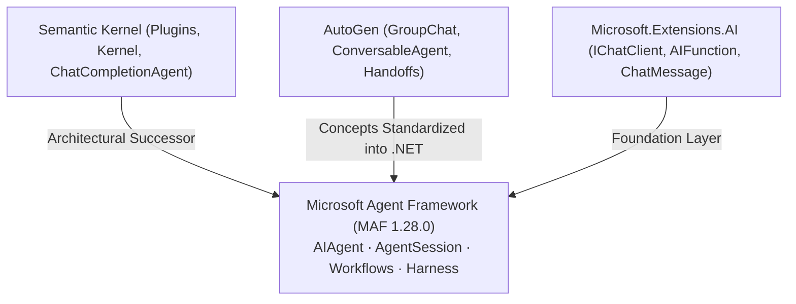
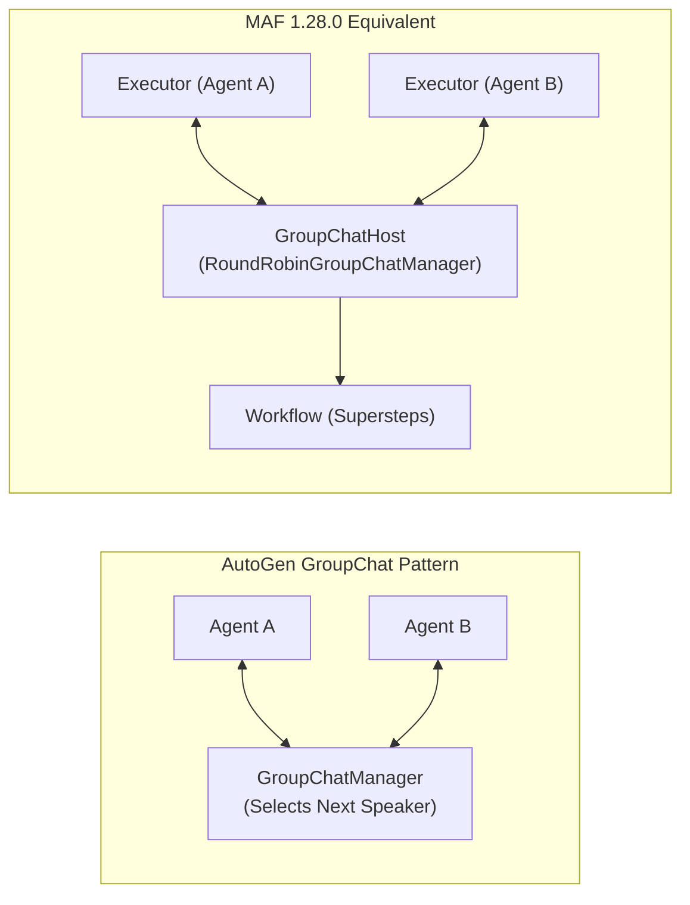

# Module 22 — Migration: Semantic Kernel, AutoGen, and Early Previews

> **Time:** ~45 min · **Level:** Intermediate · **Prerequisites:** [Module 01](01-introduction.md), [Module 02](02-first-agent.md), [Module 03](03-tools.md), [Module 04](04-conversations-and-threads.md), [Module 13](13-orchestrations.md)
> **Packages:** `Microsoft.Agents.AI.OpenAI` 1.28.0 (GA), `Microsoft.Agents.AI.Workflows` 1.28.0 (GA)

## Learning objectives

- Map legacy Semantic Kernel primitives (`Kernel`, `KernelPlugin`, `ChatCompletionAgent`, `AgentThread`) to Microsoft Agent Framework (MAF) equivalents.
- Migrate AutoGen multi-agent architectures (ConversableAgent, GroupChat, Swarm handoffs) into typed C# MAF agents and `AgentWorkflowBuilder` workflows.
- Replace Semantic Kernel invocation filters with MAF run and function middleware pipelines.
- Update codebases utilizing early MAF preview syntax (`AgentThread`, `GetNewThread`, `CreateAIAgent`) to the released GA 1.28.0 API surface.
- Execute side-by-side refactoring of production C# agent code with zero loss of functionality.

---

## Concepts

### The Evolution: Unification of SK Agents and AutoGen

Prior to Microsoft Agent Framework (MAF), .NET developers building agentic AI applications faced fragmented options:
1. **Semantic Kernel (SK):** Excellent for single-turn tool calling, plugins, and raw model connectors, but experimental and monolithic for complex multi-agent orchestration.
2. **AutoGen:** Pioneered multi-agent collaboration, conversational group chats, and agent handoffs, but was Python-first with limited and lagging .NET support.

MAF standardizes agent architecture across Microsoft. Built on top of `Microsoft.Extensions.AI` (MEAI), MAF serves as the modern, enterprise-grade unified framework for C# developers.



---

### Semantic Kernel to MAF Mapping

| Semantic Kernel Concept | Semantic Kernel API (C#) | MAF Equivalent API (1.28.0 C#) | Notes |
|---|---|---|---|
| **Core Client / Engine** | `Kernel` | `IChatClient` (MEAI) / `AIAgent` | MAF decouples the raw model client (`IChatClient`) from the agent loop (`AIAgent`). |
| **Plugin / Tools** | `KernelPlugin` / `[KernelFunction]` | `AIFunctionFactory.Create` / `[Description]` | Plain C# methods decorated with `[Description]` become `AITool` / `AIFunction`. |
| **Chat Agent** | `ChatCompletionAgent` | `ChatClientAgent` / `chatClient.AsAIAgent()` | Extension method `chatClient.AsAIAgent(...)` creates a lightweight, composable agent. |
| **Conversation State** | `AgentThread` / `ChatHistory` | `AgentSession` / `ChatHistoryProvider` | Sessions manage state (`StateBag`) and history across turns via `agent.CreateSessionAsync()`. |
| **Filters & Interceptors** | `IFunctionInvocationFilter`, `IPromptRenderFilter` | MAF Run Middleware (`AsBuilder().Use(...)`) | Unified delegate-based pipeline similar to ASP.NET Core middleware. |
| **Multi-Agent Chat** | `AgentGroupChat` | `AgentWorkflowBuilder.CreateGroupChatBuilderWith` | Modeled as strongly-typed, visualizable workflows with supersteps. |

#### Side-by-Side: Agent Definition & Tool Calling

```csharp
// ==========================================
// Semantic Kernel (Legacy Approach)
// ==========================================
IKernelBuilder builder = Kernel.CreateBuilder();
builder.AddOpenAIChatCompletion("gpt-5.4-mini", apiKey);
Kernel kernel = builder.Build();

kernel.Plugins.AddFromType<OrderPlugin>("OrderPlugin");

ChatCompletionAgent skAgent = new()
{
    Name = "OrderAssistant",
    Instructions = "Help customers check orders.",
    Kernel = kernel,
    Arguments = new KernelArguments(new OpenAIPromptExecutionSettings
    {
        FunctionChoiceBehavior = FunctionChoiceBehavior.Auto()
    })
};

// Execution
ChatHistory history = [];
history.AddUserMessage("Check order ORD-100");
await foreach (ChatMessageContent msg in skAgent.InvokeAsync(history))
{
    Console.WriteLine(msg.Content);
}
```

```csharp
// ==========================================
// MAF 1.28.0 (Modern Approach)
// ==========================================
using Microsoft.Agents.AI;
using Microsoft.Extensions.AI;
using OpenAI;
using OpenAI.Chat;

AIAgent mafAgent = new OpenAIClient(apiKey)
    .GetChatClient("gpt-5.4-mini")
    .AsAIAgent(
        instructions: "Help customers check orders.",
        name: "OrderAssistant",
        tools: [AIFunctionFactory.Create(CheckOrder, name: "check_order")]);

// Execution
AgentSession session = await mafAgent.CreateSessionAsync();
AgentResponse response = await mafAgent.RunAsync("Check order ORD-100", session);
Console.WriteLine(response.Text);
```

---

### AutoGen to MAF Mapping

AutoGen (Python 0.2 / 0.4) established core design patterns for multi-agent systems. In MAF, these patterns are implemented natively in C# via `Microsoft.Agents.AI.Workflows`.

| AutoGen Pattern | AutoGen Representation (Python) | MAF C# Implementation (1.28.0) |
|---|---|---|
| **ConversableAgent / AssistantAgent** | `AssistantAgent(name, system_message)` | `AIAgent` via `chatClient.AsAIAgent(...)` |
| **UserProxyAgent (HITL)** | `UserProxyAgent(human_input_mode="ALWAYS")` | `ApprovalRequiredAIFunction` / `RequestInfoEvent` approval flow |
| **GroupChat & Manager** | `GroupChat(agents, messages)` + `GroupChatManager` | `AgentWorkflowBuilder.CreateGroupChatBuilderWith(agents => new RoundRobinGroupChatManager(agents))` |
| **Swarm / Agent Handoffs** | `register_hand_off(agent_a, agent_b)` | `AgentWorkflowBuilder.CreateHandoffBuilderWith(triageAgent).WithHandoff(a, b)` |
| **Sequential Processing** | `initiate_chat(recipient, ...)` pipeline | `AgentWorkflowBuilder.BuildSequential(agent1, agent2, agent3)` |



---

### MAF Preview API Rename Table

During early preview iterations (pre-1.0 to 1.28.0), several core MAF abstractions were renamed to standardize terminology and align with the `Microsoft.Extensions.AI` ecosystem.

| Early Preview Syntax | Released 1.28.0 GA Syntax | Reason & Migration Note |
|---|---|---|
| `AgentThread` | `AgentSession` | Standardized on "Session" across all agents and workflows. |
| `agent.GetNewThread()` / `GetNewThreadAsync()` | `agent.CreateSessionAsync()` | Thread creation is asynchronous and provider-managed. |
| `agent.CreateAIAgent(...)` | `chatClient.AsAIAgent(...)` | Extension method on `IChatClient` / provider client. |
| `AgentRunResponse` | `AgentResponse` | Streamlined response object carrying `Text`, `Messages`, `Usage`. |
| `session.SerializeSession()` | `agent.SerializeSessionAsync(session)` | Session serialization is asynchronous and handled by the agent. |
| `session.DeserializeSession()` | `agent.DeserializeSessionAsync(json)` | Asynchronous restoration of session state. |
| `IWorkflowExecutor` / `WorkflowExecutorBase` | `Executor<TIn, TOut>` | Strongly-typed generic message handlers. |
| `Superstep` / `SuperstepId` | `SuperStepEvent` / `SuperStepCompletedEvent` | Standardized casing and event naming in `Workflows`. |
| `RunOptions` | `AgentRunOptions` / `ChatClientAgentRunOptions` | Explicit agent-level run configuration. |
| `agent.Use(...)` | `agent.AsBuilder().Use(...)` | Pipeline construction uses explicit builder pattern. |

---

## Hands-on

### Example 1 — Migrating a Semantic Kernel Agent & Tools to MAF

This example demonstrates migrating a Semantic Kernel plugin class with balance lookup and fund transfer capabilities into a modern MAF agent with multi-turn session persistence.

#### Setup

```powershell
dotnet new console -n SkMigrationSample
cd SkMigrationSample
dotnet add package Microsoft.Agents.AI.OpenAI --version 1.28.0
```

#### Program.cs

```csharp
using System;
using System.ComponentModel;
using System.Threading.Tasks;
using Microsoft.Agents.AI;
using Microsoft.Extensions.AI;
using OpenAI;
using OpenAI.Chat;

// Environment variable retrieval
string apiKey = Environment.GetEnvironmentVariable("OPENAI_API_KEY") ?? "mock-key";
string model = Environment.GetEnvironmentVariable("OPENAI_MODEL") ?? "gpt-5.4-mini";

// 1. Define tools (previously Semantic Kernel Plugins with [KernelFunction])
// In MAF, standard C# functions with [Description] and AIFunctionFactory are used.
[Description("Gets account balance for a given customer ID.")]
static decimal GetAccountBalance([Description("Unique ID of customer")] string customerId)
{
    return customerId == "CUST-100" ? 1540.50m : 0.00m;
}

[Description("Transfers money between customer accounts.")]
static bool TransferFunds(
    [Description("Source customer ID")] string fromId,
    [Description("Target customer ID")] string toId,
    [Description("Amount to transfer")] decimal amount)
{
    Console.WriteLine($"[TOOL] Transferring ${amount} from {fromId} to {toId}");
    return true;
}

// 2. Create Agent (previously SK ChatCompletionAgent)
AIAgent bankingAgent = new OpenAIClient(apiKey)
    .GetChatClient(model)
    .AsAIAgent(
        instructions: "You are a secure banking assistant. Use provided tools for balance queries and transfers.",
        name: "BankingAssistant",
        tools: [
            AIFunctionFactory.Create(GetAccountBalance, name: "get_account_balance"),
            AIFunctionFactory.Create(TransferFunds, name: "transfer_funds")
        ]);

// 3. Multi-turn conversation (previously SK AgentThread / ChatHistory)
// In MAF, use AgentSession via CreateSessionAsync
AgentSession session = await bankingAgent.CreateSessionAsync();

Console.WriteLine($"Created MAF session: {session}");
Console.WriteLine("MAF Agent initialized successfully (Semantic Kernel migration pattern).");
```

#### What's happening
1. Instead of building a `Kernel` object and registering `KernelPlugin`, we define static or instance C# methods decorated with `[Description]`.
2. `AIFunctionFactory.Create` wraps each method into an `AIFunction` (implementing `AITool`).
3. Calling `GetChatClient(model).AsAIAgent(...)` creates the agent without requiring a container wrapper.
4. Calling `CreateSessionAsync()` replaces the legacy `GetNewThreadAsync()`.

---

### Example 2 — Migrating AutoGen GroupChat and Handoff Patterns to MAF

This example shows how AutoGen's multi-agent patterns (Researcher + Reviewer group chat and dynamic handoffs) are constructed in MAF using `AgentWorkflowBuilder`.

#### Setup

```powershell
dotnet new console -n AutoGenMigrationSample
cd AutoGenMigrationSample
dotnet add package Microsoft.Agents.AI.OpenAI --version 1.28.0
dotnet add package Microsoft.Agents.AI.Workflows --version 1.28.0
```

#### Program.cs

```csharp
using System;
using System.Collections.Generic;
using Microsoft.Agents.AI;
using Microsoft.Agents.AI.Workflows;
using Microsoft.Extensions.AI;
using OpenAI;
using OpenAI.Chat;

// Environment setup
string apiKey = Environment.GetEnvironmentVariable("OPENAI_API_KEY") ?? "mock-key";
string model = Environment.GetEnvironmentVariable("OPENAI_MODEL") ?? "gpt-5.4-mini";

var chatClient = new OpenAIClient(apiKey).GetChatClient(model);

// AutoGen concepts translated to MAF:
// 1. AutoGen AssistantAgent -> AIAgent / ChatClientAgent
AIAgent researcher = chatClient.AsAIAgent(
    instructions: "You research topics thoroughly and output bullet points.",
    name: "Researcher",
    description: "Researches user questions and returns key facts.");

AIAgent reviewer = chatClient.AsAIAgent(
    instructions: "You review drafts for factual accuracy and conciseness.",
    name: "Reviewer",
    description: "Critiques and polishes research findings.");

// 2. AutoGen GroupChat with GroupChatManager -> AgentWorkflowBuilder.CreateGroupChatBuilderWith
Workflow groupChatWorkflow = AgentWorkflowBuilder.CreateGroupChatBuilderWith(agents =>
        new RoundRobinGroupChatManager(agents) { MaximumIterationCount = 4 })
    .AddParticipants([researcher, reviewer])
    .WithName("CollaborativeResearch")
    .WithDescription("Round-robin multi-agent research and critique workflow")
    .Build();

// 3. AutoGen Swarm / Handoff -> AgentWorkflowBuilder.CreateHandoffBuilderWith
Workflow handoffWorkflow = AgentWorkflowBuilder.CreateHandoffBuilderWith(researcher)
    .WithHandoff(researcher, reviewer)
    .WithHandoff(reviewer, researcher)
    .Build();

Console.WriteLine($"Group chat workflow created: {groupChatWorkflow != null}");
Console.WriteLine($"Handoff workflow created: {handoffWorkflow != null}");
```

#### What's happening
1. Individual AutoGen `AssistantAgent` instances map directly to `AIAgent`.
2. AutoGen's `GroupChatManager` is implemented via `RoundRobinGroupChatManager` (or custom subclasses of `GroupChatManager`).
3. Calling `AgentWorkflowBuilder.CreateHandoffBuilderWith(researcher).WithHandoff(researcher, reviewer)` translates AutoGen swarm routing into a verified MAF workflow.

---

## Common pitfalls

- **Symptom:** Compilation error: `'ChatCompletionAgent' could not be found` or `'Kernel' is missing`.
  - **Cause:** Attempting to mix Semantic Kernel packages with Microsoft Agent Framework packages.
  - **Fix:** MAF 1.28.0 relies directly on `Microsoft.Extensions.AI` and `Microsoft.Agents.AI`. Replace `ChatCompletionAgent` with `ChatClientAgent` or `chatClient.AsAIAgent()`.
- **Symptom:** `InvalidCastException` when serializing session state.
  - **Cause:** In early previews, session state was stored in custom dictionaries. In MAF 1.28.0, `session.StateBag` is an `AgentSessionStateBag` which requires reference types (`where T : class`).
  - **Fix:** Use `session.StateBag.SetValue<string>("key", value)` and `session.StateBag.GetValue<string>("key")`.
- **Symptom:** Handoff workflow fails at runtime because target agent does not respond.
  - **Cause:** Handoff edges were configured in one direction only (`WithHandoff(A, B)`), leaving Agent B without a routing edge back to Agent A or a termination condition.
  - **Fix:** Register bi-directional handoffs (`WithHandoff(A, B).WithHandoff(B, A)`) or designate terminal completion edges.
- **Symptom:** Compiler warning `CS0618: AgentThread is obsolete`.
  - **Cause:** Using early MAF preview syntax.
  - **Fix:** Update `AgentThread` to `AgentSession` and call `agent.CreateSessionAsync()`.

---

## When to use / when not to use

| Scenario | Migration Recommendation | Notes |
|---|---|---|
| **Existing Semantic Kernel app with complex plugins** | **Migrate to MAF** | Wrap plugin methods in `AIFunctionFactory.Create`. Benefit from standard `IChatClient` and MAF session persistence. |
| **Existing Semantic Kernel app doing single-turn completions** | **Stay on MEAI / SK** | If you only call `IChatClient.GetResponseAsync`, full agent abstraction may add unnecessary overhead. |
| **AutoGen Python multi-agent system porting to .NET** | **Rebuild on MAF Workflows** | Use `AgentWorkflowBuilder` for group chats, handoffs, and sequential pipelines with native .NET typing. |
| **Legacy MAF Preview (< 1.0) codebases** | **Immediate Upgrade to 1.28.0** | Update naming per the rename table. Previews prior to 1.28.0 have deprecated session APIs. |

---

## Exercises

1. **SK Plugin Class Migration** — Take a legacy Semantic Kernel class containing two mathematical operations (`Add` and `Multiply` with parameter descriptions). Refactor the plugin into plain C# methods and register them as an `AITool` list using `AIFunctionFactory.Create`.
2. **Session and StateBag Migration** — Replace a legacy `AgentThread` and `ChatHistory` dictionary by creating a MAF `AgentSession` with `CreateSessionAsync()`. Store and retrieve custom contextual metadata (`UserId`, `TurnCount`) using `session.StateBag.SetValue` and `session.StateBag.GetValue`.
3. **AutoGen Handoff Trio Migration** — Implement a three-agent customer service handoff workflow in MAF (`TriageAgent` -> `BillingAgent` or `TechSupportAgent`). Ensure both specialist agents can hand back to `TriageAgent` upon request.

---

## Summary

- Microsoft Agent Framework (MAF) unifies the strengths of Semantic Kernel plugins and AutoGen multi-agent orchestrations on top of `Microsoft.Extensions.AI`.
- Legacy `KernelPlugin` and `[KernelFunction]` declarations map cleanly to standard C# methods wrapped with `AIFunctionFactory.Create`.
- `AgentThread` has been renamed to `AgentSession`, instantiated asynchronously via `agent.CreateSessionAsync()`.
- AutoGen group chats and swarms are represented in MAF as strongly-typed, visualizable workflows using `AgentWorkflowBuilder`.
- MAF run middleware (`AsBuilder().Use(...)`) replaces legacy Semantic Kernel invocation filters with an ASP.NET Core-style delegate pipeline.

---

## Further reading

- [Microsoft Learn: Migration from Semantic Kernel to MAF](https://learn.microsoft.com/agent-framework/dotnet/migration/semantic-kernel)
- [Microsoft Learn: Multi-Agent Workflows and Orchestration](https://learn.microsoft.com/agent-framework/dotnet/workflows/orchestrations)
- [Official Sample: Agent Workflow Patterns (Handoffs & GroupChat)](https://github.com/microsoft/agent-framework/tree/main/dotnet/samples/03-workflows/_StartHere/03_AgentWorkflowPatterns)
- [Official Sample: Multi-Turn Conversations with AgentSession](https://github.com/microsoft/agent-framework/tree/main/dotnet/samples/01-get-started/03_multi_turn)

---

## Solutions

### Exercise 1 — SK Plugin Class Migration

```csharp
using System;
using System.Collections.Generic;
using System.ComponentModel;
using Microsoft.Agents.AI;
using Microsoft.Extensions.AI;

// Refactored plugin: Plain C# class with standard [Description] attributes
public sealed class MathPlugin
{
    [Description("Adds two numbers together.")]
    public double Add(
        [Description("The first addend")] double a,
        [Description("The second addend")] double b) => a + b;

    [Description("Multiplies two numbers together.")]
    public double Multiply(
        [Description("The first factor")] double a,
        [Description("The second factor")] double b) => a * b;
}

// Migration to MAF tools
var plugin = new MathPlugin();

List<AITool> tools =
[
    AIFunctionFactory.Create(plugin.Add, name: "add"),
    AIFunctionFactory.Create(plugin.Multiply, name: "multiply")
];

Console.WriteLine($"Migrated {tools.Count} tools successfully.");
```

### Exercise 2 — Session and StateBag Migration

```csharp
using System;
using System.Collections.Generic;
using System.Threading;
using System.Threading.Tasks;
using Microsoft.Agents.AI;
using Microsoft.Extensions.AI;

var mockClient = new SimpleMockChatClient("Session initialized.");
AIAgent agent = mockClient.AsAIAgent(instructions: "Customer Account Agent");

// 1. Create MAF session (replaces legacy GetNewThreadAsync)
AgentSession session = await agent.CreateSessionAsync();

// 2. Store session metadata in StateBag (replaces manual dictionaries)
session.StateBag.SetValue("UserId", "USER_1234");
session.StateBag.SetValue("TurnCount", "5");

// 3. Retrieve metadata with type safety
string? userId = session.StateBag.GetValue<string>("UserId");
string? turnCount = session.StateBag.GetValue<string>("TurnCount");

Console.WriteLine($"Retrieved UserId: {userId}, TurnCount: {turnCount}");

public sealed class SimpleMockChatClient : IChatClient
{
    private readonly string _reply;
    public SimpleMockChatClient(string reply) => _reply = reply;

    public Task<ChatResponse> GetResponseAsync(
        IEnumerable<ChatMessage> chatMessages,
        ChatOptions? options = null,
        CancellationToken cancellationToken = default) =>
        Task.FromResult(new ChatResponse(new ChatMessage(ChatRole.Assistant, _reply)));

    public async IAsyncEnumerable<ChatResponseUpdate> GetStreamingResponseAsync(
        IEnumerable<ChatMessage> chatMessages,
        ChatOptions? options = null,
        [System.Runtime.CompilerServices.EnumeratorCancellation] CancellationToken cancellationToken = default)
    {
        yield return new ChatResponseUpdate(ChatRole.Assistant, _reply);
    }

    public object? GetService(Type serviceType, object? serviceKey = null) =>
        serviceType.IsInstanceOfType(this) ? this : null;

    public void Dispose() { }
}
```

### Exercise 3 — AutoGen Handoff Trio Migration

```csharp
using System;
using System.Collections.Generic;
using System.Threading;
using System.Threading.Tasks;
using Microsoft.Agents.AI;
using Microsoft.Agents.AI.Workflows;
using Microsoft.Extensions.AI;

var mockClient = new SimpleMockChatClient("Acknowledged");

// Create the three specialist agents
AIAgent triageAgent = mockClient.AsAIAgent(
    instructions: "You triage incoming requests to Billing or Tech Support.",
    name: "TriageAgent",
    description: "Routes user requests to appropriate department.");

AIAgent billingAgent = mockClient.AsAIAgent(
    instructions: "You resolve invoices, refunds, and charges.",
    name: "BillingAgent",
    description: "Handles payment and invoice inquiries.");

AIAgent techAgent = mockClient.AsAIAgent(
    instructions: "You troubleshoot technical product issues.",
    name: "TechSupportAgent",
    description: "Handles technical debugging and diagnostics.");

// Build AutoGen handoff topology in MAF
Workflow handoffWorkflow = AgentWorkflowBuilder.CreateHandoffBuilderWith(triageAgent)
    .WithHandoff(triageAgent, billingAgent)
    .WithHandoff(triageAgent, techAgent)
    .WithHandoff(billingAgent, triageAgent)
    .WithHandoff(techAgent, triageAgent)
    .WithName("CustomerSupportHandoff")
    .Build();

Console.WriteLine($"Handoff workflow successfully configured with {handoffWorkflow != null}");

public sealed class SimpleMockChatClient : IChatClient
{
    private readonly string _reply;
    public SimpleMockChatClient(string reply) => _reply = reply;

    public Task<ChatResponse> GetResponseAsync(
        IEnumerable<ChatMessage> chatMessages,
        ChatOptions? options = null,
        CancellationToken cancellationToken = default) =>
        Task.FromResult(new ChatResponse(new ChatMessage(ChatRole.Assistant, _reply)));

    public async IAsyncEnumerable<ChatResponseUpdate> GetStreamingResponseAsync(
        IEnumerable<ChatMessage> chatMessages,
        ChatOptions? options = null,
        [System.Runtime.CompilerServices.EnumeratorCancellation] CancellationToken cancellationToken = default)
    {
        yield return new ChatResponseUpdate(ChatRole.Assistant, _reply);
    }

    public object? GetService(Type serviceType, object? serviceKey = null) =>
        serviceType.IsInstanceOfType(this) ? this : null;

    public void Dispose() { }
}
```
